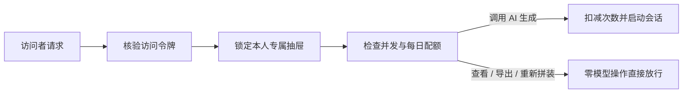
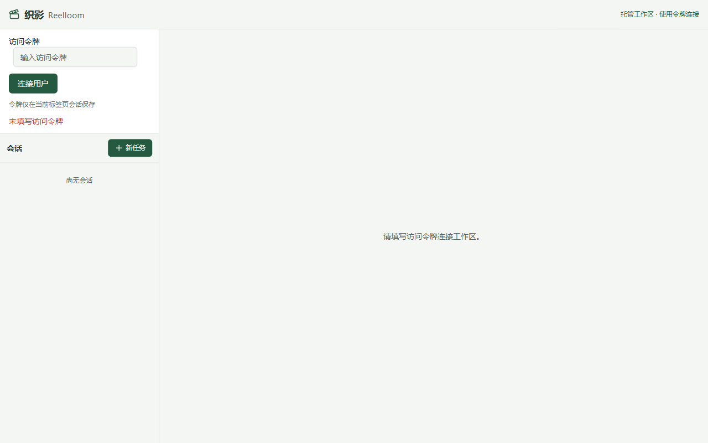
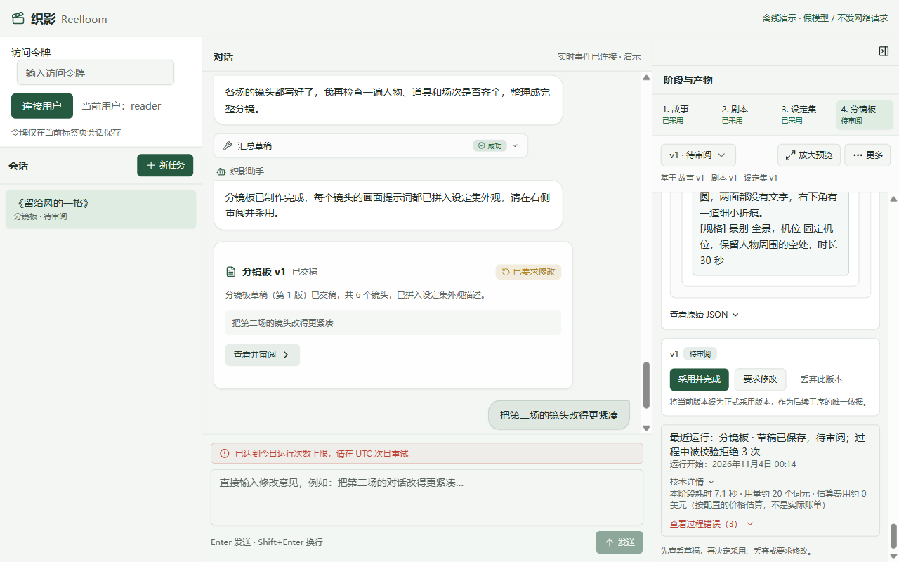

# 附录 · 搬上云端之前

> 上一章：[第 8 章 · 验好货再交稿](./p08.md) · [本篇入口](../README.md)

## 从一个场景开始

你在自己的电脑上把织影用顺了，《留给风的一格》的分镜板也顺利交了稿。团队里的几位编剧和导演伙伴看到后也想一起用，于是你打算把织影搬到一台云服务器上，让大家打开浏览器就能各自写片子。

讨论怎么部署上云时，团队里很快吵成了两派：

- 一派听说“AI Agent 很危险”，坚持认为凡是带 Agent 的系统上云，都必须给每个用户单独启动一套重型虚拟机或容器集群，算下来服务器成本和运维工程量都大得惊人；
- 另一派图省事，直接把本地运行的服务端口原样暴露到了公网上，结果第二天就出了乱子：甲编剧在左栏会话列表里直接点开了乙编剧正在写的保密剧本，到了半夜又有人连续点击生成几百次，把团队一整天的模型调用额度刷空了。

核心问题是：**没有先看清当前系统手里的真实工具权限，要么防卫过当去造昂贵的重型容器，要么漏掉了最基本的钥匙验证、分抽屉存稿和每日限次**。

## 这一章要解决什么

这一章作为全书附录，帮你理清从“单机自用”走向“多人共享上云”的安全边界：先根据织影的实际工具能力判断是否需要重型沙盒，再用访问令牌鉴权、按用户目录隔离、错误路径脱敏与每日调用配额这三道轻量防线，让纯文字创作系统安全地放到网上供多人使用。

为什么纯文字创作 Agent 不需要笨重的虚拟机容器？因为我们在第 2 章就已经收走了 AI 执行终端命令和读写任意文件的全部系统工具。屋里根本没有危险工具，真正需要管好的是不同用户之间的隐私隔离与资源配额。

本章交付云端多用户模式下的令牌验证、用户目录隔离、路径脱敏，以及放行零模型操作的每日生成配额保护。

> **一句话记住**：没给 AI 执行代码的锤子，就不必造防爆地堡；管好钥匙、分清抽屉、卡住每日次数，纯文字 Agent 就能稳稳上云。

## 先看清手里的工具：为什么不需要造防爆地堡

很多团队一听到“把 Agent 放到网上”，第一反应就是去搭复杂的容器沙盒。其实在决定修多厚的墙之前，产品经理应该先问研发团队三个问题：

1. 模型能不能让服务器执行任意代码、终端命令或外部脚本？
2. 模型能不能自己指定任意网址去联网，或者指定任意文件路径去读写系统文件？
3. 多个人同时访问时，谁能看谁的稿子？一个人最多能消耗多少次模型调用？

前两个问题决定你需不需要“防代码逃逸的容器沙盒”；第三个问题决定你需不需要“身份鉴权、分目录隔离与调用配额”。

回看我们在前八章为织影挂载的全部工具，答案非常清楚：

| 织影中的业务工具与操作 | 能否执行任意代码 | 能否访问任意网络 | 能否读写任意路径 | 真正需要守住的边界 |
|---|---|---|---|---|
| 读取上游：`read_upstream` | 否 | 否 | 否 | 仅限读取当前用户、当前项目下已采用的上游版本 |
| 提交草稿：`write_draft` | 否 | 否 | 否 | 仅限写入当前工序待审阅新版本，须通过格式与覆盖检查 |
| 剧本分场暂存：`write_scene`、`remove_scene` | 否 | 否 | 否 | 仅限写入当前项目的剧本分场暂存区 |
| 分镜分场暂存：`write_scene_shots`、`remove_scene_shots` | 否 | 否 | 否 | 仅限写入当前项目的分镜暂存区，须通过引用核对与粗筛 |
| 汇总草稿：`finalize_draft` | 否 | 否 | 否 | 由程序排序、拼装设定外观并复核通过后生成待审阅版本 |
| 网页审阅、导出分镜板与重新拼装 | 否 | 否 | 否 | 由人工发起，仅操作本人名下项目；采用本身不调用模型，但首次采用前三道工序后会尝试启动下一道生成 |

因为织影从头到尾只是一个纯文本创作系统，模型既碰不到终端命令行，也没法自己填文件路径，所以它**不需要用来防代码逃逸的重型虚拟机容器**。

## 带锁储物柜：管好进门钥匙，各用各的抽屉

既然不需要防爆地堡，多人共用一台服务器时最怕什么？最怕没锁门，或者所有人的稿子混放在同一个大桌面上。

织影在开启云端多用户模式后，用“专属钥匙 + 带锁储物柜”的办法守住前两道门：

1. **进门先验访问令牌**：每位团队成员分配一把唯一的访问令牌。打开网页时，如果还没有输入令牌或者令牌填写有误，系统会直接拦截请求并在左栏显示访问令牌表单，在通过验证前拒绝加载左栏会话列表和任何项目数据。
2. **按用户分抽屉存稿**：服务器根据通过验证的令牌自动识别当前用户身份，把每个人的项目存放在各自独立的专属目录抽屉下（如按用户编号再建项目子目录）。用户身份完全由后端根据令牌锁定，网页请求参数或 AI 模型都无权指定或切换目录。
3. **防翻墙与路径脱敏**：为了防止有人在项目编号里塞入特殊符号试图翻进别人的抽屉，程序在每次读写和导出文件前都会逐级核对真实文件路径，拒绝任何越界路径及越界软链接跳转；甲编剧就算猜到了乙编剧的项目编号，系统也只会返回“项目不存在”。同时，所有发往网页的提示与报错信息都会先做路径脱敏，自动抹掉服务器本机的目录前缀，不暴露内部文件结构。

## 游乐园每日限次票：卡住 AI 次数，放行零模型操作

分清了各自的储物柜，接下来还要防备另一件事：某位成员不小心连续点击生成，或者把脚本挂在后台反复重跑，一个晚上就把全团队的模型预算耗光了。

这就像游乐园卖的**每日限次套票**：你可以凭票进园，但大型机动游戏（调用大模型生成）每人每次只能坐一台，且每天默认最多坐 20 次；等今天的 20 次用完了，你不能再开动大型机器，但依然可以随时打开自己的储物柜，拿走已经拍好的照片或重新装订纪念册。

在织影的云端模式里，配额保护正是按这个原则区分“耗费模型算力的操作”与“纯程序操作”的：

- **占用配额的操作（需检查并发锁与每日次数）**：发起四道工序的草稿生成、或在待审阅时点击“按意见修改”。默认每位用户同时只能运行 1 个生成任务、每天最多启动 20 次，均可配置；每次获准启动即预占当日次数，初始化失败或中断也不退还，按 UTC 换日恢复。首次采用前三道工序后自动启动的下一道生成也计次。
- **不占用配额的操作（次数用完仍可正常使用）**：查看历史版本、采用或丢弃当前版本、点击「导出分镜板」下载文档，以及在第 7 章讲过的「分镜板」零模型「重新拼装」。采用本身不计次；若随后自动启动下一道生成，该次生成仍受配额限制，超限时保留采用结果并停止推进。

当某位用户当天的生成次数达到上限后，如果再次尝试发起生成，系统会返回配额上限提示：“已达到今日运行次数上限，请在 UTC 次日重试”，对话区保留未能启动的说明。已有产物仍可查看、导出，符合条件的分镜板仍可零模型重新拼装。

当前网页不会根据剩余配额自动把“按意见修改”按钮置灰；再次提交会由服务端拒绝启动生成。“采用并完成”、“导出分镜板”和符合条件的“重新拼装”仍可使用，但也须满足各自的运行空闲与版本规则。这样就算当天额度用尽，也绝不会把用户已经写好的成果锁死在系统里。

## 什么时候必须补上真沙盒？附全书设计回顾

最后需要提醒的是，“织影当前不需要重型容器”这个结论，建立在“我们关掉了所有代码执行和任意文件工具”的前提之上。如果未来你的产品路线图打算往织影里加入以下高风险能力，就必须同步补上真正的执行沙盒：

| 未来假如新增的能力 | 带来的新风险 | 必须同步补上的防护措施 |
|---|---|---|
| 允许 AI 编写并运行代码或终端脚本 | 可直接读写服务器文件、探测内网或耗尽计算资源 | 将代码与命令执行关进受限容器或微虚拟机，严格限制文件、网络与运行时间 |
| 允许 AI 操控浏览器访问外部网页 | 可能访问恶意网页、触发内网请求伪造或下载木马 | 使用独立隔离的远程浏览器环境，限制出网白名单与文件下载 |
| 接入本地音视频合成、转码或复杂渲染工具 | 处理外部媒体文件时可能触发解析漏洞或路径越界 | 对媒体处理进程做独立沙盒隔离，严格校验输入输出文件路径 |

回看第二篇从第 1 章到附录的完整搭建过程，我们用一套四道工序的短片分镜创作工具，把 Agent 工程里最核心的控制手段落到了实处：

| 章节 | 核心工程机制 | 解决的产品痛点 |
|---|---|---|
| 第 1 章 · 先看成品 | 四道工序单向依赖与产物格式检查 | 不让 AI 一口气乱写，先定好交稿规格与签字顺序 |
| 第 2 章 · 跑出第一份稿 | 受限工具白名单与实时事件流 | 收走危险系统工具，把生成与自我修正过程实时亮给用户 |
| 第 3 章 · 让人签字把关 | 人工审阅门与带原稿的结构化改稿 | 区分候选稿与采用稿，改稿时不丢原有结构，签字即推进下一道 |
| 第 4 章 · 长剧本拆开写 | 输出预算控制与按场暂存、局部改写 | 写一场验一场防烂尾，改第 2 场时不把第 1、3 场推倒重洗 |
| 第 5 章 · 角色道具先对上号 | 设定集覆盖检查与分镜板引用核对闸门 | 设定集不许漏建剧本人物档案，分镜板不许瞎编编号或跨场串场 |
| 第 6 章 · 外貌不用每次重写 | 镜头描写粗筛与画面提示词确定性拼装 | AI 只写蓝色镜头描写，程序原样带入绿色设定外观，文字不走样 |
| 第 7 章 · 改一处，不用推倒重来 | 版本来源追溯、待更新传导与零模型重新拼装 | 上游换版下游自动亮黄灯，只改外观时零模型调用直接换上新词 |
| 第 8 章 · 验好货再交稿 | 机器确定性检查、人工评分表与分镜板导出 | 机器守格式底线、人工评内容好坏，一键导出完整分镜板文档 |
| 附录 · 搬上云端之前 | 令牌鉴权、多租户目录隔离与每日配额保护 | 不造冗余防爆地堡，管好钥匙、抽屉和次数即可安全多人共享 |

## 这一章你学到了

1. 决定是否上容器沙盒前，先盘点 AI 手里的工具权限：没有任意代码执行、任意网络访问和任意路径读写能力的纯文字 Agent，不需要笨重的虚拟机容器。
2. 多人共享上云必须守住三道门：进门核验访问令牌、存储层按用户分抽屉并防路径越界与路径泄露、运行前卡住单用户并发与每日生成次数上限。
3. 配额限制应当精准卡在“调用大模型”的入口上；当今日生成次数用完时，查看、采用、「导出分镜板」与零模型「重新拼装」等纯程序操作依然保持可用。

## 产品拍板

- 在保持关闭内置代码与文件工具的前提下，云端部署采用轻量级单进程多租户隔离方案；若未来引入代码执行、网页浏览或媒体转码工具，必须重新评估并接入执行沙盒。
- 云端模式下所有接口强制校验访问令牌，用户目录严格按令牌身份隔离；跨用户访问项目统一返回“项目不存在”，且所有对外消息与错误提示均抹除服务器本机路径。
- 按用户设置并发运行锁与每日模型生成次数上限，在创建模型会话前预占名额；超限时返回明确中文提示并说明 UTC 次日恢复。
- 查看产物、人工签字采用、导出分镜板文档与分镜板零模型「重新拼装」不消耗模型生成配额，在配额用尽后仍允许用户正常操作。

## PM 该追问什么

1. 我们的 Agent 现在到底有哪些工具权限？需不需要上容器沙盒的依据是什么？
2. 如果甲用户知道了乙用户的项目编号，直接发请求去读详情、改稿或者导出分镜板，系统能不能拦住？报错信息里会不会漏出服务器的文件夹路径？
3. 每日生成次数是在调用大模型之前扣减，还是等跑完了才算？服务重启之后，今天的已用次数会不会被清零？
4. 当用户的今日生成次数用完时，他还能不能把自己已经写好的分镜板导出带走？还能不能点「重新拼装」更新设定外观？
5. 如果下个季度我们要接自动跑代码或者视频转码功能，现在的轻量隔离还够用吗？需要补哪一层防护？

## 动手的人看这里

> 这一节写给要动手实现的人。只想理解产品思路，可以跳到章末。

本章关注**云端多用户鉴权、租户目录隔离、路径脱敏与配额保护**模块，对应文件如下：

- `src/server/hosting.ts`：实现 `hosted` 模式下的 Bearer Token 鉴权、单用户并发锁、每日模型运行配额统计与持久化，以及对外响应字符串的绝对路径与敏感令牌脱敏。
- `src/project/paths.ts`：提供 `containedPath` 真实路径解析与边界检查，拦截 `..` 相对路径穿越、符号链接逃逸与跨用户目录访问。
- `src/server/index.ts`：在所有接口与事件流入口挂载令牌鉴权、租户作用域绑定与响应脱敏；区分消耗模型配额的运行请求与不消耗模型配额的读取、采用、导出及零模型重拼装请求。
- `src/hosted.test.ts`：覆盖无令牌拦截、跨租户读写与导出隔离、`..` 与软链接逃逸拦截、并发与每日配额 429 拦截、配额耗尽后零模型重拼装与导出放行、以及错误消息路径脱敏的离线测试。

**实现要点**：

1. 在 `hosting.ts` 与 `paths.ts` 中实现 `hosted` 模式下的 Bearer Token 鉴权、租户目录隔离（`containedPath` 防 `..` 与符号链接逃逸）及错误消息路径脱敏。
2. 实现单用户并发锁与每日模型运行配额统计；模型生成与按意见修改消耗配额（超限返回 HTTP 429），而读取、采用、导出 Markdown 及 `board` 零模型重新拼装不占用模型运行配额。

在 `book/build` 执行 `npm test -- src/hosted.test.ts` 与 `npm run typecheck` 可完成离线验证。

**给 AI Coding 的任务描述**：

> **文件**：`src/server/hosting.ts`、`src/project/paths.ts`、`src/server/index.ts`、`src/hosted.test.ts`。
> **意图**：在 `hosting.ts` 与 `paths.ts` 中实现 `hosted` 模式下的 Bearer Token 鉴权、租户目录隔离（`containedPath` 防 `..` 与符号链接逃逸）及错误消息路径脱敏；实现单用户并发锁与每日模型运行配额统计——模型生成与按意见修改消耗配额（超限返回 HTTP 429），而读取、采用、导出 Markdown 及 `board` 零模型重新拼装不占用模型运行配额。
> **验收**：跨租户读写或导出返回 403/404；配额耗尽后模型运行请求被挡且不残留运行锁，零模型重拼装与导出仍可正常执行；全部错误响应不含本机绝对路径。

<!--
需要的截图：
1. app-01-hosted-token-gate.png
   - 演示中的哪一步：开启云端多用户模式（HARNESS_MODE=hosted）访问网页，未输入或输入错误访问令牌。
   - 画面内容：左栏显示“访问令牌”输入框与“连接用户”按钮，未通过验证时拒绝加载左栏会话列表与任何项目数据，且报错信息中不暴露服务器本地绝对路径。
2. app-02-quota-limit-reached.png
   - 演示中的哪一步：某用户当日生成次数达到上限后，尝试再次发起生成。
   - 画面内容：对话区显示“已达到今日运行次数上限，请在 UTC 次日重试”；右栏修改按钮不会因剩余配额自动置灰，再次提交由服务端拒绝启动生成。“采用”、“导出分镜板”与符合条件的“重新拼装”仍可操作；前三道工序首次采用后的自动生成会因配额不足停下。
-->
