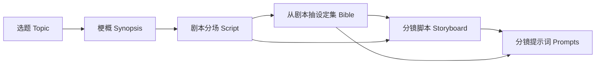

# P00 · 拆流水线：先定产物，再请模型 / Artifacts Before Agents

> 上一篇：[第 10 章 · 综合项目](../../harness/chapters/ch10.md)、[第 11 章 · 从失败到修复](../../harness/chapters/ch11.md) · 下一章：[P01 · 搭骨架](./p01.md) · [本篇入口](../README.md)

## 这一章解决什么问题

第一篇教你看见工具循环、挡住越界、用 trace 和产物签收。第 10 章让同一个 agent 在一组闸门下交付多个文件，适合观察“模型自己规划、程序守边界”。第二篇换一个产品问题：如果每一步都要人选版本，下一步还只能使用已认可的内容，谁来决定现在走到哪儿？

我们做一个只生产文本的“分镜工坊”：从选题到分镜提示词。它不生成图片或视频，也不接外部创作服务。外层用 workflow 固定顺序与确认位置，内层用受限 agent 完成每一阶段的创作。第一篇的闸门继续用，变化的是编排的职责。

## 何时 workflow，何时 agent

当步骤、输入、输出和审批人已经明确，且跳步会破坏产品承诺时，用 workflow。比如“剧本还没确认，不能抽设定集”，没有必要交给模型每次重新判断。

当阶段内部存在多种合理解法，需要读输入、创作、看错误再修改时，用 agent。比如“这个选题的一句话冲突怎么写”，可以让模型反复尝试；但它没有采用版本或解锁下一阶段的工具。

| 判断问题 | 适合 workflow | 适合受限 agent |
|---|---|---|
| 下一步是否由产品预先规定？ | 是：用状态机检查前置条件 | 否：可在明确范围内探索 |
| 结果能否确定性验收？ | schema、状态、引用、版本 | 创作方案与修改尝试 |
| 失败后能否自由换目标？ | 不能：保留阶段并报错 | 可改写本阶段草稿，不能跳阶段 |
| 谁负责最终采用？ | 人发指令，程序执行 | 模型只提交候选版本 |

“状态机保证顺序”和“模型懂得流程”是两份承诺。前者可以写离线测试；后者受提示与模型表现影响。产品需要哪份保证，就把相应判断放到哪一层。

## 六阶段流水线 / Six-stage workflow

每条箭头都表示一项输入依赖，目标阶段的全部依赖都被人采用后才解锁 / Adopt all dependencies before unlock。展示顺序仍是选题、梗概、剧本、设定集、分镜、提示词，但依赖不只线性：分镜同时读剧本与设定集，提示词同时读分镜与设定集。设定集从剧本抽取已经出现的人、道具与地点；分镜引用设定 ID；提示词里的固定描述最终由程序原样拼装。六阶段之后的交付包属于后续扩展，本章的状态机只覆盖上述六阶段。

## 每阶段怎么签收

| 阶段 | 产出什么 | 谁确认 | 怎样算合格 |
|---|---|---|---|
| 选题 topic | 标题、冲突、类型、受众、分钟数 | 选题负责人 | 字段齐全，时长为正数；人认可要拍什么、给谁看 |
| 梗概 synopsis | 起承转合四拍与基调 | 内容负责人 | 四拍齐全；人认可冲突发展和结尾 |
| 剧本 script | 带场号的场景、动作和台词 | 编剧负责人 | 每场有地点时间、摘要与行；对白有说话人；人认可可拍性 |
| 设定集 bible | 角色、道具、地点及稳定 ID | 美术或内容负责人 | 描述明确、ID 格式正确；从剧本抽取，后续 P5 再加完整覆盖与唯一性闸门 |
| 分镜 storyboard | 镜头号、设定引用、景别、运镜、动作、对白、秒数 | 导演或分镜负责人 | schema 合规且时长为正；人审镜头表达；P6 再拦不存在的引用 |
| 提示词 prompts | 镜头部分、注入 ID、程序拼装文本 | 提示词负责人 | 当前验字段；P7 再以代码保证固定描述原样注入，创作效果仍需人审 |

一个人可以兼任这些角色，但采用动作必须明确。**schema 合规只代表结构过关，不等于故事好，也不等于已确认。** 当前只实现选题的模型提示；六份 schema 与示例先把后续交付边界定下来。

## 产物字段为什么存在

代码在 `src/contracts/index.ts`。所有对象拒绝多余字段，文本不能为空或全为空白，时长必须为正数；不靠类型转换“修好”模型输出。

| 产物 | 字段 | 为什么需要 |
|---|---|---|
| topic | `title` | 在项目里识别候选选题，允许与项目工作标题不同 |
| topic | `logline` | 用一句话约束主角面对的冲突，避免下游只继承一个空标题 |
| topic | `genre` | 提前约定类型，避免梗概突然换创作方向 |
| topic | `audience` | 让内容负责人知道要为谁取舍信息与表达 |
| topic | `target_minutes` | 提供篇幅目标，单位固定为分钟，后续可与镜头秒数对账 |
| synopsis | `title`、`logline` | 使梗概可独立评审，并保留对核心选题的承诺 |
| synopsis | `beats[]` | 固定四项，按起、承、转、合排序，把转折和结尾变成可讨论对象 |
| synopsis | `tone` | 把节奏与情感尺度写下来，供剧本与镜头选择参考 |
| script | `scenes[]` | 把整篇文本拆成可以逐场审阅和引用的单元 |
| script.scenes | `scene_id` | 给场景段落稳定地址，如 `S01`；它是叙事场号，不是地点 ID |
| script.scenes | `heading` | 合并记录地点与时间，让人知道这一场在哪里、何时发生 |
| script.scenes | `summary` | 不必逐句重读，也能检查一场承担的叙事任务 |
| script.scenes | `lines[]` | 保留动作与对白的发生顺序 |
| script.lines | `kind` | 只允许 `action` / `dialogue`，避免下游猜一行是什么 |
| script.lines | `character` | 对白必填说话人；动作行不填，先使用剧本角色名，P5 再抽稳定 ID |
| script.lines | `text` | 承载动作或台词正文，不混用文件路径或工具指令 |
| bible | `characters[]`、`props[]`、`locations[]` | 分别管理人物、物件和地点，避免同名对象被当成同一实体；允许无道具的故事 |
| bible.characters | `id`、`name` | `C01` 用于稳定引用，名字供人阅读；改称呼不应改引用 |
| bible.characters | `role` | 说明叙事作用，帮助检查是否从剧本抽出而非凭空加人 |
| bible.characters | `appearance` | 存一份固定外观描述，后续镜头提示词直接原样引用，减少改写漂移 |
| bible.characters | `personality` | 帮助创作人物行为；与固定视觉描述分开，避免每条提示都塞心理分析 |
| bible.props、locations | `id`、`name`、`description` | `P01` / `L01` 标识实体，名字供人审，描述是以后原样注入的视觉事实 |
| storyboard | `shots[]` | 逐镜头审阅、调时长，也作为提示词条目来源 |
| storyboard.shots | `shot_id`、`scene_id` | `S01-01` 定位镜头，`S01` 回到剧本；格式合法不代表两者前缀已经做了业务关联校验 |
| storyboard.shots | `location_id` | 明确引用唯一设定地点，同一地点可以出现在多个叙事场中 |
| storyboard.shots | `character_ids[]`、`prop_ids[]` | 只引用该镜头实际出现的对象，空镜可没有人物；数组内不允许重复 ID |
| storyboard.shots | `shot_size` | 固定远景、全景、中景、近景、特写五种值，减少同义词歧义 |
| storyboard.shots | `camera` | 单独记录机位与运动，方便导演审阅，而不埋进动作中 |
| storyboard.shots | `action` | 记录镜头里发生什么，是镜头独有描述的主要来源 |
| storyboard.shots | `dialogue` | 可选对白，空镜或无对白镜头省略此字段 |
| storyboard.shots | `duration_s` | 每镜头使用正数秒，为节奏与总时长检查提供输入 |
| prompts | `items[]` | 每个镜头一条提示词，方便将来导出交付包 |
| prompts.items | `shot_id` | 让提示词能追溯到镜头，而不靠数组顺序猜测 |
| prompts.items | `shot_part` | 模型只创作动作、构图、情绪和镜头语言，减少重写固定设定的机会 |
| prompts.items | `injected_ids[]` | 记录程序拼装使用了哪些设定，方便核对漏注入、多注入 |
| prompts.items | `final_prompt` | 保存拼装后的最终文本；它是程序责任，后续 P7 才接运行时生成，不能让模型自行改写定稿 |

ID 格式：场 `^S[0-9]{2}$`，角色 `^C[0-9]{2}$`，道具 `^P[0-9]{2}$`，地点 `^L[0-9]{2}$`，镜头 `^S[0-9]{2}-[0-9]{2}$`，注入列表只接受 C/P/L 三类。数字宽度是本教学样例的取舍，不表示已经解决 ID 分配、唯一性或跨产物引用。

## 原创样例：留给风的一格

`examples/sample-project/` 下六份 JSON 是一个原创三分钟生活短片。三场发生在旧候船亭与社区修表间，三个角色围绕一块橙色空白磁片争执，最终给一个没说完的告别留出三分钟。蓝色机械计时器和空白磁片贯穿故事。

按 `topic.json` → `synopsis.json` → `script.json` → `bible.json` → `storyboard.json` → `prompts.json` 阅读。设定集从示例剧本出现的对象整理而来，六个镜头共 180 秒。样例的 `final_prompt` 是已拼好的静态结果：镜头部分后依次接地点、人物、道具的固定原文。样例检查会逐字对照，但本章没有实现运行时拼装器。

## 动手验收

在本包执行 `npm install`、`npm test`、`npm run typecheck`。观察 `contracts.test.ts`：六份样例各有通过检查，坏数据会被拒绝；还有数字字符串、ID 格式、对白缺说话人等例子。另一个样例完整性测试核对这六份文件的引用和拼装文本。前者是运行时字段契约，后者只是这套静态样例的质量检查。

## 产品拍板

- 外层展示顺序与依赖由代码固定，模型没有跳步权限；全部依赖都有人采用版本才解锁当前阶段。
- 设定集从剧本抽取，固定视觉描述只存一份；分镜按 ID 引用，提示词最终由程序拼装。
- 结构验收与创作评分分开。P0/P1 的绿色测试不能替代后续引用闸门，更不能替代人工审片。
- 本章先定义文本产物的契约；图片视频生成、Web 与返工不在本章范围内。每阶段的输入输出要能独立解释和验证。

## 给 AI Coding 的任务描述

> 文件：`src/contracts/index.ts`、`examples/sample-project/*.json`、`src/contracts.test.ts`。意图：用同一组可执行契约连接六阶段，避免各步骤“看起来像 JSON”却无法被下游消费。验收：六份原创样例全部通过，缺字段、错误类型与错误 ID 被拒；静态样例的镜头引用、固定描述与时长能逐项核对。不得把后续语义闸门写成已完成。

## PM 该追问什么

1. 哪些步骤是产品规定，哪些选择真的需要模型探索？
2. 每份产物的人审负责人是谁？点了采用后下游读哪个版本？
3. “schema 过了”检查了哪些内容？不存在的 ID、重复角色和人物漏抽现在会挡吗？
4. 固定描述由谁写入最终提示词？有没有逐字比较，还是只相信模型答应“不改”？
5. 示例好看是否被误当成模型稳定产出的证据？目前哪些结论只有离线证据？

[下一章 P01](./p01.md) 把这些契约接上版本存储、状态机和受限会话，实际建立项目并观察一份草稿如何等待采用；随后在 [P02 · 接上 Web](./p02.md) 中把事件与人工指令接到页面。
