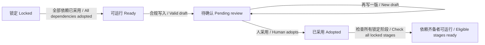

# P01 · 搭骨架：程序管阶段，模型写草稿 / Workflow and Restricted Sessions

> 上一章：[P00 · 拆流水线](./p00.md) · 下一章：[P02 · 接上 Web](./p02.md) · [本篇入口与运行命令](../README.md)

## 这一章解决什么问题

上一章把六份产物说清楚了。现在把“只有采用后才能进入下一步”变成可以执行的规则，再把模型放进每阶段的有限工作区。

本章最小闭环是：建项目 → 运行选题 → schema 验草稿 → 人查看版本 → CLI 采用 → 梗概解锁。只有选题提示模板可用，其他阶段先保留契约和占位，避免为了展示一条全链路而省略闸门。

## 目录长什么样

```text
book/build/
  package.json / package-lock.json / tsconfig.json
  pi-agent/models.json          本包模型配置 / Local model catalog
  src/
    contracts/index.ts          产物契约 / Artifact contracts
    workflow/index.ts           状态机 / Workflow
    project/store.ts            版本存储 / Version store
    agent/prompts.ts            阶段系统提示 / Stage prompts
    agent/model.ts              模型选择与环境加载 / Model configuration
    agent/session.ts            受限会话与工具 / Restricted session
    agent/run.ts                运行摘要 / Run summary
    cli.ts                      命令入口 / CLI
    *.test.ts                   离线验收 / Offline checks
    testing/                    假模型与临时夹具 / Test fixtures
  examples/sample-project/      六份原创示例 / Original examples
  projects/<id>/                不提交 / Ignored
    project.json                阶段、版本与采用状态 / Project state
    artifacts/topic/v1.json      第一份不可覆盖的草稿 / Immutable draft
    artifacts/topic/v2.json      下一次提交的新草稿 / Next draft
    sessions/*.jsonl             SDK 会话与运行摘要 / Sessions and audit
```

`projects/` 和模型目录缓存都进本包 `.gitignore`。测试临时夹具也只在 `projects/` 内建立，结束后只清理自己生成的目录。固定样例不属于某个真实项目，不能误当成模型已经为项目生成了产物。

## 状态机：先判断能不能做，再请求模型

`STAGES` 保持六阶段展示顺序，`src/workflow/index.ts` 用显式的 `DEPENDENCIES` 定义推进与读取规则，状态放在 `project.json`：

```json
{
  "status": "pending_review",
  "versions": [1, 2],
  "adopted_version": null
}
```

这是单个阶段的记录。`versions` 是已落盘版本号列表，`adopted_version` 是人选的编号，不是“最大的那个编号”。完整文件还包含项目 `id`、工作标题 `title` 与六个阶段的 `stages`。



新项目只有 topic 为 ready；其他阶段 locked。`assertRunnable` 同时检查两件事：本阶段的全部依赖是否 adopted 且有采用编号；本阶段是否 ready 或 pending_review。依赖阶段只生成了草稿，不算前置条件完成。

| 当前阶段 | 依赖的采用产物 |
|---|---|
| topic | 无 |
| synopsis | topic |
| script | synopsis |
| bible | script |
| storyboard | script、bible |
| prompts | storyboard、bible |

`writeDraft` 每次保存一个新版本，把状态改为 pending_review，不解锁任何下游。`adopt` 检查草稿是否存在、版本文件是否仍合规，再把选中的版本设为 adopted，扫描所有 locked 阶段，将全部依赖均已采用的阶段改成 ready。重复采用同一版本允许；采用后换版本或写新草稿会报“返工留到 P8”。

为什么现在挡住返工？因为上游改了、下游却继续拿旧结果，会制造“看起来已完成，实际已过期”的状态。`DEPENDENCIES` 就是后面“改上游 → 下游失效”的依据：沿依赖关系找出直接与间接受影响的阶段。P8 再实现失效标记与恢复，此前明确拒绝返工。

## 版本存储：有草稿，还得知道采用了哪份

`src/project/store.ts` 提供建项目、写草稿、采用和读采用版本。项目 ID 只接受字母数字、连字符与下划线，不能用作任意路径；版本号必须是正整数；阶段必须在六阶段列表里。模型不能提供文件名。

写入顺序是：检查阶段 → 严格校验本阶段 schema → 以 `wx` 创建 `artifacts/<stage>/v<N>.json` → 更新项目状态。schema 失败发生在创建产物目录之前；版本文件已存在时拒绝覆盖。项目状态用临时文件加 rename 替换，避免把半截 JSON 当成新状态。

这仍是**单进程本地文件骨架**。版本文件与 `project.json` 不是同一事务，进程中断可能留下未登记版本；没有并发写锁，也没有处理恶意预置的符号链接或跨用户文件权限。不要把 UUID、正则检查与原子 rename 当成云端隔离方案。P10 再讨论多用户权限；更早若接服务端并发，需先补事务和恢复策略。

`readAdopted` 总是按状态里选中的编号读取，读取后再次校验 schema。它不自动取最新版，也不允许读一个尚待确认的阶段。

## 受限会话：只给两种业务能力

`src/agent/session.ts` 每次运行建立一个新的 pi-coding-agent 会话。`SessionManager.create` 的输出目录固定为本项目的 `sessions/`。本章证明会话可落盘并重新打开，不提供 CLI 续跑命令。

模型只有两种工具：

| 工具 | 可读写什么 | 不合规时 |
|---|---|---|
| `read_upstream` | 参数 `stage` 是本阶段依赖的 TypeBox 字面量枚举，只读该依赖的采用产物；topic 无依赖，用空参数返回 `null` | 非依赖阶段在读盘前报错；依赖未全采用时状态机报错，不回退到草稿 |
| `write_draft` | 用 `artifact` 提交本阶段完整 JSON，经 schema 校验写新版本 | 工具执行失败，错误返回模型，不落盘；可修改后重试 |

例如分镜可调用 `read_upstream({ stage: "script" })` 与 `read_upstream({ stage: "bible" })`；提示词阶段可读 storyboard 与 bible。工具参数枚举和执行前白名单都来自同一张 `DEPENDENCIES` 表：即使直接调用 executor 绕过 SDK 参数校验，非依赖读取也会在访问项目或产物文件之前被拒绝，错误由 SDK 返回模型。topic 不接受 `stage` 参数，不能借此读取任何产物。

### 为什么关掉所有内置工具

如果还给 `bash`、`read`、`write`、`edit`，模型就可以绕开业务接口：直接改 project.json、读尚未采用的产物、或者覆盖已有版本。给它更长的流程说明不能消除这些能力。

本章使用离线测试验证过的组合：

```ts
noTools: "all",
tools: tools.map(t => t.name),
customTools: tools,
```

`noTools: "all"` 关闭内置工具，再显式激活两个自定义工具。只写 `noTools` 会连自定义工具也关掉，不能省略白名单。测试检查模型实际看到的工具声明，并强行调用四种内置工具，确认只得到“工具不存在”的错误。

`write_draft` 的参数声明中，`artifact` 用 `Type.Unknown()`，真实阶段契约放在工具说明里，由存储层执行 `Value.Errors`。这是为了保留原始 JSON 类型：SDK 对结构化参数可能先做类型转换；若直接接受转换后的值，模型传 `"3"` 就可能被改成 `3`。离线测试专门验证这个数字字符串仍被拒绝。所有写入入口共用存储层验证，不依赖系统提示说“请遵守 schema”。

### 为什么还要强制替换系统提示

`DefaultResourceLoader` 设置 `systemPrompt` 后，SDK 仍可能追加 `<cwd>`。因此本章用内联扩展在 `before_agent_start` 返回本阶段模板，覆盖完整提示。测试比较**真正发给假模型的提示**与 `TOPIC_PROMPT` 逐字相等，并连续跑两轮；不是只看配置对象。

资源加载器关闭全局扩展、skills、prompt templates、themes、上下文文件和追加提示。只允许这个包主动传入的内联扩展。模型目录只读 `pi-agent/models.json`，凭据用 `InMemoryCredentialStore`，设置用 `SettingsManager.inMemory`；不加载本机 `~/.pi` 的配置和登录态。

去掉发给模型的 cwd 不代表 SDK 会话文件也去掉了本地路径。会话元数据可能仍含 cwd；所以本地项目目录不提交，不能原样作为公开 trace。

## 运行一个阶段，以及怎样判断“完成”

安装与完整命令见 [README](../README.md)。最小顺序是 `new` → `status` → `run <id> topic` → 查看版本 → `adopt <id> topic <编号>` → `status`。

`src/agent/run.ts` 记录 `stage_run_start`（模型、用户提示、系统提示、工具、上下文说明），结束时记录 `stage_run_end`（耗时、轮数、工具或模型错误、`stop_reason`）。假模型替换 `session.agent.streamFunction`，其余会话、工具执行、文件写入和 SessionManager 都跑真实 SDK。

| stop_reason | 说明 | CLI 结果 |
|---|---|---|
| `draft_written` | 本次有新增合规草稿，不代表人已采用 | 成功退出 |
| `no_draft` | 模型只说完成，没有写出新版本 | 非零退出 |
| `max_turns` | 连续工具调用达到八轮，停止继续请求 | 非零退出，保留已产生草稿 |
| `model_error` / `aborted` | SDK 返回模型错误或取消 | 非零退出 |
| `runtime_error` | 会话抛出运行异常 | 非零退出 |

八轮上限使用 pi 1.4.0 的 `finishTurn`，防止错误草稿在工具循环里无限重试。本章的骨架尚不包含时间、token 或费用预算，运行摘要也不是完整评测系统；错误后不自动采用，不自动转入下游。离线测试证明错误可以返回给模型并被修正，不证明真实模型每次都愿意修正。

## 给 AI Coding 的任务描述

不要只说“做一个有流程的 Agent”。把文件、意图和验收写在一起：

> **文件**：`src/workflow/index.ts`、`src/project/store.ts`、`src/agent/session.ts`、`src/cli.ts` 及对应测试。  
> **意图**：阶段顺序与人工采用由程序管理；模型每次只创作一个阶段，不能通过通用文件工具绕过采用门。  
> **验收**：新项目 topic ready、其余 locked；任一依赖未采用不能运行当前阶段；坏草稿不产生版本；好草稿生成 v1 且 pending_review；采用后解锁所有依赖齐备的 locked 阶段；read_upstream 可读全部直接依赖、拒读非依赖且不读盘；模型实际可见工具仅两个；实际系统提示与阶段模板逐字一致；会话落在项目目录，能读回。  
> **边界**：只实现 topic 模板，其他模板显式占位；不做 Web、返工、评测或多用户部署。验证用假模型、`npm test`、`npm run typecheck`，不请求真实模型。

AI 给出实现后，追问具体证据：哪条测试尝试了非法推进？是比较 loader 配置，还是比较最终模型请求？坏草稿被拦后，磁盘里到底有没有文件？能回答这些问题，才说明任务描述真的落到了行为。

## 产品拍板

- 草稿是候选，采用是人的决定；模型没有 adopt 工具。CLI 的采用命令是本章的人工入口，网页确认门在后续章节接入。
- 版本追加，不覆盖；下游只用明确采用的编号。已采用阶段先禁止返工，避免产生没有失效标记的下游。
- 最小权限按业务能力给：仅能读取依赖表列出的采用产物、写当前草稿；变更输入需求时先审依赖表，不开放任意路径读取。
- 离线验收验证状态、类型、工具与提示；真实创作质量和网络可用性需要另行实测。

## PM 该追问什么

1. 模型能不能绕过 write_draft，直接修改项目状态？有什么实际拒绝证据？
2. 上一阶段有 v2 但人选了 v1，下游到底读哪份？重开项目后还一样吗？
3. 模型只输出“完成”时，系统会不会误显示草稿已交付？
4. 系统提示有没有隐含追加内容？比较的是模板，还是发给模型的最终文本？
5. 当前哪些阶段只有 schema、没有模板？UI 将来怎样诚实表达“尚未实现”？
6. 单进程文件存储的限制是什么？后续章节加入服务端时，如何避免同时写同一项目？

[下一章 P02](./p02.md) 把事件流与命令边界接到 Web 脚手架，并保留这组离线验收；随后再实现选题、梗概和网页确认门。
