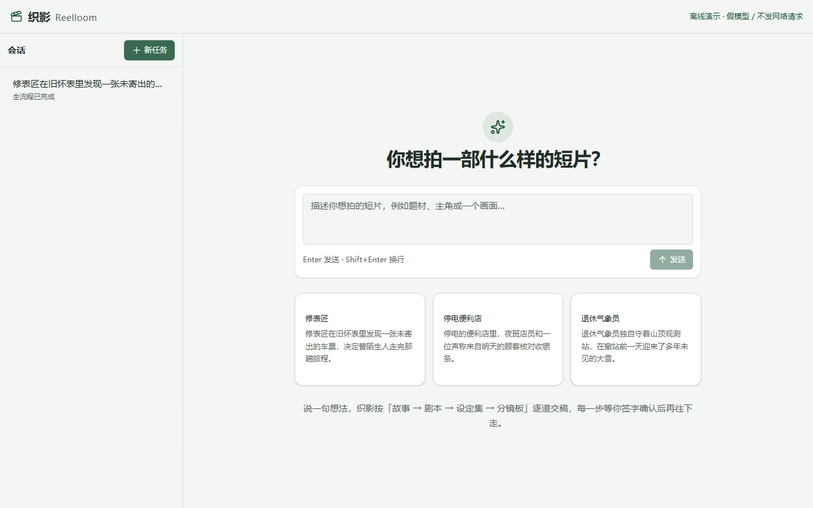
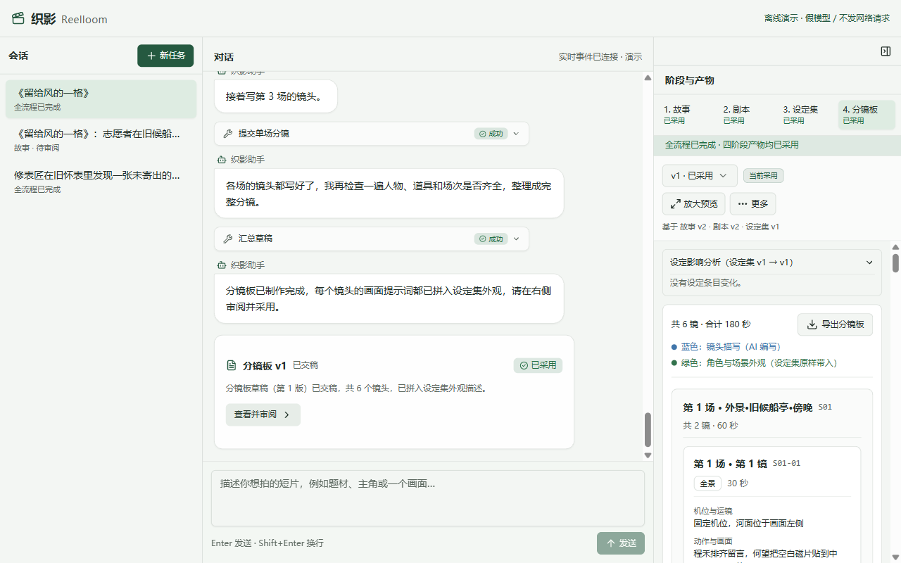
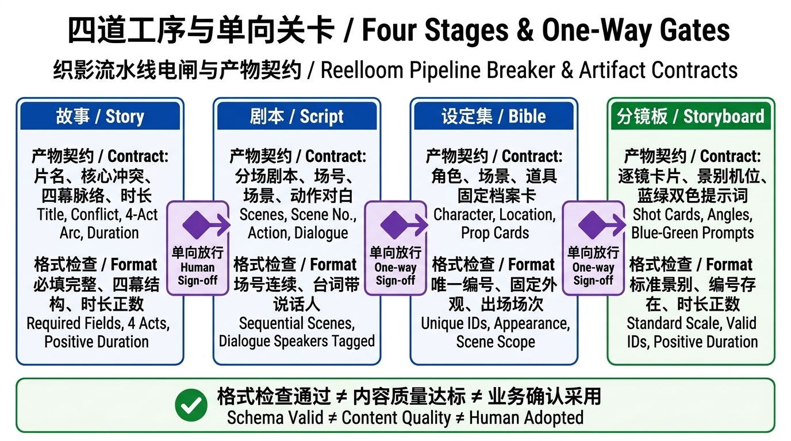
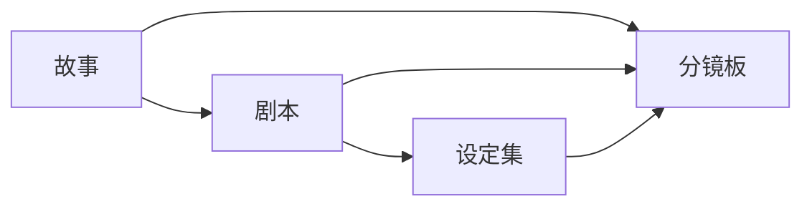

# 第 1 章 · 先看成品

> 上一篇：[第 11 章 · 从失败到修复](../../harness/chapters/ch11.md) · 下一章：[第 2 章 · 跑出第一份稿](./p02.md) · [本篇入口](../README.md)

## 从一个场景开始

假设你想拍一部三分钟短片《留给风的一格》。你对通用聊天机器人说：“从故事一直写到分镜提示词。”

几分钟后它吐出几千字，从故事梗概、分场剧本到每个镜头的画面提示词一应俱全，乍看一气呵成。

细看细节却漏洞百出：

- 故事核心冲突还没定准，它已经顺手把三场剧本全写完了。
- 修表师陆岑在第 1 场穿墨绿针织背心，到了后面的画面提示词里，衣服悄悄换了颜色。
- 你想改一下结尾，却理不清整条链路里哪些内容得跟着重做，只能让它从头再写一遍。

AI 写得并不差。核心问题是：**开工前没有拆开工序，没有定下谁签字说了算，也没有立好每一步的交稿格式**。

## 这一章要解决什么

这一篇带你搭建短片前期创作工具“织影”，把一句话想法逐步推演成一页分镜板。它只产出文字与分镜规划，不直接生成图像或视频。

为什么不直接生成画面？因为故事与人物没定好就直接生图，返工成本很高。先在文字阶段把上下游规矩立好，能大幅减少后续返工。

这一章先看清最终的一页分镜板成品，再把流程拆成四道单向工序，定好每一步的交稿规格与签字规则。

> **一句话记住**：先定好四步交什么、谁签字，再请 AI 在工序里发挥。顺序和格式交给程序，创作交给 AI。

## 先看终点：一页拿得走的分镜板

做产品先看最终交付物。在织影里，无论中间改了多少版，最终交到导演、摄影师或画面生成工具手里的，是一页结构清晰的分镜板。

刚打开织影首页时，页面处于空状态。居中主标题直接提问：“你想拍一部什么样的短片？”下方是输入框，占位文字为：“描述你想拍的短片，例如题材、主角或一个画面…”。再往下展示 3 个可点击的示例需求卡片，底部一行说明交代了协作规则：“说一句想法，织影按「故事 → 剧本 → 设定集 → 分镜板」逐道交稿，每一步等你签字确认后再往下走。”

当我们跑完《留给风的一格》全部四道工序并逐一签字确认后，右栏工序条四道工序均显示为“已采用”，右栏产物面板展示出一页可视化分镜板。

分镜板顶部配有“导出分镜板”按钮，旁边是蓝绿双色图例：“蓝色：镜头描写（AI 编写）”与“绿色：角色与场景外观（设定集原样带入）”。

图例下方是可滚动的镜头卡片列表。每张卡包含镜号、景别、时长、机位与运镜、动作与画面、对白与声音、出场角色与场景；卡片下方的“画面提示词”按蓝绿双色展示（蓝色是 AI 针对本镜写的构图、动作与光线，绿色是程序从已采用设定集原样带入的角色、场景与道具外观），并配有“复制提示词”按钮。当前窗口展示第 1 场标题与首镜（`S01-01`）卡片上半部，其余字段、双色提示词及后续镜头可向下滚动或点击“放大预览”查看。

## 流水线电闸：四道工序与单向关卡

为什么不让 AI 一口气写出分镜板，而要拆成「故事 → 剧本 → 设定集 → 分镜板」四步？

这就像工厂流水线的电闸。前一道工序没有签字盖章，后一道机器连电闸都通不上。在织影里，这套控制先后顺序的机制叫工序关卡。

AI 助手只是工序里请来的外聘写手，可以在工位上写草稿、改稿，但手里没有签字章，也碰不到通往下一关的电闸。

图中的每条箭头都代表单向依赖：下游必须读取上游已经采用的版本；上游未采用，下游不开工。

对照这张图，可以看清三个产品设计取舍：

1. **故事一步到位**：片名、一句话核心冲突和起承转合四幕脉络合成第 1 道「故事」工序，一次审清故事骨架。
2. **先定剧本，再抽设定集**：若先写人设再写剧本，AI 写剧本时容易自行加人或改道具名。先由人工审定剧本，再让 AI 从剧本原文清点出场人物、地点与道具建档，也便于人工核对设定集有没有掺入剧本没写过的闲杂角色。
3. **分镜板汇总三方依据**：设计镜头时，既要核对故事的计划时长，又要按剧本的场次与台词排画面，还要调取设定集里的固定外观。只有故事、剧本、设定集全部采用，分镜板才准开工。

在右栏工序条上，每道工序只会处于五种状态之一：

| 工序状态 | 含义 | 何时出现 |
|---|---|---|
| 未开始 | 当前工序还没有待审或采用版本，可能已可开工，也可能仍未解锁 | 新建项目、上游尚未采用，或候选稿均已处理后 |
| 进行中 | 助手正在生成或按意见修改当前草稿 | 发起生成或点击按意见修改期间 |
| 待审阅 | 当前工序尚无采用版本，已有候选稿等待用户签字确认 | 首份合规草稿落盘后；已有采用版的返工新稿也待审，但工序可仍显示“已采用”或“待更新” |
| 已采用 | 当前工序已有签字确认的采用版本 | 点击右侧采用主按钮后 |
| 待更新 | 上游采用版本发生变更，当前版本基于旧上游 | 回头修改并重新采用上游版本后 |

## 财务报销单核对：每道工序的产物契约

电闸管住了先后顺序，那怎么防止 AI 交上来的稿子漏填栏目或格式错乱？比如写故事漏了计划时长，或者写剧本忘了标注台词是谁说的。

这要靠每道工序的产物契约，也就是程序执行的格式检查。

它就像财务前台核对报销单：发票抬头、税号、金额格式少填一项或填错类型，前台当场退回重填，连主管办公桌都进不了。

| 工序 | 交什么 | 格式检查拦什么（前台退回） | 人工审阅看什么（主管拍板） |
|---|---|---|---|
| 故事 | 片名、一句话冲突、类型、受众、计划时长、起承转合四幕、基调 | 缺必填项、文本空白、时长非正数、脉络非四幕、多塞额外栏目 | 核心冲突是否立得住、四幕走向是否顺畅 |
| 剧本 | 分场剧本，含场号、场景标题、概要、动作与带说话人的对白 | 场号不合规或不连续、必填文本空白、对白缺说话人 | 戏剧节奏好不好、台词是否贴合人物 |
| 设定集 | 角色、场景、道具档案卡，含唯一编号、名称、固定外观、出场场次 | 编号格式不对、外观描述空白、漏掉剧本里出场过的角色或地点 | 外观细节是否具体、视觉风格是否统一 |
| 分镜板 | 逐镜卡片，含镜号、场号、景别、机位、动作、对白、时长、引用编号与提示词 | 景别不在五种标准内、时长非正数、引用编号不存在、AI 伪造最终提示词 | 镜头调度是否有画面感、视听节奏是否自然 |

这里有一条清晰的分工边界：

> **格式检查通过 ≠ 内容质量达标 ≠ 业务确认采用。**

格式检查由代码执行，核对必填项、类型和跨工序引用规则；质量审读由人阅读判断，看故事和镜头好不好看；确认采用则是人工点击签字按钮，正式授权该版本流向下游。

## 用《留给风的一格》串起四份样板

在接通大模型之前，项目里先备好了一套《留给风的一格》四阶段静态样板，用来检验工序关卡与格式检查是否可靠。

故事梗概：停航后的旧候船亭里，志愿者程禾想把留言墙每一格填满，少年麦冬却贴上一块橙色空白磁片，说这一格留给还没开口的人。两人带着停走的蓝色机械计时器找到老修表师陆岑。陆岑修好计时器后，终于对着那块空白磁片说出迟到多年的告别。

四份静态样板首尾咬合：

- **故事**：定下 3 分钟温情剧情短片，立好起、承、转、合四幕脉络。
- **剧本**：顺着四幕拆出旧候船亭、社区修表间、回到旧候船亭 3 场戏，写清每场出场角色、动作与对白。
- **设定集**：从剧本清点出程禾、麦冬、陆岑 3 位角色，旧候船亭、修表铺等场景，以及机械计时器、空白磁片等道具，登记唯一编号与固定外观。
- **分镜板**：全片拆为 6 个镜头，累计 180 秒；每镜由 AI 编写蓝色镜头描写，由程序按引用编号原样带入绿色设定集外观。

测试程序会先拿这套样板做离线校验，并故意构造缺字段、负数时长、非法编号等坏数据，确认格式检查每次都能准确拦截。

## 这一章你学到了

1. 动工前先看清终点：织影按「故事 → 剧本 → 设定集 → 分镜板」四道工序推进，最终交付一页带蓝绿双色提示词的分镜板。
2. 工序顺序与签字流转交给程序控制，每一步内部的文本创作交给 AI；上游未采用，下游不开工。
3. 格式检查通过不代表内容可用：程序像财务核对报销单一样查字段与类型，好不好看、采不采用由人拍板。

## 产品拍板

- 全流程固定为「故事、剧本、设定集、分镜板」四道单向工序，上游未签字采用前，下游不准开工。
- 设定集放在剧本之后，按剧本清点角色、场景与道具建立档案卡，是否夹带了多余设定仍需人工核对。
- 画面提示词拆为蓝绿两半：AI 只写当镜动作与构图，固定外观由程序从设定集原样带入。
- 格式检查由代码强制执行，不合规的草稿当场退回，不生成新版本。

## PM 该追问什么

1. 四道工序的依赖关系是由代码强制检查的，还是只写在提示词里叮嘱模型遵守？
2. 模型交上来的故事如果少了四幕脉络或多塞了未定义字段，系统能否在落盘前拦住？
3. 为什么设定集排在剧本之后？如果设定集漏掉了剧本里的出场角色，系统能不能自动查出来？
4. 分镜板里的绿色外观描述，是程序按编号原样拼进去的，还是让模型写分镜时重新默写的？
5. 接通真实大模型前，有没有完整的四阶段静态样板和离线测试来验证契约规则？

## 动手的人看这里

> 这一节写给要动手实现的人。只想理解产品思路，可以跳到章末。

本章关注**四道工序定义与产物契约**模块，对应文件如下：

- `src/contracts/index.ts`：定义四道工序列表 `STAGES`；`src/workflow/index.ts` 定义显式依赖表 `DEPENDENCIES`。
- `src/contracts/index.ts`：定义四道工序的 Schema 与跨产物校验函数。
- `examples/sample-project/{story,script,bible,board}.json`：《留给风的一格》四份静态样例。
- `src/contracts.test.ts`：验证静态样例通过与坏数据拦截的离线测试。

**实现要点**：

1. 在 `src/contracts/index.ts` 中将 `STAGES` 收敛为 `['story', 'script', 'bible', 'board']`，在 `src/workflow/index.ts` 中定义 `DEPENDENCIES`：`story: []`、`script: ['story']`、`bible: ['script']`、`board: ['story', 'script', 'bible']`。
2. 合并原选题与梗概为 `StorySchema`，包含 `title`、`logline`、`genre`、`audience`、`target_minutes`、固定 4 项的 `beats` 起承转合数组、`tone`，开启 `additionalProperties: false`。
3. 区分 `BoardShotInputSchema` 与 `BoardSchema`：模型按场提交镜头时只传 `shot_part` 等输入字段；持久化输出包含 `assembly_template: 'shot-v1'`、程序生成的 `injected_ids` 与 `final_prompt`。

在 `book/build` 执行 `npm test -- src/contracts.test.ts` 与 `npm run typecheck` 即可完成离线验证。

**给 AI Coding 的任务描述**：

> **文件**：`src/contracts/index.ts`、`src/workflow/index.ts`、`examples/sample-project/{story,script,bible,board}.json`、`src/contracts.test.ts`。
> **意图**：将 `STAGES` 收敛为 `['story', 'script', 'bible', 'board']` 并定义显式 `DEPENDENCIES`；定义 `StorySchema`、`ScriptSchema`、`BibleSchema`、`BoardShotInputSchema` 与 `BoardSchema`，开启 `additionalProperties: false`。
> **验收**：四份静态样例全部通过 Schema 与跨产物一致性校验；多余字段、空白字符串、非正数时长、不合规则的编号均被确定性拦截。

---

[下一章 · 第 2 章 · 跑出第一份稿](./p02.md) 会把 AI 放进只给专属按钮的受限工位，通过实时事件流在网页上跑出第一版待审阅的「故事」草稿。

<!--
需要的截图：
1. p01-01-home-and-pipeline.png
   - 演示中的哪一步：打开织影首页（空状态），尚未输入需求。
   - 画面内容：居中主标题显示“你想拍一部什么样的短片？”，下方是输入框（占位文字“描述你想拍的短片，例如题材、主角或一个画面…”），再往下展示 3 个可点击的示例需求卡片，底部说明“说一句想法，织影按「故事 → 剧本 → 设定集 → 分镜板」逐道交稿，每一步等你签字确认后再往下走。”。
2. p01-02-final-storyboard.png
   - 演示中的哪一步：跑完《留给风的一格》全部四道工序并签字确认后，查看右栏「分镜板」。
   - 画面内容：右栏工序条四道工序均显示为“已采用”；右栏产物面板顶部有“共 6 镜 · 合计 180 秒”、“导出分镜板”按钮及蓝绿图例（“蓝色：镜头描写（AI 编写）”、“绿色：角色与场景外观（设定集原样带入）”）；下方可滚动列表显示第 1 场标题及首镜（S01-01）卡片上半部的镜号、景别、时长、机位与运镜、动作与画面（其余字段、双色提示词及后续镜头可向下滚动或放大预览查看）。
-->
