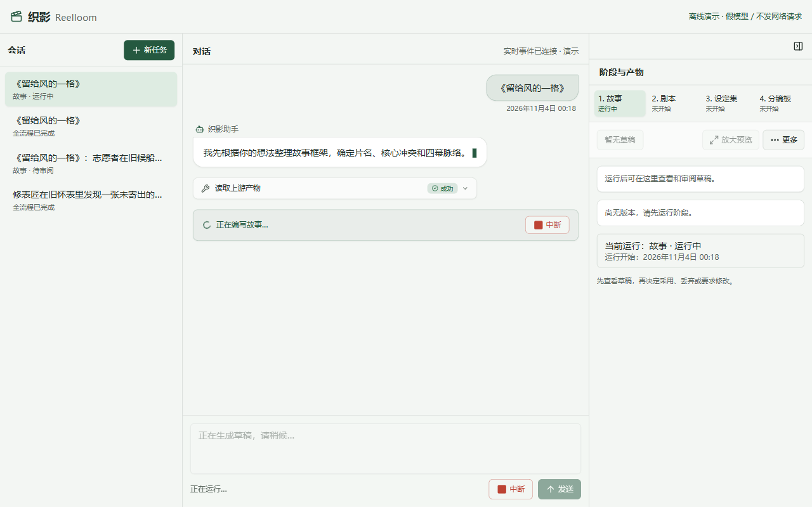
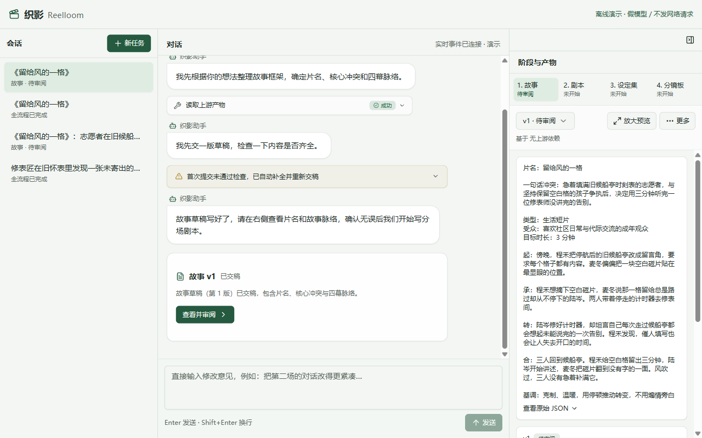

# 第 2 章 · 跑出第一份稿

> 上一章：[第 1 章 · 先看成品](./p01.md) · 下一章：[第 3 章 · 让人签字把关](./p03.md) · [本篇入口](../README.md)

## 从一个场景开始

工序和交稿规格立好后，你在织影首页输入框写下《留给风的一格》的初步想法，让 AI 动手写第一道「故事」草稿。

如果直接使用带默认权限的通用编程助手，再配上黑盒运行的后台，马上会撞上两个问题：

- 默认助手手握读写任意文件和执行终端命令的权限，可能误读无关目录，甚至绕过格式检查直接修改系统状态文件。
- 如果后台黑盒运行，你盯着毫无反应的页面干等一分钟，不知道它是在思考、在交稿还是早就卡死了。

核心问题是：**AI 手里的工具权限没收紧，运行过程对用户也是黑盒**。

## 这一章要解决什么

这一章要把第 1 道「故事」工序跑通，在网页上拿到第一版待审阅的故事草稿。

为什么在第一次调用模型时就要收紧权限并实时推送进度？因为一旦放开底层文件读写，上一章定好的工序关卡和格式检查就会被绕开；而没有透明的进度反馈，用户遇到卡顿或报错时就只能盲目等待。

本章在后台把 AI 关进只给专属按钮的受限会话，在前台通过实时事件流把生成进度、自我修正和交稿卡片实时推到网页。

> **一句话记住**：把 AI 关进只给专属按钮的工位，开一扇玻璃窗把每一步动作实时亮给用户看。

## 工位上的外聘写手：受限会话与专属按钮

怎样确保 AI 按填表规则交稿，不去乱翻文件，也不私自跳步？

想象你请来一位外聘写手。他进屋前先交出所有钥匙和危险工具，坐进单独工位，桌上只留一张规定表格和一支笔。他可以在工位上写草稿，但翻不到别的档案，也碰不到通往下一关的电闸。

在织影里，这个独立工位叫受限会话。程序在启动会话时，先关闭终端命令、文件读取、文件写入和编辑等全部内置系统工具，再按当前工序只挂载白名单里的业务按钮。

在第 1 道「故事」工序里，AI 桌上只有两个按钮：

| AI 能按的按钮 | 允许做什么 | 程序在背后拦住什么 |
|---|---|---|
| 读取上游定稿 | 按依赖表读取已采用的上游产物；故事无上游依赖，固定返回空值 | 拒绝读取非依赖工序，拒绝读取未采用草稿，不接受文件路径参数 |
| 提交当前草稿 | 提交填好的故事草稿，由程序按故事填表规则逐项核对 | 缺字段、类型不对或含多余栏目时当场退回，不生成版本号，将中文错误原因发回给 AI 重填 |

可以看到，工位上根本没有“采用版本”或“推进下一道工序”的按钮。就算用户在下方输入框里让 AI“直接帮我采用并开始写剧本”，它也做不到。

同时，程序会把系统提示词固定为「故事」工序专属的工作指南，不拼接本机目录路径，也不加载外部全局配置。

## 玻璃窗直播：实时事件流与自我修正

写手在工位里动笔了，外面的用户需要看清进展。这就像在工位正面开了一扇透明玻璃窗：写手写到哪一行、哪次填错表被退回重填、何时正式交出第 1 版草稿，你在窗外一目了然。

网页和服务端之间分两条通道配合：用户发送想法或点击中断，走的是普通指令请求；而 AI 写稿过程中的动作，则通过单向的实时事件流持续推回网页。

当你在首页输入《留给风的一格》的一句话想法并发送后，页面立刻给出三处反馈：

1. 右栏工序条中，「故事」状态从“未开始”变为“进行中”，其余三道保持“未开始”。
2. 对话区显示助手开场话术：“我先根据你的想法整理故事框架，确定片名、核心冲突和四幕脉络。”
3. 底部状态提示显示“正在编写故事…”及右侧“中断”按钮，输入框置灰并显示“正在生成草稿，请稍候…”。

离线演示中，AI 第一次提交的是一份空草稿，格式检查会当场拦下，把具体原因退回给 AI。AI 收到错误提示后补齐片名、核心冲突和四幕脉络重新提交，全程无需人工介入。

退回与重填的过程会收束成一张可展开的折叠提示卡片：

- 折叠标题显示：“首次提交未通过检查，已自动补全并重新交稿”。
- 展开详情可见：格式检查列出的缺失项，以及助手话术：“刚才提交的是空草稿，漏了片名、核心冲突和四幕脉络，我已经补齐并重新提交。”

## 交稿只是候选，停在“待审阅”

当第 2 次提交通过格式检查，草稿正式落盘为故事第 1 版，右栏工序条中「故事」状态变为“待审阅”。

对话区随之出现助手收尾话术：“故事草稿写好了，请在右侧查看片名和故事脉络，确认无误后我们开始写分场剧本。”紧接着出现交稿卡片：“故事草稿（第 1 版）已交稿，包含片名、核心冲突与四幕脉络。”

交稿卡片带有“查看并审阅”按钮；右栏产物面板同步展示故事第 1 版的可读内容，包括片名、一句话核心冲突、类型、受众、时长、起承转合四幕与基调。

这里守住了两条完成边界：

- **落盘过检才算交稿**：如果模型只在对话里说“我已经写好了”，却没有调用提交草稿按钮并通过格式检查，运行结束时会判定为未产出草稿，不会把聊天文字当成版本。
- **交稿只进“待审阅”，不自动采用**：草稿保存为第 1 版后只是候选方案，系统不会自动将其设为已采用，也不会擅自启动下一道「剧本」工序。若模型连续重试达到轮数上限仍未过检，系统会停止运行，运行摘要显示“达到运行轮数上限”，对话区提示：“故事运行失败，已停下。请检查运行记录后重试。”

## 中断、防撞车与断线保护

真实使用中，用户可能半路喊停、连点两次发送、遇到网络闪断或当日生成次数用完。服务端为此准备了四道保护：

| 突发状况 | 服务端处理机制 | 网页反馈文案 |
|---|---|---|
| 用户主动喊停 | 调用会话中止接口停止生成，保留已保存的历史版本 | 对话区显示：“故事运行已中断，已停下。请检查运行记录后重试。” |
| 同一项目连点或双开 | 会话启动前为项目加锁；运行期间拒绝同一项目的重复运行或采用请求 | 输入框置灰显示“正在生成草稿，请稍候…”，重复请求由服务端直接拦截 |
| 连接闪断与恢复 | 连接断开时自动重连并轮询状态，恢复后拉取最新快照同步进度 | 断开时提示“连接断开了，正在自动重连。断开期间的进度会在重连后补上。”，恢复后连接状态显示“实时事件已连接” |
| 当日生成次数用完 | 拦截新的模型生成请求，但放行查看、导出与重新拼装等纯程序操作 | 提示“已达到今日运行次数上限，请在 UTC 次日重试”；已有产物仍可查看、导出或执行零模型重新拼装 |

网页上的按钮置灰只是前端提示，真正的运行锁与状态规则全部守在服务端。

## 这一章你学到了

1. 给 AI 派活前先收紧工位：关闭全部内置系统工具，在「故事」工序只给“读取上游定稿”和“提交当前草稿”两个按钮。
2. 用实时事件流打破黑盒：把助手开场话术、格式检查拦截后的自我修正、以及交稿卡片实时推送到网页。
3. 交稿不等于采用：新草稿过检落盘后状态停在“待审阅”，是否采用留给人工拍板。

## 产品拍板

- 默认关闭模型的全部内置系统工具，按工序白名单挂载专属工具，防止模型越权读写文件或自批自改。
- 模型首次提交未过检并自动修正成功时，用折叠卡片提示“首次提交未通过检查，已自动补全并重新交稿”，兼顾透明与简洁。
- 运行是否成功以“是否有合规新版本落盘”为准，不凭模型自然语言回复判断完成。
- 同一项目同一时刻只允许一个运行过程，运行期间拒绝并发运行或采用操作。

## PM 该追问什么

1. 怎么证明模型没有文件读写和终端命令权限？是否有离线测试直接断言了会话的工具列表？
2. 模型提交的故事草稿格式不合规时，能否收到中文错误原因并在同一会话内自我修正重交？
3. 模型只在对话里说“写完了”而没点提交按钮时，系统会不会误判为已交稿？
4. 两个标签页同时对同一项目点发送时，服务端是在调用模型前拦下请求，还是已经发起了两次调用？
5. 今日生成次数用完后，用户还能不能查看、导出已有版本？

## 动手的人看这里

> 这一节写给要动手实现的人。只想理解产品思路，可以跳到章末。

本章关注**受限会话、故事阶段运行与实时事件流**模块，对应文件如下：

- `src/agent/session.ts`：使用 `noTools: 'all'` 关闭内置工具，覆盖系统提示词，挂载阶段白名单工具。
- `src/agent/prompts.ts`：定义各工序系统提示词模板，本章使用 `STORY_PROMPT`。
- `src/agent/run.ts`：启动阶段会话，订阅事件流，控制最大轮数并记录 `stop_reason`。
- `src/server/runs.ts`：维护项目级运行锁、中断处理与配额检查。
- `src/server/events.ts`：将会话事件与项目状态封装为 SSE 事件流推给前端。
- `src/agent.test.ts`：断言内置工具关闭、坏草稿退回修正与 `pending_review` 状态停靠的离线测试。

**实现要点**：

1. 在 `src/agent/session.ts` 中设置 `noTools: 'all'`，覆盖默认系统提示词，`story` 阶段仅挂载 `read_upstream` 与 `write_draft` 两个自定义工具。
2. `write_draft` 的 `artifact` 参数使用 `Type.Unknown()` 保留原始类型，由存储层执行 `StorySchema` 校验，防止数字字符串被静默转换。
3. 在 `src/agent/run.ts` 与 `src/server/runs.ts` 中跑通 `story` 阶段会话，将 `session.subscribe()` 事件流经 SSE 推给前端；草稿通过 `StorySchema` 校验后落盘为 `v1`，工序状态更新为 `pending_review`，界面显示“待审阅”，不自动采用。

在 `book/build` 执行 `npm test -- src/agent.test.ts` 与 `npm run typecheck` 可完成离线验证。

**给 AI Coding 的任务描述**：

> **文件**：`src/agent/session.ts`、`src/agent/prompts.ts`、`src/agent/run.ts`、`src/server/runs.ts`、`src/server/events.ts`、`src/agent.test.ts`。
> **意图**：在 `src/agent/session.ts` 中使用 `noTools: 'all'` 关闭全部内置工具并覆盖系统提示词，`story` 阶段仅挂载 `read_upstream` 与 `write_draft`；在 `src/agent/run.ts` 与 `src/server/runs.ts` 中将 `session.subscribe()` 事件流经 SSE 推给前端，草稿过检后落盘为 `v1` 并停在 `pending_review`。
> **验收**：离线测试断言会话中不存在 `bash`/`read`/`write`/`edit` 等内置工具；格式不合规的草稿被拒并返回中文可操作错误；生成成功后版本落盘且状态停在 `pending_review`。

---

[下一章 · 第 3 章 · 让人签字把关](./p03.md) 会讲清楚面对这份「待审阅」的故事第 1 版，人工怎样在采用、要求修改、丢弃中拍板，以及签了字如何直接启动下一道「剧本」工序。

<!--
需要的截图：
1. p02-01-story-running.png
   - 演示中的哪一步：在首页输入《留给风的一格》一句话想法并发送，启动第 1 道「故事」工序。
   - 画面内容：右栏工序条中「故事」状态变为“进行中”，其余三道为“未开始”；对话区显示助手开场话术“我先根据你的想法整理故事框架，确定片名、核心冲突和四幕脉络。”，底部状态提示显示“正在编写故事…”及右侧“中断”按钮，输入框置灰显示“正在生成草稿，请稍候…”。
2. p02-02-story-v1-pending-review.png
   - 演示中的哪一步：「故事」草稿第 1 版生成完毕。
   - 画面内容：右栏工序条中「故事」状态变为“待审阅”；对话区出现自我修正折叠提示“首次提交未通过检查，已自动补全并重新交稿”以及交稿卡片“故事草稿（第 1 版）已交稿，包含片名、核心冲突与四幕脉络。”，卡片带“查看并审阅”按钮；右栏产物面板展示故事第 1 版可读内容（片名、一句话核心冲突、类型、受众、时长、起承转合四幕与基调）。
-->
