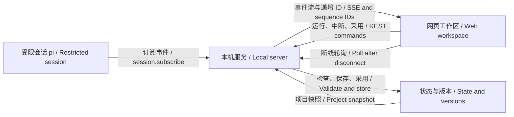

# P02 · 接上 Web：事件流与指令 / Events and Commands

> 上一章：[P01 · 搭骨架](./p01.md) · 下一章：[P03 · 选题与梗概](./p03.md) · [本篇入口与运行命令](../README.md)

## 这一章解决什么问题

CLI 已经能建项目、写草稿和采用版本。换成网页后，人希望在等待时看到文字、知道哪个工具正在执行，并能中断；审阅时还要知道眼前是哪一阶段、哪个版本。

本章直接提供 Vite + React 脚手架，不逐行讲组件和样式。重点是两条接线：**事件从会话流向页面，人的指令从页面回到服务端。** 状态机仍在服务端，浏览器上的禁用按钮只是提示，不承担推进规则。

## 事件走哪条路 / Event path



`src/server/index.ts` 使用 Node 自带的 `node:http`。这里只有少量固定路由、JSON 请求和一条 SSE 长连接，引入后端框架带来的路由便利还不足以抵消额外概念。网页由 Vite 开发服务提供，`/api` 统一代理到 Node，浏览器不必管理两个 API 域名。

页面左侧是对话与工具卡片，右侧是六阶段导航、版本列表和格式化 JSON，底部发送补充要求或中断。前端只导入共享类型，不把会话、存储或凭据打包进浏览器。

## REST 发指令，SSE 看过程

以下路径均相对 API 服务；在网页中走 Vite 的 `/api` 代理。`:id` 是建项目返回的项目 ID，`:stage` 只接受六阶段之一。

| 方法与路径 | 用途与请求体 |
|---|---|
| `GET /api/config` | 当前是真实模型还是离线演示、哪些阶段有模板 |
| `POST /api/projects` | 建项目，`{ "title": "原创短片" }` |
| `GET /api/projects` | 列项目 |
| `GET /api/projects/:id` | 阶段状态、版本号、采用编号、当前运行与最近运行结论 |
| `GET /api/projects/:id/events` | 接收 SSE 项目快照、会话事件与运行结论 |
| `POST /api/projects/:id/stages/:stage/run` | 运行，`{ "instructions": "雨天，两位角色" }`；补充要求可省略 |
| `POST /api/projects/:id/abort` | 请求中断，`{}` |
| `POST /api/projects/:id/stages/:stage/adopt` | 采用，`{ "version": 1 }` |
| `GET /api/projects/:id/stages/:stage/versions/:version` | 读取登记在项目内的该版本 JSON |

修改请求须使用 `Content-Type: application/json`，请求体上限 64 KiB，补充要求最多 8000 字，标题最多 200 字。ID、阶段、版本都先校验，API 不接受文件路径，也没有任意文件下载路由。非法推进返回 422 和状态机原文，例如“不能运行 synopsis：依赖阶段 topic 尚未采用版本”；未知项目返回 404，重复操作返回 409。

运行返回 **202**，表示请求已接收，后续可能仍然失败。草稿是否产生、为什么停止，要看之后的事件或项目快照里的 `last_run.stop_reason`。补充要求由 `runStage` 加进真实用户提示并记录审计，固定系统提示与工具白名单保持原有规则。

SSE 每条业务事件包含递增 `id` 和一份 JSON `data`。保留 SDK 的类型名，裁掉前端不需要的完整消息、token 用量等字段：

```text
id: 12
data: {"type":"message_update","run_id":"example-run","stage":"topic","assistantMessageEvent":{"type":"text_delta","delta":"开始创作","contentIndex":0}}

id: 13
data: {"type":"tool_execution_end","run_id":"example-run","stage":"topic","toolCallId":"call_1","toolName":"read_upstream","result":{"content":[{"type":"text","text":"null"}]},"isError":false}
```

`tool_execution_start` 带工具名、调用 ID 与参数，结束事件带结果和 `isError`。网页按“运行 ID + 调用 ID”更新同一卡片；不能把“发起调用”直接画成成功。文本 `text_delta` 追加到对话块，工具调用仍有独立卡片。

服务端额外发 `run_started`、`run_ended`、`project_state`。草稿成功写入、运行结束、人工采用后，都会发项目快照。阶段状态从存储层读取，页面不会根据一句“我已完成”自行变更状态。没有新草稿就是 `no_draft`，保留 P01 的其他停止原因。

## 为什么用 SSE，不用 WebSocket

现在的长连接只有一个方向：服务端推送文字和工具进度。反方向只是几条可以独立确认结果的 HTTP 指令，REST 已足够。SSE 是普通 HTTP，浏览器提供 EventSource 和自动重连，无须再定义 WebSocket 消息确认、命令应答与连接生命周期协议。

代价也要清楚：SSE 只推文本事件，事件 ID 本身不保证历史可重放。若以后需要持续双向音频或高频双向交互，再按需求评估 WebSocket；本章没有这样的输入。

## 断线怎么办

`web/src/live.ts` 在 EventSource 出错时，每两秒请求 `GET /api/projects/:id`。此时页面显式显示“连接中断 · 轮询”，仍可看到版本、采用状态、运行是否结束和最近的停止原因。SSE 自己重连，重新收到 `project_state` 后停止轮询。晚到的旧请求不能覆盖较新的快照；切换项目时关闭事件连接、计时器和未完成的读取。

这条 SSE 不存历史缓冲，也不实现 `Last-Event-ID` 重放；每次连接先发当前快照。序号在单个服务进程、单个项目内递增，重启后重新计数。页面在重连时接受新的编号。断线期间漏掉的文字和工具结束事件不会凭空补齐；若运行已经结束而某张卡片没收到结果，它显示“结果未收到”。刷新或切换项目后，对话流从当前连接重新开始，已保存的版本仍然可读。

运行锁、当前运行与最近结论存于服务内存；项目、产物与 SDK 会话保存在磁盘。服务重启会清空内存概况，不会抹掉已落盘草稿。持久任务队列、崩溃恢复和历史对话回放需要独立设计，不能用 EventSource 的自动重连冒充这些能力。

## 409 的产品含义：一次只能改一个项目的运行状态

连续点两次运行，如果只在按钮上防抖，另一个标签页仍能启动第二个会话。两个会话同时写版本可能争抢 v1；有人中途采用，还可能改变模型正在处理的阶段。

`src/server/runs.ts` 在创建会话的第一个 `await` 之前为项目占位。已有运行时，任何阶段的第二个运行请求和采用请求都返回 409。不同项目可以各自运行。配置错误会释放占位；正常结束和中断完成也会释放。UI 禁用按钮是第一层反馈，服务端检查才是实际规则。

中断调用 SDK 的 `session.abort()`。它请求停止并等待运行退场，不回滚已经写入的草稿；页面保持“正在中断”，直到快照确认结束。运行摘要记 `stop_reason=aborted`，可保留草稿供人工审阅，不自动采用。

锁只在这个 Node 进程内有效。Web 运行时不要同时用 CLI 修改同一项目，也不要为同一存储目录起第二个 API 进程。跨进程互斥、磁盘事务与崩溃恢复仍未实现。

## 为什么只监听 127.0.0.1

这个服务没有鉴权。若绑定 `0.0.0.0`，局域网中的其他设备就可能访问建项目、运行和采用接口。本章明确把入口限制在本机回环地址，Vite 也使用同样的监听边界，固定 API 3001、网页 5173，不自动换端口。

此外，API 检查本机 Host 与允许的 Origin，修改请求只收 JSON，不开放跨域响应头；Vite 文件访问限制在网页和包内依赖目录。它们只是本机开发入口的基本约束，不是用户身份或多用户授权。P10 再讨论鉴权、隔离、配额与云端存储。不要把这里的启动命令直接当成公开部署方案。

## 动手看一次事件流

按 [README 的 Web 步骤](../README.md#打开-web-工作区) 安装后，执行 `HARNESS_DEMO=1 npm run dev`，访问 `http://127.0.0.1:5173`。新建项目，运行选题，观察假模型故意提交的坏草稿被工具拒绝，修正后保存 v1；选 v1 预览并采用，看梗概徽标变为 ready。接着可按 [P03](./p03.md) 继续审阅与修改，并运行梗概。

演示只替换 `streamFunction`，其余 SDK、工具和存储照常执行，不请求模型，也不按输入临时创作。想看真实创作，先结束演示，再按 README 配好 Ollama 或 DeepSeek，不设 `HARNESS_DEMO=1` 启动。真实模型的完成率与故事质量不由离线演示证明。

`npm test` 会临时监听随机的本机端口，并在结束时关闭自己的服务。验收实际 SSE 帧里有 `text_delta` 和 `tool_execution_end`，检查补充要求进入用户提示、准备会话时的第二个请求返回 409、abort 传到模型 signal 后记为 aborted、采用后下一阶段 ready、非法推进返回状态机错误；页面事件处理另测断线轮询、旧请求覆盖保护和工具卡片状态。`npm run typecheck` 检查两端，`npm run build` 产出网页构建。浏览器中的实际布局和真实模型效果还需要分别走查。

## 给 AI Coding 的任务描述

> **文件**：`src/server/`、`src/agent/run.ts`、`web/` 和相应离线测试。  
> **意图**：把受限会话事件送到网页，把运行、中断和人工采用通过 REST 送回服务端；页面不决定阶段是否可推进。补充要求进入用户提示，不改变工具权限。  
> **验收**：假模型实际触发的文本与工具结束事件能在 SSE 读到；ID 递增；同项目并发返回 409，创建会话期间也受保护；中断完成记 aborted；人工采用后下一阶段 ready；断线后真实请求详情轮询，旧结果不覆盖新快照；非法推进返回 4xx 与状态机文案。`npm test`、`npm run typecheck`、`npm run build` 均通过。  
> **边界**：只监听回环地址；无任意静态文件读取；本章先接 topic 模板；采用的是已落盘草稿，P03 再扩充采用前的三种审阅决定，不做鉴权、返工或云端部署。

## 产品拍板

- HTTP 请求成功和模型完成分开表达；202 是已接收，`stop_reason` 才是运行结论，人工采用另有按钮。
- 草稿先落盘再由人审阅，schema 通过不自动采用。下一章补齐采用、丢弃、要求修改的决定；草稿追加不挂起，覆盖或外发等副作用才在执行前确认。
- 同一项目只允许一个运行，运行期间拒绝采用；锁由服务端维护，不能只靠按钮变灰。
- 断线保住项目事实，缺失事件如实说明；不拿连接恢复代替历史回放或任务恢复。
- 网页作为脚手架帮助看清 harness，前端样式和 React 技法不是本章教学重点。

## PM 该追问什么

1. 点击运行收到 202 后，什么证据说明草稿真的写进去了？只说“完成”会显示什么？
2. 两个标签页同时发请求，谁得到 409？是在建立会话前就拦住，还是已经请求了两个模型？
3. 卡片的“成功”来自工具结束事件，还是调用刚发出就被当成成功？断线漏结果怎么显示？
4. 断线后还看得到哪些事实？漏掉的文字会不会被页面猜补？服务重启后又少哪些信息？
5. 中断时已写入的草稿会保留吗？采用按钮和停止原因是否会误导人？
6. ready 与模板已实现是一回事吗？无鉴权的入口究竟监听哪里？

[下一章 P03](./p03.md) 继续选题与梗概，明确采用前的三种审阅决定，并由程序把原稿和修改意见带入新的运行。
