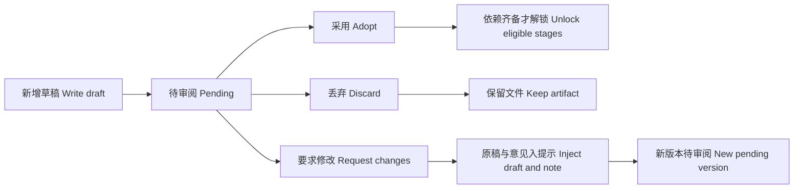

# P03 · 选题与梗概：采用之前的审阅门 / Review Before Adoption

> 上一章：[P02 · 接上 Web](./p02.md) · [本篇入口与运行命令](../README.md)

## 这一章解决什么问题

选题交了一份合规 JSON，不代表方向值得继续。人可能认可它，可能放弃它，也可能觉得核心不错但结尾需要改。若页面只有“采用”，修改意见就容易停在聊天里，下次模型收到的仍是最初要求。

这一章把这三种决定存进版本记录，并打通选题、梗概两个阶段。外层程序管阶段与采用关系，内层模型只读允许的上游、写当前草稿；人决定哪份可以成为后续创作的依据。

## 确认门放在哪里

[第一篇 Ch8](../../harness/chapters/ch08.md) 讲的是有副作用的动作：覆盖文件、对外发消息等，要在执行前先检查策略，再等待人的批准；拒绝或超时就不执行。

这里的 `write_draft` 只在项目里追加一个新文件，不覆盖、不外发。它确实会写磁盘，但没有覆盖或发布这样的业务副作用；因此不在写入前挂起会话。模型先交出可看的版本，人再决定是否**采用**。确认门放在版本成为下游输入之前。将来接入对外发布等能力，仍应在副作用发生前确认，不能拿“草稿已经审过”代替发布授权。



网页按钮只是入口。真正的检查在 `src/workflow/index.ts` 和 `src/project/store.ts`；从另一个标签页直接发 HTTP，也不能绕过这些规则。

## 三种决定的产品含义

| 决定 | 版本状态 | 后果 |
|---|---|---|
| 采用 | `adopted` | 记录采用编号，下游只读这份；所有依赖已采用的阶段解锁 |
| 丢弃 | `discarded` | 文件保留供追溯，不能再采用；不解锁下游 |
| 要求修改 | `changes_requested` | 必须填写意见；可显式发起“按意见修改”，生成新的 `pending` 版本 |

页面把版本级 `pending` 与阶段级 `pending_review` 统一显示为“待审阅”；运行期间，对应阶段显示“运行中”，不会改变已经保存的阶段状态。新版本总是 `pending`。一次审阅决定完成后不能反复改状态；要求修改的版本只能作为修改来源，新产物需要重新审阅。采用同一版本的重复请求保持幂等，不重复写审计。已经采用的版本不能丢弃或要求修改，阶段也不能再运行；换采用版本和下游失效处理留给 P8。

阶段状态和版本状态分别回答两个问题。阶段问“流程走到哪了”，版本问“这份稿子怎么处理”：有采用编号则阶段为 `adopted`；没有采用但还有待审版本则为 `pending_review`；所有候选都已丢弃或要求修改，则回到 `ready`。没有满足依赖的阶段仍为 `locked`。`ready` 不等于已采用，也不等于该阶段已经有提示模板。

`project.json` 在原有版本号列表之外增加 `reviews`：

```json
{
  "status": "ready",
  "versions": [1],
  "adopted_version": null,
  "reviews": {
    "1": {
      "status": "changes_requested",
      "note": "保留空白格的意象，让主角主动做出选择。",
      "at": "2026-11-02T00:00:00.000Z"
    }
  }
}
```

旧文件没有 `reviews` 时，未采用版本按 `pending` 读取；若旧文件已经记录采用编号，保留那份采用关系并显示为 `adopted`。不要求读者手工迁移项目。

## 为什么让程序带入修改意见

`POST /api/projects/:id/stages/:stage/run` 可接收 `{ "revise_from": 1 }`，也可以附带 `instructions`。服务端在建立会话前检查来源必须是同阶段、已登记且有意见的 `changes_requested` 版本；不存在、已丢弃、仍待审或已采用的来源都返回 4xx 和原因。

`runStage` 再次检查来源，从存储层读取原版本 JSON 的原文与已保存意见，确定性地拼进用户提示，并把完整提示和 `revise_from` 记入会话。原文包含原有换行；意见不先裁剪或改写。额外补充要求仍能一起传入，但不替换系统提示和工具白名单。

如果只告诉模型“去找刚才的意见”，就依赖它记得上一段对话、猜到文件位置、选对版本。现在每次都是全新受限会话，也没有通用文件读取工具；程序知道明确的编号，就该把输入准备好。这个保证是**意见确实进入了本次请求**，不是保证模型一定理解并完全落实。改得好不好仍需人审。

“要求修改”和“按意见修改”是两个动作：保存意见不会立即请求模型。后者才启动一次运行，`write_draft` 按当前最大编号追加新版本；原稿和意见保持不变。修改失败或只有文字回答，不会伪造新版本。

## 丢弃为什么不删除文件

删除会失去“当时看过什么、为什么没用”的依据，还可能使已有版本链接失效。丢弃只改变候选资格，版本 JSON 仍可通过原有读取接口查看；不回收编号，不把下一个稿子重新编号为 v1。

`projects/<id>/audit.jsonl` 追加每个有效审阅决定：`actor` 固定为 `local`，另有 `action`、`at`、`stage`、`version`，有意见时保存 `note`。非法请求不追加审计。这里没有鉴权，`local` 仅表示本机审阅入口，不能当作用户身份凭证。

审计与项目状态是不同文件，仍没有跨文件事务或崩溃恢复保证；不要把本机追加日志解释成不可篡改的生产审计系统。服务进程内锁覆盖运行与三种审阅操作，运行期间均返回 409；CLI 或另一个服务进程不共享此锁。

## 两个阶段的提示契约

`src/agent/prompts.ts` 的选题模板要求 `title`、`logline`、`genre`、`audience`、正数 `target_minutes`。选题没有上游，`read_upstream({})` 返回 `null`。

梗概模板先调用 `read_upstream({"stage":"topic"})` 读取人工采用选题，再写 `title`、`logline`、恰好四项的 `beats`（起承转合）和 `tone`。它不写剧本、不读取选题的未采用候选。两份中文模板均使用 P00 的 schema，要求用 `write_draft` 提交完整 JSON，收到修改意见后在原稿基础上交新版本。

字段与类型由 schema 保证；是否真的有因果、是否有好的人物选择，不由字段齐全保证。设定集及以后的模板尚未实现，即使阶段解锁，页面仍显示不可运行的具体原因。剧本的逐场提交见 [P04](./p04.md)。

## 动手审一次稿

在 `book/build` 运行 `HARNESS_DEMO=1 npm run dev`，打开 `http://127.0.0.1:5173`，按以下顺序操作：

1. 新建项目，运行选题，等 v1 出现。假模型会先交坏数据再修正，用来展示工具校验。
2. 在 v1 下点“要求修改”，演示模式预填“把孩子换成一位老站长，保留空白格的意象。”；清空或只填空格时不能提交。使用示例意见保存。选题尚未采用，梗概仍锁定。
3. 点“按意见修改 v1”，左侧用户消息显示修改意见原文，对应阶段显示“运行中”。v2 出现后自动选中，预览可看到孩子换成了老站长；采用后梗概显示“可运行”。之后也可手动切回旧版本查看，只有生成新版本或切换阶段时才自动选择最新版本。
4. 切到梗概，运行并预览 v1，再采用；剧本解锁，可按 [P04](./p04.md) 逐场提交并汇总待审阅版本。
5. 要看丢弃效果，另建项目运行选题，点“丢弃”。弹窗说明“版本保留可追溯，但之后不能采用”；取消或按 Escape 不改变状态，点“确认丢弃”才生效。v1 仍可选、可预览，显示“已丢弃”，采用按钮禁用；再运行会自动选中新生成的 v2。

演示是固定原创样例，第二份答案预设为把孩子换成老站长，不会理解任意输入的意见。如果更改了示例意见，弹窗、修改入口和本次用户消息会注明“离线演示的修改结果为预设内容”；用户自己的意见仍原样保存并进入实际请求。生成的新版本也保留预设内容提示，刷新后仍可看到。真实模型模式不预填演示意见。它不调用真实模型；状态机、工具、版本、审计与 SSE 均照常工作。验证截图应覆盖意见弹窗、v2 出现、丢弃版本仍可见，以及采用后梗概解锁。已采用阶段的按钮解释为“已采用的版本暂不支持更换”等实际限制，不向用户展示章节排期。结束后按 Ctrl+C 关闭自己的服务。

离线验收执行 `npm test`、`npm run typecheck`、`npm run build`。测试覆盖三种审阅的状态变化与拒绝、原稿保留、审计、旧项目兼容、实际模型请求中的原文与意见、HTTP/SSE、运行互斥和演示闭环；它不证明真实模型的创作质量。

## 给 AI Coding 的任务描述

> **文件**：`src/workflow/index.ts`、`src/project/store.ts`、`src/agent/run.ts`、`src/agent/prompts.ts`、`src/server/`、`web/src/` 及对应离线测试。  
> **意图**：给每个版本明确审阅结论；让人选择采用、丢弃或要求修改。修改运行的输入由程序准备，模型只能交新稿。  
> **验收**：待审版本可三选一；空意见、无效版本和重复审阅被拒；丢弃不删文件且不能采用；没有采用不解锁下游；`revise_from` 只接受要求修改的来源，实际请求逐字包含原稿 JSON 与意见；新版本仍待审；有效决定追加本地审计；旧项目可读；HTTP 4xx 带原因，SSE 带审阅状态；页面显示状态与禁用原因；选题修改到梗概采用可离线走通。  
> **边界**：不挂起草稿写入；不实现已采用阶段返工、设定集及以后的模板、鉴权或外部发布；只用假模型验收。

## 产品拍板

- 确认门要匹配风险：草稿追加可先交后审，覆盖与外发要在执行前确认。
- 要求修改必须有意见，保存意见与启动修改分开，避免一次点击意外触发模型请求。
- 丢弃保留证据，修改新增版本；每个新版本都重新审阅，不继承原稿的采用资格。
- 下游只读人工采用版本，模型没有审阅工具；提示模板负责指导创作，状态机负责强制规则。
- 本机日志记录决定，不冒充用户身份、事务或云端审计。

## PM 该追问什么

1. 这个确认是在防止什么副作用？放在写入前还是采用前，有什么具体依据？
2. 丢弃以后文件还在吗？能否通过直接 API 请求采用它？
3. 修改运行到底改哪一版？实际模型请求中有没有原文和意见的逐字证据？
4. 意见已保存但模型还没启动，页面是否清楚表达这两个状态？失败时原稿还在吗？
5. 选题 v2 已生成但未采用，梗概能不能偷读它？采用后重跑是否会破坏下游依据？
6. “审阅人 local”能证明谁做的决定吗？服务崩溃时状态和审计能否保证同时落盘？

后续 P04 把梗概展开为分场剧本，并继续沿用相同的版本与审阅规则。
