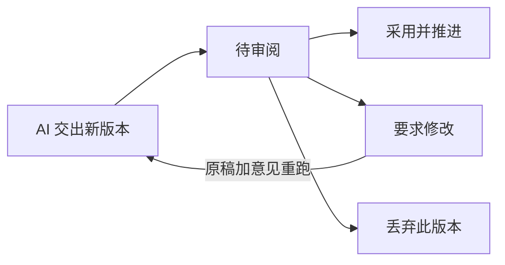
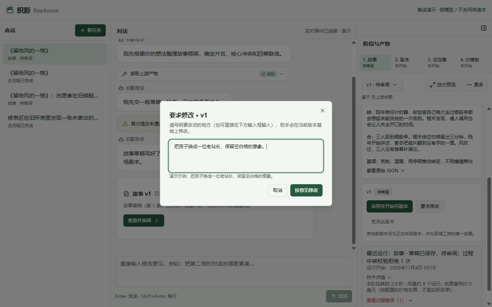
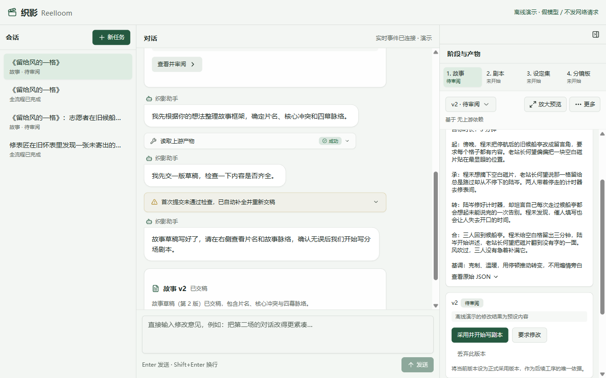

# 第 3 章 · 让人签字把关

> 上一章：[第 2 章 · 跑出第一份稿](./p02.md) · 下一章：[第 4 章 · 长剧本拆开写](./p04.md) · [本篇入口](../README.md)

## 从一个场景开始

上一章跑通了受限会话，AI 交上了《留给风的一格》的故事第 1 版。你点开右栏产物面板一看，发现它把核心冲突写成了“年轻志愿者和孩子争抢最后一块空白磁片”。

你觉得故事骨架能用，但争抢的火药味太重，想把孩子改成老站长，保留空白格的意象。

如果像普通聊天机器人那样，在输入框里随口回一句“把孩子换成老站长，保留空白格”，往往会碰上两件糟心事：

- AI 在重写时顾此失彼，把第 1 版里原本已经定好的片名、3 分钟计划时长或四幕脉络改丢了，还顺手覆盖了原来的第一版。
- 要是系统没有人工签字环节，上一秒刚交上来的不满意初稿，下一秒就已经流向下游去写分场剧本了，一步偏、步步偏。

核心问题是：**初稿和定稿没有分开，修改意见也没有和原稿绑定在一起**。

## 这一章要解决什么

这一章在「故事」草稿和下游「剧本」工序之间立起一道人工审阅门，把“人工拍板签字”与“带原稿结构化改稿”接进网页闭环。

为什么在进入剧本前必须让人签字？因为几百字的故事改起来只需几秒钟；一旦放任带病的故事流入几千字的剧本和分镜板，后续返工成本会成倍增加。

本章区分工序状态与版本审阅状态，提供「采用、要求修改、丢弃」三种审阅决定，并在点击“采用并开始写剧本”后由服务端直接启动下一道工序。

> **一句话记住**：AI 交来的每份稿子都只是候选，人工在采用、修改、丢弃中拍板；只有签了字的一版才准往下走。

## 报社专栏与记者稿件：分清工序状态和版本状态

为什么不能把“AI 交稿了”直接当成“这道工序定稿了”？

想象一家报社的编辑部。墙上的进度板写着某个专栏的版面状态：是在等记者交稿、有新稿待主编审阅，还是已经签字定版；而主编办公桌上摆着的第 1 版、第 2 版打印稿，则是记者交来的具体稿件，每份稿件上分别盖着“待审阅”“要求修改”“已丢弃”或“已采用”的印章。

在织影里，这两套状态严格分开：

- **工序状态（看版面进度）**：显示在右栏工序条上，共有“未开始、进行中、待审阅、已采用、待更新”五种，回答的是“这道工序现在停在哪一步”。
- **版本审阅状态（看单篇稿件）**：显示在右栏产物面板的版本选择器与签字区，共有“待审阅、已采用、要求修改、已丢弃”四种，回答的是“这一版草稿怎么判”。

为什么草稿生成不需要人工提前审批，而采用却必须人工签字？

因为生成新草稿只是在版本库里多存一份候选文件（如第 2 版），既不会覆盖第 1 版原稿，也不会改动下游产物，属于低风险动作；真正影响全局的动作，是“把哪一版定为下游工序的唯一开工依据”。因此，审阅门精准设在“采用定稿”这一步。

## 三种审阅决定：采用、要求修改、丢弃

当故事第 1 版停在“待审阅”状态且生成已结束时，右栏产物面板的预览下方签字区会亮起三个操作按钮，对应人工审阅的三种决定：

| 审阅决定 | 签字区按钮名称 | 对当前版本的影响 | 对工序与下游的影响 |
|---|---|---|---|
| 采用 | 采用并开始写剧本 | 当前版本标记为“已采用”，成为正式定稿 | 「故事」工序变为“已采用”，服务端立即启动下一道「剧本」工序 |
| 要求修改 | 要求修改 | 记录修改意见，当前版本标记为“要求修改”，原稿完整保留 | 不解锁下游；点击“按意见修改”后基于该版本生成新版本 |
| 丢弃 | 丢弃此版本 | 当前版本归档为“已丢弃”，不可再被采用 | 不解锁下游；若无其他待审或采用版本，工序回退至可重新生成状态 |

这里有两条保护历史现场的产品规矩：

第一，**丢弃不删文件**。点击“丢弃此版本”时，界面会说明：“将当前版本归档为已丢弃，不进入下游工序；历史记录仍会保留。”为什么不直接从硬盘删掉？因为团队复盘时经常需要回看“之前试过哪个废案、当时为什么没选它”。保留历史版本供随时切换查阅，同时把已丢弃版本的采用按钮置灰（提示“此版本已丢弃，不可采用。如需恢复可基于其它版本要求修改。”），既防误用又留住了试错过程。

第二，**审阅决定留痕**。每次点击采用、要求修改或丢弃，服务端都会在项目的本地操作记录里追加一条记录，写明时间、工序、版本号、操作类型与修改意见，做到每次拍板都有据可查。

## 钉在原稿上的审稿批注单：结构化改稿

回到开场的难题：当你只想把孩子换成老站长并保留空白格的意象，怎么防止 AI 在改稿时把原本定好的片名、时长和四幕结构改丢？

在编辑部里，主编退稿不会只在走廊里冲记者喊一句“改温和点”，而是会把一张写明具体意见的《审稿批注单》用订书机钉在原稿第 1 版上，连同原稿一起退回给记者。记者看着原稿改，没批注的段落自然照旧保留。

在织影里，这套机制叫结构化改稿：

| 对比维度 | 普通聊天框随口提意见 | 织影的结构化改稿 |
|---|---|---|
| 修改基准 | 靠模型在冗长的聊天记录里自己找 | 明确指定基于哪一个版本号修改 |
| 模型收到的输入 | 只有一句孤零零的修改要求 | 程序将“原稿完整内容 + 本次修改意见”打包拼入提示词 |
| 原稿命运 | 容易在对话滚动中被遗忘或覆盖 | 原稿第 1 版文件不可覆盖，改完另存为第 2 版 |
| 未提及的设定 | 片名、时长、四幕结构容易随重算漂移 | 提示词要求除修改意见涉及处外，保持原稿结构与设定一致 |

织影在界面上提供了两处提修改意见的入口，怎么顺手怎么用：

1. **在右栏签字区提意见**：点击“要求修改”次按钮，弹窗显示修改意见输入框，提示“请写明要改动的地方（也可直接在下方输入框输入），助手会在当前版本基础上修改。”填入“把孩子换成一位老站长，保留空白格的意象。”后，点击弹窗里的“按意见修改”确认按钮。
2. **在对话区输入框直接发消息**：当项目中有工序处于“待审阅”时，对话区底部的输入框会自动切换占位提示：“直接输入修改意见，例如：把第二场的对话改得更紧凑…”。在这里直接发送文字，服务端会将其作为依赖顺序最前一道工序的最新待审版本的修改意见，并立即启动改稿运行。

为什么要把右栏面板的“要求修改”和“按意见修改”拆成两步？因为构思和填写批注是人的决策过程，不花一分钱模型额度；只有点击“按意见修改”才是正式派单叫 AI 开工。如果未填意见就误点确认，界面会拦住并提示：“请先填写具体的修改意见。”

## 采用即推进：签字盖章，直通下一关

点击“按意见修改”后，受限会话带着第 1 版原稿和你的批注启动运行，生成并通过格式检查后落盘为故事第 2 版。

此时右栏产物面板顶部的版本选择器自动切换到第 2 版（你随时可以点下拉框切回第 1 版对比改动）。在离线演示里，修改结果是预设内容：片名《留给风的一格》、3 分钟计划时长与四幕结构保留，孩子麦冬换成了老站长何望；真实模型的改稿结果仍需逐项核对。

再看点击采用前的右栏签字区：主按钮文案清楚写着“采用并开始写剧本”，旁边配有“要求修改”与“丢弃此版本”次按钮，下方附有小字说明：“将当前版本设为正式采用版本，作为后续工序的唯一依据。”

当你点击“采用并开始写剧本”，服务端在一个连贯动作里完成两件事：

1. 将故事第 2 版标记为“已采用”，右栏工序条中「故事」状态变为“已采用”。
2. 立即启动下一道「剧本」工序，右栏工序条中「剧本」状态变为“进行中”，对话区随即开始推送剧本编写进度。

这种“采用即推进”的设计，省去了用户先点采用、再去工序条切换工序、再找开始按钮的三步繁琐操作。前 3 道工序的主按钮文案各自写明下一步去向：

- 第 1 道「故事」：**采用并开始写剧本**
- 第 2 道「剧本」：**采用并开始整理设定集**
- 第 3 道「设定集」：**采用并开始制作分镜板**
- 第 4 道「分镜板」：**采用并完成**

如果用户在「故事」已经推进到下游之后，又切回故事第 2 版查看，签字区主按钮会置灰并提示：“当前版本已采用，无需重复确认。”服务端对同一版本的重复采用请求保持幂等，不会再次触发下游重复运行。

同时，AI 的“读取上游定稿”工具在代码层锁死了只读已采用版本：只要故事还没有任何一版被点击采用，哪怕故事已经有第 1 版、第 2 版躺在待审阅列表里，下游「剧本」也读不到半个字，更无法提前开工。

## 这一章你学到了

1. 工序状态与版本状态要分开：右栏工序条反映这道工序走到哪一步，右栏产物面板里的版本号反映单篇候选稿的审阅结论。
2. 人工通过“采用、要求修改、丢弃”掌管放行权；历史版本只增不改，丢弃版本保留存档供复盘但不可采用。
3. 改稿不能靠聊天印象盲改：程序必须把选定版本的原稿全文与修改意见绑在一起喂给模型，签字采用后再由服务端直接启动下一道工序。

## 产品拍板

- 新生成的草稿一律先停在“待审阅”，未经人工点击采用，不得作为下游工序的输入依据。
- 改稿必须绑定原稿：服务端读取指定版本的完整原稿与人工修改意见，拼成结构化改稿提示词，生成新版本并保留旧版本不变。
- 支持右栏签字区“要求修改 → 按意见修改”分步操作，也支持在待审阅态直接从对话区输入框发送修改意见触发改稿。
- 采用即推进：首次采用故事、剧本、设定集时，服务端直接启动下一道工序，直至分镜板点击“采用并完成”。

## PM 该追问什么

1. 当故事只有“待审阅”或“要求修改”的版本时，直接调用接口启动剧本工序会被服务端拦下吗？
2. 发起按意见修改时，传给大模型的请求里是否一字不差包含了原稿全文和用户填写的修改意见？
3. 丢弃某个版本后，它的历史文件是否还保留可查？有没有人能绕过前端按钮，调接口把已丢弃版本设为采用？
4. 按意见修改生成第 2 版失败或中途中断时，原本的第 1 版原稿会不会被破坏？
5. 对同一个已经采用的版本重复发送采用请求，服务端会不会误触发下游工序再跑一遍？

## 动手的人看这里

> 这一节写给要动手实现的人。只想理解产品思路，可以跳到章末。

本章关注**版本审阅状态机、结构化改稿与采用推进**模块，对应文件如下：

- `src/project/store.ts`：在 `ProjectStore` 中管理版本文件（`v1.json`、`v2.json`）与 `pending | adopted | discarded | changes_requested` 四种审阅状态，追加写入 `audit.jsonl`。
- `src/agent/run.ts`：构建 `revisionContext`，将基准版本原稿全文与修改意见拼入改稿提示词并启动会话。
- `src/server/index.ts`：处理审阅路由；`src/server/runs.ts` 处理对话区 `POST /api/projects/:id/messages` 待审改稿分流，以及首次采用后的下一道工序启动。
- `web/src/features/artifacts/components/ReviewPanel.tsx`：渲染右栏签字区主次按钮、修改意见输入框与各禁用原因提示。
- `src/project.test.ts`、`src/conversation.test.ts`：验证版本状态流转、原稿保留、结构化改稿与采用推进的离线测试。

**实现要点**：

1. 在 `ProjectStore` 中维护每个版本的 `pending | adopted | discarded | changes_requested` 状态，版本文件按递增编号写入 `v1.json`、`v2.json`，禁止覆盖历史版本。
2. 支持在右栏点击“要求修改”打开弹窗、填写批注，再点“按意见修改”保存批注并启动生成，也支持在待审阅态通过 `POST /api/projects/:id/messages` 直接发送修改意见启动改稿；由 `revisionContext` 将原版本 JSON 与修改意见拼入提示词生成新版本。
3. 首次采用 `story`、`script`、`bible` 时，若没有其他待审稿且紧邻下一道处于可运行状态，服务端尝试启动它；配额或启动失败时保留采用结果并提示，重复采用同一版本不重复触发运行。

在 `book/build` 执行 `npm test -- src/project.test.ts src/conversation.test.ts` 与 `npm run typecheck` 可完成离线验证。

**给 AI Coding 的任务描述**：

> **文件**：`src/project/store.ts`、`src/agent/run.ts`、`src/server/index.ts`、`src/server/runs.ts`、`web/src/features/artifacts/components/ReviewPanel.tsx`、`src/project.test.ts`、`src/conversation.test.ts`。
> **意图**：在 `ProjectStore` 中维护版本的 `pending | adopted | discarded | changes_requested` 审阅状态与不可覆盖的版本文件；支持右栏“要求修改”与对话区 `POST /api/projects/:id/messages` 触发带 `revisionContext` 的结构化改稿；首次采用 `story`、`script`、`bible` 时由服务端直接启动下一道工序，重复采用保持幂等。
> **验收**：未采用上游时下游拒绝运行；已丢弃版本不可直接采用；按意见修改生成 `v2` 且保留 `v1` 不变；首次点击采用自动触发下一道工序。

---

[下一章 · 第 4 章 · 长剧本拆开写](./p04.md) 进入第 2 道「剧本」工序，看看面对几千字的多场剧本，怎样拆成独立场次逐场提交、逐场检查，并且在改稿时只重交需要改的那一场。

<!--
需要的截图：
1. p03-01-request-changes.png
   - 演示中的哪一步：在右栏「故事」第 1 版审阅区点击“要求修改”（或在对话区底部输入框直接输入修改意见）。
   - 画面内容：右栏弹出修改意见对话框（提示文字“请写明要改动的地方（也可直接在下方输入框输入），助手会在当前版本基础上修改。”），填入“把孩子换成一位老站长，保留空白格的意象。”，下方显示“按意见修改”确认按钮；同时可见对话区底部输入框待审阅占位提示“直接输入修改意见，例如：把第二场的对话改得更紧凑…”。
2. p03-02-story-v2-adopt-and-advance.png
   - 演示中的哪一步：点击“按意见修改”生成故事第 2 版后，在右栏签字区准备点击主按钮“采用并开始写剧本”。
   - 画面内容：取点击采用前的故事第 2 版待审阅状态：右栏工序条中「故事」为“待审阅”，版本选择器切换为“v2 · 待审阅”，上方展示修改后的故事内容；下方签字区显示主按钮“采用并开始写剧本”（下方小字“将当前版本设为正式采用版本，作为后续工序的唯一依据。”），旁有次按钮“要求修改”与“丢弃此版本”。
-->
