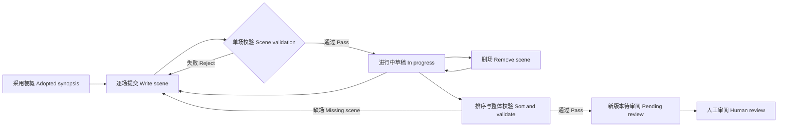

# P04 · 剧本：把输出预算变成产品规则 / Script and Output Budget

> 上一章：[P03 · 选题与梗概](./p03.md) · [本篇入口与运行命令](../README.md)

## 这一章解决什么问题

梗概只有四个叙事拍，三分钟剧本却可能有多场动作与对白。如果要求模型一次提交整份 JSON，即使故事想得清楚，也可能在结尾之前用完输出额度。缺一个括号就无法解析，已经生成的大半份文字也不能成为合规产物。

解决方法是改变提交单位：模型一次交一场，程序收齐后组装成剧本。对 PM 来说，输出预算应影响产品契约、失败恢复与验收方式，不能只藏在模型配置中。

## 单次输出上限与上下文上限

本包 `pi-agent/models.json` 配置的 `maxTokens` 为 **2048**，`contextWindow` 为 **32768**。两者回答不同的问题：

| 预算 | 限制什么 | 对剧本的影响 |
|---|---|---|
| 单次输出上限 | 一次模型响应最多生成多少 token，包括工具参数 | 一次输出完整剧本可能截断；改为逐场提交 |
| 上下文上限 | 一次请求可容纳的输入与输出总量 | 系统提示、采用梗概、历次工具参数、结果和待生成输出共同占用空间 |
| 阶段轮数上限 | 一次运行最多允许多少轮模型响应 | 防止模型无限修正或反复调用工具 |

token 不等于汉字数，也不等于分钟数。2048 不能解读成“必定装下 2048 个汉字”。32768 的上下文窗口也不意味着单次能输出 32768。实际可用空间还受模型与供应商限制；配置上限不是创作长度保证。

逐场提交解决的是单次输出过长。它没有消除上下文增长：旧场参数和工具结果仍在会话里。本包关闭自动压缩；多场长对白仍可能超过窗口，单场特别长也仍可能截断。因此不能声称“分场后任意长度都能生成”。这里以短片为范围；更长内容需要进一步拆分单场、裁剪上下文或设计摘要与恢复机制。

## 从一份大 JSON 到两种提交动作

`src/agent/session.ts` 为剧本只注册四种工具：

- `read_upstream({"stage":"synopsis"})`：只读人工采用梗概，不能指定候选版本或任意路径。
- `write_scene({"scene": {...}})`：校验单场后暂存；同 `scene_id` 重交会替换暂存内容。
- `remove_scene({"scene_id":"S02"})`：从暂存区删除一场，不修改原版本；后续场号需显式重排。
- `finalize_draft({})`：按场号排序，整体校验，通过后追加一个 `pending` 版本。

剧本没有 `write_draft`，不能通过另一种模型工具绕过逐场流程。选题与梗概仍使用 `read_upstream` 和 `write_draft`。阶段与采用关系继续由外层状态机控制。

单场参数示例：

```json
{
  "scene": {
    "scene_id": "S01",
    "heading": "外景·旧候船亭·傍晚",
    "summary": "程禾决定暂时保留时刻表上的空白格。",
    "lines": [
      { "kind": "action", "text": "程禾放下磁片，转身望向修表间。" },
      { "kind": "dialogue", "character": "程禾", "text": "这一格先不填。" }
    ]
  }
}
```



`src/agent/script-draft.ts` 管暂存区。一场失败不会污染已经合规的场，也不会覆盖原有暂存内容；同编号的合规重交只替换暂存场，不覆盖历史版本。`finalize_draft` 成功后本次暂存区封口，再写场或重复汇总会被拒，避免一次运行反复产生相同版本。

## 哪些问题拒绝，哪些问题提醒

schema 检查字段、类型、非空文字、编号格式、行类型与额外字段。程序还检查完整剧本的跨场关系；这些规则不能靠提示词里的“请自查”保证。

| 检查 | 处理 | 理由 |
|---|---|---|
| 场号符合 `S` 加两位数字 | 拒绝不合规单场 | 场号是稳定引用，不接受 `S1` 或任意路径 |
| 每场至少一行；`dialogue` 必须有非空 `character` | 拒绝不合规单场 | 台词必须知道谁说，空场不是可用剧本 |
| `action` 不得有 `character` | 拒绝不合规单场 | 动作行与台词行契约明确，不能混用字段 |
| 排序后从 `S01` 连续 | 汇总时拒绝 | 缺首场、缺中间场都不能形成版本；重复编号是替换暂存 |
| 场数与梗概 `beats` 数量不同 | 汇总成功但给警告 | 叙事拍是故事转折，场是空间与时间组织；一拍可拆多场，多拍也可发生在一场 |

例如先交 S03，再交 S01，单场都可暂存；汇总时提示缺 S02。补齐后按 S01、S02、S03 拼装，与调用先后无关。`ProjectStore.writeDraft` 在真正写文件之前也检查完整结构，内部调用存储层不能绕过连续编号规则。

示例的四拍梗概展开为三场，汇总会提醒“剧本 3 场，梗概 4 拍”。警告记录在工具结果与结束快照中，页面的汇总卡片也会显示；它不算工具错误，不阻止待审阅版本生成。场数相等只代表没有这条数量提醒，不证明故事完整。是否遗漏转折、人物选择是否成立，仍由人审阅。

## 为什么不同阶段需要不同轮数

`src/agent/run.ts` 的 `STAGE_TURN_LIMITS` 明确配置：选题 8 轮、梗概 8 轮、剧本 20 轮。尚未开放的阶段不会因为有预算就变成可运行。

一轮指一次模型响应，不是一个汉字，也不是固定一次工具调用。三场剧本的常见路径是：读梗概 1 轮、逐场 3 轮、汇总 1 轮、结束说明 1 轮；失败再修正需要额外空间。把所有阶段都限制为 8 轮，会让场数稍多的剧本过早停止；无限放宽又容易增加等待与失控消耗。20 是短片范围内的初始保护值，应结合实际场数、失败率、耗时与上下文占用调整，不是质量分数。

程序在模型响应和工具执行后检查轮数。达到上限且模型仍在调用工具时，记录 `max_turns` 并结束，不再请求下一轮。若最后允许的一轮已经汇总成功，版本仍保留，但运行上限结论不改写成普通成功，便于检查预算是否合理。

## 暂存区与版本的区别

暂存区只属于本次运行，保存在内存中。只有汇总通过才形成版本，并继续使用采用、丢弃、要求修改三种审阅决定。剧本待审时设定集仍锁定；模型不能自行采用。

模型只交场却没汇总时，记录 `no_draft`；中断、模型失败、运行异常或超限时保留真实结束原因。**未汇总的场不会变成版本**。每次工具调用、结果留在 SDK 会话里，`stage_run_end.in_progress` 另记已接收场、汇总版本号与警告。开始条目记录模型、提示、工具名单、上下文说明与 `max_turns`；结束条目还记录耗时、响应轮数、错误和 `stop_reason`。

普通运行从空暂存区开始，不继承旧运行的暂存区；这些记录用于追溯，没有自动恢复草稿的承诺。进程突然退出时可能来不及写结束快照，仍可检查此前已落盘的工具事件。若先前已经汇总成功，后续中断不删除已形成的待审版本。

## 修改时只重写受影响的场

若意见只要求改 S02，却让模型重写 S01、S02、S03，会多花两场的输出预算，也可能让没要求改的动作或台词一起漂移。剧本修改采用“程序预装原稿，模型只交差量”的契约：

1. 人对 v1 要求修改，再显式发起 `revise_from: 1`。程序复核来源必须是有意见的 `changes_requested` 版本。
2. `ScriptDraft.reset(1)` 读取并复制 **v1 的全部场**，而不是挑最新候选，也不是加载失败运行的半成品。程序仍把原稿 JSON 与意见原文带进用户提示。
3. 模型只用 `write_scene` 重交受影响的 S02。S01、S03 不经过模型重写，由程序原样沿用；无效重交不覆盖已预装的场，也不计入成功重交记录。
4. `finalize_draft` 对完整暂存区重新排序与校验，写成新的待审阅版本；原版本的文件与意见保持不变。

这是**输出预算与一致性保护**：少输出未改内容，避免无关场随生成而变化。它保证没有重交的场保持原样，不保证模型能正确理解“哪些场该改”；审阅人仍需检查重交场及其与上下文的衔接。原稿全文仍占输入窗口，差量输出没有消除输入预算。

意见要求删场时，调用 `remove_scene`。例如删掉原 S02 后只剩 S01、S03，汇总会拒绝并提示应有 S02、需要补齐或重排。若确实要删去第二场，应先保留原 S03 的内容，把它以 S02 重交，再删掉残留的 S03；工具不自动替模型改号。最终原 S03 的内容位于新 S02，需要人工核对场号关系。删除不存在或格式不合法的场会报错。

`stage_run_start` 记录预装来源及初始沿用场；结束摘要、`stage_run_end` 与 `in_progress` 快照中的 `scene_changes` 记录来源版本 `revise_from`、当前稿中成功重交或新增的场 `resubmitted`、仍沿用来源的场 `reused`、已删除且未重新加入的场 `removed`，场号均排序。逐次工具事件保留全部操作历史；删除后重建同编号的场算重交，已重交但又删除的场只列入删除项。这是按场号的操作记录，不是逐字 diff，也不自动判断重排前后的内容身份。

网页汇总成功卡片显示“本版相对 v1：重交/新增 S02；沿用 S01、S03；删除 无”，帮助人确认修改范围。字段原文可展开工具结果查看。普通运行没有 `revise_from`，即使已有候选版本也从空暂存区开始。修改中断时不产生半成品版本，seed 来源与已接收改动仍记在会话中；下次要修改仍须明确指定来源。

## 离线看一次失败与修正

在 `book/build` 运行：

```bash
HARNESS_DEMO=1 npm run dev
```

打开 `http://127.0.0.1:5173`：

1. 新建项目，运行选题，预览并采用；切到梗概，运行、预览并采用。
2. 切到已解锁的“剧本”，点击“运行阶段”。左侧先出现读取采用梗概的卡片，再出现漏填台词角色的 `write_scene` 错误卡片与可读原因。
3. 随后的 `write_scene` 补齐角色并成功，继续提交 S02、S03。此时尚未生成剧本版本。
4. `finalize_draft` 卡片成功后，右侧自动选中 v1，显示“待审阅”与剧本 JSON；汇总卡片提醒三场与四拍的区别。可展开原始结果核对警告。
5. 保持剧本 v1 未采用，点“要求修改”。演示预填“只修改 S02：让程禾先询问陆岑是否愿意讲述，其他场保持原样。”；保存后点“按意见修改 v1”。
6. 左侧只出现一次 S02 的成功 `write_scene`，随后汇总为 v2；汇总卡片标明相对 v1 重交 S02、沿用 S01 与 S03。右侧自动选中待审阅 v2，S02 对白体现征求意愿；可切回 v1 核对，其余场保持原样。
7. 截图后按需要决定采用、丢弃或要求修改。结束后按 Ctrl+C 关闭自己启动的两个服务。

假模型使用固定原创示例，不理解任意补充要求；若采用梗概包含示例老站长，剧本固定示例同步替换角色。剧本修改同样是固定的 S02 示例，自定义意见会提示预设结果。它不证明真实模型能完成三分钟创作，但真实工具、schema、状态机、版本和 SSE 都会运行。

验证截图可分别覆盖：逐场工具卡片；单场拒绝原因与随后成功重交；汇总卡片和右侧待审阅剧本预览；修改意见预填、只重交 S02、v2 与相对 v1 的场号说明。离线检查执行 `npm test`、`npm run typecheck`、`npm run build`；测试覆盖单场坏数据、同编号覆盖、乱序拼装、缺场拒绝、未汇总与中断不出版本、seed 后只改一场、沿用场逐字一致、删场与重排、普通运行空暂存区、工具白名单、阶段轮数上限和 HTTP/SSE 演示闭环。

## 给 AI Coding 的任务描述

> **文件**：`src/contracts/index.ts`、`src/agent/script-draft.ts`、`src/agent/session.ts`、`src/agent/prompts.ts`、`src/agent/run.ts`、`src/server/demo.ts`、`src/server/runs.ts`、网页工具卡片及对应离线测试。  
> **意图**：把长剧本从整份输出改成逐场输出、程序组装；让失败停在明确的场，不让半成品成为版本。  
> **验收**：剧本只开放读采用梗概、提交单场、删场、汇总四工具；坏场被拒且可修正，同编号可替换；乱序提交排序正确，场号必须从 S01 连续；每场非空，台词有角色，动作无角色；数量与叙事拍不等只警告；未汇总不出版本，汇总通过后新版本待审阅；中断与错误留痕；剧本 20 轮而选题、梗概 8 轮；修改时预装指定原稿、只重交受影响场，其余场原样沿用；删场缺号要求重排；摘要与会话记录来源和场号改动；离线页面可看到失败、修正、只改 S02 的 v2 和场号说明。  
> **边界**：不靠提高单次输出上限解决长文本；不实现暂存区自动恢复、后续阶段创作、已采用阶段返工、鉴权或真实模型验收。

## 产品拍板

- 提交单位采用单场，版本单位仍是完整剧本；用户只审完整版本。
- 编号连续、台词角色与行类型是确定性硬规则，由程序拒绝坏数据。
- 场数与叙事拍数量不绑定；数量提醒帮助审稿，不替代故事质量判断。
- 阶段预算显式配置并记入会话，便于发现“好稿被截断”和“坏循环耗尽额度”。
- 中断时暂存场可追溯，但不冒充已保存版本，也不暗示自动恢复。
- 修改时显式指定原稿，未重交的场由程序原样沿用；删场要检查重排，按场号说明改动范围。

## PM 该追问什么

1. 这份长文本受限于单次输出、输入窗口，还是总轮数？有哪项真实证据？
2. 一场失败时是只重交该场，还是整份重来？已经通过的场会受影响吗？
3. 未汇总时页面是否出现了可采用版本？中断后能在哪里查到已提交的场？
4. 场号缺一场、乱序、重复时各会怎样？直接调用存储层是否同样拒绝坏结构？
5. 为什么三场四拍只是提醒？四场四拍就能证明故事完整吗？
6. 20 轮预算为读上游、修正、汇总预留多少空间？极限一轮已保存版本时如何报告？
7. 修改一场时其他场有没有经过模型重写？汇总卡片能否说明相对哪一版重交、沿用、删除了哪些场？
8. 分场后上下文仍在增长，有没有错误宣称长篇也能无限生成？

接下来可以从人采用的完整剧本抽取角色、道具与场景；稳定引用的依据应是已审版本。
