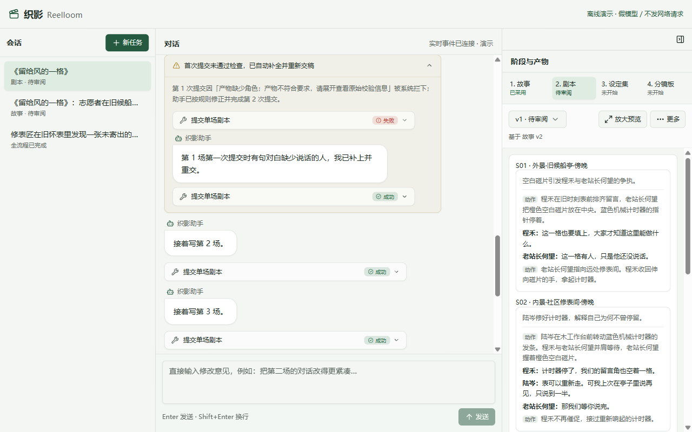
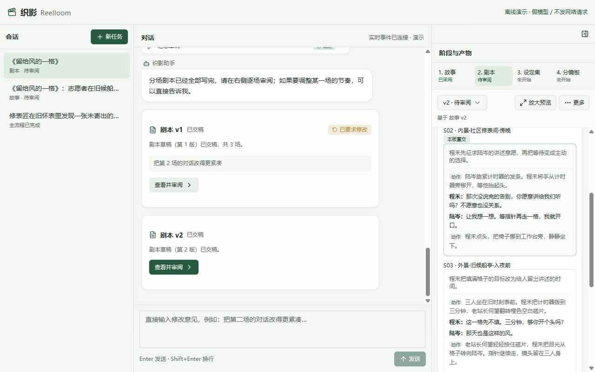

# 第 4 章 · 长剧本拆开写

> 上一章：[第 3 章 · 让人签字把关](./p03.md) · 下一章：[第 5 章 · 角色道具先对上号](./p05.md) · [本篇入口](../README.md)

## 从一个场景开始

《留给风的一格》的故事签字定稿后，系统自动进入第 2 道「剧本」工序，需要顺着起承转合写出旧候船亭、修表铺、回到旧候船亭三场戏的完整人物动作与台词。

如果还像上一章写故事那样，让 AI 一次把整部剧本几千字全吐出来，很快就会撞上两堵墙：

- 它往往第 1 场候船亭写得很细致，写到第 3 场就因为单次输出太长开始敷衍收尾，甚至漏掉某句台词是谁说的，或者在结尾前因为用完单次输出额度而半截断开。
- 更头疼的是改稿：当你审阅剧本第 1 版，只觉得第 2 场修表铺的一句台词太啰嗦，想让它改紧凑一点，整篇重跑却会把第 1 场和第 3 场原本很满意的对白也随机洗牌重来。

核心问题是：**单次生成超出了模型的稳定输出预算，缺少按场拆分的暂存与局部改写机制**。

## 这一章要解决什么

这一章把第 2 道「剧本」工序从“整篇一次交稿”改成“按场提交、逐场检查、收齐汇总”，并在按意见修改时实现只重交改动场次的局部返工。

为什么要在剧本阶段把提交颗粒度拆到每一场？因为剧本是全片篇幅最长、台词与动作最密集的环节，不在这一步管住单次输出体量和改稿范围，后面每次微调台词都会变成全篇重抽盲盒。

本章在受限会话中提供按场暂存按钮，写完一场当场核验一场；改稿时先把上一版各场预装进暂存区，AI 只需重交改动的那一场，其余场次原封不动。

> **一句话记住**：长文一口气吐完容易烂尾；拆成独立场次逐场过筛，改动时哪场要改只换哪场。

## 盖楼分层验收：输出预算与按场暂存

为什么大模型写几百字的故事很稳，一写几千字的多场剧本就容易虎头蛇尾或漏填栏目？

每次模型回复都有固定的单次输出预算。就像让一个人一口气背诵几千字的长文，越往后越容易漏词、串行；一旦超过单次输出上限，文字还会在半途截断，连基本的结构都不完整。

解决办法就像盖大楼的分层验收：施工队不能一次浇筑三十层，必须盖好一层、监理验收一层，哪一层钢筋不对当场返工重做，等全部楼层都验收合格后再封顶交付。

在织影里，这套分层交验机制叫按场暂存。进入「剧本」工序后，程序收走了整篇提交草稿的按钮，换上四个按场配合的专属按钮：

| AI 能按的按钮 | 允许做什么 | 程序在背后拦住什么 |
|---|---|---|
| 读取上游定稿 | 读取已采用的「故事」定稿，获取片名、计划时长与起承转合四幕脉络 | 拒绝读取未采用的故事草稿，不接受任意文件路径 |
| 提交单场剧本 | 每次提交一场戏（如第 1 场），通过单场检查后存入暂存区 | 场号格式不对、场景标题空白或台词缺说话人时当场退回，不污染暂存区已有好数据 |
| 移除单场剧本 | 从当前暂存区移除指定场次（用于删减场次后重排） | 拒绝移除不存在或编号不合规的场次，不修改已落盘的历史版本 |
| 汇总完整剧本 | 将暂存区里的各场按场号排序，检查连续无缺漏后生成待审阅新版本 | 暂存区为空、缺首场或中间跳号时拒绝汇总，提示缺哪一场 |

可以看到，AI 手里没有“一次交整篇剧本”的捷径。它必须写完一场交一场，过筛一场存一场。

## 写一场验一场：单场硬规则与自我修正

把长剧本拆成单场提交后，程序在“单场存入暂存区”和“最终汇总成版”两个关口分别执行严格的格式检查：

| 检查关口 | 具体核对规则 | 为什么必须由代码硬查 |
|---|---|---|
| 单场入暂存区 | 场号符合 `S01`、`S02` 规范；场景标题和概要非空（地点与时间是否交代清楚由人审阅） | 保证每一场都有稳定的场号索引，便于人工核对时间空间设定 |
| 单场台词核对 | 每场至少一行动作或对白；台词行必须带非空说话人；动作行不得混入说话人字段 | 防止出现“没写谁说的台词”或动作与对白字段混淆 |
| 覆盖保护 | 若重交同一场号时格式不合规，拒绝本次提交并保留暂存区里原有的合规场次 | 防止一次失误把前面已经验好的同场好数据冲掉 |
| 汇总封顶 | 按场号排序后必须从 `S01` 起连续不跳号（如 `S01`、`S02`、`S03`） | 哪怕先交了 `S03` 和 `S01`，漏了中间的 `S02` 也不准生成残缺版本 |

当你在上一章点击“采用并开始写剧本”后，右栏工序条中「剧本」变为“进行中”，对话区首先显示助手开场话术：“故事已确认，接下来我按起承转合拆出分场剧本，逐场写清场景、人物动作与对白。”

离线演示中，AI 第一次提交第 1 场时有句对白漏了说话人，单场检查当场退回，不写入暂存区。AI 只需补上说话人重新提交，接着再交第 2、3 场并调用汇总按钮；若后续场次提交失败，之前已暂存的好数据同样不受影响。

对话区展开“首次提交未通过检查，已自动补全并重新交稿”后，可见第 1 场失败的单场提交、助手说明“第 1 场第一次提交时有句对白缺少说话的人，我已补上并重交。”与成功重交记录，下方接着显示第 2 场、第 3 场的提交记录；向上或向下滚动对话区可查看开场话术、收尾话术与“剧本草稿（第 1 版）已交稿，共 3 场。”卡片。

右栏产物面板同步展示分场剧本预览，当前视口可见 `S01` 与 `S02`（向下滚动可查看 `S03`）。

## 换单个故障零件：局部改稿只重交那一场

现在右栏产物面板里躺着待审阅的剧本第 1 版。你逐场读下来，觉得第 1 场候船亭和第 3 场回到旧候船亭的情绪很到位，唯独第 2 场修表铺里程禾与陆岑的对白略显拖沓。

你在对话区底部输入修改意见“把第 2 场的对话改得更紧凑”并发送，或在右栏点击“要求修改”，在弹窗中填好意见再点“按意见修改”。离线演示只展示第 2 场的固定修改示例，不解释任意修改意见。

这就像汽车雨刷坏了去修理厂：师傅只需要把旧雨刷拆下来换副新的，犯不着把完好的发动机、变速箱和底盘全拆了重装一遍。

在织影里，剧本改稿采用“原稿预装暂存区 + 只重交改动场次”的局部返工机制：

1. **原稿预填暂存区**：改稿会话启动前，程序先从版本库读取剧本第 1 版的全部场次（`S01`、`S02`、`S03`），原封不动装入本次运行的暂存区。
2. **只重交受影响场次**：程序把第 1 版剧本全文与你的修改意见“把第 2 场的对话改得更紧凑”传给 AI。AI 看到暂存区里三场戏已经齐备，只需调用“提交单场剧本”按钮重新提交改紧凑后的 `S02`，替换暂存区里的旧 `S02`。
3. **其余场次原样沿用**：替换完 `S02` 后，AI 直接调用“汇总完整剧本”生成剧本第 2 版。整个过程中，第 1 场 `S01` 和第 3 场 `S03` 根本不经过模型重写，由程序从预填暂存区里原样带入新版本。

| 对比维度 | 整篇重写整部剧本 | 按场预填局部改写 |
|---|---|---|
| 模型输出体量 | 把三场戏从头到尾重吐一遍，耗时且费额度 | 只输出需要改动的第 2 场，省时省额度 |
| 未改动场次安全性 | 第 1 场和第 3 场的满意台词可能被模型顺手改乱 | 第 1 场和第 3 场不经模型重写，与上一版逐字一致 |
| 审阅核对成本 | 审阅人得把三场戏从头再读一遍防漏改 | 预览高亮重交场次，签字区标明“相对 v1：重交 S02；沿用 S01、S03” |

当剧本第 2 版生成完毕，对话区显示带修改意见的剧本 v1 卡片与剧本 v2 交稿卡片；右栏产物预览切换为“v2 · 待审阅”，为重交的第 2 场 `S02` 标出“本版重交”高亮标签，下方展示未重交的 `S03`。

向下滚动到右栏底部签字区，会标明“相对 v1：重交 S02；沿用 S01、S03”。你可以只核对第 2 场的新台词，确认满意后点击签字区主按钮“采用并开始整理设定集”，定稿剧本并启动下一道「设定集」工序。

## 暂存区封口与轮数保护：半成品不冒充版本

既然剧本分成了多步提交，要是写到第 2 场时用户点了“中断”，或者模型反复报错没能凑齐三场戏，暂存区里的两场半成品会不会变成一个残缺的第 2 版？

不会。程序在暂存区和正式版本之间立了三道保护：

- **未汇总不出版本**：暂存区与正式版本分开保存，可以显式选择从暂存继续或重新开始。只要还没走完“汇总完整剧本”并通过连续性检查，中途中断或报错都不会生成新版本号，上一版完整剧本依然保留不变。
- **单场检查点留痕**：每次成功提交或移除单场，程序都会将暂存进度与场次变动写入检查点记录，方便随时排查运行停在了哪一场。
- **分阶段轮数预算**：单次交稿的「故事」只需几轮交互，而「剧本」要经历“读故事 + 逐场提交 + 单场修正 + 汇总”，因此程序为剧本阶段配置了更高的轮数上限（如 20 轮），既留足逐场打磨的余地，又防止异常循环无限空转。

这里也要把能力边界说清楚：按场提交解决的是短片范围内“单次输出过长截断”和“改一场乱全篇”的问题；但在同一会话里，已提交场次的记录仍会占用上下文空间，因此它适合几场戏的短片剧本，并不等于可以不加裁剪地一次生成几十集长剧。

## 这一章你学到了

1. 面对超出单次输出预算的长文本，不要让 AI 一口气吐完，而要拆成独立场次，写一场、验一场、存一场。
2. 暂存区与正式版本严格隔离：只有全部场次从 `S01` 起连续齐备并通过汇总检查，才会生成待审阅的新版本。
3. 改稿时由程序把上一版各场预装进暂存区，AI 只需重交受影响的那一场，未改动的场次由程序原样沿用并明确标注改动范围。

## 产品拍板

- 剧本工序取消整篇直交按钮，改为按场提交、单场核验、收齐汇总；半成品暂存不冒充正式版本。
- 每场必须填写场景标题和概要，每句对白必须标明说话人；地点时间和人物安排是否合理仍需人审；汇总时场号必须从 `S01` 连续无跳号。
- 按意见修改剧本时，默认预装上一版全部场次，模型只重交需改动的场次，其余场次原样保留。
- 在右栏剧本版本顶部向用户清晰展示本版重交了哪几场、沿用了哪几场，降低人工复核负担。

## PM 该追问什么

1. 如果模型提交第 2 场时漏写了台词说话人，之前已经通过检查的第 1 场需要跟着重跑吗？
2. 模型只交了第 1 场和第 3 场、漏了第 2 场就点汇总，或者运行中途被中断，系统会不会存出一个残缺的剧本版本？
3. 当用户要求“只改第 2 场台词”时，怎么证明第 1 场和第 3 场是没有经过模型重写、与上一版逐字一致的？
4. 为什么剧本阶段允许的最大交互轮数要比故事阶段高？达到轮数上限时系统如何安全收尾？
5. 按场提交能不能直接拿去生成几十集的长篇连续剧？它的真实上下文边界在哪里？

## 动手的人看这里

> 这一节写给要动手实现的人。只想理解产品思路，可以跳到章末。

本章关注**剧本按场暂存、局部改写与检查点记录**模块，对应文件如下：

- `src/contracts/index.ts`：定义单场剧本校验；`src/agent/scene-draft.ts` 提供共用的 `SceneDraft` 场次暂存逻辑。
- `src/agent/script-draft.ts`：实现 `ScriptDraft` 暂存器，复用 `SceneDraft` 维护 `scene_changes`；四个阶段工具由 `src/agent/session.ts` 挂载。
- `src/project/checkpoints.ts`：持久化阶段运行过程中的单场暂存检查点与变动摘要。
- `src/script.test.ts`：验证逐场提交、跳号拦截、坏提交不覆盖好数据、以及预填局部改写的离线测试。

**实现要点**：

1. 在 `src/agent/session.ts` 中为 `script` 阶段仅挂载 `read_upstream`、`write_scene`、`remove_scene`、`finalize_draft` 四个工具，不挂载整篇 `write_draft`。
2. 每次 `write_scene` 严格校验场号格式（`S` 加两位数字，汇总时再检查从 `S01` 起连续）、场景标题与概要非空、每句台词必须带非空说话人；坏提交直接拒绝，不覆盖暂存区已有的合规同场数据；`finalize_draft` 校验场号从 `S01` 起连续无缺漏。
3. 按意见修改时，将上一版各场预装入暂存区（seed），模型只需重交受影响的 `S02` 即可调用 `finalize_draft`，并在版本元数据中记录 `scene_changes`（含 `resubmitted`、`reused`、`removed`）。

在 `book/build` 执行 `npm test -- src/script.test.ts` 与 `npm run typecheck` 可完成离线验证。

**给 AI Coding 的任务描述**：

> **文件**：`src/contracts/index.ts`、`src/agent/session.ts`、`src/agent/scene-draft.ts`、`src/agent/script-draft.ts`、`src/project/checkpoints.ts`、`src/script.test.ts`。
> **意图**：在 `src/agent/session.ts` 中为 `script` 阶段提供 `read_upstream`、`write_scene`、`remove_scene`、`finalize_draft` 四个工具；每次 `write_scene` 校验场号格式、场景标题与概要非空、台词说话人非空，坏提交不覆盖暂存区好数据；按意见修改时将上一版各场预装入暂存区，模型只重交受影响场次并在元数据中记录 `scene_changes`。
> **验收**：跳号、漏场或台词缺说话人时拒绝汇总；局部修改测试断言 `S01` 与 `S03` 的文本与上一版完全一致，`scene_changes` 准确记录仅 `S02` 更新。

---

[下一章 · 第 5 章 · 角色道具先对上号](./p05.md) 会往下走完「设定集」与「分镜板」的名单核对：看看怎样用“设定集覆盖检查”和“分镜板引用闸门”两道关卡，拦住漏建角色档案和跨场串场。

<!--
需要的截图：
1. p04-01-script-scene-staging.png
   - 演示中的哪一步：「剧本」工序运行并完成首次交稿。
   - 画面内容：对话区展开“首次提交未通过检查，已自动补全并重新交稿”，显示第 1 场对白缺说话人的失败工具记录、助手说明“第 1 场第一次提交时有句对白缺少说话的人，我已补上并重交。”与成功重交记录，下方可见继续提交第 2 场、第 3 场的记录；右栏产物面板展示剧本第 1 版的 S01、S02 预览（开场话术、汇总交稿卡片与 S03 位于其他滚动位置）。
2. p04-02-script-partial-rework-s02.png
   - 演示中的哪一步：针对剧本第 1 版提出“把第 2 场的对话改得更紧凑”，点击“按意见修改”生成第 2 版。
   - 画面内容：对话区显示标有修改意见的剧本 v1 卡片与剧本 v2 交稿卡片；右栏版本选择器为“v2 · 待审阅”，产物预览中第 2 场 S02 带有“本版重交”高亮标签，下方展示未重交的 S03（向下滚动至右栏底部签字区可查看“相对 v1：重交 S02；沿用 S01、S03”说明与“采用并开始整理设定集”按钮）。
-->
