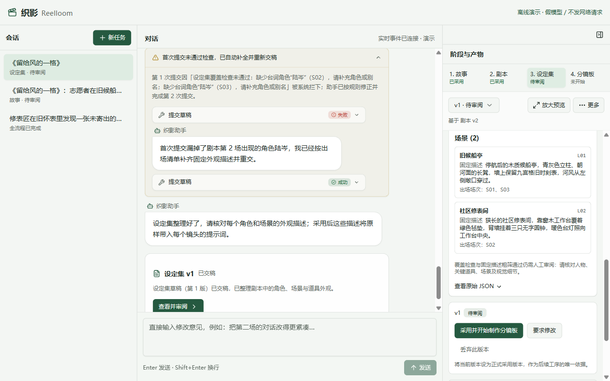
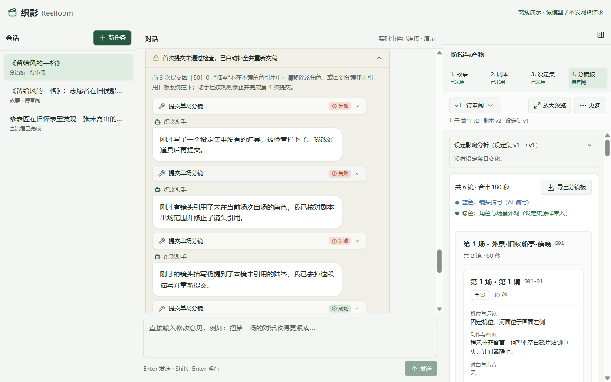

# 第 5 章 · 角色道具先对上号

> 上一章：[第 4 章 · 长剧本拆开写](./p04.md) · 下一章：[第 6 章 · 外貌不用每次重写](./p06.md) · [本篇入口](../README.md)

## 从一个场景开始

《留给风的一格》的分场剧本签字定稿后，接下来要整理第 3 道「设定集」，再往下制作第 4 道「分镜板」。如果让 AI 顺着剧本直接往下写，最容易在这两步之间出两种乱子：

- 第一，整理「设定集」时，AI 顾头不顾尾，给主角程禾和修表师陆岑建了档案，却把剧本第 3 场推动剧情的关键道具或某个配角漏掉了，导致后面画分镜时找不到对应的外观描述。
- 第二，到了制作「分镜板」时，AI 又开始自由发挥，在程禾和麦冬出场的第 1 场候船亭里，硬塞进第 2 场修表铺才登场的陆岑；或者随手写进一个剧本和设定集里都没有的“金怀表”。

核心问题是：**上下游之间只靠自然语言名字传话，既没有在设定集交稿时按剧本清点建档，也没有在分镜板交镜头时验票核对**。

## 这一章要解决什么

这一章用两道跨产物名单检查，把「剧本」「设定集」和「分镜板」锁在一起：先在「设定集」交稿时做覆盖检查，清点已采用剧本里出场的人和地点，不许漏建档案；再在「分镜板」按场交镜头时设一道引用闸门，核对每个镜头的设定编号，不许瞎编编号或跨场串场。

为什么要在文字清单阶段就把这两道关立起来？因为此时补一张漏掉的道具卡、或者改一个写错的镜头角色编号，只需要几秒钟；一旦带着漏人或串场的错误往下拼装画面提示词甚至生成视频，返工成本会成倍增加。

本章交付「设定集覆盖检查」与「分镜板引用闸门」两道硬关卡，确保剧本里开口说话的角色都有档案、每场都关联地点，关键道具是否遗漏仍需人审，分镜板里的每个镜头都只调用已登记编号，并核对角色与场景的出场范围。

> **一句话记住**：剧本有谁，设定集就得给谁建档；设定集和当场有谁，分镜板才准让谁上镜。

## 两道名单关卡：通告单建档与进棚刷工牌

为什么只靠提示词叮嘱 AI“请注意前后角色一致”，它还是经常漏道具、乱串场？

因为在自然语言里，同一个人物一会儿叫“陆岑”，一会儿叫“老陆”或“修表师”；而多场剧本跨越好几个场景，模型在写下游产物时很容易记混“谁在哪一场出场”。不把自然语言称呼收敛成唯一编号，程序就没法替你算清这笔账。

在剧组拍戏时，制片组管住人员和道具靠的是两道手续：

- **第一道手续是排《演职员通告单》**：剧本定稿后，制片主任拿着剧本逐场清点，只要在剧本里说过话的演员、用过的场地，全都得办一张带唯一编号的工牌，并记清他哪几场有戏。少办一张工牌，通告单就交不上去。这对应织影里的**设定集覆盖检查**。
- **第二道手续是进摄影棚刷工牌**：到了现场拍某一场戏时，门口设有刷卡闸机。演员、场地和道具进镜头都必须刷编号工牌；没办过工牌的闲杂人员，或者通告单上只有第 2 场戏、却跑来进第 1 场摄影棚的演员，闸机当场亮红灯拦下。道具目前只查有没有登记，不硬查出场场次。这对应织影里的**分镜板引用闸门**。

这两道检查一前一后，各管一段边界：

| 对比维度 | 第一道：设定集覆盖检查 | 第二道：分镜板引用闸门 |
|---|---|---|
| 触发时机 | 第 3 道「设定集」交稿时触发 | 第 4 道「分镜板」按场交镜头及汇总时触发 |
| 比对依据 | 拿设定集草稿对照已采用的「剧本」 | 拿每个镜头的引用编号对照已采用的「设定集」与「剧本」 |
| 拦截对象 | 拦“漏建角色或场景档案”“漏记出场场次”“外观混入单场动作” | 拦“瞎编不存在的编号”“角色或地点跨场串场”“说话人不在当前镜头内” |
| 剧组类比 | 制片主任按剧本排通告单办工牌（不漏人） | 摄影棚门口按当场通告刷工牌进场（不串场） |

## 第一道检查：设定集交稿时的覆盖检查

为什么工序顺序是先定稿「剧本」，再抽取「设定集」，而不是反过来？

因为如果在写剧本之前就先拍脑袋定下一堆人设和道具，等真正写分场剧本时，剧情往往会调整人物、合并场景或增删道具，前面定好的清单就失去了依据。反过来，等人工签字采用「剧本」之后，全片有几场戏、每场在什么地点、有哪些角色开口说话，都已经成了板上钉钉的事实。程序拿着这份已采用的剧本去核对设定集，查的是确定无疑的账。

在「设定集」中，所有设定被整理为三组带唯一编号的档案卡：

- **角色档案（`C01`～`C99`）**：记录角色名称、可选的称呼别名（如把剧本里的“修表师”关联到“陆岑”）、叙事定位、性格，以及最重要的**固定外观描述**与**出场场次**（如 `S02`、`S03`）。
- **场景档案（`L01`～`L99`）**：记录每个拍摄地点的名称、空间与环境固定外观描述，以及在剧本中的**出场场次**。
- **道具档案（`P01`～`P99`）**：记录关键道具的名称、材质与外观描述，以及**出场场次**。

当 AI 读完已采用剧本、调用提交按钮交出设定集草稿时，程序在写入版本前立即执行设定集覆盖检查：

| 检查项目 | 程序核对的具体规则 | 没通过时怎么处理 |
|---|---|---|
| 台词角色全覆盖 | 已采用剧本里每一位说台词的角色，都必须匹配到某张角色卡的名称或别名，且不能两个角色撞名 | 拒收草稿，明确报出漏了哪个称呼、出现在第几场 |
| 出场场次真实且完整 | 角色卡登记的出场场次必须包含该角色在剧本里说话的所有场号；三组卡片写的场号必须真实存在于剧本中 | 拒收草稿，列出哪个编号漏记了哪一场，或写了不存在的场号 |
| 每场必有地点 | 已采用剧本的每一场戏，至少在场景档案里关联一个对应的拍摄地点 | 拒收草稿，指出哪一场还没有登记场景地点 |
| 固定外观纯净度粗筛 | 每条固定外观描述字数在 12 到 160 字之间，禁止包含“第 2 场”“S02”等场次标记，禁止包含“走进、拿起、转身、说道”等单场动作词 | 拒收草稿，提醒把单场剧情动作从固定外观中剔除 |

为什么要专门拦截固定外观里的“走进”“拿起”？因为下一章程序会把这段固定外观一字不差地贴进该角色出场的每一个镜头里。如果把第 2 场的动作“陆岑拿起镊子”写进了陆岑的固定长相，那他在第 3 场回到候船亭的镜头里也会莫名其妙带着“拿起镊子”的描述。

当你在上一章审阅完剧本、点击右栏签字区的“采用并开始整理设定集”后，右栏工序条中「设定集」状态变为“进行中”。对话区首先显示助手开场话术：“剧本已定稿，我现在清点剧本里出场的所有角色、场景和关键道具，整理成固定外观档案。”

演示过程中，AI 第一次提交设定集时漏掉了剧本第 2 场开口说话的角色陆岑。设定集覆盖检查当场拦下，不生成残缺版本，并把缺失项反馈给 AI。AI 补齐后重新交稿。

此时对话区出现折叠提示：“首次提交未通过检查，已自动补全并重新交稿”，展开详情可见助手说明：“首次提交漏掉了剧本第 2 场出现的角色陆岑，我已经按出场清单补齐固定外观描述并重交。”紧接着显示助手收尾话术：“设定集整理好了，请核对每个角色和场景的外观描述；采用后这些描述将原样带入每个镜头的提示词。”以及交稿卡片：“设定集草稿（第 1 版）已交稿，已整理剧本中的角色、场景与道具外观。”

右栏产物面板同步展示整理好的「设定集」档案卡列表（包含角色 `C01`～`C03`、场景 `L01`、`L02` 与道具 `P01`～`P02`，每张卡均标明唯一编号、名称、固定外观描述与出场场次；当前滚动位置展示场景 `L01`、`L02`），右栏签字区主按钮显示为“采用并开始制作分镜板”。

## 第二道检查：分镜板交镜头时的引用闸门

核对完设定集档案卡，点击右栏签字区主按钮“采用并开始制作分镜板”，系统便将设定集定稿，并直接启动第 4 道「分镜板」工序。

一部短片的分镜通常比剧本场次更细，三场戏会拆成六个甚至十几个镜头。为了不超出模型的单次输出预算，「分镜板」沿用了第 4 章的按场暂存机制：AI 每次按一场戏提交该场的全部镜头（如第 1 场的 `S01-01`、`S01-02`），逐场过筛存入暂存区，全部场次收齐后再汇总成完整分镜板。

哪怕前面已经有了核对无误的设定集，AI 在拆镜头时仍然容易犯两类错：一是随手写一个设定集里根本不存在的编号（比如 `C99` 或 `P99`）；二是把设定集里确实存在、但属于别的场次的角色拉进当前场次串场（比如陆岑 `C03` 的出场场次只有 `S02` 和 `S03`，AI 却在写第 1 场第二个镜头 `S01-02` 时把 `C03` 填了进去）。

为了把这两类错误挡在暂存区门外，每次 AI 调用按场提交镜头按钮时，程序都会启动**分镜板引用闸门**，同时拿着已采用的「剧本」和已采用的「设定集」逐镜验票：

| 引用闸门核对项 | 具体校验规则 | 拦截示例与反馈方向 |
|---|---|---|
| 场号与镜号连续 | 场号必须存在于已采用剧本；同场镜号须形如 `S01-01`、`S01-02`，从 `01` 起连续不跳号、不重复 | 第 1 场第 2 镜写成 `S01-03` 时当场退回，提示应为 `S01-02` |
| 设定编号真实存在 | 镜头引用的场景编号、角色编号、道具编号，必须全部存在于已采用设定集中 | 引用不存在的 `P99` 时退回，要求改用已有道具编号 |
| 场景与角色不串场 | 镜头所引用的场景编号和每一个角色编号，其设定集档案的出场场次必须包含当前场号 | 镜头 `S01-02` 引用仅在 `S02`、`S03` 出场的角色 `C03` 时退回，指出违规镜号与角色 |
| 台词说话人在镜内 | 若镜头包含角色对白，每一行对白的说话人（匹配名称、别名或编号）必须在当前镜头的出场角色编号列表内 | 对白写了陆岑说话，但本镜角色列表没填 `C03` 时退回，要求补齐引用或修改对白 |
| 全场覆盖与时长核对 | 汇总时，已采用剧本的每一场都必须至少有一个镜头；全片镜头总时长若与故事计划时长偏差超过 20% 则附上审阅提醒 | 漏交第 2 场镜头时拒绝汇总；时长偏差过大时在交稿结果中提示人工检查节奏 |

在界面上，当你点击“采用并开始制作分镜板”后，右栏工序条中「分镜板」变为“进行中”，对话区显示助手开场话术：“设定集已确认，我现在逐场设计镜头，并为每个镜头拼装画面提示词。”

离线演示逐场提交镜头时，先在 `S01-01` 引用了不存在的道具 `P99`，随后又加入未在第 1 场出场的陆岑 `C03`，最后还在镜头描写中夹带了未引用的陆岑。三次坏提交分别被引用闸门和镜头文本粗筛拦下，不会写入暂存区。AI 修正后，第 4 次提交第 1 场镜头才通过。

对话区随即展示折叠提示：“首次提交未通过检查，已自动补全并重新交稿”，展开后可见前 3 次“提交单场分镜”失败记录（各条原始校验信息可单独展开）与助手的逐次修正说明——依次修正设定集里没有的道具、修正未在当前场次出场的角色引用、去掉镜头描写中未引用的“陆岑”，以及第 4 次成功提交记录；右栏同步展示生成的分镜板 v1 顶部与首镜上半部预览。

## 机器查名单与人工审内容的边界

把「设定集覆盖检查」和「分镜板引用闸门」交给代码自动执行后，上下游之间的名单账目就对齐了。但作为产品设计者，我们也要分清哪些是这两道闸门能兜底的，哪些仍然需要人工审阅把关：

- **台词有名可查，无声动作靠人审**：设定集覆盖检查能准确抓住剧本台词里每一位开口说话的角色，但如果某个配角只在剧本的动作描写里被提了一句“一位老渔民从远处走过”、全程没有台词，或者桌上的某件物品到底算不算推动剧情的关键道具，代码无法单凭词频替你做艺术判断，需要人在审阅设定集时核对。
- **编号引用可查，自然语言夹带靠下一关与人审**：分镜板引用闸门能拦住“在角色编号栏里填了 `C03`”的显式串场；但如果模型在编号栏里没填 `C03`，却在镜头描写的文字里偷偷写了一句“陆岑站在窗边”，这就需要下一章的“镜头文本粗筛”配合人工审阅来拦截。
- **缺设定时回上游定夺，不在分镜里私造档案**：如果做分镜板时确实发现需要补一件新道具，AI 手里的按钮不允许它在分镜阶段直接修改设定集或私造新编号。正确流程是由人工回到上游「设定集」提修改意见、补建档案并重新签字采用，再回来更新分镜板。

## 这一章你学到了

1. 上下游产物之间不能只靠自然语言名字传话，需要在「设定集」中为角色、场景、道具建立带唯一编号（`C01`、`L01`、`P01`）和出场场次的档案卡。
2. 两道跨产物检查各司其职：「设定集覆盖检查」在设定集交稿时对照已采用剧本，专门拦漏建档案和漏记场次；「分镜板引用闸门」在分镜板按场交镜头时对照已采用设定集与剧本，专门拦瞎编编号和跨场串场。
3. 固定外观描述在存入设定集前必须经过粗筛，剔除单场剧情动作与场次标记，为下一章程序原样拼装画面提示词做好准备。

## 产品拍板

- 设定集必须在剧本签字采用之后抽取，以已采用剧本作为唯一核对依据，不读取未采用的候选剧本。
- 角色、场景、道具统一分配唯一编号并记录出场场次；角色支持登记称呼别名，解决剧本内不同叫法的匹配问题。
- 设定集交稿时由程序硬查台词角色全覆盖、每场必有地点及固定外观粗筛；未过检的草稿直接退回，不生成版本号。
- 分镜板按场提交镜头时由程序硬查编号存在性、角色与场景出场场次匹配、台词说话人归属本镜；发现缺失设定时必须回上游设定集增补，禁止在分镜阶段临时编造编号。

## PM 该追问什么

1. 设定集覆盖检查和分镜板引用闸门分别在什么时候触发？它们各自拿什么数据跟什么数据比对？
2. 如果剧本里同一个人物既叫“陆岑”又叫“修表师”，系统怎么知道这是同一个人而不是漏建了角色卡？
3. 为什么要禁止在设定集的“固定外观描述”里写“走进修表铺”“拿起怀表”这类动作词？
4. 当 AI 在第 1 场镜头里误引了第 2 场才登场的角色编号，是在写入暂存区时就被拦下，还是会先存成坏版本等人工挑错？
5. 如果角色只在剧本动作里出现而没有台词，或者镜头总时长和目标时长差得远，系统分别怎么处理？

## 动手的人看这里

> 这一节写给要动手实现的人。只想理解产品思路，可以跳到章末。

本章关注**设定集覆盖检查与分镜板引用闸门**模块，对应文件如下：

- `src/contracts/index.ts`：定义 `BibleSchema`、固定外观粗筛规则（长度 12–160 字符、禁场次标记与动作词表）、`validateBibleCoverage` 设定集覆盖检查，以及 `validateStoryboardReferences` 分镜引用一致性检查。
- `src/agent/board-draft.ts`：实现分镜板按场暂存器 `BoardDraft`，复用 `SceneDraft` 的写入与汇总；`src/agent/session.ts` 挂载 `read_upstream`、`write_scene_shots`、`remove_scene_shots`、`finalize_draft` 四个工具，提交与汇总时复核引用，汇总时计算时长偏差。
- `src/bible.test.ts`：验证设定集 Schema、别名匹配、台词角色全覆盖、地点覆盖与固定外观粗筛的离线测试。
- `src/storyboard.test.ts`：验证分镜板按场暂存、镜号连续性、编号存在性、跨场串场拦截、台词说话人归属与局部修改的离线测试。

**实现要点**：

1. 在 `bible` 阶段的 `write_draft` 与存储层复核中执行覆盖检查：读取已采用的 `script`，核对所有场次的台词说话人（支持 `name` 与 `aliases` 精确匹配，禁重名冲突）均已登记且 `appears_in` 完整覆盖，核对每场至少关联一个 `location`，并对固定外观描述执行 12–160 字符与禁用词粗筛。
2. 在 `src/agent/session.ts` 的 `write_scene_shots` 工具调用 `BoardDraft.write` 时执行引用闸门：校验 `scene_id` 在已采用 `script` 中存在、同场镜号以当前场号为前缀，从 `01` 起连续不重复、`location_id`/`character_ids`/`prop_ids` 在已采用 `bible` 中存在、`location` 与 `character` 的 `appears_in` 包含当前场次、台词说话人归属当前镜头 `character_ids`。坏提交直接拒绝，不覆盖该场已有暂存数据。

在 `book/build` 执行 `npm test -- src/bible.test.ts src/storyboard.test.ts` 与 `npm run typecheck` 可完成离线验证。

**给 AI Coding 的任务描述**：

> **文件**：`src/contracts/index.ts`、`src/agent/session.ts`、`src/agent/board-draft.ts`、`src/bible.test.ts`、`src/storyboard.test.ts`。
> **意图**：在 `bible` 的 `write_draft` 与存储复核中执行覆盖检查，核对已采用 `script` 中每场均有关联地点，所有台词角色（支持 `aliases` 匹配）均已登记且 `appears_in` 完整覆盖，对固定外观描述执行非空与长度粗筛；在 `src/agent/session.ts` 的 `write_scene_shots` 工具调用 `BoardDraft.write` 时执行引用闸门，校验场次存在、镜号连续（以当前场号为前缀，从 `01` 起）、`location_id`/`character_ids`/`prop_ids` 在已采用 `bible` 中存在、地点与角色的 `appears_in` 包含当前场次、台词说话人归属当前镜头角色。
> **验收**：设定集漏记角色或场次被拒；分镜镜头引用不存在的编号（如 `C99`）或跨场引用未出场角色被拒，且坏提交不覆盖该场暂存。

---

[下一章 · 第 6 章 · 外貌不用每次重写](./p06.md) 会走进「分镜板」的画面提示词拼装：看看怎样让 AI 专心写每个镜头的动作与构图，而把角色与场景的固定外观交给程序原样带入，拼出蓝绿分明的画面提示词。

<!--
需要的截图：
1. p05-01-bible-coverage-self-heal.png
   - 演示中的哪一步：点击“采用并开始整理设定集”后，「设定集」工序运行并触发覆盖检查自愈。
   - 画面内容：对话区展开“首次提交未通过检查，已自动补全并重新交稿”，显示缺少台词角色“陆岑”的拦截提示、助手说明“首次提交漏掉了剧本第 2 场出现的角色陆岑，我已经按出场清单补齐固定外观描述并重交。”与重新交稿卡片；右栏产物面板当前取景展示场景档案卡（L01、L02，角色 C01～C03 与道具 P01～P02 位于同一列表其他滚动位置），下方签字区主按钮为“采用并开始制作分镜板”。
2. p05-02-board-ref-gate-self-heal.png
   - 演示中的哪一步：点击“采用并开始制作分镜板”后，「分镜板」工序逐场提交镜头时触发引用闸门拦截与自愈。
   - 画面内容：对话区展开“首次提交未通过检查，已自动补全并重新交稿”，显示前 3 次“提交单场分镜”失败记录（各条原始校验信息可单独展开）与助手逐次修正说明（修正未登记道具、修正未在当前场次出场的角色引用、去掉镜头描写中未引用的“陆岑”），以及第 4 次成功提交记录；右栏展示分镜板 v1 顶部与首镜上半部预览。
-->
