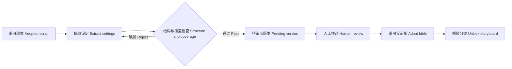

# P05 · 从剧本抽取设定集 / Extract a Story Bible

> 上一章：[P04 · 剧本与输出预算](./p04.md) · [本篇入口与运行命令](../README.md)

## 为什么先剧本，后设定集

设定集把角色、关键道具和地点变成可引用的资料卡。如果先写设定集再写剧本，故事可能引入新人物、合并地点、删掉道具，原来的清单就会失去依据。这里从人已采用的完整剧本抽取，检查的是明确版本，不是模型记忆里的故事。

设定集仍要经过人审阅。程序可以回答“台词中的陆岑有没有登记”，却不能可靠判断动作行的“三人”究竟是谁，也不能仅凭词频判断一件物品是否推动剧情。提示模板要求检查动作行人物，只收对剧情有作用的道具，不发明剧本里没有的角色；这些语义要求仍需人工核对。

剧本可能没有写衣服颜色或镜框形状。可以给出保守的造型建议供人确认，但不能把建议冒充剧本原文。`appears_in` 记录出场来源，不是每个视觉细节都有原文证据的保证。



## 把清单变成引用契约

`src/contracts/index.ts` 的 `BibleSchema` 分为三个数组。每个条目都有稳定编号、名称、非空且不重复的 `appears_in`：

| 分组 | 编号 | 固定描述 | 其他字段 |
|---|---|---|---|
| `characters` 角色 | C01–C99 | `appearance` 外观 | `role` 叙事定位、`personality` 性格、可选 `aliases` 别名 |
| `props` 道具 | P01–P99 | `description` 外观与材质 | 可为空数组，没有关键道具就不硬凑 |
| `locations` 场景 | L01–L99 | `description` 空间与布景 | 至少一个地点 |

编号分类唯一，不要求连续。修改时保持原编号，不能因为删除一张卡就重排所有身份。场号须使用 S01 这样的两位格式，并且存在于采用剧本。示例中的旧候船亭 `L01` 来源是 S01、S03，社区修表间 `L02` 来源是 S02。

角色可以写 `name: "陆岑"`、`aliases: ["修表师"]`，让剧本里的称呼变体指向同一身份。匹配仅去除首尾空白，然后逐字相等，不做模糊匹配或自动猜名；同一称呼不能同时属于两个角色，角色自己的别名也不能重复其正式名称。

这些来源关系为按场追踪影响提供依据，但没有实现已采用阶段返工或自动失效计算。出场场次合法也不代表人物真的在该场出现，人工还要检查是否标多了、标错了。

## 用代码回答“漏了谁”

模型调用 `write_draft` 时，`ProjectStore.writeDraft` 在创建版本目录或修改项目状态之前校验 schema、编号、描述和覆盖关系。跨产物检查读取 `readAdopted(projectId, "script")`，不接受模型另交一份剧本作为校验依据。

| 检查 | 失败时的反馈 |
|---|---|
| 每个 `dialogue.character` 匹配某个角色 name 或 aliases | 列出缺少的称呼与场号，例如“缺少台词角色‘陆岑’（S02）” |
| 匹配角色的出场场次包含其台词所在场 | 列出角色编号和缺少的出场场次 |
| 三组条目的出场场次均存在于采用剧本 | 列出条目编号和不存在的场号 |
| 每场至少关联一个地点 | 列出没有地点的场号 |
| 编号格式正确且唯一，别名无歧义 | 给出错误字段或冲突编号、称呼 |

覆盖检查汇总发现的缺漏，便于一次补齐。失败没有新版本、不会消耗版本号；修正后重交完整设定集，通过才新增 `pending` 版本。只交一份名字列表，没有出场场次，不能被当作覆盖完整。

读取版本、采用版本和准备修改原稿时也重新检查，防止损坏的本地文件绕过写入规则。采用失败不会保存阶段状态，也不会解锁分镜。这里仍是单进程本地存储，不承诺跨进程事务或防篡改。

## 固定描述为什么要和剧情解耦

后续分镜提示词中，程序会把被引用角色的 `appearance`、道具与地点的 `description` **原样注入**。若把“程禾拿起计时器，走进修表间”写进外观，每次引用程禾都可能重复这段动作，污染其他镜头。

固定描述适合写“成年女性，齐耳黑发，浅灰工装外套，左袖口有圆形布补丁”；“拿起计时器”属于某场动作。`role` 和 `personality` 可以解释叙事作用与性格，它们不是固定视觉描述。

确定性粗筛只覆盖三类条件：

1. 固定描述去除首尾空白后，按 Unicode 码点计数，长度在 **12–160** 个字符之间。程序不改写或裁剪保存的原文。这个范围是教学短片的初始产品约束，不是视觉质量评分。
2. 禁止 `S` 后跟数字（大小写均检查），以及“第 2 场”“第十二场”等明确场次标记。
3. 禁止这份小词表中的字面子串：**走进、拿起、放下、转身、追赶、争吵、说道、问道、回答、决定、冲向、递给**。

词表与长度常量集中在契约文件，提示模板读取同一份规则。页面展示中文原因，原始工具错误仍可展开追溯。粗筛可能误伤“转身镜”这样的名词，也会漏掉未列出的剧情动作、英文动词或换一种写法的场次；它不能识别所有语言表达，不能替代人工审阅。补一个未出现过的动作词，不应被当作绕过质量要求的技巧。

## 阶段工具与提示模板

设定集只开放 `read_upstream` 与 `write_draft`，唯一可读依赖为 `script`。读取工具复核阶段白名单和采用状态；没有任意路径读取、自动采用或阶段推进工具。系统模板要求读剧本、抽取、按报错补齐、等待人审。

一次运行最多八轮模型响应，沿用有界循环、错误记录、会话保存与结束原因。离线演示通常四轮：读上游、提交漏角色稿、补全提交、结束说明。更长剧本仍受上下文与单次输出预算约束，本章没有设定集分批提交工具；若经常超限，应重新评估拆分策略，不能仅把上限无限调大。

## 旧数据怎么处理

`aliases` 可省略，旧的角色名称仍可直接匹配。`appears_in` 是必填来源证据：不能自动填全部场，也不能悄悄写回旧文件。缺少它时，读取、采用和修改运行明确报“缺少出场场次，请从采用剧本重新抽取”。项目列表与状态仍可读取，历史文件保持原样；未采用的设定集阶段可以重新运行，生成带来源的新版本再审阅。

旧设定集若已经采用，本包的已采用阶段不能再次运行。需要保留原项目，在新项目重新完成上游采用与设定抽取；这里不提供自动迁移或强行重置状态。其他阶段的旧产物与审阅兼容规则保持原状。`examples/sample-project/bible.json` 已补齐来源，原来的固定描述保持不变，因此静态分镜提示词的原文拼装关系也不变。

## 离线看一次漏角色与补齐

在 `book/build` 运行：

```bash
HARNESS_DEMO=1 npm run dev
```

打开 `http://127.0.0.1:5173`：

1. 新建项目，依次运行选题、梗概、剧本，预览并采用各阶段版本。不采用剧本时设定集仍锁定。
2. 切到“设定集”，点击“运行阶段”。先读取采用剧本；随后 `write_draft` 漏掉陆岑，被覆盖检查拒绝，卡片列出陆岑及 S02、S03。此时没有设定集版本。
3. 假模型补齐后，右侧自动选中待审阅 v1，按角色／道具／场景展示七张卡片，包含编号、固定描述和出场场次。原始 JSON 默认折叠。预览区域可滚动查看其他分组，分镜仍锁定。
4. 核对陆岑的 S02、S03，以及两个地点覆盖三场，点击“采用”。分镜依赖满足，导航显示“可运行”；接着可按 [P06](./p06.md) 验证分镜引用闸门。
5. 截图覆盖拒绝卡片、三组预览与采用后的分镜状态。结束后按 Ctrl+C 关闭自己的服务。

若先按选题预填意见把孩子换成老站长，演示剧本与设定集会同步使用何望，别名含“老站长何望”，不会又引入麦冬。设定集的演示修改预填“保留角色与出场场次，只把程禾外套改为深灰色”；它是固定示例，不理解任意修改要求。真实模型模式没有这些静态回答。演示使用真实 SDK、工具、校验、存储和 SSE，但不证明模型能正确抽取任意剧本。

验收执行 `npm test`、`npm run typecheck`、`npm run build`。离线测试覆盖各条规则的通过与拒绝、别名、采用剧本而非最新候选、错误不落盘、旧数据、版本复核、提示与工具隔离、网页可读卡片、HTTP/SSE 的拒绝修正与解锁，以及两种演示人物路径。

## 给 AI Coding 的任务描述

> **文件**：`src/contracts/index.ts`、`src/project/store.ts`、`src/agent/prompts.ts`、`src/server/demo.ts`、`web/src/ArtifactPreview.tsx`、`web/src/validation-errors.ts` 与对应离线测试。  
> **意图**：从采用剧本抽取稳定设定，程序检查漏了谁和来源是否有效，人审查语义完整性与视觉质量。  
> **验收**：三组条目必填出场场次，角色支持别名；全部台词角色有唯一匹配且来源正确，每场有地点，引用场真实存在，编号格式正确且唯一；固定描述长度与小词表粗筛；写入失败不出版本，读取与采用复核；旧来源缺失明确拒绝且不改原文件；设定集只读采用剧本，漏角色演示先拒后补；页面按三组展示来源，采用后解锁分镜；示例与离线测试一致。
> **边界**：不把语义抽取、未出场角色、道具重要性或视觉质量假装成确定性保证；不实现分镜创作、提示词注入、已采用阶段返工或鉴权；不请求真实模型。

## 产品拍板

- 设定集从人采用的剧本抽取，来源与台词称呼由代码检查，动作行人物仍靠人审。
- 编号是稳定身份，别名解决称呼变化；不得让同一称呼指向两个角色。
- 固定描述与动作分离，避免之后原样注入时把某场剧情带进所有镜头。
- 长度、场号与小词表只是粗筛，通过后仍需审阅。
- 缺来源的旧数据不猜测迁移，历史文件保持原样，新版本补齐证据。

## PM 该追问什么

1. 抽取依据是哪份采用剧本？还有一份更新的未采用稿时会不会误读？
2. 角色漏了一个、只在动作行出现、用了别称，这三种情况分别怎样发现？
3. 出场场次存在就代表来源真实吗？地点是否覆盖每场？
4. 不合规草稿是否真的没有文件、没有版本号、没有阶段变化？直接采用损坏文件能绕过吗？
5. 固定描述哪些词会被拒绝，哪些仍可能漏检？人审的责任是否清楚？
6. 若某条剧情动作被原样注入所有镜头，会造成什么可见问题？
7. 旧设定集缺少来源时，页面有没有说明原因，程序是否偷偷修改了历史数据？
