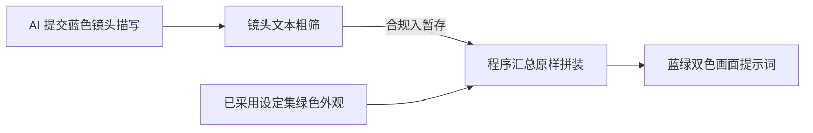
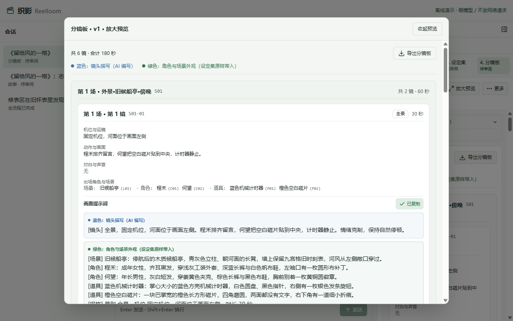

# 第 6 章 · 外貌不用每次重写

> 上一章：[第 5 章 · 角色道具先对上号](./p05.md) · 下一章：[第 7 章 · 改一处，不用推倒重来](./p07.md) · [本篇入口](../README.md)

## 从一个场景开始

《留给风的一格》的分镜景别和角色道具编号都核对无误了，现在每个镜头还需要一段完整的画面提示词，用来复制到下游的生图或视频生成工具里。

如果让大模型在写每一个镜头时，都顺手把修表师陆岑的长相和穿着重新描写一遍，很快就会走样：

- 第 1 个有他的镜头里，AI 写的是“银白短发、细圆框眼镜、墨绿背心”；
- 到了第 4 个镜头，它换了个词写成“灰白头发的老匠人穿着深色马甲”；
- 再到第 6 个镜头，干脆把细圆框眼镜和背心颜色漏掉了。

只要让概率模型每次靠重新造句来复述固定设定，人物和场景的外观描述就难免前后不一。

核心问题是：**把本该一字不差的固定档案，交给了每次都在重新发挥的大模型**。

## 这一章要解决什么

这一章在「分镜板」工序内部把画面提示词拆成两半：让 AI 只负责写当前镜头的构图、动作、光线与情绪描写，而角色、场景和道具的固定外观描述，则由程序在汇总分镜板时从已采用的「设定集」原样带入，拼成蓝绿分明的完整画面提示词。

为什么要把“写镜头”和“贴外观”拆开？因为这一镜怎么拍、人物做什么动作需要创作发散，适合交给 AI；而角色长什么样、穿什么衣服在设定集里已经签字确认，用代码按编号原样贴进去，既省掉模型重复默写的负担，又能保证每个镜头提示词里的外观文字一字不差。

本章交付「分镜板」的画面提示词程序拼装、镜头描写粗筛、右栏蓝绿双色高亮展示与一键复制能力。

> **一句话记住**：AI 只写这一镜怎么拍，程序负责把角色外观原样贴进去；能用代码拼准的固定文字，一个字也别让模型重新默写。

## 合同套印红头与填空题：模型写蓝色，程序拼绿色

为什么在提示词里反复叮嘱 AI“请保持角色外貌描述一致”，它还是会在长篇输出里偷偷换词或漏字？

因为大模型的本质是按概率接龙造句。让它在六个镜头里把同一段五十来字的人物外貌默写六遍，就像让一个人在白纸上凭记忆手抄六遍公司营业执照——越抄到后面越容易简写、漏项或改词。

各行各业签标准化合同时，早就有了现成的解决办法：**合同套印红头公章与填空题**。公司名称、资质证号、银行账号这些固定信息，早就作为红头底板印死在纸上了，根本不让业务员动笔抄写；业务员每次只需要在空白横线上填写本次采购的物品、数量和交货动作。

在织影的「分镜板」工序里，每一张镜头卡的「画面提示词」正是按这套逻辑拆成了蓝绿两半：

- **蓝色部分：镜头描写（AI 编写）**——AI 在按场提交镜头时，只允许填写当前镜头的构图、人物动作、光线氛围与情绪变化。程序在提交入口处直接拦住，不允许 AI 自己提交拼装后的完整提示词。
- **绿色部分：角色与场景外观（设定集原样带入）**——当全场的镜头提交完毕、调用汇总按钮生成分镜板版本时，程序自动按每个镜头引用的场景、角色、道具编号，从已采用的「设定集」中取出固定外观原文，连同镜头的景别、机位、时长规格，按固定模板一字不差地拼成完整画面提示词。

| 提示词组成部分 | 界面颜色图例 | 负责方 | 内容来源与规则 |
|---|---|---|---|
| 镜头描写 | 蓝色：镜头描写（AI 编写） | AI 写手 | 当前镜头的构图、动作、光线与情绪（12 到 500 字），不重复默写固定外貌 |
| 场景、角色与道具外观 | 绿色：角色与场景外观（设定集原样带入） | 程序自动拼装 | 按本镜引用的设定编号，从已采用「设定集」原样取出描述文本，不增删改一字 |
| 镜头规格 | 绿色：角色与场景外观（设定集原样带入） | 程序自动拼装 | 按本镜的景别、机位与时长自动格式化生成 |



## 固定模板与填空防越界：拦住偷塞编号和场外人名

当 AI 调用汇总按钮生成「分镜板」草稿时，程序对每个镜头执行同一个纯函数拼装模板，严格按以下五行顺序生成完整的画面提示词：

```text
[镜头] {AI 编写的当前镜头构图、动作、光线与情绪描写}
[场景] {场景名称}：{设定集中的场景固定外观原文}
[角色] {角色名称}：{设定集中的角色固定外观原文}
[道具] {道具名称}：{设定集中的道具固定外观原文}
[规格] 景别 {景别}，机位 {机位}，时长 {时长} 秒
```

如果某一个镜头是空镜（没有角色或没有道具出场），程序会自动省略对应的 `[角色]` 或 `[道具]` 行；如果同一镜头有多个角色出场，则按镜头引用的角色编号顺序逐一展开。同一个角色不管出现在第几场第几镜，带入的都是设定集里的同一段原文，连标点符号都不会变。

既然只留了 `[镜头]` 这一道填空题给 AI，要是 AI 在填空时不老实——比如自己伪造一整段带 `[角色]` 标签的完整提示词，或者在蓝色镜头描写里偷偷写进没在本镜出场的角色名字，程序怎么防住？

在 AI 每次按场提交镜头时，程序会对填空内容执行三道硬检查：

| 检查关口 | 具体拦截规则 | 为什么要拦 |
|---|---|---|
| 禁止伪造派生字段 | 提交参数只接收镜头基本字段与镜头描写；若模型传入完整提示词、注入编号列表或模板标识，直接拒绝 | 防止模型绕过拼装函数，自己编造一段看似完整的提示词 |
| 长度与保留标记检查 | 镜头描写去除首尾空白后须在 12 到 500 字之间；禁止出现 `[镜头]`、`[场景]`、`[角色]`、`[道具]`、`[规格]` 五种保留标记 | 防止镜头描写过短敷衍、过长失控，或伪造模板段落结构 |
| 禁塞设定编号与场外角色 | 镜头描写中禁止直接写 `C01`、`L01`、`P01` 等设定编号；若设定集已登记的某角色（含别名）未被本镜引用，镜头描写中禁止出现该角色称呼 | 防止编号栏没引陆岑、文字里却写“陆岑在旁边鼓掌”的隐性串场 |

此外，程序不仅在汇总生成时拼装一次，在**写入草稿、读取历史版本、人工签字采用**这三个存储关口，都会重新计算并核对一遍完整提示词；新稿按当前采用设定集核对，历史版本按生成时记录的设定集版本核对。就算有人打开本地磁盘上的版本文件手动改了一个外观词，系统在读取和采用时也会立刻发现账目不符并拒绝放行。

## 看懂分镜板卡片：蓝绿分色核对与一键复制

当「分镜板」全部场次的镜头过筛并汇总完成后，右栏工序条中「分镜板」状态变为“待审阅”。对话区显示助手收尾话术：“分镜板已制作完成，每个镜头的画面提示词都已拼入设定集外观，请在右侧审阅并采用。”以及交稿卡片：“分镜板草稿（第 1 版）已交稿，共 6 个镜头，已拼入设定集外观描述。”

点击右栏的“放大预览”打开“分镜板 · v1 · 放大预览”弹窗，顶部清晰展示总镜数与时长、“导出分镜板”按钮及双色图例：“蓝色：镜头描写（AI 编写）”与“绿色：角色与场景外观（设定集原样带入）”。

往下看首镜（`S01-01`）镜头卡，上半部分整齐排列着该镜头的结构化拍摄信息：**镜号**、**景别**、**时长**、**机位与运镜**、**动作与画面**、**对白与声音**、**出场角色与场景**；下半部分的「画面提示词」区域配有“复制提示词”按钮，并把拼装好的完整提示词按蓝绿双色分块高亮展示（绿色区域末尾几行可向下滚动查看）。


为什么要特意做成蓝绿双色？因为这样人工审稿时可以一眼分清责任：

- 绿色的设定外观已经在上一道「设定集」审过了，而且是程序原样贴进来的，你不用再逐字检查陆岑的眼镜和背心有没有抄错；
- 你只需要把目光集中在**蓝色部分**，看 AI 为这一镜设计的构图、动作和光线好不好，以及蓝色动作有没有跟绿色外观自相矛盾。

审阅某张镜头卡后，如果你想立刻把这段提示词拿到生图或视频工具里试拍，只需在放大预览或卡片上点击“复制提示词”按钮。按钮文字会短暂变为“已复制”，此时剪贴板里拿到的就是包含镜头描写、固定外观与镜头规格的完整画面提示词文本。

收起放大预览弹窗、等全部镜头核对满意后，点击右栏签字区主按钮“采用并完成”，第 4 道「分镜板」工序状态变为“已采用”，四道工序的首次创作流程就此定稿。



## 搞清真实边界：管住提示词文字，不等于包办画面一致

用程序拼装替代模型默写，是内容生产工具里性价比很高的一步设计。但在实际落地时，产品经理必须向团队和用户把它的真实能力边界讲清楚，不能把话说满：

1. **防走样靠的是“禁止提交完整提示词”，不是“把设定集藏起来”**：在「分镜板」工序中，AI 为了给每个镜头挑选正确的角色、场景和道具编号，需要读取已采用的「设定集」。因此模型在上下文里是能看到设定集内容的。我们之所以能保证最终外观文字不走样，靠的不是蒙住模型的眼睛，而是**收走它填写最终提示词的权力**——模型只能交蓝色镜头描写，绿色外观部分由程序在汇总时百分之百按编号原样带入。
2. **保证提示词里的外观描述一字不差，但不保证生成出来的画面一致**：程序拼装管住的是喂给下游工具的**提示词文本本身**。它能确保第 1 镜和第 6 镜的提示词里，对陆岑外貌的文字描述一字不差；但下游的图像或视频生成大模型本身具有随机性，哪怕输入完全相同的文字描述，两次生成的脸型或衣服细节仍可能存在差异。要让最终生成的画面保持稳定一致，还需要配合下游生图或视频工具的角色参考图、垫图控制或固定随机种子等视觉手段。
3. **文本粗筛不能替代人工审阅**：程序能拦住镜头描写里出现未出场角色的登记名字和设定编号，但如果 AI 用“那位老人”之类的代词暗指场外角色，或者在蓝色镜头描写里写了与绿色外观冲突的细节（比如绿色设定里写的是短发，AI 在蓝色动作里写了“长发被风吹起”），代码无法识别这类自然语言矛盾，仍需人工在审阅分镜板时把关。

## 这一章你学到了

1. 固定不变的角色、场景和道具外观描述，不应该让大模型在每个镜头里反复凭记忆重抄，而应该由程序在汇总时按引用编号原样带入。
2. 通过拆开“AI 编写的蓝色镜头描写”与“程序带入的绿色设定外观”，既锁住了跨镜头外观文字的一致性，又让人工审阅时只需聚焦每镜新增的蓝色动作与构图。
3. 守住诚实的产品边界：程序确定性拼装能保证每个镜头提示词里的外观描述一字不差，但它管的是提示词文本，不保证下游生图或视频工具画出来的画面一致。

## 产品拍板

- 分镜板的画面提示词统一采用“模型写镜头描写 + 程序拼装设定外观与规格”的职责切分，禁止模型直接提交或修改最终完整提示词。
- 对模型提交的镜头描写执行字数范围（12 到 500 字）、禁含模板保留标记、禁含设定编号及禁提本镜未出场角色称呼的粗筛。
- 在右栏分镜板卡片中以蓝绿双色区分 AI 编写内容与设定集原样带入内容，并提供单镜“复制提示词”按钮。
- 对外说明与团队验收时明确区分“提示词文本一致”与“下游画面生成一致”，不把文本拼装能力夸大为视觉生成一致性承诺。

## PM 该追问什么

1. 最终画面提示词里的角色外观描述，是靠提示词叮嘱大模型“原样抄写”，还是由代码函数在汇总时原样拼进去的？
2. 如果模型在提交镜头时自己塞了一个伪造的完整提示词字段，或者在镜头描写里写进了没在本镜出场的角色名字，系统能不能当场拦住？
3. 界面上的蓝色文字和绿色文字分别代表什么？审稿人看这张卡时重点该审哪一部分？
4. 有人直接修改本地存储文件里的完整提示词文字，系统在读取和采用时会不会发现并拒绝？
5. 程序拼装保证每个镜头提示词里的外观描述一字不差，这能不能保证下游生图工具画出来的角色长相也一模一样？为什么？

## 动手的人看这里

> 这一节写给要动手实现的人。只想理解产品思路，可以跳到章末。

本章关注**画面提示词确定性拼装、镜头描写粗筛与蓝绿双色展示**模块，对应文件如下：

- `src/contracts/prompts.ts`：定义纯函数 `assembleShotPrompt`、镜头描写粗筛函数 `validateShotPart`（校验 12–500 Unicode 字符、禁含 `[镜头]` 等五种保留标记与 `C01`/`L01`/`P01` 设定编号、禁提本镜未引用的已知角色名或别名）及完整提示词复核逻辑。
- `src/agent/board-draft.ts`：在 `write_scene_shots` 调用 `BoardDraft.write` 时，经 `validateBoardSceneInput` 调用 `validateShotPart` 拦截违规镜头描写，在继承的 `SceneDraft.finalize` 汇总时经 `assembleBoard` 按场/镜排序并调用 `assembleShotPrompt` 生成 `injected_ids` 与 `final_prompt`。
- `src/project/store.ts`：在 `writeDraft`、`readVersion`、`adopt` 三个存储边界复算并校验每个镜头的 `injected_ids` 与 `final_prompt`，防止绕过工具或篡改磁盘文件。
- `web/src/features/artifacts/components/board/BoardToolbar.tsx`、`web/src/features/artifacts/components/board/BoardPromptSection.tsx`：渲染当前分镜板的蓝绿双色图例、分段展示与“复制提示词”交互反馈。
- `src/prompts.test.ts`：验证模板原样拼装、跨镜同角色外观逐字一致、派生字段拒收、镜头描写粗筛与存储边界复核的离线测试。

**实现要点**：

1. 在 `BoardShotInputSchema` 中开启 `additionalProperties: false`，严格拒绝模型传入 `final_prompt`、`injected_ids`、`assembly_template`；在 `write_scene_shots` 中调用 `validateShotPart` 校验 12–500 Unicode 字符、禁含保留标记与设定编号、禁提本镜未出场角色。
2. 在 `BoardDraft` 继承的 `SceneDraft.finalize` 与 `assembleBoard` 中按场/镜排序，确认全剧本每场至少一镜后，调用唯一 `assembleShotPrompt` 生成 `injected_ids` 与 `final_prompt`，并在 `store.writeDraft` / `readVersion` / `adopt` 三个边界复算校验，防止磁盘篡改。

在 `book/build` 执行 `npm test -- src/prompts.test.ts` 与 `npm run typecheck` 可完成离线验证。

**给 AI Coding 的任务描述**：

> **文件**：`src/contracts/prompts.ts`、`src/agent/board-draft.ts`、`src/project/store.ts`、`web/src/features/artifacts/components/board/BoardToolbar.tsx`、`web/src/features/artifacts/components/board/BoardPromptSection.tsx`、`src/prompts.test.ts`。
> **意图**：在 `BoardShotInputSchema` 中严格拒绝模型传入 `final_prompt`、`injected_ids`、`assembly_template`；在 `write_scene_shots` 中调用 `validateShotPart` 校验 12–500 Unicode 字符、禁含保留标记与设定编号、禁提本镜未出场角色；在 `BoardDraft` 继承的 `SceneDraft.finalize` 与 `assembleBoard` 中按场/镜排序，确认全剧本每场至少一镜后，调用唯一 `assembleShotPrompt` 生成 `injected_ids` 与 `final_prompt`，并在 `store.writeDraft` / `readVersion` / `adopt` 三个边界复算校验，防止磁盘篡改。
> **验收**：模型伪造 `final_prompt` 或 `shot_part` 违规时被拒；汇总后的每条 `final_prompt` 100% 包含被引用设定的原文且顺序固定；前端蓝绿分色展示与一键复制准确无误。

---

[下一章 · 第 7 章 · 改一处，不用推倒重来](./p07.md) 会解决创作中最常见的返工难题：当四道工序都跑完了，你突然想回「设定集」把程禾的“浅灰工装外套”改成“深灰工装外套”，怎么让分镜板自动亮起「待更新」提醒，并且不用调用一次大模型就能换上新外观。

<!--
需要的截图：
1. p06-01-board-blue-green-card.png
   - 演示中的哪一步：「分镜板」草稿第 1 版汇总完成，点击“放大预览”查看首镜卡片详情。
   - 画面内容：打开“分镜板 · v1 · 放大预览”弹窗，顶部展示“共 6 镜 · 合计 180 秒”、“导出分镜板”按钮及蓝绿双色图例；首镜（S01-01）卡片内显示镜号、景别、时长、机位与运镜、动作与画面、对白与声音、出场角色与场景，下方「画面提示词」区域带“复制提示词”按钮，并以蓝绿双色分块展示镜头描写与设定集外观（绿色区域末尾几行可向下滚动查看）。
2. p06-02-copy-prompt-feedback.png
   - 演示中的哪一步：在放大预览中点击首镜卡片上的“复制提示词”按钮。
   - 画面内容：在“分镜板 · v1 · 放大预览”弹窗中点击首镜（S01-01）卡片上的“复制提示词”按钮后，按钮文字变为绿色的“已复制”，剪贴板取得该镜头存储的完整 final_prompt 文本（收起放大预览弹窗后，可在右栏底部签字区点击“采用并完成”）。
-->
