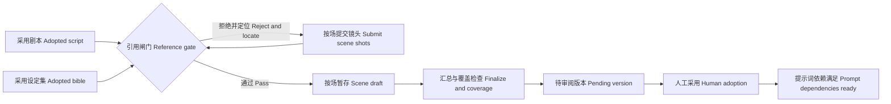

# P06 · 分镜脚本与引用一致性 / Storyboard Reference Gates

> 上一章：[P05 · 从剧本抽取设定集](./p05.md) · [本篇入口与运行命令](../README.md)

## 让角色前后不一致在写入时被挡住

设定集里有修表师陆岑，不代表他可以出现在每一场。采用设定把 C03 的来源限定在 S02、S03；若分镜把他放进 S01，JSON 完全合法，角色编号也存在，但内容已经偏离审过的来源。

引用一致性闸门把这个问题变成确定性规则：读取人采用的剧本和设定集，在写入前检查镜头引用。拒绝时说明场号、镜号、具体编号和改法，不先保存坏版本再等人发现。它能挡住已知关系的冲突；动作中写了一个名字却没有引用编号，程序仍无法理解全部自然语言，因此通过后还要人审。

## 存在性检查与语义检查

`src/contracts/index.ts` 的 `ShotSchema` 定义每镜的景别、机位、动作、时长和引用；`validateStoryboardReferences` 对比采用上游，汇总检查结果。二者共同构成可信边界。

| 规则 | 拒绝例子与修正方向 |
|---|---|
| scene_id 存在于采用剧本 | S99 不存在，改用采用剧本已有场号 |
| 镜号形如 S01-01，前缀同场，从 01 连续且不重复 | 第二镜写 S01-03，提示应为 S01-02；同场镜头按数组叙事顺序编号 |
| 地点、角色、道具 ID 存在于采用设定集 | P99 不存在，引用已有道具；缺设定则回上游补齐 |
| 地点和角色的 appears_in 包含当前场 | S01 引用 C03，提示“改镜头或回到设定集修正出场场次” |
| 台词说话人属于本镜 character_ids | 陆岑说话但没有引用 C03，拒绝并要求修正角色引用 |
| 采用剧本每场至少一镜 | 漏 S02 时汇总拒绝，补交该场再汇总 |

存在性只回答“这个编号有没有登记”；来源关系回答“已确认资料是否允许它用于这一场”。这里的语义检查是对显式关系的检查，不是模型对剧情合理性的评分。道具只检查存在性，不把道具出场场次作为额外拒绝条件；地点与角色检查来源。空镜可以没有角色、道具，仍需已有地点和正数时长。

`dialogue` 保留字符串契约。每行写“角色名：台词”，也接受英文冒号、已采用别名或角色 ID；多位说话人用换行分开。每行的称呼去除首尾空白后精确匹配，不猜测无标注对白的归属。例如 `程禾：等等。` 只有在本镜引用 C01 时才通过。把两位说话人塞进同一行不能可靠识别，应按契约逐行写，人也要核对台词内容。

## 为什么缺设定必须回上游

若镜头需要一把尚未登记的伞，让模型临时编一个 P99 会让后续提示词缺少固定描述；让它临时补描述，又绕过设定集的人审。正确反馈是说清缺什么，由人决定修改镜头，还是回到上游建立设定，再重新审阅。

工具没有修改设定集、自动采用或推进阶段的能力。当前已采用阶段不允许返工，所以需要补设定时，应保留原项目，在新项目重新准备上游；不要宣称点一个按钮就能修改已采用的设定。后续返工机制解决的是如何保留证据和计算影响，不是取消引用闸门。

## 按场暂存为什么值得复用

镜头通常多于剧本场数，单次输出 2048 token 的约束仍在。整份分镜一次输出容易截断；每次交一场的全部镜头，能把失败与修正限制在该场。单场过长、会话上下文累积仍可能超限，不能承诺任意长度。

`src/agent/scene-draft.ts` 把剧本已有的暂存、覆盖、删除、排序、封口、预装和修改记录抽成共用组件。`ScriptDraft` 保留剧本校验与四拍数量提醒；`StoryboardDraft` 提供分镜校验、按场拆原稿、镜头拼装和时长提醒。共用的是生命周期，各阶段的业务规则仍明确独立。

分镜只有四个工具：

- `read_upstream({"stage":"script"})` 或 `{"stage":"bible"}`：只读采用版本，不能指定路径、候选版本或其他阶段。
- `write_scene_shots({"scene":{"scene_id":"S01","shots":[...]}})`：提交该场全部镜头；结构与引用检查通过才替换暂存场。不能混入别场，坏重交保留原暂存内容。
- `remove_scene_shots({"scene_id":"S02"})`：删除暂存区整场镜头，不改历史版本。采用剧本场号不能删掉，汇总前仍须补齐该场。
- `finalize_draft({})`：按 scene_id 排序、保留各场镜头顺序，复核所有引用及覆盖，保存完整 pending 版本。成功后封口，不能继续写场或重复汇总。

`ProjectStore` 写入前也执行引用检查，读取、采用、准备修改原稿时再次检查；直接调用存储层不能绕过。失败不创建分镜版本、不消耗版本号、不解锁提示词。旧分镜若不符合关系检查，会明确拒绝，不自动改写历史文件。

修改运行预装显式指定的原版本全部场，只重交受影响的 S02，S01、S03 由程序原样沿用。`scene_changes` 与版本元数据记录来源、重交、沿用、删除场号；网页刷新后仍可看到。它是按场号操作记录，不是逐字差异，也不证明模型正确理解意见。原稿仍占输入窗口。未汇总、中断、模型失败时不把暂存区冒充新版本，结束快照和工具事件保留过程；普通运行从空暂存开始，没有自动恢复承诺。

## 时长提醒与运行预算

`duration_s` 是每镜正数秒。程序汇总，与采用选题 `target_minutes × 60` 比较，相对偏差**超过 20%** 才警告，恰好 20% 不警告。目标三分钟而总镜头只有六秒仍能保存待审版本，但汇总卡片明确提醒检查节奏。目标时长与实际剪辑并非精确相等关系，因此与剧本场数提醒一样只警告；正数时长、合法引用则是硬规则。

时长检查由 harness 读取采用选题完成，模型的上游读取白名单仍只有剧本与设定集。二十四轮预算为读两个上游、逐场写入、错误修正、汇总和结束留空间；剧本仍为二十轮，选题、梗概、设定集仍为八轮。它是初始保护值，不是质量保证或无限重试。运行记录包含模型、提示、工具、上下文、耗时、错误与真实 stop_reason。

## 离线看拒绝、修正与单场修改

在 `book/build` 运行 `HARNESS_DEMO=1 npm run dev`，打开 `http://127.0.0.1:5173`：

1. 新建项目，依次运行并采用选题、梗概、剧本、设定集；未采用设定集时分镜锁定。
2. 切到“分镜脚本”运行。先看到引用不存在道具 P99 的中文错误卡片，再看到 C03 的出场场次不含 S01 的中文拒绝。两次都不产生版本。
3. 修正后 S01、S02、S03 分别暂存，汇总才产生待审 v1。右侧按场展示六镜，景别、机位、动作、台词、时长和引用名称／编号都可读，原始 JSON 默认折叠。
4. 保持 v1 未采用，点“要求修改”，确认预填“只修改 S02：首镜缓慢推近程禾，先征求陆岑讲述意愿，其余场保持原样。”再点“按意见修改 v1”。
5. 只出现一次 S02 的提交，汇总为 v2；修改记录显示“相对 v1：重交 S02；沿用 S01、S03”。切换版本核对无关场保持原样。
6. 采用 v2，页面提示“分镜提示词已解锁（依赖已满足）”。提示词模板仍暂未开放运行，解锁不等于已有生成功能。结束后 Ctrl+C 关闭自己启动的服务。

演示用原创静态数据和假模型，真实 SDK、工具、存储与 SSE 照常执行，不请求模型供应商，不理解任意修改要求。采用了老站长示例时沿用何望身份；修改的答案固定只改 S02。截图覆盖两类拒绝、可读预览、单场修改记录和采用后的依赖解锁。

离线执行 `npm test`、`npm run typecheck`、`npm run build`。测试覆盖每条引用规则的通过与拒绝、无效重交不覆盖、未汇总无版本、乱序按场拼装、时长警告、指定原稿预装、沿用场一致、修改记录、封口、预算与中断，以及剧本已有行为。通过这些检查不证明真实模型的创作质量。

## 给 AI Coding 的任务描述

> **文件**：`src/contracts/index.ts`、`src/project/store.ts`、`src/agent/scene-draft.ts`、`script-draft.ts`、`storyboard-draft.ts`、`session.ts`、`prompts.ts`、`run.ts`、`src/server/demo.ts`、网页预览与错误翻译及对应离线测试。  
> **意图**：以采用剧本和设定集为依据，在写入时拒绝引用冲突；复用按场暂存控制输出预算，修改时只交受影响场。  
> **验收**：场号存在、镜号同场连续、设定引用存在、地点与角色来源匹配、台词说话人在镜头内、每场有镜头；失败指出镜号与改法且不出版本；时长超过 20% 只警告；只开放四工具，汇总才生成版本；修改预装指定原稿、沿用场一致且记录来源；两次拒绝后修正的离线演示与按场可读卡片；剧本原测试保持通过。  
> **边界**：不把自然语言动作的全部语义或创作质量当作确定性保证；不实现提示词拼装、图片视频生成、已采用阶段返工或鉴权；不请求真实模型。

## 产品拍板

- 模型只能引用已采用上游，不在镜头中临时发明身份与固定描述。
- 存在性、显式来源、台词归属和覆盖是拒绝条件；时长是审阅提醒。
- 每次提交一场全部镜头，版本仍是完整分镜；无效场不能污染暂存区。
- 修改仅重交受影响场，共用暂存生命周期，保持剧本阶段行为。
- 名称帮助阅读，ID 承担关系；人工负责镜头语言与没有编码的语义。

## PM 该追问什么

1. “角色存在”与“角色允许在这一场出现”有没有分别验收？
2. 报错能否指出哪一镜、哪个引用、该改镜头还是上游？坏稿是否真的没有版本？
3. 校验读的是采用版本，还是最新候选？绕过工具直接写存储层会怎样？
4. 台词中有两个说话人、只有声音没有人物、动作里写了未引用名字，各能检查到什么？
5. 缺设定时谁决定改上游？已采用上游当前是否允许修改？
6. 单场重交是否整体替换？无关场有没有经过模型重写？修改记录刷新后还在吗？
7. 三分钟目标与实际镜长不同，为何只警告？阈值在哪里定义？
8. 提示词依赖解锁是否被误说成提示词功能已经实现？真实模型质量有哪些证据仍缺？
