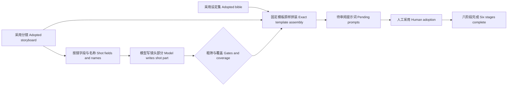

# P07 · 模型写镜头，程序注入设定 / Shot Prompts and Deterministic Injection

> 上一章：[P06 · 分镜与引用一致性](./p06.md) · [本篇入口与运行命令](../README.md)

## 一致性不能只靠提醒

“请保持程禾的外貌一致”是一条创作要求，却没有保证每镜都包含同一段描述。模型可能把浅灰外套改成白色，把圆形补丁漏掉，或在长对话中忘记设定。提示词写得认真，并不等于系统具有约束能力。

分镜工坊把责任分成两块：模型只创作镜头特有的动作、构图、情绪、镜头语言，程序负责把人采用的固定设定逐字放进完整提示词。程序可以保证**文本注入一致**；它不能保证下游图像或视频一定画得一致，本包也不调用图片、视频生成服务。



## 谁写什么

| 字段 | 负责方 | 依据 |
|---|---|---|
| `shot_id` | 模型选择，程序复核 | 必须存在于采用分镜 |
| `shot_part` | 模型 | 该镜动作、构图、情绪与镜头语言，不描述外貌 |
| `injected_ids` | 程序 | 分镜中的地点、角色、道具引用，保留原顺序 |
| `final_prompt` | 程序 | 固定模板＋镜头部分＋采用设定原文＋分镜规格 |

`src/contracts/prompts.ts` 的 `assembleShotPrompt` 是纯函数：给定一镜、设定集、镜头部分，返回同一份结果。模板固定为以下顺序，每段以换行分隔，角色和道具分别按引用数组展开。没有角色或道具时省略对应段。

```text
[镜头] {shot_part}
[场景] {名称}：{description}
[角色] {名称}：{appearance}
[道具] {名称}：{description}
[规格] 景别 {shot_size}，机位 {camera}，时长 {duration_s} 秒
```

固定描述不裁剪、不翻译、不总结，连原文中的空白也保留。同一个角色在不同镜头中使用同一份采用设定，因此注入段逐字相同。`injected_ids` 与完整提示词不是模型参数。工具只收 `shot_id`、`shot_part`，额外字段会被拒绝。

存储层也有边界：`ProjectStore` 写入、读取、采用、准备修改原稿时，都用采用分镜与设定集重新计算并比对注入编号和完整提示词。直接调存储接口或篡改本地文件，不能绕过这项检查。拒绝发生在版本写入之前，不消耗版本号。旧提示词若使用其他拼装格式，会明确拒绝读取和采用，不自动覆盖历史文件；可在未采用的提示词阶段重新运行并审阅新版本。

## 按需读取同时节省上下文和防止改写

阶段依赖仍是 `prompts ← storyboard + bible`。依赖表示程序必须找到哪些采用版本，并不表示模型有权读取这些版本的全部内容。

提示词阶段只有四个工具：

- `list_shots({})`：返回每镜 `shot_id` 与最多 60 个 Unicode 字符的动作摘要，不含设定集。
- `read_shot({"shot_id":"S01-01"})`：返回该镜分镜字段与 `names`，其中只有引用实体的名称，没有角色外观、道具或地点固定描述。
- `write_shot_prompt({"shot_id":"S01-01","shot_part":"程禾排齐留言，麦冬将磁片贴在中央，河面留在画面左侧，情绪克制。"})`：校验后暂存，同镜可覆盖重交，不生成版本。
- `finalize_draft({})`：要求采用分镜每镜恰有一条，按分镜顺序拼装全部完整提示词，再保存待审阅新版本。成功后封口，不能继续提交或重复汇总；返回版本与改动镜号，不把完整外观回灌给模型。

没有 `read_upstream`、整份设定集读取、采用或改上游工具。模型不必重新抄写固定描述，错误面随之缩小。固定描述仍由程序在服务端读取，页面右侧也能看见完整结果；这里约束的是模型工具上下文，不是用户对设定的访问。

按镜读取不意味着每轮模型只看到一镜。SDK 会保留此前工具结果与对话，累计输入仍会增长；历史分镜动作或用户意见也可能包含外貌文字。工具投影能避免主动加载固定描述字段，不能声称清除了所有自然语言中的外貌信息。

## 用示例算一次预算

在 `book/build` 执行：

```bash
npm run context:compare
```

`scripts/context-budget.ts` 读取原创示例，用紧凑 `JSON.stringify` 后的 Unicode 码点数计数；估算 token 为 `ceil(字符数 / 2)`。它使用与工具相同的 `shotList`、`shotContext` 投影，不需要运行模型。

| 一次交付给模型的数据 | 字符数 | 估算 token |
|---|---:|---:|
| 首镜字段＋全量设定集 | 1253 | 627 |
| 首镜按需字段＋引用名称 | 289 | 145 |
| 整份分镜＋整份设定集，各读一次 | 2420 | 1210 |
| 镜号清单＋六次按镜读取，各读一次 | 2162 | 1081 |

首镜局部数据约减少 77%，但整个示例的工具返回内容仅约减少 11%。不能把局部收益当成整次运行成本。这里没有计入工具定义、系统提示、调用参数、模型输出及每轮重传的累计历史；也没有使用供应商 tokenizer。真实费用与延迟需要真实运行的 usage 与计时证据，不能从这张表推导。更大的设定集和不同的镜头数量会改变结果，可修改示例后重新运行脚本观察。

## 哪些错误由程序拒绝

`shot_part` 按去除首尾空白后的 Unicode 码点计数，须在 **12–500** 字之间，保存时不改原文。这个范围是教学短片的初始产品约束。除长度外，粗筛拒绝：

1. `C`、`P`、`L` 后跟数字的设定编号，大小写均检查，例如 C01、p99；镜号由独立字段提交。
2. 五种模板保留标记：`[镜头]`、`[场景]`、`[角色]`、`[道具]`、`[规格]`。
3. 采用设定集中已知、但没有被该镜引用的角色名称或别名。按去除首尾空白后的字面子串匹配，拒绝时指出镜号、称呼与修改方向。

它会漏掉未登记的人名、代词、同音字和隐含人物，也可能因人名包含关系误伤正常文本；它不自动识别所有外貌描述。提示要求“不描述外貌”仍需人审。不能因为注入原文一致，就忽略镜头部分写出与设定矛盾的服装。缺角色引用时，由人决定改镜头还是改上游，不能在提示词阶段补造角色或绕开分镜。

完整提示词还要检查未知镜号、重复镜号、漏镜、注入编号及模板逐字相等。全覆盖是确定性签收，镜头语言与视觉质量属于人工审阅。

## 修改只重交受影响镜头

要求修改指定版本后，`PromptDraft.reset` 预装该原稿全部镜头部分，模型只重交受影响镜头，其他镜头原样沿用。汇总时程序重新注入采用设定，原版本不覆盖。模型提示只包含原稿的 `shot_id`、`shot_part` 与意见，不包含旧 `final_prompt` 和 `injected_ids`，避免通过修改入口重新带入整段外观。

工具结果、运行摘要及版本元数据用 `shot_changes` 记录来源、重交与沿用镜号；页面刷新后仍可看到版本修改记录与镜头高亮。它记录重交操作，不是逐字差异，也不证明模型理解了修改意见。版本内容仍保留完整提示词，便于用户审阅和复制。

未汇总、中断或失败不把暂存镜头当成版本，结束快照保留暂存内容以便审计，普通运行不自动恢复。提示词最多 **32 轮**模型响应，为列清单、逐镜读写、修正、汇总与结束留空间；示例六镜够用，不承诺任意长分镜。超过上限记录 `max_turns`，需要评估拆分或预算，而非无限重试。既有运行记录继续包含模型、提示、工具、上下文说明、耗时、错误和真实 `stop_reason`。

## 离线看拒绝、双色预览与完成

在 `book/build` 运行 `HARNESS_DEMO=1 npm run dev`，打开 `http://127.0.0.1:5173`：

1. 新建项目，依次运行并采用选题、梗概、剧本、设定集、分镜。也可按上一章要求修改分镜第二场，采用修改版后再继续。
2. 切“分镜提示词”，点“运行阶段”。先看到读镜头卡片，首镜试写“陆岑在旁鼓掌”被拒绝：陆岑没有被首镜引用，不产生版本。
3. 假模型移除陆岑后重交，再按镜提交余下镜头。汇总才生成待审阅 v1。蓝色块标明“模型写的部分”，绿色块标明“程序注入的部分”，其中包含固定描述和分镜规格。
4. 点首镜的“复制完整提示词”，核对剪贴板包含五类模板段。保留未采用状态，点“要求修改”，确认预填的“只修改 S02-01”意见，再点“按意见修改 v1”。只重交 S02-01，其余五镜沿用；v2 显示镜号修改记录与高亮。
5. 采用 v2，六个导航项均“已采用”，页面显示“全流程已完成 · 六阶段产物均已采用”。这表示本包六类文本产物已审阅采用，不表示已经生成图片、视频或交付包。
6. 结束后 Ctrl+C 关闭自己启动的服务。

演示从采用分镜的动作生成静态镜头部分，兼容麦冬与何望两种示例路径，修改结果固定，不理解任意意见。它使用真实 SDK、工具、存储、SSE 和审阅门，但不调用真实模型，不提供模型创作质量证据。

离线执行 `npm test`、`npm run typecheck`、`npm run build`。测试覆盖拼装原文、同角色跨镜一致、粗筛、全覆盖、无效重交保留原稿、封口、存储复核、受限工具和上下文、指定原稿单镜修改、轮数上限、中断、示例以及 HTTP/SSE 的审阅与完成路径。

## 给 AI Coding 的任务描述

> **文件**：`src/contracts/prompts.ts`、`src/agent/prompt-draft.ts`、`prompt-tools.ts`、`session.ts`、`prompts.ts`、`run.ts`、`src/project/store.ts`、`src/server/demo.ts`、网页预览与展示逻辑、`scripts/context-budget.ts`、示例与离线测试。  
> **意图**：模型仅写单镜创作部分，程序从采用分镜取得引用，从采用设定集逐字注入固定描述；上下文只提供该镜字段和名称。  
> **验收**：四工具白名单无整份上游读取；未知镜号、长度、设定编号、镜头外已知角色和保留标记被拒；全镜覆盖才汇总，模板顺序固定、注入原文逐字一致；写入、读取、采用复核；修改预装指定原稿只重交一镜，镜号记录持久化；双色卡片与复制、先拒后改演示、采用后六阶段完成；示例通过检查，预算对比可复现。  
> **边界**：不把粗筛当作完整语义识别，不承诺图像一致性；不请求真实模型，不实现图片视频生成、已采用上游返工、鉴权或外部发布。

## 产品拍板

- 固定设定由程序逐字注入，模型无权提交注入编号与完整提示词。
- 阶段依赖与模型读取权限分开；按镜读名称，不把整份设定集送入上下文。
- 全覆盖、精确拼装属于硬闸门；动作、构图、外貌冲突与创作质量由人审。
- 修改以镜头为单位，原稿保留，未重交镜头原样沿用，修改记录可追溯。
- 采用提示词标记六类文本产物完成，不等同于媒体制作完成。

## PM 该追问什么

1. 相同角色跨镜注入是否逐字相同？证据是纯函数测试还是一句提示要求？
2. 模型实际有哪些工具？能否从修改原稿入口重新读到固定描述？
3. 拒绝后有没有偷偷落盘、消耗版本号，或覆盖原暂存镜头？
4. 漏镜、重复镜、篡改注入文本能否绕过工具直接存储或采用？
5. 已知角色名、别名、代词、陌生人名，各能检查到什么？误伤怎样交给人处理？
6. 上下文对比算的是单镜、全部工具结果，还是多轮累计输入？token 是估算还是实际 usage？
7. 单镜修改有没有重写其他五镜？刷新后还能找到来源与改动镜号吗？
8. 双色提示词中，镜头动作若与固定外观冲突，谁负责审阅？六阶段完成究竟代表什么？
