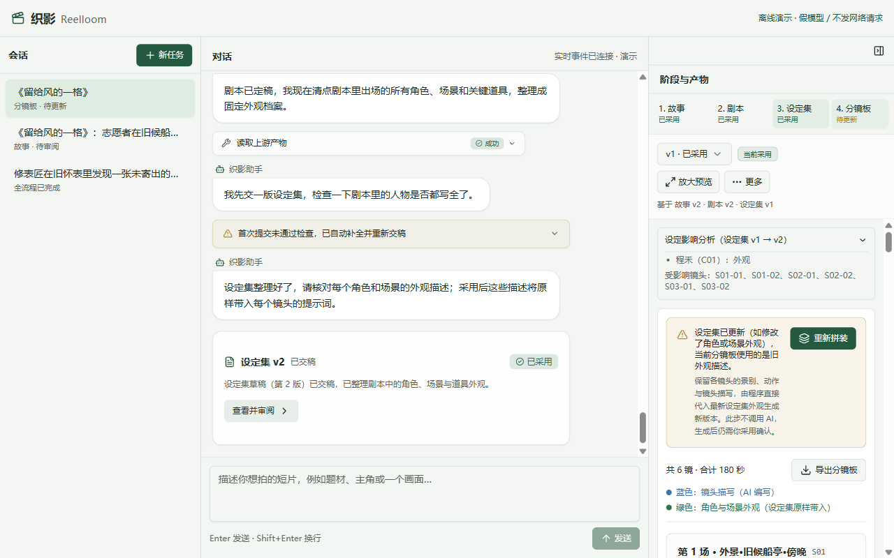
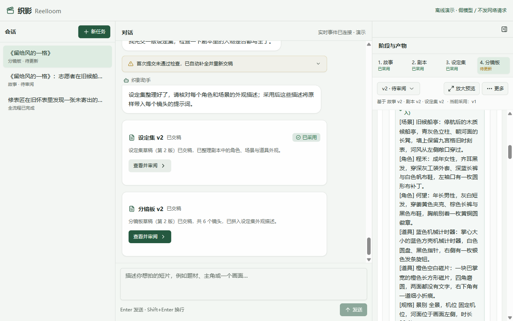

# 第 7 章 · 改一处，不用推倒重来

> 上一章：[第 6 章 · 外貌不用每次重写](./p06.md) · 下一章：[第 8 章 · 验好货再交稿](./p08.md) · [本篇入口](../README.md)

## 从一个场景开始

《留给风的一格》的四道工序全部跑通，「分镜板」第 1 版也已经签字采用了。

这时你突然想改一个人物细节：回到「设定集」，把程禾的“浅灰工装外套”改成“深灰工装外套”，并采用了设定集第 2 版。

在没有版本追溯的工具里，这处小改动会让你陷入两难：

- 要么自己打开几十张分镜卡片，靠肉眼逐条查找哪些镜头有程禾，手动把提示词里的“浅灰工装外套”替换成“深灰工装外套”，稍不留神就会漏改一两处；
- 要么让 AI 把整页分镜板推倒重跑一遍——不仅白白消耗一次大模型调用配额，还会把第 1 版里原本已经挑好、拍板确认的镜头景别、动作和构图全部冲掉重来。

核心问题是：**系统既没有记住“这版分镜板当时是依据哪一版设定集做的”，也没有区分“只需要程序重贴外观文字”和“需要 AI 重新设计镜头”**。

## 这一章要解决什么

这一章为织影加上来源追溯、待更新预警与分镜板零模型重新拼装能力：让每一份产物版本都记录它依据的上游版本编号；当上游换用新版本时，下游自动亮起「待更新」提醒；如果设定集只是修改了固定外观描述，用户只需点击「重新拼装」，程序就能在不调用大模型的情况下直接换上新外观。

为什么要在产品里专门做这一步？因为在真实创作中，“定稿后微调一处设定”是家常便饭。把上下游的版本账本算清楚，把纯文本替换的工作交给确定性程序，才能既守住跨工序一致性，又保住已经审好的创作成果。

本章交付版本来源记录、下游「待更新」状态自动传导，以及「分镜板」的零模型重新拼装流程。

> **一句话记住**：上游一改，下游自动贴上「待更新」黄标签；只改外观就由程序直接换上新词，不让 AI 把好好的镜头推倒重做。

## 施工图黄标签预警：记清来源，上游改动自动提醒

为什么改了设定集之后，很多工具里的分镜板还在显示绿色的“已完成”，让人误以为所有内容都已经同步更新了？

因为那些工具只记住了“分镜板有没有文件”，却没有记录**这份分镜板当时是拿着哪一版故事、哪一版剧本、哪一版设定集做出来的**。

这就像建筑工地上的施工图纸管理：如果一楼结构图从第 1 版改到了第 2 版，而水电工手里的水电图背面没有注明“本图依据结构图第 1 版绘制”，大家就会拿着过期图纸继续施工。在规范的工程管理里，每张图纸背面都有版本印戳；一旦上游底图换了新版，资料员会立刻在下游关联图纸上贴一张醒目的**黄色「待更新」标签**，提醒所有人手里的图纸需要重新核对。

在织影里，程序为四道工序的每一个版本都维护着这样一份来源账本：

1. **生成时自动盖上来源印戳**：当「分镜板」第 1 版生成时，程序会自动记录它当时读取的上游采用版本——例如基于「故事」第 1 版、「剧本」第 1 版、「设定集」第 1 版。这笔账由程序在写入时直接记录，不允许 AI 模型猜测或涂改。
2. **上游换版时顺着依赖图贴上「待更新」**：当你回到「设定集」生成并采用了第 2 版时，程序会顺着「故事 → 剧本 → 设定集 → 分镜板」的依赖关系往下核对。它发现「分镜板」第 1 版依据的还是设定集第 1 版，与当前采用的设定集第 2 版对不上号，于是立即将右栏工序条中的「分镜板」状态从“已采用”切换为黄色的“待更新”。
3. **间接下游同样自动预警**：如果改动的是更上游的「故事」并采用了新版本，不仅直接依赖它的「剧本」会变成“待更新”，连同后面的「设定集」和「分镜板」也会沿着依赖链条一并标记为“待更新”，防止中间环节带着过期依据往下走。

与此同时，系统严格遵守一条历史版本保护规则：**绝不拿今天的新设定去偷偷篡改昨天的旧分镜板**。

被打上“待更新”标签后，原有的「分镜板」第 1 版依然安静地留在版本列表里，随时可以查看、复制或导出；而且当你读取或导出第 1 版时，程序始终按照它当时的历史来源（设定集第 1 版）去核对和展示“浅灰工装外套”，卡片上的角色名、场景名与场次标题也跟随当时的设定集和剧本版本。任何更新都必须生成全新的「分镜板」第 2 版，再由人工审阅拍板。

## 重盖印章不重画图：零模型调用的「重新拼装」

切回右栏的「分镜板」，你会看到顶部亮起一条黄色提醒横幅：“设定集已更新（如修改了角色或场景外观），当前分镜板使用的是旧外观描述。”横幅下方提供了主操作按钮“重新拼装”，并附有一行清楚的说明：“保留各镜头的景别、动作与镜头描写，由程序直接代入最新设定集外观生成新版本。此步不调用 AI，生成后仍需你采用确认。”

为什么改了衣服颜色，可以做到一次 AI 都不调用就把分镜板更新好？

这就是第 6 章把画面提示词拆成“蓝色镜头描写 + 绿色设定外观”带来的直接回报。还记得合同套印红头公章的比喻吗？如果公司只是换了新的银行账号或公章抬头（只修改了设定集里的固定外观文字），而合同正文里的采购物品和数量（每个镜头的景别、动作和蓝色镜头描写）根本没变，你完全不需要把业务员叫回来重新写一份合同——打印室直接拿原来的合同内文，套印上新的红头公章，几秒钟就能印出第 2 版合同。

当你点击横幅上的“重新拼装”按钮，并在弹窗中点击“确认重新拼装”后，后台程序会按顺序做好三件事：

1. **原样取出旧版镜头内容**：程序读取「分镜板」第 1 版里每个镜头的景别、机位、时长、引用编号以及 AI 编写的蓝色镜头描写，这些内容一个字都不动。
2. **代入新版设定集重跑拼装函数**：程序读取当前已采用的「设定集」第 2 版，调用第 6 章同一个确定性拼装函数，把程禾更新后的“深灰工装外套”连同其他设定原文，重新拼入每个镜头的绿色外观区域，生成「分镜板」第 2 版，并记下它的来源依据已更新为设定集第 2 版。
3. **新版本停在「待审阅」等你最后签字**：对话区立刻出现交稿提示：“分镜板草稿（第 2 版）已交稿，共 6 个镜头，已拼入设定集外观描述。”整个过程没有发起任何大模型对话，耗时取决于本地处理，也不消耗每日生成次数。

你只需在右栏看一眼重新拼装后的第 2 版镜头卡：在尚未点击采用前，右栏工序条仍显示“待更新”，版本选择器显示“v2 · 待审阅”（注明“基于 故事 v2 · 剧本 v2 · 设定集 v2 · 当前采用：v1”），滚动到画面提示词的绿色外观区域，可以看到程禾的外观已更新为“深灰工装外套”（上方的蓝色镜头描写保持原封不动）。向下滚动并点击右栏底部签字区的“采用并完成”，在弹窗中确认切换采用后，「分镜板」工序恢复为“已采用”。

## 分清改动的轻重：什么时候能重新拼装，什么时候得重做镜头

是不是只要改了上游，分镜板都能靠「重新拼装」一键搞定？并不是。

程序在执行重新拼装前，会先对比新旧两版上游的差异，分清这次改动到底只是“换了外观描述”，还是“动了故事筋骨”。不同改动幅度对应的处理方式如下：

| 上游改了什么 | 能不能直接「重新拼装」 | 为什么 | 正确的恢复方式 |
|---|---|---|---|
| 仅修改设定集中的固定外观描述（如把“浅灰工装外套”改为“深灰工装外套”） | 可以（0 次模型调用） | 场次、出场名单和设定编号均未变，只需程序重贴绿色外观文字 | 点击「重新拼装」生成新版本，审阅后点击「采用并完成」 |
| 设定集增删了角色/场景/道具，或修改了角色名称、别名 | 不可以 | 旧分镜板引用的设定编号可能已失效，或蓝色镜头描写中的人物称呼已失准 | 拒绝快速重拼装，需让 AI 按新设定重新提交受影响场次的镜头 |
| 设定集修改了角色或场景的出场场次范围 | 不可以 | 原有镜头可能触发跨场串场拦截，不再符合引用核对闸门规则 | 拒绝快速重拼装，需核对剧本与设定集后重做对应场次镜头 |
| 上游「故事」或「剧本」切换了新的采用版本 | 不可以 | 分场剧情、动作或台词已变，旧镜头的景别和动作描写不再匹配 | 按工序顺序依次更新剧本、设定集，再更新分镜板 |

哪怕在允许「重新拼装」的场景下，我们也要看到一条清晰的产品边界：程序重新拼装能够百分之百换掉绿色区域的设定集外观原文，因此生成的新版本**不会直接自动变为“已采用”**，而是停在“待审阅”状态。

为什么要留这一步人工确认？因为万一 AI 当初写第 1 版蓝色镜头描写时，顺手写了一句“她拍了拍浅灰外套上的灰尘”，当绿色设定从“浅灰工装外套”改成“深灰工装外套”后，蓝色动作里的“浅灰”二字就会和新外观产生语义冲突。留出“待审阅”这一步，让你扫一眼确认没有冲突再点“采用并完成”；如果发现某几个镜头需要微调动作文字，直接提一句修改意见即可。

此外，如果之前在跑「剧本」或「分镜板」这类按场提交的长工序时，遇到网络波动或主动点击了“中断”，程序也做好了防丢稿保护：每一场通过检查的剧本或镜头都会实时存进本地暂存区。只要上游采用版本和改稿基准没有变化，并在运行确认中显式选择“从暂存继续”，就能沿用前面已经写好的场次；选择“重新开始”则会舍弃本次暂存。但如果中断期间你去改了上游采用版本，程序会拒绝把旧暂存和新上游混在一起，防止拼出一份前后依据打架的草稿。

## 这一章你学到了

1. 每一份产物版本都必须由程序记录它依据的上游采用版本编号；上游一旦切换新版本，下游自动顺着依赖链变成「待更新」，同时旧版本原样保留、绝不篡改历史。
2. 因为提前把画面提示词拆成了“AI 写蓝色镜头 + 程序拼绿色外观”，当设定集只修改固定外观描述时，点击「重新拼装」即可零模型调用、零配额消耗生成新版分镜板。
3. 重新拼装有明确的准入条件：一旦涉及角色增删、改名、出场场次变化或剧本换版，程序会拒绝快速重拼装，守住引用一致性底线；重新拼装出的新版本同样需要人工签字确认才正式生效。

## 产品拍板

- 每个产物版本在生成时由系统自动记录其依赖的上游采用版本编号，上游采用版本变更时，沿依赖链核对已有下游采用版及最新分镜板候选，来源不再匹配的工序标记为「待更新」。
- 历史版本的镜头内容与提示词严格按其生成时的原始上游版本校验、展示与导出，不允许拿新版设定集去覆盖或改写已落盘的历史版本。
- 当且仅当故事与剧本采用版本未变、设定集仅修改外观描述且旧镜头引用与镜头描写仍合规时，开放「分镜板」零模型「重新拼装」操作，此操作不消耗模型生成配额。
- 零模型「重新拼装」产出的新版本默认处于「待审阅」状态，不继承旧版人工评分，须经人工点击「采用并完成」后才设为正式采用版本。

## PM 该追问什么

1. 当我们看分镜板第 1 版时，系统能不能明确告诉我是基于哪一版剧本、哪一版设定集生成的？
2. 如果我回设定集把主角衣服颜色改了并采用第 2 版，分镜板会不会立刻出现「待更新」提醒？这时候我去查看或导出旧的分镜板第 1 版，里面的衣服颜色还是不是原来的旧颜色？
3. 点击「重新拼装」时，后台到底有没有偷偷调用大模型？如果用户今天的 AI 生成次数已经用完了，还能不能点「重新拼装」？
4. 如果我在设定集里删掉了一个角色，或者改了某个角色的出场场次，点「重新拼装」会被系统拦下来吗？
5. 为什么「重新拼装」出来的新版本还要停在「待审阅」等人工点一次「采用并完成」，而不是直接静默替换掉当前采用版？

## 动手的人看这里

> 这一节写给要动手实现的人。只想理解产品思路，可以跳到章末。

本章关注**版本来源追溯、待更新传播与分镜板零模型重新拼装**模块，对应文件如下：

- `src/workflow/index.ts`：定义四道工序的依赖图；`src/project/provenance.ts` 提供来源计算逻辑，用 `refreshStale` 沿依赖链传播直接与间接 `stale` 状态，以及对比设定集变更范围的确定性检查函数。
- `src/project/store.ts`：在版本元数据中维护 `based_on`、`original_based_on`、`generated_by: 'reassemble'` 与 `reassembled_from`；读取历史版本时按其记录的来源版本校验内容与提示词；实现 `reassembleBoard` 零模型重新拼装逻辑。
- `src/server/index.ts`：暴露重新拼装接口路由，校验前置条件并在不创建模型会话、不扣减每日模型运行配额的前提下生成待审阅新版本。
- `web/src/features/artifacts/components/board/BoardStaleBanner.tsx`：在分镜板处于「待更新」状态时渲染顶部黄色提醒横幅、「重新拼装」主按钮与操作说明。
- `src/provenance.test.ts`、`src/p08-feedback.test.ts`：覆盖来源记录、直接与间接 `stale` 传播、零模型重拼装准入与拦截条件、历史版本不变性及断点暂存恢复的离线测试。

**实现要点**：

1. 在 `provenance.ts` 与 `store.ts` 中维护四阶段 `based_on` 与 `refreshStale` 传播；读取历史版本时按 `original_based_on` / `based_on` 校验历史内容与提示词；网页卡片的角色名、场景名与场次标题也按该分镜板的原始设定集与剧本版本加载。
2. 实现 `board` 的零模型重拼装：当且仅当 `story`/`script` 采用版本未变、`bible` 仅修改外观描述且旧镜头引用与 `shot_part` 仍合规时，复用最新旧稿 `board` 的镜头输入与新 `bible` 生成 `pending` 状态的 `board` 新版本（记录 `generated_by: 'reassemble'`、`reassembled_from`），不消耗模型配额。若 `bible` 增删角色、改名或改 `appears_in`，则拒绝快速重拼装，引导按场返工。

在 `book/build` 执行 `npm test -- src/provenance.test.ts src/p08-feedback.test.ts` 与 `npm run typecheck` 可完成离线验证。

**给 AI Coding 的任务描述**：

> **文件**：`src/project/provenance.ts`、`src/project/store.ts`、`src/server/index.ts`、`web/src/features/artifacts/components/board/BoardStaleBanner.tsx`、`src/provenance.test.ts`、`src/p08-feedback.test.ts`。
> **意图**：在 `provenance.ts` 与 `store.ts` 中维护四阶段 `based_on` 与 `refreshStale` 传播；读取历史版本时按 `original_based_on` / `based_on` 校验历史内容与提示词；网页卡片的角色名、场景名与场次标题也按该分镜板的原始设定集与剧本版本加载；实现 `board` 的零模型重拼装——当且仅当 `story`/`script` 采用版本未变、`bible` 仅修改外观描述且旧镜头引用与 `shot_part` 仍合规时，复用最新旧稿 `board` 的镜头输入与新 `bible` 生成 `pending` 状态的 `board` 新版本（记录 `generated_by: 'reassemble'`、`reassembled_from`），不消耗模型配额；若 `bible` 增删角色、改名或改 `appears_in`，则拒绝快速重拼装，引导按场返工。
> **验收**：`bible` 升版后 `board` 自动变为 `stale`；仅改外观时重拼装 0 次模型调用生成待审新版本，采用后恢复 `adopted`；改角色出场场次时重拼装被拒绝；旧版 `v1` 读取内容与评分保持不变。

---

[下一章 · 第 8 章 · 验好货再交稿](./p08.md) 会带你走完创作交付的最后一步：怎么用机器检查和人工评分表给这套四道工序流水线验货，并把定稿的分镜板一键导出成整洁的文档发给拍摄团队。

<!--
需要的截图：
1. p07-01-board-stale-banner.png
   - 演示中的哪一步：回到「设定集」工序，将角色外观中的“浅灰工装外套”改为“深灰工装外套”并采用第 2 版后，切回「分镜板」工序。
   - 画面内容：右栏工序条中「设定集」为“已采用”，「分镜板」状态变为黄色“待更新”；右栏分镜板顶部出现黄色提醒横幅：“设定集已更新（如修改了角色或场景外观），当前分镜板使用的是旧外观描述。”，横幅上带主按钮“重新拼装”及说明文字“保留各镜头的景别、动作与镜头描写，由程序直接代入最新设定集外观生成新版本。此步不调用 AI，生成后仍需你采用确认。”。
2. p07-02-board-reassembled-v2-pending.png
   - 演示中的哪一步：点击黄色横幅上的“重新拼装”按钮并在弹窗中确认，生成待审阅的第 2 版（随后可点击“采用并完成”切换采用）。
   - 画面内容：取重新拼装后、点击采用前的状态：对话区显示“分镜板草稿（第 2 版）已交稿，共 6 个镜头，已拼入设定集外观描述。”卡片；右栏工序条中「分镜板」仍为“待更新”，版本选择器为“v2 · 待审阅”（注明“基于 故事 v2 · 剧本 v2 · 设定集 v2 · 当前采用：v1”）；右栏滚动至画面提示词绿色区域，可见程禾外观已更新为“深灰工装外套”（蓝色镜头描写与底部“采用并完成”按钮位于其他滚动位置）。
-->
