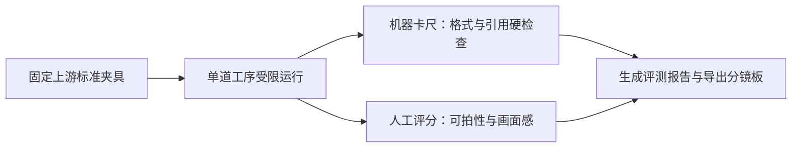
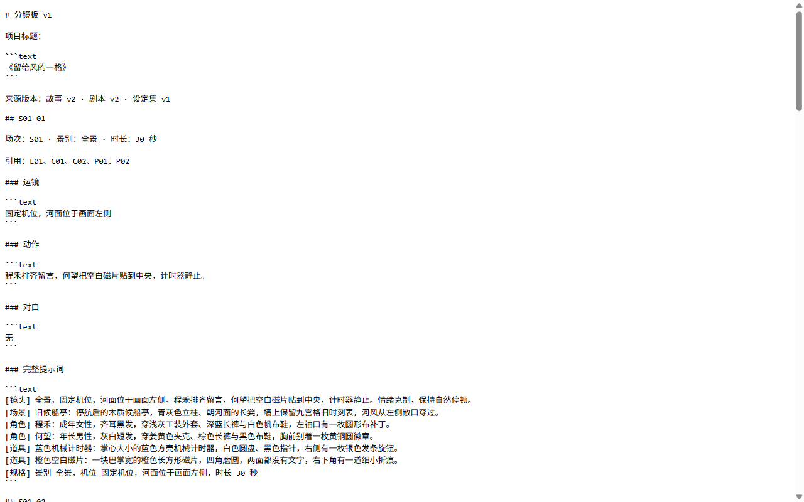
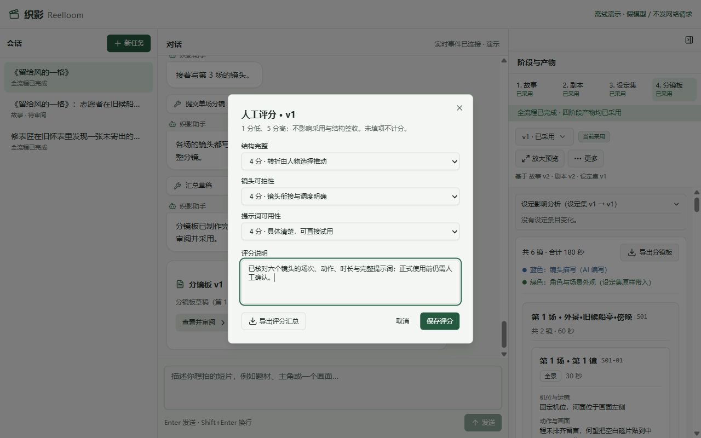

# 第 8 章 · 验好货再交稿

> 上一章：[第 7 章 · 改一处，不用推倒重来](./p07.md) · 下一章：[附录 · 搬上云端之前](./appendix-cloud.md) · [本篇入口](../README.md)

## 从一个场景开始

《留给风的一格》的四道工序全部跑通，连修改设定后的「分镜板」第 2 版也已经签字定稿了。

当你准备把织影投入团队日常使用，并把做好的分镜板发给摄影师搭档时，马上会遇到两个非常实际的问题：

- 摄影师和现场导演并不想登录你的创作系统去点一个个网页卡片，他们问你：“怎么把这页分镜板干干净净地发给我，让我带到片场直接看？”
- 团队里的工程师想升级一下底层大模型，或者微调一句系统提示词，你心里却没底：“今天演示跑通了一次，怎么证明改完之后四道工序不会突然漏字段、串角色或者卡死？”

如果每次改动都只靠人工盯着屏幕跑一两遍、肉眼抽查几个镜头，既没法放心迭代系统，也没法把最终成果顺畅地交到下游合作者手里。

核心问题是：**缺少一份带得走的标准交付文档，也缺少一套“机器查底线、人工评好坏”的验收尺子**。

## 这一章要解决什么

这一章为织影补齐收官交付与质量验收闭环：一方面提供「导出分镜板」功能，把选定版本的全部镜头与完整画面提示词一键导出为排版整洁的文档；另一方面建立“机器确定性检查 + 人工质量评分表”的双层评测体系，让你在更换模型或调整提示词时，能拿出客观的验收证据。

为什么要把“导出成品”和“双层评测”放在一起讲？因为对于一个内容生产工具来说，单次跑通只是起点，能够稳定跑通、量化评估好坏并把成品顺畅交出去，才算真正完成了从玩具到工具的跨越。

本章交付「分镜板」标准文档导出、版本独立人工评分表，以及覆盖四道工序的自动化评测报告。

> **一句话记住**：机器用卡尺守住格式底线，人工用评分表把关内容好坏；验好货再一键导出，分镜板才能放心交出去。

## 出厂卡尺与美食品鉴：为什么必须拆成两层评测

很多团队在验收 AI 产品时，容易犯两个极端错误：要么只看“程序有没有报错”，觉得只要生成出了文字就算合格；要么让另一个大模型给生成结果打个“综合 90 分”，看到高分就以为万事大吉。

在内容生产流水线里，**“格式合不合格”和“内容好不好看”是两件完全不同性质的事，必须拆成两把尺子分别去量**。

这就像食品加工厂的出厂检验：**游标卡尺量包装尺寸 + 品鉴官试吃打分**。

- 第一关用机器卡尺去量：包装盒有没有封口、生产日期和配料表有没有漏印、净含量够不够克数。这一关是硬底线，差一毫米都不准出厂，不需要人类凭感觉商量。
- 第二关请美食品鉴官试吃：汤底鲜不鲜、口感层次够不够丰富。这一关没法用卡尺量出来，必须由人对照明确的口味标准给出星级评价。

如果把这两关混成一个模糊的“平均分”，就会出现“菜里掉了异物（引用了不存在的角色），但因为文笔优美还是得了 85 分放行”的荒唐事。因此在织影中，评测被严格拆成互不替代的两层：

| 评测层级 | 回答什么问题 | 由谁执行 | 核心检查项与标准 |
|---|---|---|---|
| 第一层：机器确定性检查 | 底线合不合格 | 自动化评测脚本 | 四道工序字段齐全、剧本场号连续、设定集全覆盖、分镜引用合法、提示词外观原文百分之百带入、在预算轮数内正常交稿 |
| 第二层：人工质量评分表 | 内容好不好看 | 审稿人与产品负责人 | 故事核心冲突吸引力与四幕结构、分镜板视觉节奏与可拍性、画面提示词对下游工具的可用性 |

## 固定上游跑四道用例：看懂通过率、修正次数与成本

当我们想测试“换了一个新模型后，写「分镜板」的能力有没有退步”时，如果每次都从第 1 道「故事」开始一路串行往下跑，就会遇到一个归因难题：万一这次「分镜板」没跑通，到底是因为模型写分镜的能力变差了，还是因为今天随机生成的「故事」或「剧本」本身太怪异？

为了每次都能公平比较同一个问题，织影的自动评测采用了**固定上游夹具**的做法：

评测库里预先存好了《留给风的一格》全套标准定稿数据。当评测脚本测试第 4 道「分镜板」用例时，程序会先把标准版的故事、剧本、设定集直接作为“已采用”状态装入测试项目，然后只启动「分镜板」这一道工序。这样一来，「故事」「剧本」「设定集」「分镜板」四道评测用例各自独立，哪一道出了问题一目了然。

跑完四道工序的自动评测后，我们不看笼统的印象，而是看报告里拆开的四项硬指标：

1. **结构通过率**：四道工序是否都在规定轮数内交出了通过全部格式检查与引用闸门的草稿。如果单道工序连续跑 3 次或 5 次（重复观测），哪怕有 1 次失败，报告也会如实记录，绝不用最后一次的成功去掩盖前面的失败。
2. **闸门拦截与自我修正次数**：记录模型在交稿过程中被程序拦下了几次、最后有没有自己改对。如果拦截次数高但最终通过了，说明程序的闸门正在帮模型兜底；如果拦截之后一直改不对直到超时，说明提示词或工具说明需要优化。
3. **参数格式容错计数**：在实际测试本地开源模型时，模型有时会把本该是表格对象的内容多包一层引号，当成一整串文字提交上来，导致白白报错十几次。织影在工具入口处做了一层轻量的外壳解码：遇到多包了一层引号的结构化参数，程序自动帮它剥开外层引号再送去严格核对，并把这次“剥引号”记录在报告的参数修正次数里。这样既没有放宽任何业务检查标准，又避免了模型因为表面格式问题无谓耗尽重试次数。
4. **耗时、调用量与流水线基线标识**：如实记录每道工序消耗的时间与词元数量。同时，每份基线报告都带有明确的四道工序流水线版本标识，不会拿旧的六阶段历史数据来冒充当前基线，也禁止用离线假模型的跑分去覆盖真实大模型的评测基线。

### 真实模型跑出来是什么样

用同一套 `reelloom-4stage-v1` 固定上游夹具对本地 `ollama/qwen3.8:27b` 与 `deepseek/deepseek-flash` 各执行一次全量四道工序评测（`repeat=1`），两个模型均为 4/4 结构通过、均以 `draft_written` 结束。拦截与容错集中在两类问题：一是工具参数外壳与 JSON 语法（Qwen 触发 9 次 `coerced_args` 参数容错解码，并在「剧本」因 `scene` 参数不是合法 JSON 被拦截 1 次；DeepSeek 在「剧本」因原始参数 JSON 语法错误被拦截 1 次），二是「分镜板」的字段缺失与未引用角色串场（DeepSeek 被拦截 3 次，首次缺少镜头 `scene_id`、`prop_ids`，随后两次在 `S02-03` 描写中提到了不在本镜角色引用中的麦冬与陆岑）。这些被拦下的提交均未写入正式版本，两个模型都在同次运行的轮数预算内按报错修正并通过。四道用例耗时合计分别为 Qwen 374,669 ms、DeepSeek 93,316 ms，总 Token（`totalTokens`）分别为 86,648 与 118,469。

| 模型 | 结构通过 | 闸门拒绝 / 全部工具执行 | 参数容错解码 `coerced_args` | 各 case 耗时合计 ms | totalTokens | 配置价格估算 USD |
| --- | ---: | ---: | ---: | ---: | ---: | ---: |
| Qwen3.8 27B | 4/4 | 1/18（5.56%） | 9 | 374,669 | 86,648 | $0 |
| DeepSeek Flash | 4/4 | 4/22（18.18%） | 0 | 93,316 | 118,469 | $0.019770024 |

对 PM 来说，这说明硬闸门能在剧本和分镜板上兜住漏字段与角色串场，把错误挡在同一次运行内；但单次结构全通不等于多次运行的稳定性，也不代表创作质量评分，逐工序明细见[四工序 Qwen 与 DeepSeek 真实评测对照](../evals/runs/compare-4stage-qwen-vs-deepseek.md)。

## 一键导出分镜板与人工评分：装箱发货

当机器确定性检查替我们守住了格式与引用的硬底线，接下来就是人工对内容质量打分，并把最终成品交出去。

在右栏产物面板中，审稿人可以从“更多”菜单选择“产物评分”或“修改评分”，针对当前版本打开评分弹窗，对照评分表里的五档标准，给「故事」的吸引力与结构、或者「分镜板」的结构完整性、可拍性与提示词可用性打分，并写下具体评语。

这里的评分严格绑定到**具体版本**：比如你给「分镜板」第 1 版打了分，后来因为修改设定集执行了「重新拼装」生成了第 2 版，第 2 版不会自动继承第 1 版的分数，防止新版本顶着旧版本的高分蒙混过关。

等一切核对妥当，点击右栏「分镜板」顶部的“导出分镜板”按钮（按钮旁有辅助说明：“导出包含全部镜头的景别、动作、对白、时长与完整画面提示词。”），浏览器就会立即下载一份排版整洁的分镜板文档。

打开导出的文档，《留给风的一格》的全套拍摄信息已经按现场可执行的结构整理就绪：

- 顶部注明项目标题、导出的分镜板版本号，以及该版所依据的故事、剧本和设定集版本号；
- 下方按所存镜头顺序排列每一镜的**场号与镜号**、**景别**、**机位与运镜**、**动作**、**对白**、**时长**及**引用编号**；
- 每个镜头底部单独附上代码块格式的**完整画面提示词**（已包含蓝色镜头描写与绿色设定外观），摄影师或美术搭档拿到文档后，不用打开织影系统，直接复制代码块就能去生图或拍片。

更重要的是，导出功能同样遵守第 7 章立下的历史版本保护规则：**你选中哪一版导出，导出的就是哪一版当时的真实历史数据**。哪怕后来设定集改过好几轮，只要你切回分镜板第 1 版点击导出，拿到的依然是第 1 版原封不动的镜头与外观文字，文档顶部的来源版本清单也保留它当时的原始来源。

人工评分在网页里打，四道工序的评测报告则在 `book/build` 执行 `EVAL_FAKE=1 npm run eval`（或 `npm run eval`）运行后生成。网页上的“人工评分 · v1”弹窗展示“结构完整”“镜头可拍性”“提示词可用性”三项评分下拉框与“评分说明”输入框，底部提供“导出评分汇总”“取消”与“保存评分”按钮。

## 这一章你学到了

1. 验收内容生产 Agent 必须拆成两把尺子：用机器确定性检查守住“字段齐全、引用合法、外观原样带入”的 100% 硬底线，用人工质量评分表评估“故事吸不吸引人、分镜好不好拍”的创作上限。
2. 自动评测必须固定上游夹具、逐道工序独立测试，并如实记录重复运行的通过率、闸门拦截次数、外壳参数修正次数与真实消耗，不用单次巧合跑通代替稳定性证据。
3. 最终交付的「导出分镜板」文档把结构化镜头信息与完整画面提示词打包成带得走的标准文件，且严格按所选版本的真实历史数据导出，不被后续改动污染。

## 产品拍板

- 验收标准实行“双轨制”：机器结构检查通过率与人工质量评分严格分开展示与统计，禁止将两者加权合并成单一总分。
- 自动评测用例与四道工序一一对应（故事、剧本、设定集、分镜板），评测报告必须记录流水线版本标识，禁止用离线假模型结果覆盖真实大模型基线。
- 人工评分按具体版本独立保存，新生成的版本或零模型「重新拼装」出的新版本均不自动继承旧版本评分。
- 在右栏「分镜板」顶部提供「导出分镜板」操作，按指定版本的真实落盘内容导出包含全部镜头字段与完整画面提示词的文档，此操作不消耗模型生成配额。

## PM 该追问什么

1. 研发同学说“测试全绿通过了”，这代表的是格式和引用没出错，还是代表写出来的故事和分镜已经好看了？谁来负责后者的打分？
2. 评测第 4 道「分镜板」的时候，输入给它的故事、剧本和设定集是固定的标准夹具，还是每次现场随机生成的？
3. 评测报告里的“通过率”是跑了 1 次的结果，还是连续跑了多次的结果？中间如果有失败或被闸门拦下重交，报告里看得见吗？
4. 当我在第 2 版分镜板上点「导出分镜板」和切回第 1 版点「导出分镜板」时，导出的文档内容是不是严格对应各自版本的历史数据？
5. 如果分镜板提示词里本身带有反引号或换行符，导出的文档排版会不会乱掉？

## 动手的人看这里

> 这一节写给要动手实现的人。只想理解产品思路，可以跳到章末。

本章关注**分镜板导出、版本人工评分与四阶段自动化评测**模块，对应文件如下：

- `src/contracts/board-export.ts`、`src/server/index.ts`：提供纯函数将指定 `board` 版本的真实存储内容渲染为整洁的 Markdown 文档（正确转义反引号与多行文本，不被新设定污染历史版本导出），并暴露导出下载路由。
- `src/project/ratings.ts`、`evals/rubric.md`：维护按阶段与版本独立存储的人工评分数据结构，定义四道工序的评分维度与五档锚点（`story`：吸引力/结构；`board`：结构/可拍性/提示词可用性；重新拼装的新版本不自动继承旧评分）。
- `src/eval/evaluate.ts`、`src/eval/report.ts`、`src/eval/run-evals.ts`、`evals/cases.json`：定义四道工序评测用例（`story-draft`、`script-draft`、`bible-draft`、`board-draft`），基于固定上游夹具运行目标工序，统计结构通过率、闸门拒绝率、`coerced_args` 参数解码次数、耗时与 Token 消耗，并校验 `pipeline_version` 基线身份标识。
- `src/board-export.test.ts`、`src/eval.test.ts`、`src/rating.test.ts`：验证分镜板 Markdown 导出逐字一致性、评分版本隔离、四阶段离线评测闭环、参数容错计数与基线保护规则的离线测试。

**实现要点**：

1. 新增 `src/contracts/board-export.ts` 纯函数与导出路由，按指定 `board` 版本的真实存储内容渲染 Markdown（正确转义反引号与换行，不被新设定污染历史导出）。
2. 在 `ratings.ts` 与 `evals/rubric.md` 中收敛四阶段人工评分维度（`story`：吸引力/结构；`board`：结构/可拍性/提示词可用性；重新拼装的新版本不自动继承旧评分）。
3. 更新 `evals/cases.json` 与 `src/eval/` 为四阶段流水线，加入 `pipeline_version` 基线身份校验；假模型（`fake`）仅验证机制，无权覆盖真实模型基线。

在 `book/build` 执行 `npm test -- src/board-export.test.ts src/eval.test.ts src/rating.test.ts`、`EVAL_FAKE=1 npm run eval` 与 `npm run typecheck` 可完成离线验证。

**给 AI Coding 的任务描述**：

> **文件**：`src/contracts/board-export.ts`、`src/server/index.ts`、`src/project/ratings.ts`、`src/eval/evaluate.ts`、`src/eval/report.ts`、`src/eval/run-evals.ts`、`evals/cases.json`、`evals/rubric.md`、`src/board-export.test.ts`、`src/eval.test.ts`、`src/rating.test.ts`。
> **意图**：新增 `src/contracts/board-export.ts` 纯函数与导出路由，按指定 `board` 版本的真实存储内容渲染 Markdown（正确转义反引号与换行，不被新设定污染历史导出）；在 `ratings.ts` 与 `evals/rubric.md` 中收敛四阶段人工评分维度（`story`：吸引力/结构；`board`：结构/可拍性/提示词可用性；重新拼装的新版本不自动继承旧评分）；更新 `evals/cases.json` 与 `src/eval/` 为四阶段流水线，加入 `pipeline_version` 基线身份校验，假模型（fake）仅验证机制，无权覆盖真实模型基线。
> **验收**：导出的镜头字段与完整提示词和所选存储版本逐字一致且通过路径安全检查；四阶段离线评测全绿；基线流水线版本不匹配时明确提示。

---

到这里，从一句话想法到导出一页完整「分镜板」的八章核心旅程已经全部走完。如果你还想把织影部署到云服务器上供团队多人共同使用，接下来的[附录 · 搬上云端之前](./appendix-cloud.md) 会讲清楚怎样用最轻巧的方式管好访问钥匙、分清用户抽屉并卡住每日调用配额。

<!--
需要的截图：
1. p08-01-export-storyboard-markdown.png
   - 演示中的哪一步：在右栏「分镜板」右上角点击“导出分镜板”按钮（旁有说明“导出包含全部镜头的景别、动作、对白、时长与完整画面提示词。”）。
   - 画面内容：触发下载并展示导出的 Markdown 分镜板文档预览：包含分镜板版本号、各镜头完整段落（场号与镜号、景别、运镜、动作、对白、时长、引用编号，以及带代码块格式的完整画面提示词）。
2. p08-02-rating-and-eval-report.png
   - 演示中的哪一步：在右栏“更多”菜单选择“产物评分”或“修改评分”，打开“人工评分”弹窗，对当前版本进行人工质量打分（四道工序的评测报告通过命令行运行后生成）。
   - 画面内容：网页中央展示“人工评分 · v1”弹窗，包含“结构完整”“镜头可拍性”“提示词可用性”三个评分下拉框、“评分说明”文本框，以及底部的“导出评分汇总”“取消”“保存评分”按钮。
-->
