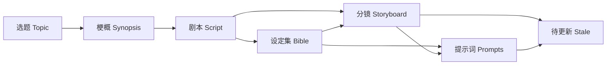

# P08 · 版本与返工：改上游，下游怎么办 / Provenance and Rework

> 上一章：[P07 · 模型写镜头，程序注入设定](./p07.md) · [本篇入口与运行命令](../README.md)

## 改需求的代价要看得见

程禾的外套从浅灰改成深灰，看起来只是几个字。设定集已经改了，分镜仍然引用程禾，完整提示词却还写着浅灰。如果六个阶段都显示已采用，人会以为所有结果仍然一致。

问题不是有没有保存旧文件，而是能否回答：这份产物当时依据哪份上游？现在依据是否还成立？本章让来源、待更新状态和人工决定共同回答这两个问题。

## 来源属于每个版本

`project.json` 的 `provenance` 按阶段和版本保存来源。例如分镜 v2：

```json
{
  "storyboard": {
    "2": { "based_on": { "script": 2, "bible": 1 } }
  }
}
```

`based_on` 的键来自 P01 的 `DEPENDENCIES`，值是写入时各依赖的采用编号。生成候选不会切换采用关系；下游继续使用人已经选中的稿子。模型也不能提交、猜测或改写来源记录。

页面在版本旁显示“基于 剧本 v2 · 设定集 v1”。没有此字段的旧版本显示“未知来源”，不推测为最新版，不自动补写历史。旧版本仍按本体 schema 读取；未知来源不能提供跨版本引用一致性的证据。遇到上游换版，对未知来源的下游保守地标记待更新。

历史内容按原始来源校验，而非拿今天的设定拒绝昨天的提示词。`original_based_on` 在人工确认有效时保留初始来源；`based_on` 表达最新的人工有效性声明。产物 JSON 始终不覆盖，审计保留声明前后的来源与理由。这区分了“当时怎样生成”与“现在确认可用”。

## 依赖图怎样传播失效



`src/project/provenance.ts` 沿同一张依赖表计算直接、间接下游，并依次检查采用版本：来源编号与当前依赖采用编号不符，或者任一依赖本身待更新，就标为 `stale`。第二个条件处理间接失效：选题变化时，剧本引用的梗概编号即使没变，梗概自身已待更新，剧本也不能继续假装有效。

`stale` 不删除产物、不撤销采用编号，可以查看、复制和审阅。它表示仍需处理的有效性问题。依赖待更新时不能继续生成下游；先恢复上游，再恢复下游。切回原采用版本时会重新计算，确实重新匹配的来源可以恢复，不会永久保留错误徽标。

只有全部六阶段都为 `adopted` 才显示全流程完成。待更新的阶段即使有采用编号，也不算完成。返工期间只新增候选，原采用仍保留；新版本始终重新待审阅。

## 重跑与确认有效是不同承诺

| 操作 | 产品含义 | 记录 |
|---|---|---|
| 返工运行 | 输入当前采用上游，创作并审阅新稿 | 二次确认、运行审计、新版本来源 |
| 按意见修改 | 预装指定原稿，只提交需要修改的场或镜头 | 意见、来源版本、重交与沿用记录 |
| 切换采用 | 人选另一份未丢弃候选，下游重新检查 | 二次确认、原编号、新编号 |
| 确认仍然有效 | 人声明旧产物在当前上游下无需修改 | 必填理由、二次确认、更新来源 |

确认有效不会请模型“判断一下”。程序先要求依赖有效，并在当前上游下复核结构、引用、覆盖或精确拼装；能通过的版本才允许声明。程序不能代替人审创意和语义。理由如“仅外观颜色变化，镜头引用与动作不变”表达了人的判断范围；空格不能充当理由。理由与确认时间随版本来源落盘，在版本信息中可查看。

若提示词仍逐字写着旧外观，确认有效会被精确拼装校验拒绝，必须重新拼装或生成。若分镜的动作与新角色背景矛盾，结构检查未必发现，仍由人选择重跑或修改。丢弃版本不能重新采用；当前采用版本不能直接丢弃，须先选择替代版本。先前要求修改的版本仍可经过审阅选择采用，审计保存这个决定。

网页按钮不是唯一防线：API 对返工运行、切换采用、确认有效、重新拼装要求 `confirmed: true`；没有这个标记就拒绝。它证明客户端显式表达了确认，不是身份认证或无法伪造的授权凭据。

## 影响分析为何不必调用模型

设定集中的编号是关系，描述是数据。程序按角色、道具、地点的 ID 比较新旧采用设定，逐字段列出变化，例如“C01：外观”。再查分镜的 `character_ids`、`prop_ids`、`location_id` 和提示词的 `injected_ids`，即可列出受影响镜号。

这是引用关系上的确定性分析，不是语义理解。新增、删除、名称、别名、来源场或性格改变都能列出；没有引用的新增条目可能没有受影响镜头。程序不知道一个隐喻是否也需要改写，也不保证被列出的每镜都必须重做。未知来源时直接显示无法可靠比较，不编造一份精确清单。

## 拼装式设计让改设定接近零模型成本

P07 把模型负责的 `shot_part` 与程序负责的固定描述分开，现在得到回报：仅 `appearance` / `description` 变化时，提示词页面开放“重新拼装”。

程序要求当前分镜有效且采用编号未变，来源设定已知，比较后确实只有固定描述变化。随后逐镜取原 `shot_part`，调用同一个 `assembleShotPrompt(shot, bible, shot_part)`，用新设定原文生成完整提示词并保存待审阅新版本。无需创建 AgentSession，也不调用模型。人查看后采用，旧版完整提示词保持原样。版本信息明确显示“由程序拼装，未调用模型”，与假模型修改区分。

这节省的是此次操作的模型请求，不能据此宣称全部返工零成本：人审、存储和计算仍有成本；分镜改变、角色增删、名称或性格改变时会禁用此入口，并说明原因。程序也不会自动重写镜头部分中可能残留的外貌文字，人仍需检查冲突。

## 中断之后怎样继续

剧本和分镜每次成功提交或删除单场、提示词每次成功提交单镜，都会原子替换 `projects/<id>/staging/<stage>.json`。其中保存暂存内容、来源编号、修改来源与已重交记录。未汇总的内容不是版本，不能采用；成功汇总后暂存标为已完成，不再作为续跑入口。

重新打开阶段时，页面显示未汇总数量。启动运行必须明确选择：

1. **从暂存继续**：创建新的受限会话，预装已保存内容，并在用户提示中列出暂存；模型可补交或修正，再汇总。按意见修改的暂存必须从同一原版本的修改入口继续。
2. **重新开始**：替换该阶段暂存，从空稿或指定修改原稿开始；已经形成的版本不删除。

上游采用编号变化时，拒绝直接继续旧暂存，需重新开始，避免把两套依据混入一个新版本。它恢复的是业务暂存，不是 SDK 历史对话、模型内部状态或精确生成进度；离线假模型会跳过已暂存的场或镜头，从下一项继续提交；对话先显示恢复数量与编号。

服务在创建会话前落盘 `run-lock.json`，正常结束标为 finished。启动时将残留 running 锁改为 `interrupted`，写本地审计并在页面明确显示“上次运行被中断”、阶段与运行开始时间；不会假报成功，也不自动请求模型。暂存继续保留供人选择。进程内互斥覆盖运行、审阅、确认与拼装。

这仍是单进程本地教学存储。状态、版本、审计、暂存与运行锁不属于一个跨文件事务；断电时可能留下孤立版本或缺少最后一条审计。不支持多个服务或 CLI 同时修改同一项目，也不构成跨用户权限隔离。

## 离线走一遍改外观与恢复

在本包执行 `HARNESS_DEMO=1 npm run dev`，打开 `http://127.0.0.1:5173`：

1. 新建项目，依次运行并采用六阶段，确认全流程完成。每阶段仍展示真实工具、校验和审阅门。
2. 回到设定集，点“返工运行”并二次确认。演示 v2 固定把 C01 程禾外套改成深灰色；查看后点“切换采用此版本”，确认切换。
3. 导航的分镜、提示词出现“待更新”。选择分镜 v1，查看“基于 剧本 v1 · 设定集 v1”和设定影响清单。提示词旧稿仍可查看。
4. 在分镜点“确认仍然有效”，填写“仅外观颜色变化，引用与动作无需修改”，确认。分镜来源更新为设定集 v2，提示词仍待更新。
5. 切到提示词，点“重新拼装”，确认。新 v2 待审阅；绿色程序注入区包含深灰外套，蓝色模型部分保持原文。审阅并二次确认切换采用，六阶段恢复完成。
6. 要看断点续跑，可返工运行剧本，在至少一张单场工具卡成功后中断；待运行结束，再运行时选择从暂存继续，或明确重新开始。结束后 Ctrl+C 关闭自己的服务。

CLI 对已采用阶段的 `run` 和切换 `adopt` 可显式附加 `--confirm`，对暂存选择 `--resume` / `--restart`。仅查看 `status` 不会启动恢复或请求模型。没有确认或暂存选择会报具体原因。

离线验收执行 `npm test`、`npm run typecheck`、`npm run build`。证据覆盖来源落盘、直接与间接失效、切回恢复、必填理由与审计、历史稿可读、字段比较与镜号映射、复用拼装函数的零模型路径、暂存继续和重新开始、来源变化拒绝续跑、残留锁恢复、未知来源与 HTTP 确认。它不证明模型理解意见或创作质量。

## 给 AI Coding 的任务描述

> **文件**：`src/project/provenance.ts`、`checkpoints.ts`、`store.ts`、`src/workflow/index.ts`、`src/agent/scene-draft.ts`、`prompt-draft.ts`、`run.ts`、`src/server/`、`web/src/ReworkPanel.tsx` 与审阅入口、离线测试。  
> **意图**：使来源、采用关系、下游有效性和业务暂存可追溯，改设定后人能看见影响并有明确恢复路径。  
> **验收**：新版本逐一记录来源；失效沿依赖传递；历史产物可看；确认有效需理由并留审计；影响按 ID 和引用计算；仅固定描述变化时用既有纯函数拼装新提示词，不创建模型会话；暂存落盘，显式续跑或重新开始；服务启动处理残留锁；未知来源不猜测；网页确认和禁用原因与 API 一致。  
> **边界**：仅文本产物，本机单进程；不接媒体生成、鉴权或外部发布，不将本地审计当作生产事务保证。

## 产品拍板

- 新候选不影响原采用关系，采用变化才检查下游。
- 待更新保留可见旧稿，依赖有效后才允许下游运行。
- 确认有效是人的有理由声明，程序继续执行结构闸门。
- 固定描述变化可重新拼装，其他变化交给修改与审阅。
- 暂存恢复需要人选择，来源变化拒绝混用，服务重启不自动请求模型。

## PM 该追问什么

1. 哪份上游产生了这份稿子？来源未知时，界面是否诚实显示？
2. 改选题是否连间接依赖的提示词也待更新？切回原版怎样重新判断？
3. 新版未采用时，下游有没有偷偷读取它？历史预览会不会被当前设定挡住？
4. 谁声明旧稿仍有效，理由是什么？程序还能挡住哪些错误，哪些要人审？
5. 影响清单是引用匹配还是语义分析？未引用新增角色应怎样处理？
6. 重新拼装有没有模型调用？旧镜头部分、固定设定原文和旧版本是否都保留？
7. 中断后恢复哪些数据？上游变了，能否继续混用旧暂存？
8. 服务崩溃被显示为中断还是成功？多文件写入和多进程并发的限制在哪里？
