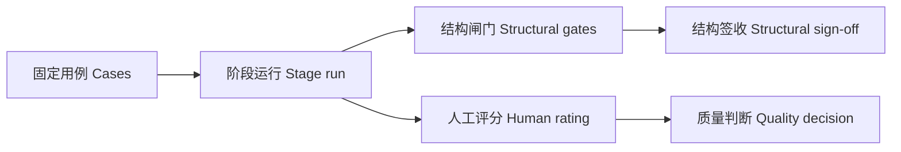

# P09 · 评测与签收：结构能签，质量要人评 / Evaluation and Human Review

> 上一章：[P08 · 版本与返工](./p08.md) · 下一章：[P10 · 上云与隔离](./p10.md) · [本篇入口与运行命令](../README.md)

## 为什么需要两层评测

六个阶段都能生成 JSON，不等于故事值得拍。分镜引用了不存在的角色，程序可以明确拒绝；角色说话没有个性，程序很难给出可靠的唯一答案。把这两类问题混成一个“质量通过率”，会让团队误以为自动绿灯代表创作已经签收。

结构层检查契约、引用、覆盖、原样注入与版本状态。规则确定，可复现，可签收。质量层由人按锚点评价吸引力、因果结构、人物差异、可拍性和提示词可用性。评分帮助比较和讨论，不自动挡住采用，也不改变结构签收。



## 固定上游，才能比较同一个问题

`evals/cases.json` 有六个 case，每个只运行一个阶段，先把 `evals/fixtures/` 中原创《留给风的一格》的全部先行阶段写入并采用。夹具固定，不拿刚生成的随机选题串到下一条 case，否则梗概失败可能来自选题变化，难以定位。

夹具逐阶段经过原有存储校验与采用门；目标阶段创建全新的受限会话，使用与网页相同的系统提示、工具白名单和 `runStage`。不开放内置工具。输出保存在独立运行目录中的项目，既有用户项目不受影响。

`src/eval/evaluate.ts` 在运行后读取新版本，通过同一套 schema 和业务规则：剧本场号连续、设定覆盖、分镜引用与来源场、提示词精确拼装。目标是保存合法待审阅版本；评测不会替人采用创作结果。只有形成有效版本、正常以 `draft_written` 停止、轮数不超 case 预算且有 usage，才判结构 PASS。模型只说“完成”但没交版本仍然 FAIL；先写成功后超轮数也 FAIL。警告仍是警告，不偷偷升级或降低原有闸门。

用例校验拒绝重复 ID、非法阶段、越界夹具名、缺上游和非法轮数。每次运行使用原有阶段上限（8／8／20／8／24／32），case 可设更严格的签收预算。`EVAL_TIMEOUT_MS` 默认每次 600000 毫秒，超时中断并记 `timeout`，已有文件保留。

## 先离线看机制，再运行真实模型

在 `book/build` 执行：

```bash
EVAL_FAKE=1 npm run eval
EVAL_FAKE=1 npm run eval -- --repeat 3
npm test
npm run typecheck
npm run build
```

假模型使用固定答案，故意先提交一份坏数据，再修正。它验证 runner、闸门、统计和落盘，不证明真实模型会修正或创作质量高。fake 的 token 是合成值、费用为零，不与真实模型比较。

真实 Ollama 由具备模型环境的评审者运行：

```bash
MODEL_ID=ollama/qwen3.8:27b NO_PROXY=127.0.0.1,localhost npm run eval
MODEL_ID=ollama/qwen3.8:27b NO_PROXY=127.0.0.1,localhost npm run eval -- --repeat 5
# 真实全量全部通过、review 运行记录后，显式建立或更新基线：
UPDATE_BASELINE=1 MODEL_ID=ollama/qwen3.8:27b NO_PROXY=127.0.0.1,localhost npm run eval
```

首次没有 `baseline.json` 时各 case 显示 new，不编造历史基线。普通运行包括 fake、repeat 均仅写被忽略的 `evals/runs/local/<model>/<run-id>/`：逐次 JSON、`summary.json`、`report.md`，以及项目下的版本、来源和 SDK 会话。`stage_run_start` 记录模型、提示、工具与上下文说明，`stage_run_end` 记录轮数、耗时、拒绝和 usage。运行摘要还保留 case 定义、attempt 和结果项目相对路径，可下钻查证。会话可能含本机路径，不直接公开整个 local 目录。

更新基线只接受非 fake、默认 Qwen、repeat=1、全量评测；不支持 `CASES` 子集。全部通过且无 regressed 或 removed 才替换基线；失败保留旧文件。当前 `evals/baseline.json` 已由验证方真实全量运行生成，该次结构通过 6/6，拒绝率 5.9%。基线随代码评审后再提交，不能用假模型结果替代。DeepSeek 可用现有模型配置作另行批准的付费对照，但不能覆盖 Qwen 基线。

预计本地六条串行单次约 10–30 分钟，repeat 5 约 50–150 分钟；这些耗时范围仍是规划估计，取决于硬件、输出和修正次数，不是下文评测的实测时长。每次默认十分钟中断，六条单次的运行等待预算约六十分钟，另加初始化与落盘时间；超时可显式调整，不能把超时失败删掉。

## 拒绝率与完成率分开读

报告保留三个口径：

- 结构通过率：PASS 次数 / 实际运行次数；repeat 中任一次失败都使整体签收 BLOCKED，退出码 1。
- 完成率：形成有效目标版本的次数 / 运行次数。一个已交版本但后来超轮数的运行可算完成，却不能结构 PASS。
- 拒绝率：写入或汇总闸门的失败执行次数 / 全部工具执行次数，包括读取。另列分子、分母；它不是恶意请求防御成功率，也不包含未进入工具执行的 SDK 参数错误。

高拒绝率可能表示闸门正在保护系统，也可能表示模型反复犯错。拒绝率下降但完成率也下降，可能是模型根本没用工具。必须结合停止原因、原始工具参数、错误和实际产物看，不能只优化单个数字。

`--repeat N` 每 case 连续执行 N 次，每次新项目和新会话；case、提示和夹具保持一致。summary 保留所有 attempt、逐 case 通过率与停止原因分布，不用最后一次覆盖前面失败。一次 100% 是一次观察，五次 100% 也不是永远稳定的保证。runner 不自动补跑失败。

与同模型基线比，PASS→FAIL 为 regressed，FAIL→PASS 为 fixed；还显示 new 和 removed。removed 阻止签收，防止删用例变绿。比较不同模型时各自报告，不把 fake 对照真实基线。

## 成本怎么读

每条 assistant 结束时累计 SDK 返回的 input、output、cacheRead、cacheWrite、totalTokens，以及由模型配置价格估算的 USD。按阶段汇总全部尝试的 token、费用和耗时，失败尝试照常计入。修正越多，输入反复进入上下文，成本可能继续增加。

本地 Ollama 价格配置为零，仍记 token 和墙钟，不代表硬件、电力或人审免费。DeepSeek 单价来自本包 `pi-agent/models.json`，按 SDK usage 和配置刊例估算，不是发票；价格变动需更新配置后重新比较。缺 usage 显示 unknown，不补造零；缺 usage 的运行不签收。墙钟含初始化、工具与磁盘时间，不能把本地 GPU 与云 API 的差值当纯模型速度。

网页最近一次运行显示耗时、token 与估算金额；跨阶段的累计统计在 eval 报告中。不要把暂存恢复时的新会话当作旧会话免费续写。

## 从真实失败到参数容错

一份保留的本地 Qwen 运行记录显示结构通过 **1/6**：只有扁平字段的提示词阶段完成，其余五阶段失败。逐条检查会话中的原始 `toolCall.arguments`，可见模型提交的不是嵌套对象，而是对象的 JSON 编码字符串：

```json
{"artifact":"{\"title\":\"留给风的一格\",\"logline\":\"志愿者与孩子为一格空白发生争执，随后共同倾听修表师未完成的告别。\",\"genre\":\"剧情\",\"audience\":\"成年观众\",\"target_minutes\":3}"}
```

内容可能已经具备所需字段，传输形态却多了一层引号。旧代码将字符串直接交给对象 schema，返回 `/ must be object`。剧本阶段留下 19 次被拒绝的单场提交，最后以 `max_turns` 停止；错误没有告诉模型该修哪个参数。记录中还出现扁平字段、点号键，以及一次 `Stream ended without finish_reason`。编码错误的修复不能据此承诺其他失败同时消失。

先保留失败，再读取 trace，才能区分工具参数表示、业务契约和模型服务错误。这里修复的是 harness 边界的容错，系统提示与阶段提示保持不变；不靠追加“不要传字符串”让问题暂时躲开。

`src/agent/tool-input.ts` 在所有接收结构化内容的自定义写入工具中，按本阶段原始 schema 遍历：只在需要对象或数组的位置，对字符串尝试一次 `JSON.parse`。`write_draft.artifact`、`write_scene.scene`、`write_scene_shots.scene`，以及内部的 `beats`、`lines`、`shots`、引用数组等都使用同一个规则。数组元素若应为对象也遵循此规则；应为文字的位置不解析，即使片名恰好像 JSON，也原样保留。未知字段不删除，缺失字段不补，扁平参数和点号键不自动猜测重组。

传输参数继续用 `Unknown` 接纳对象和字符串，避免 SDK 在业务校验之前隐式转换嵌套值；它不等于产物 schema 放宽。解码后先严格复核原 schema，再进入原有暂存、存储和引用闸门。非法 JSON 返回中文错误，说明参数路径、期望对象或数组、实际类型及一行值形态示例；数字字符串如 `artifact.target_minutes = "12"` 明确要求去掉数字外的引号。字段形态示例只解释当前值，仍须保留其余必填字段并满足完整业务规则。

这里选择**不自动转换数字字符串**，包括整数与小数：`"12"`、`"3.5"` 都不自动改成数字。数值可能涉及时长、编号、预算；把所有“像数字”的文字都改掉，会模糊契约错误并可能损坏本来合法的文字。结构化 JSON 解码与数值类型纠错是两件事：前者处理外层编码，后者给出明确错误让模型修正。

容错是 harness 的责任，但必须计数可见。运行结束摘要与每次 eval 结果新增 `coerced_args`：每成功解析一个结构位置的 JSON 字符串记 1，嵌套编码分别累计；非法 JSON 没有成功解析，不增加计数。即使解码后被 schema、引用或其他业务闸门拒绝，已经发生的解码仍计入。原始对象记 0，不改写会话中的原始工具调用参数。字段既进入 `stage_run_end`，也进入每次 eval JSON、汇总和分阶段统计；报告单独显示解码次数。历史结果没有该字段时标明未记录，不能反推为从未发生过解码。

离线测试用固定假模型复现编码表示、非法 JSON、嵌套数组、数字字符串和解码后引用拒绝，证明容错机制与原有闸门仍然成立。验证方随后完成真实模型评测，保留旧失败并将重跑写入新的 local 目录，得到以下观察。模型均为本地 `ollama/qwen3.8:27b`，Ollama 估算费用均记为 0；token 仍按实际运行累计。

| 运行 | 结构通过 | 完成率 | 拒绝率 | `coerced_args` | 总 token |
| --- | --- | --- | --- | --- | --- |
| 返工前 | 1/6 | 16.7% | 73.7%（56/76） | 未记录 | 575569 |
| 返工后全量 | 6/6 | 100% | 8.6%（3/35） | 10 | 167466 |
| repeat 3 | 18/18 | — | 11.1%（12/108） | 33 | 349401 |
| 生成基线的全量运行 | 6/6 | — | 5.9% | — | — |

“—”表示本段记录未单列该项，不代表 0。返工前记录为 `2026-11-02T18-00-33-974Z-b573f933`，返工后全量的目录尾段为 `23-18-51-645Z-d11c435d`，repeat 3 的目录尾段为 `23-27-46-987Z-92ca7362`，均位于 `evals/runs/local/ollama-qwen3-8-27b/`。这些是不同运行，不能把各次的拒绝率、token 或解码次数拼成同一次结果。

返工前，topic、synopsis、script、bible 停在 `max_turns`，storyboard 为 `no_draft`，仅 prompts 通过。返工后全量的解码次数按阶段分布为 topic 1、synopsis 1、script 4、bible 1、storyboard 3、prompts 0。真实重跑中的 `coerced_args` 每次都非零，说明模型仍在提交字符串编码的结构化参数，harness 仍需解码。这里修复的是**传输表示的兼容性**，不能把通过率提升说成模型创作能力提升；解码后仍然执行原有业务闸门。

### 一次通过 ≠ 稳定

prompts 原本没有嵌套参数，本次容错并不直接作用于它，但返工前后两次单次运行的轮数从 5 变为 15，token 从约 17k 变为约 43k；repeat 3 中平均约 18k token/次。它提醒我们：即使结构通过，同一阶段的运行路径和用量也可能大幅波动。一次通过既不能代表以后都通过，也不能代表成本稳定。

repeat 3 的 18/18 是三次重复观察全部通过的证据，不是永久稳定的保证。要同时看逐次通过情况、停止原因、拒绝次数、解码次数和 token，不能只挑一次低成本成功来承诺产品表现。当前真实基线已经生成；以后仍使用前述命令在新目录保留结果，显式更新基线须再次满足全量签收条件。

## 人工质量审阅

[评分表](../evals/rubric.md) 给每个指标的五档锚点。选版本，在审阅区展开“评分（可选）”，填相关指标、说明与具体证据，保存；刷新后仍在，新版本不继承旧分。采用、丢弃、要求修改与评分相互独立。导出汇总含阶段、版本、时间、人评来源、当前采用/审阅/有效性状态和各指标均分；空项不算零，同一作品多个版本也不是独立样本。

评分覆盖的是表达质量。JSON 里有起承转合字段，是结构证据；转折是否可信，是人的判断。先让评审者独立评价相同少量样本、对齐锚点，再扩大样本，可减少把个人偏好伪装成精确均分的问题。

模型打分没有默认请求入口。若扩展，须用单独的“模型参考”记录，保留评审模型、提示、rubric 版本与来源，明确“仅参考”。模型可能偏爱靠前答案，也可能偏爱自己的文风或自己生成的答案。随机换位置、隐藏作者、抽检与人评一致性，才能判断参考价值。一个 4.8 的模型分数不能代替人审，也不能放进结构 PASS 条件。

## 给 AI Coding 的任务描述

> **文件**：`evals/cases.json`、`fixtures/`、`rubric.md`、`src/eval/`、`src/agent/run.ts`、`src/project/ratings.ts`、`store.ts`、评分 API、`web/src/RatingPanel.tsx`、离线测试。  
> **意图**：固定上游逐阶段评测，用确定性证据签结构；人评质量独立存储并可导出。  
> **验收**：fake 全流程经过真实工具；版本和全部闸门、停止与预算共同决定 PASS；重复观察不覆盖；基线仅显式真实全量更新；失败不覆盖旧基线；按阶段计 token、耗时与估算费用；评分逐版本保存、不影响采用，导出含状态和均分。  
> **边界**：不默认调用模型打分，不以创作分替代结构门，不用 fake 建真实基线，不改第一篇的代码与基线。

## 产品拍板

- 结构签收有明确、可执行的规则，创作质量另有人负责。
- 固定夹具比较阶段能力；全链创意连贯性还要单独人审。
- 失败、拒绝、未完成与缺用量都保留，不能补跑洗白。
- 模型更换与费用估计带上环境、配置和样本口径。

## PM 该追问什么

1. 这次签的是字段与引用，还是故事好看？谁看过质量？
2. 完成率和拒绝率的分母分别是什么？模型有没有直接文字结束？
3. 每个 case 的 N 次观察是否完整？任一次失败能否找到会话和版本？
4. fixed 与 regressed 来自同一模型、同一夹具和提示吗？删了用例会不会绿？
5. token 是供应商返回还是合成？失败尝试是否计费？估算用了哪份单价？
6. 评分绑定哪个版本？未评分是不是误算零？待更新版本的高分会不会掩盖失效？
7. 模型参考评分是否随机过位置并抽检人评？它有没有偷偷决定签收？
