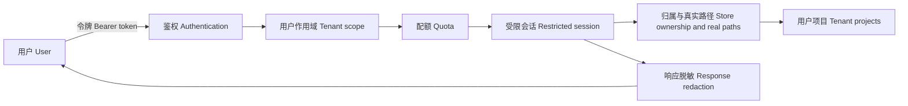

# P10 · 上云：需不需要沙盒？ / Hosting, Isolation and Quotas

> 上一章：[P09 · 评测与签收](./p09.md) · [本篇入口与运行命令](../README.md)

## 先判断能力，再决定隔离层

“这是 Agent”不是必须套容器的理由。“已经关掉 bash”也不是可以公开服务的理由。先问三个问题：

1. 模型能让程序执行任意代码、命令或浏览器脚本吗？
2. 模型能指定任意网络地址、文件路径，或让程序处理不可信文件吗？
3. 两个人同时使用时，谁能看到、修改谁的项目，最多能消耗多少资源？

前两问决定是否需要进程级或工具执行沙盒；第三问决定身份、租户权限与配额。这些层次可同时需要，不能互相替代。第一篇 [Ch5](../../harness/chapters/ch05.md) 的路径边界和 [Ch9](../../harness/chapters/ch09.md) 的累计预算在这里变成真实服务的权限与资源边界。

## 本 harness 的能力决策表

P01 关闭全部内置 `bash/read/write/edit`，并覆盖系统提示。后续新增的工具仍是有限业务接口。下表说的是**模型可调用的工具能力**；服务端为请求配置好的模型 API 发出网络请求，是另外的受信运行代码。

| 能力与工具 | 任意代码 | 任意网络 | 任意路径 | 需要守住的边界 |
| --- | --- | --- | --- | --- |
| 只读上游：`read_upstream` | 否 | 否 | 否 | 本用户、本项目、依赖表内的采用版本 |
| 写草稿：`write_draft` | 否 | 否 | 否 | 当前阶段契约、新版本、待审阅 |
| 分场暂存：`write_scene`、`remove_scene` | 否 | 否 | 否 | 已校验场号与本次剧本暂存 |
| 分镜暂存：`write_scene_shots`、`remove_scene_shots` | 否 | 否 | 否 | 场、镜、设定引用与来源 |
| 单镜提示：`list_shots`、`read_shot`、`write_shot_prompt` | 否 | 否 | 否 | 当前镜引用集合，固定描述由程序注入 |
| 汇总：`finalize_draft` | 否 | 否 | 否 | 程序排序、复核契约后追加版本 |
| 网页审阅、评分与重新拼装 | 否 | 否 | 否 | 人的令牌身份与本用户项目；模型没有采用工具 |

所以当前能力集合**不需要额外的进程级沙盒**。上云先补身份、租户隔离、配额和隐私。这个结论依赖现有工具实现，不是对 Node、SDK 或依赖漏洞的绝对安全承诺；系统提示也不承担授权。



## local 与 hosted：入口必须明确

`HARNESS_MODE` 默认 `local`。它保持原有行为：API 只听 `127.0.0.1`，无鉴权，检查本机 Host 与 Origin，项目仍在 `projects/<id>/`。

`HARNESS_MODE=hosted` 时，配置缺失或无效就拒绝启动。`HARNESS_ACCESS_TOKENS` 是 JSON 用户到令牌映射；也可用 `HARNESS_ACCESS_TOKENS_FILE` 指定本地 JSON 文件，环境变量优先。用户 ID 复用项目 ID 正则；令牌要求唯一、24–512 位非空白 ASCII 字符，部署时应使用随机值。令牌只在服务配置和内存中，不写项目、会话、数据库或审计。生产应替换为正式身份系统，接入撤销、有效期和管理流程。

所有 REST 与 SSE，包括 `/api/config`、`/api/quota`，都检查 `Authorization: Bearer ...`。无效或缺失返回 **401**“请填写有效的访问令牌后连接”。不接受查询参数传令牌，避免进入 URL、访问日志和 Referer。`HARNESS_ORIGIN` 配置网页的完整源；带其他 Origin 的请求返回 **403**。它是来源检查，不能代替令牌鉴权，也不会开放 CORS。

网页首次遇到 401 显示令牌输入。令牌存在 `sessionStorage`，读写有 try/catch；存储不可用时仍可在内存中连接，刷新需重填。连接或切换用户时先清掉当前显示的项目，再拉取新身份的数据。输入框为密码类型，提交后清空。令牌留在当前标签页会话，不进入 `localStorage`。页面上的业务项目选择记忆不承担权限。

原生 EventSource 不能设置 Authorization 请求头，所以 hosted 使用 **fetch 流式读取 SSE**，仍消费原有 `id` / `data` 帧。断开两秒后重连，期间仍轮询项目快照；缺失的文本不补造。local 继续使用 EventSource。401、403、429 都显示服务端中文原因。

## 租户隔离必须落在存储层

服务端从令牌得到用户 ID，创建固定用户的 ProjectStore、运行管理器和事件通道。请求体、查询参数和模型都不能选择用户。目录是：

```text
projects/
  alice/
    quota.json              日次数、分阶段 token / Daily runs and stage usage
    quota-audit.jsonl        配额拒绝 / Quota denials
    <project-id>/
      project.json
      artifacts/<stage>/v1.json
      staging/<stage>.json
      audit.jsonl
      sessions/*.jsonl
  bob/
    <project-id>/...
```

每个 ProjectStore 只知道自己的用户根目录。读、写、审阅、评分、中断和 SSE 都先在这个目录查项目；另一个用户的项目与随机不存在 ID 返回相同 **404**“项目不存在”。列表也只枚举本人项目。审阅与评分 actor 使用鉴权后的用户 ID。

ID 正则只是第一道门。`src/project/paths.ts` 逐级解析真实路径，尚未创建的文件回溯到最近存在的父目录；项目文件、产物、暂存、临时文件、审计、运行锁与会话目录都必须留在用户目录内。拒绝目录和文件符号链接逃逸、悬空链接，用户根目录本身也不得是指向另一个用户的符号链接。项目元数据的 ID 须与目录相同，不能借伪造元数据转移写入目标。

新用户目录权限为 0700；业务 JSON 和审计以 0600 写入。**存储目录只交给服务账号，不挂载给租户直接写入**。检查路径到实际打开文件仍有时间差；不把这些检查宣称为能抵御另一个本机进程恶意交换链接的操作系统边界。若引入不可信本机写入者，需要目录句柄等更强文件操作、独立权限或进程隔离。

## 配额：在创建会话前占名额

| 环境变量 | 默认 | 含义 |
| --- | --- | --- |
| `HARNESS_MAX_CONCURRENT` | 1 | 每用户同时运行数，不是每项目 |
| `HARNESS_DAILY_RUNS` | 20 | 每用户 UTC 自然日启动次数，跨项目累计 |
| `HARNESS_HOST` | `127.0.0.1` | hosted API 监听地址；local 忽略该配置 |
| `HARNESS_ORIGIN` | 无 | 网页请求的允许源，带 Origin 时须完全匹配 |

限额必须是正整数。每次运行先检查阶段、项目锁和修改来源，再同步预占用户并发与日次数，然后才创建 SDK 会话。不能等模型已请求后再拒绝。超并发或日次数返回 **429** 和中文原因，同时在该用户 `quota-audit.jsonl` 写 `quota_denied`，不记录令牌。

计数采用“已获准的启动尝试”：初始化失败、中断、模型错误也占一次日次数，不退还；未通过阶段校验、409 重复项目运行、429 拒绝不计。运行结束或初始化失败释放并发。并发只在本进程内存，日次数落盘，重启不会重置当日次数。日期按 UTC；跨日运行归启动日，当前日摘要不追加昨日运行用量。

`GET /api/quota` 查看本人计数、限额与各阶段用量。每阶段按 P09 的 `runStage.usage.totalTokens` 累计真实 SDK 用量，缺失记 `usage_unknown`，不伪装成零 token。这里选择**每日运行次数**作为硬额度；token 是观测数据，不是硬 token 限额，也不是供应商账单。fake 的 usage 仍是合成值。需要金额或 token 硬上限时，应像第一篇 Ch9，在工具前和下一轮模型请求前累积检查，而不是仅在结束后扣数。

这是单服务进程的最小多用户实现。不要对同一存储起多个 API 实例，也不要同时用 CLI 改 hosted 项目；CLI 仍是本机操作者入口。多副本需要共享原子配额、分布式互斥、数据库事务和独立恢复机制。

## 隐私：会话能审计，不等于能下载

P01 强制替换的是发给模型的系统提示，SDK 会话文件仍可能含 `<cwd>` 和服务器绝对路径。hosted **不提供会话原文、审计原文或任意文件下载**，也不把整个 `projects/` 当静态目录。评分导出只返回已授权的业务 JSON。

REST 与 SSE 共用响应脱敏：序列化前递归处理字符串，去掉服务根目录、Unix / Windows 绝对路径与配置令牌，再做原有模型密钥清理。初始化错误、工具结果、文本事件、业务快照和评分导出都经过这条出口。原始会话与审计留在服务器受控目录供维护者检查；脱敏不改写原始证据。它也不是通用内容审查器，用户主动写进故事的个人信息还需要产品单独定义处理规则。

hosted 可配置监听地址；启动日志明确显示“**需置于 HTTPS 反向代理之后**”。正式托管只发布 `web/dist/` 的静态网页，将同源 `/api` 转到 Node；项目、会话、令牌文件、源码和开发服务器都不公开。反向代理应保留 Authorization、不记录令牌、不缓存 SSE。

## 本地离线演示两个用户

在本包目录先生成仅本机使用、不会打印令牌的配置文件：

```bash
node --input-type=module <<'JS'
import { randomBytes } from 'node:crypto';
import { writeFileSync } from 'node:fs';
const tokens = Object.fromEntries(['alice', 'bob'].map(id => [id, randomBytes(32).toString('hex')]));
writeFileSync('.access-tokens.json', JSON.stringify(tokens), { flag: 'wx', mode: 0o600 });
JS
HARNESS_MODE=hosted HARNESS_DEMO=1 \
HARNESS_ACCESS_TOKENS_FILE=.access-tokens.json \
HARNESS_ORIGIN=http://127.0.0.1:5173 HARNESS_DAILY_RUNS=1 npm run dev
```

该文件已忽略，重复生成会拒绝覆盖。用本机编辑器查看并保管自己生成的两个令牌，不把它们贴进终端日志、截图或公开记录。这里仍是 loopback 离线演示，不能用 Vite 开发服务直接对公网部署。

打开 `http://127.0.0.1:5173`：

1. 不填令牌，看到 401 的中文提示。
2. 输入 alice 的令牌，连接，新建“A 的短片”，运行选题，等待待审阅。
3. 再建“A 的另一个短片”并运行，看到日次数 429 的中文提示。一次启动已经用了当日额度。
4. 输入 bob 的令牌并连接，列表看不到 A 的项目；新建“B 的短片”。
5. 切回 alice，列表只有 A 的项目。刷新仍是本人项目；若存储被禁用，重填令牌。

并发上限可在另一次独立演示中把日次数调高，给同一用户两个项目发运行请求；第二个项目得到并发 429。不同用户的并发互不占用。只用离线假模型即可验证这些机制。

`npm test` 的 hosted 测试实际发 HTTP/SSE，验证缺令牌 401、跨用户读写与订阅 404、编码穿越、真实链接逃逸、初始化期间的并发预占、日次数跨项目与重启保留、UTC 换日、失败释放、usage 计数与 REST/SSE 脱敏；既有 local 测试继续覆盖回环地址、无鉴权与断线轮询。`npm run typecheck` 和 `npm run build` 同时检查服务与网页接线。

## 什么时候必须升级到沙盒

| 新能力 | 新风险 | 需要补什么 |
| --- | --- | --- |
| 接入 bash 或代码执行 | 任意命令、宿主文件和进程可见 | 将不可信执行放到受限进程或容器，限制文件、网络、CPU、内存与执行时间 |
| 浏览网页或执行网页脚本 | 不可信页面、任意外连、内网探测、下载 | 隔离浏览器后端，限制出网、凭据、下载与文件访问 |
| 图片/视频生成后回写文件、渲染或转码 | 工具开始处理不可信字节、路径、外部命令 | 重审工具边界；文件验证和路径门必需，不可信渲染/转码进入执行沙盒 |
| 允许模型自选 URL、上传文件或插件 | SSRF、解析器漏洞、插件拥有宿主权限 | 网络与文件白名单；不可信插件/解析执行应隔离 |

仅调用固定的远程生成 API 并不自动产生任意代码执行，但新增下载、解码、落盘和后处理不能沿用“纯文本”的旧结论。沙盒与租户授权仍分别验收。

| 方案 | 覆盖范围 | 容易误判的地方 |
| --- | --- | --- |
| 整个 Agent 运行进程进入容器 | SDK、内置和自定义工具都在容器内执行 | 若给容器挂载全部用户数据、宿主 socket 或无限出网，权限仍然过大 |
| 只替换工具执行后端 | 将特定代码/命令/浏览工具派到隔离执行器 | **自定义工具可能仍在宿主运行**；不能因内置 bash 已隔离就认定 write_scene 或新插件也被隔离 |

选型先画每个工具的实际执行位置、可见目录、身份与网络权限，再验证拒绝证据。这里不实现沙盒，不绑定具体云厂商，也不把容器名称当作安全验收结果。

## P0 到 P10：设计决策回顾

| 章 | 决定由谁负责 | 可验收的结果 |
| --- | --- | --- |
| P00 | 人定义六阶段产物契约 | 字段、类型与样例明确 |
| P01 | 外层状态机，内层受限 Agent | 程序管阶段，模型没有通用文件或执行工具 |
| P02 | REST 发指令，SSE 看事件 | 202 与完成分开，断线回退快照 |
| P03 | 人审采用、丢弃、要求修改 | 合规草稿不自动采用 |
| P04 | 模型逐场写，程序拼装 | 单次输出预算不承担完整长剧本 |
| P05 | 从采用剧本抽取设定，人确认 | 唯一 ID、来源和覆盖复核 |
| P06 | 分镜引用由程序验收 | 不存在或来源不符的 ID 被拒 |
| P07 | 模型写镜头部分，程序注入设定 | 固定描述原样进入最终提示词 |
| P08 | 来源、失效和恢复由程序维护 | 换采用后下游不会假装仍有效 |
| P09 | 结构自动签收，质量人评 | 失败保留、重复观察、usage 可追溯 |
| P10 | 身份、路径、配额在服务端执行 | 不串租户，不裸露会话，超额可解释 |

## 给 AI Coding 的任务描述

> **文件**：`src/server/hosting.ts`、API 与运行管理、`src/project/store.ts`、`paths.ts`、网页 API/SSE 与令牌入口、离线测试。  
> **意图**：保留 local 行为，以服务端身份固定租户；在会话创建前预占配额，所有对外响应经过脱敏。  
> **验收**：所有 REST/SSE 无令牌 401；另一用户的读、写、评分和 SSE 均 404；真实路径含符号链接也不越界；每用户并发和日次数返回 429 并审计；日计数跨项目与重启保留；失败释放并发；按阶段复用 usage；hosted 不下载原始会话；令牌仅存 sessionStorage 且失败可退回内存；local 全量离线测试不变。  
> **边界**：不接正式身份系统、不写云厂商或容器部署脚本，不以配额统计冒充硬 token 预算，不以工具白名单冒充操作系统隔离。

## 产品拍板

- 当前纯文本工具没有任意执行能力，优先做租户隔离；新增工具必须重新判断。
- 另一用户的项目与不存在项目使用同一 404，不能靠 UI 隐藏列表代替权限。
- 并发按用户，日额度按 UTC 的启动尝试；失败、中断也占次数，产品应提前说明。
- 原始会话只留服务端，HTTPS、令牌文件与存储权限属于正式托管的基本配置。
- 单实例演示成立，不代表已经解决多副本的事务、配额与恢复。

## PM 该追问什么

1. 模型现在能执行什么？依据是最终工具清单、执行代码，还是一句系统提示？
2. 知道另一个项目 ID，能读详情、写草稿、评分或订阅事件吗？实际返回是否都是 404？
3. 符号链接和编码路径试过吗？是谁能够直接写服务器存储？
4. 配额在请求模型之前扣吗？初始化失败和中断算不算？服务重启能清零吗？
5. daily runs、token 观测与硬费用预算分别在哪执行？缺 usage 如何显示？
6. 用户能否下载含 cwd 的原始会话？工具错误和 SSE 文本是否也经过脱敏？
7. 新接一个自定义代码或媒体工具，究竟在宿主还是沙盒执行？隔离方案保护了哪一段？
