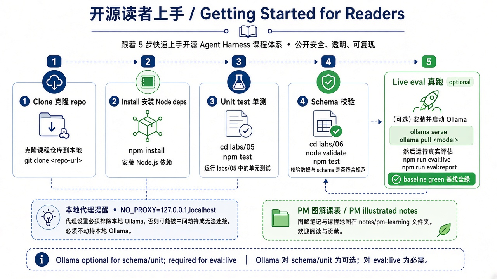

# 第 0 章 · 跑通本地栈 / Chapter 0 · Run the Local Stack

> 对照：`labs/01-model-api`、`labs/02-pi-cli` · 下一章：[第 1 章 · 看见循环](./ch01.md)



*图：从克隆仓库到第一次跑绿 / From clone to the first green run.*

## 这一章解决什么问题

在动手搭 harness 之前，先确认两件事：模型在本机能答话，pi 能连上这个模型并调用一次工具。这一章还要分清两个容易混的概念：**调用模型**只是“问一句、答一句”，模型碰不到任何文件；**运行 Agent** 则是模型提出“我要读这个文件”，由宿主程序真去读，再把结果交还给模型。后面所有章节讲的 harness，都是围绕第二件事搭起来的。

## 准备

| 需要 | 说明 |
|---|---|
| Linux 或 WSL2 | harness、Node、评测都在这里跑 |
| Node.js 20+ | `node --version` |
| Ollama + `qwen3.8:27b` | 模型服务可以在宿主机（Windows/macOS）上，只要 `127.0.0.1:11434` 能访问 |
| pi CLI | `npm install -g @earendil-works/pi-coding-agent`（装最新版即可） |

本书在 **pi 1.4.0** 上验证；pi 更新较快，更新的版本一般也能用。如遇命令或配置不兼容，可退回 `npm install -g @earendil-works/pi-coding-agent@1.4.0`。书里的代码依赖由各目录的 `package.json` + lockfile 锁定，`npm ci` 总会装到验证过的版本，与你本机全局 CLI 版本无关。

**每条访问本机模型的命令前都加 `NO_PROXY=127.0.0.1,localhost`**，否则系统代理可能劫持 `localhost`，表现为“连不上模型”或超时。

## 动手跑

**1）模型在不在、能不能答：**

```bash
NO_PROXY=127.0.0.1,localhost ollama list | grep qwen3.8
NO_PROXY=127.0.0.1,localhost curl -s http://127.0.0.1:11434/v1/chat/completions \
  -H 'Content-Type: application/json' \
  -d '{"model":"qwen3.8:27b","messages":[{"role":"user","content":"用一句话介绍你自己"}]}'
```

若 Ollama 在宿主机上、Linux/WSL 中没有 `ollama` 命令，可用 `NO_PROXY=127.0.0.1,localhost curl -s http://127.0.0.1:11434/api/tags` 查看模型列表。

这时**没有 Agent 循环，也没有工具**。你可以再问它“这个仓库 README 里写了什么”，它只能猜，因为它读不到文件。

**2）让 pi 连上本地模型。** pi CLI 读 `~/.pi/agent/models.json`。仓库里有一份可以照抄的配置：[`book/harness/pi-agent/models.json`](../pi-agent/models.json)（只含本地 Ollama，`apiKey` 是占位值 `ollama`，不是真密钥）。

先把示例中的 `ollama` provider 加入本机 `~/.pi/agent/models.json`（文件不存在就新建；已有配置则保留其他 provider），再运行下面的命令。`pi --version` 能打出版本号即可；本书验证基线是 `1.4.0`，更新的版本一般也能用。

```bash
pi --version                       # 本书基线 1.4.0；更新版本一般也可
pi --list-models qwen3.8           # 能看到 ollama / qwen3.8:27b
```

**3）第一次让 Agent 读文件**（只开只读工具）：

```bash
cd "$(git rev-parse --show-toplevel)"
NO_PROXY=127.0.0.1,localhost pi --provider ollama --model qwen3.8:27b \
  --tools read,grep,find,ls \
  -p "读取 README.md，列出这个仓库有哪些学习目录。不要修改文件。"
```

## 看什么验收

- `ollama list` 里有 `qwen3.8:27b`，`curl` 返回非空回答。
- pi 的回答和真实目录结构一致（它真的读了文件，而不是猜的）。
- 跑完后 `git status` 干净：只读工具没有改动任何文件。

## 产品拍板

- 样本栈选**本地模型**：不花钱、不外传数据、读者能复现。代价是慢：首次加载要几十秒，复杂任务要多等。
- 第一次运行只开 `read,grep,find,ls`。pi **没有默认的权限弹窗**，它拿着启动它的用户的全部权限；先只开只读工具，是这里的安全底线。

## 费曼标准答

1. 调用模型 = 把一段文字发给模型，拿回一段文字；模型自己读不了文件，也执行不了命令。
2. 运行 Agent = 模型说“我要调用 read 工具读 README.md”，**宿主程序**真去读，再把内容交还给模型。
3. 能不能读、读哪里、读完怎么办，由宿主程序说了算，这个宿主程序就是 harness。
4. 本机调用前加 `NO_PROXY=127.0.0.1,localhost`，免得代理把 `localhost` 截走。
5. 第一次运行只开只读工具：pi 没有权限弹窗，安全边界要由我们自己划。

## 下一章

[第 1 章 · 看见循环](./ch01.md)：把 Agent 跑一次的完整事件流录下来，看清“模型 → 工具 → 模型”是怎么转起来的。
