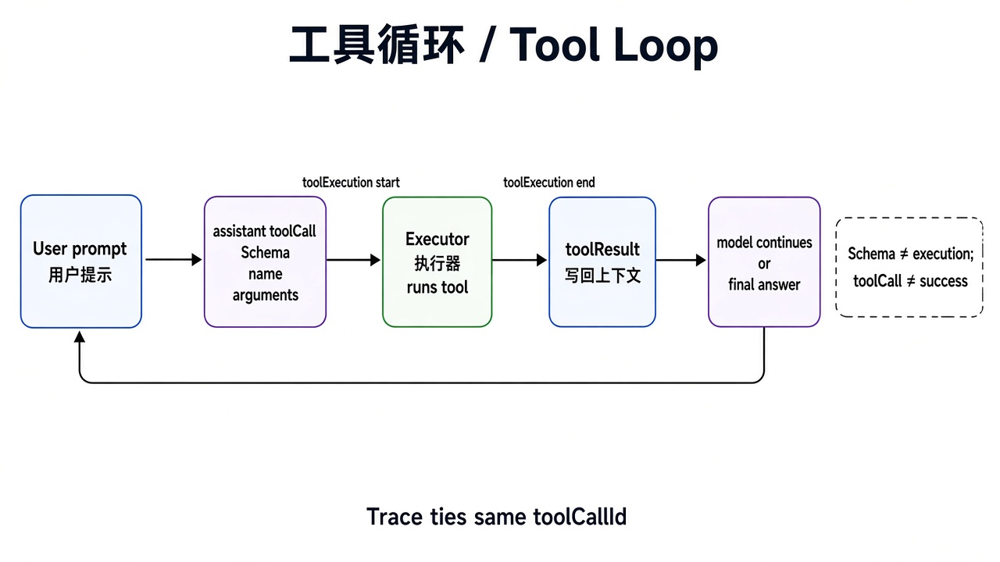

# 第 1 章 · 看见循环 / Chapter 1 · See the Loop

> 对照：`labs/03-agent-events` · 上一章：[第 0 章](./ch00.md) · 下一章：[第 2 章 · 从零写最小 harness](./ch02.md)



*图：Schema → toolCall → Executor → toolResult → 再问模型 / The tool loop.*

## 这一章解决什么问题

Agent 不是黑盒。它跑一次，背后是一串可以逐条记录的事件：用户提问、模型请求工具、宿主执行工具、结果回到模型、模型给出最终回答。这一章把这串事件完整录下来，标出其中一圈“模型 → 工具 → 模型”。后面每一道闸门，都是插在这个循环的某个位置上的。

## 动手跑

用 pi 的 JSON 模式把一次运行的事件流存成文件（只开 `read`）：

从 clone 内执行，trace 写入已被 Git 忽略的目录，避免覆盖已提交的示例、阻挡下一章切换 tag。

```bash
cd "$(git rev-parse --show-toplevel)"
NO_PROXY=127.0.0.1,localhost pi --offline --provider ollama --model qwen3.8:27b \
  --tools read --mode json --no-session -p \
  "必须调用 read 工具读取 README.md，只回答第一行标题。不要修改文件。" \
  > book/harness/traces/ch01-session.jsonl

python3 labs/03-agent-events/analyze_trace.py book/harness/traces/ch01-session.jsonl
```

## 看什么验收

在 JSONL 里按顺序找到这条链：

```text
用户提问 user prompt
  → 模型请求工具 assistant toolCall(name=read, arguments={path})
  → 宿主开始执行 tool_execution_start(toolCallId)
  → 宿主执行结束 tool_execution_end(toolCallId, isError=false)
  → 结果回到上下文 toolResult
  → 模型最终回答 assistant final answer
  → 结束 agent_end
```

同一个 `toolCallId` 把 `tool_execution_start` 和 `tool_execution_end` 串起来：这就是“一次工具调用”的完整证据。

## 真跑记录（作者本机）

一次只开 `read` 的运行：2 轮（第 1 轮模型请求 read，第 2 轮根据文件内容回答），工具调用 1 次，`isError=false`，以 `agent_end` 结束。pi 0.84 的 JSON 输出会把完整系统提示也写进去，所以文件里会出现本机路径。**公开分享 trace 之前要先脱敏**，第 6 章的评测 runner 会自动做这一步。

## 产品拍板

- 验收看 trace，不看最终那句回答。回答可以“听起来很对”，trace 才说明它到底做了什么。
- 一次任务跑几轮、调了几次工具，都能从 trace 里数出来。这是后面谈轮数上限、成本预算的基础。

## 费曼标准答

1. Agent 循环 = 模型提出工具调用 → 宿主执行 → 结果放回上下文 → 模型再想，直到给出最终回答。
2. 工具由宿主执行，模型只负责“提出请求”。
3. trace 里用同一个 `toolCallId` 把一次工具调用的开始和结束连起来。
4. 一圈“模型 → 工具 → 模型”至少要两轮：一轮提请求，一轮读结果作答。
5. 后面所有闸门都插在这个循环的固定位置：工具执行前、工具执行后、每轮结束后。

## 下一章

[第 2 章](./ch02.md)：不再用 pi CLI，自己用 pi SDK 写一个能控制、能记录的最小 harness。
