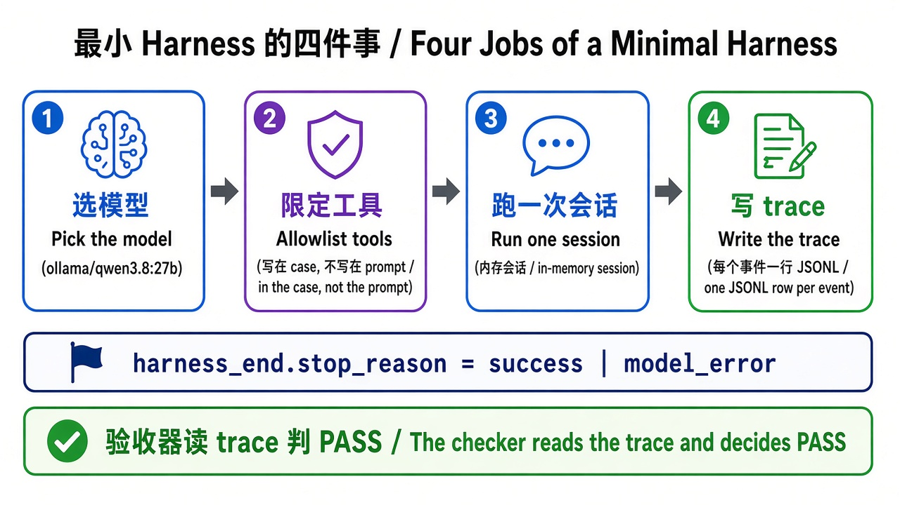

# 第 2 章 · 从零写最小 harness / Chapter 2 · A Minimal Harness from Scratch

> 对照代码：`git checkout ch02` · 上一章：[第 1 章](./ch01.md) · 下一章：[第 3 章 · 自己造工具](./ch03.md)



*图：harness 要管的几件事；本章只先做最核心的四件 / What a harness owns; this chapter builds the first four.*

## 这一章解决什么问题

pi CLI 很好用，但它替你做了所有决定：开哪些工具、记不记录、什么时候算结束。要想**控制** Agent，就得把会话握在自己手里。这一章用 pi SDK 写一个约 60 行的最小 harness，只做四件事：

1. **选模型**：显式指定 `ollama/qwen3.8:27b`。
2. **限定工具**：白名单写在代码和 case 里，不写在 prompt 里。
3. **跑一次会话**：内存会话，不落 pi 的会话文件。
4. **留证据**：每个事件压成一行 JSONL，最后写一行 `harness_end`，带上 `stop_reason`。

再配一个验收器：读 trace，判断这一次运行是否符合 case 的期望。

## 代码在哪

| 文件 | 作用 |
|---|---|
| `src/index.ts` | 读 case → 建会话 → 订阅事件 → `session.prompt()` → 写 `harness_end` |
| `src/trace.ts` | 只保留验收需要的字段（事件类型、角色、工具名、`toolCallId`、`isError`） |
| `src/check-trace.ts` | 验收器：工具有没有调用、`stop_reason` 对不对、有没有白名单外的工具 |
| `cases/cases.json` | 第一条 case：`read-happy` |

```jsonc
// cases/cases.json 里的第一条 case
{
  "id": "read-happy",
  "prompt": "必须调用 read 工具读取 lesson-input.md，然后只根据文件内容，用一句中文说明 Harness 的职责。",
  "allowed_tools": ["read"],
  "expect": { "tool_called": "read", "stop_reason": "success" }
}
```

## 动手跑

> 先按第 0 章配好本机 `~/.pi/agent/models.json`，并用 `pi --list-models qwen3.8` 确认能列出 `ollama / qwen3.8:27b`，再运行本章。本章的 harness 仍读本机配置，不会自动读取仓库里的 `pi-agent/models.json`；第 3 章才会去掉这一依赖。

```bash
cd "$(git rev-parse --show-toplevel)"
git checkout ch02
cd book/harness
npm install
npm test                                              # 离线：8 个测试，不需要 Ollama
NO_PROXY=127.0.0.1,localhost CASE_ID=read-happy npm start
npm run check -- traces/latest.jsonl read-happy       # PASS read-happy
git checkout main
```

## 看什么验收

- `npm test` 全绿。验收器自己也有测试：没写 `harness_end`、没调 `read` 就回答、用了 `bash`，这几种情况都必须判 FAIL。
- `traces/latest.jsonl` 里有 `tool_execution_start(toolName=read)`，最后一行是 `harness_end`，并且 `stop_reason=success`。
- `npm run check` 输出 `PASS read-happy`。

## 真跑记录（作者本机）

qwen3.8:27b 调用了一次 `read(lesson-input.md)`，回答“Harness 不替模型思考，而是决定模型能使用哪些工具、执行工具调用、把结果送回模型，并记录整个 Agent 循环”，和文件内容一致；`npm run check` 输出 PASS。

## 产品拍板

- **停机原因必须是一个可枚举的字段**（`stop_reason`）。本章只有 `success | model_error` 两种，之后每加一道闸门，就多一种原因。
- **验收由代码判，不由人读回答判**。case 写清“期望调用什么工具、以什么原因停”，验收器照着判。

## 费曼标准答

1. 最小 harness 只做四件事：选模型、限定工具、跑会话、写 trace。
2. 工具白名单写在 harness 的代码和 case 里，模型改不了；写在 prompt 里的只是“建议”。
3. 每次运行都以一行 `harness_end` 收尾，用 `stop_reason` 说明为什么停。
4. case 写的是期望（调用哪个工具、以什么原因停），验收器读 trace 判 PASS / FAIL。
5. 验收器本身也要有测试，否则它可能“什么都判 PASS”。

## 下一章

[第 3 章](./ch03.md)：给 harness 加一个自己写的工具，并让它不再受你本机 pi 配置的影响。
