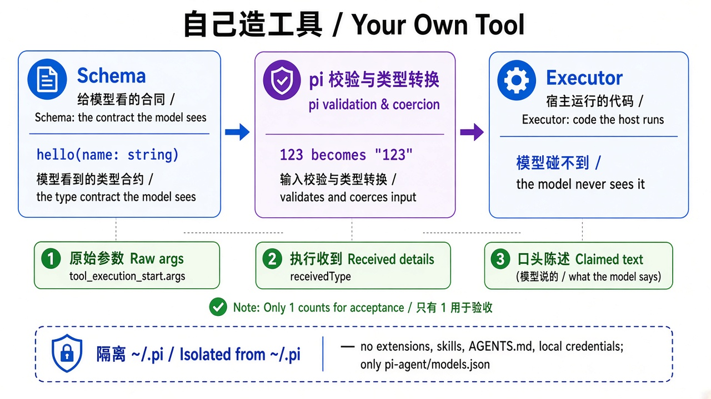

# 第 3 章 · 自己造工具 + 隔离本机配置 / Chapter 3 · Your Own Tool, Isolated from `~/.pi`

> 对照代码：`git checkout ch03` · 上一章：[第 2 章](./ch02.md) · 下一章：[第 4 章 · 刹车](./ch04.md)



*图：Schema → 校验 → Executor；验收只信原始参数 / Schema → validate → Executor; only raw args count.*

## 这一章解决什么问题

两个问题。

**第一，工具到底是什么？** 一个工具分两半：**Schema** 是给模型看的合同（叫什么、收什么参数），**Executor** 是宿主真正运行的代码。模型只能“按合同提请求”，永远碰不到执行代码。

**第二，为什么作者机器上跑出来的结果，读者复现不了？** pi 默认会读 `~/.pi/agent/` 下的扩展、技能、全局 AGENTS.md、模型清单和凭据。每台机器都不一样，同一份代码在作者机器上可能多出扩展工具、多一段系统提示。书里的 harness 必须只认仓库里的配置。

## 代码在哪

| 文件 | 作用 |
|---|---|
| `src/tools/hello.ts` | 第一个自定义工具：`parameters`（Schema）+ `execute`（Executor） |
| `src/isolated-pi.ts` | 隔离：只读 `pi-agent/models.json`，凭据和设置只放内存，不加载任何全局资源 |
| `src/trace.ts` | 新增记录：模型原始参数 `args`、executor 收到的 `details`、模型最终的回答 `text` |
| `src/check-trace.ts` | 新增断言：`expect.arg_types`，按 trace 里的真实参数类型判 |

隔离用到 pi SDK 的三处设置：

```ts
ModelRuntime.create({ credentials: new InMemoryCredentialStore(), modelsPath: "pi-agent/models.json", refreshOnCreate: false })
SettingsManager.inMemory(...)
new DefaultResourceLoader({ agentDir: "pi-agent", noExtensions: true, noSkills: true, noPromptTemplates: true, noThemes: true, noContextFiles: true })
```

再把同一个 `agentDir`、`settingsManager`、`resourceLoader` 传给 `createAgentSession`。开跑前，trace 写一行 `harness_start`，记录 `extensions`（应为 0）和 `activeTools`。

## 动手跑

```bash
cd "$(git rev-parse --show-toplevel)"
git checkout ch03
cd book/harness && npm install && npm test             # 20 个测试
NO_PROXY=127.0.0.1,localhost CASE_ID=custom-tool-call npm start
npm run check -- traces/latest.jsonl custom-tool-call  # PASS

# 招牌实验：prompt 要求传数字，Schema 要求字符串
NO_PROXY=127.0.0.1,localhost CASE_ID=custom-tool-schema-conflict npm start
grep -E '"tool_execution_(start|end)"|"text"' traces/latest.jsonl
```

## 看什么验收

- `harness_start.extensions = 0`；`activeTools` 只有 case 允许的工具；stderr 没有任何扩展告警。
- `custom-tool-call`：`hello` 的参数是 `{"name":"学员"}`，回答 `Hello, 学员!`。
- 招牌实验看三处证据：
  1. `tool_execution_start.args`：模型**原始**发出的参数（在 pi 校验之前发出，不会被改写）；
  2. `tool_execution_end.details.receivedType`：executor **实际收到**的类型。pi 会先按 Schema 把数字 `123` 转成字符串 `"123"`，所以这一项总是 `string`，**不能**用来证明模型守了规矩；
  3. 最终回答 `text`：模型**嘴上说**自己传了什么。

  验收只认第 1 处：`expect.arg_types = {"name": "string"}`。

## 真跑记录（作者本机）

隔离之前，作者机器上会加载 `pi-web-access` 等全局扩展，stderr 有告警；隔离之后，`extensions: 0`，stderr 干净。

同一个“传数字”的 prompt 跑了两次，两次 trace 里的原始参数都是字符串 `"123"`。但模型的口头说法不一样：**第一次说“我传的是 number（数字）”，这是假话；第二次如实说“字符串”**。

## 产品拍板

- 审计工具行为只看 trace 里的参数，**不看模型最终怎么说**。
- 公开教程、CI、评测必须和作者本机环境隔离，否则结果不可复现。
- 自定义工具也受白名单约束：不在 case 的 `allowed_tools` 里，就不注册。

## 费曼标准答

1. 工具 = Schema（给模型看的合同）+ Executor（宿主运行的代码），模型碰不到 Executor。
2. pi 会在调用 Executor 之前按 Schema 转换参数类型，所以 Executor 收到的类型证明不了模型守规矩。
3. 要看模型原始发了什么，看 `tool_execution_start.args`；模型嘴上说的，可能是错的。
4. 书里的 harness 只认仓库里的 `pi-agent/` 配置，不加载本机 `~/.pi` 的扩展、技能、凭据和 AGENTS.md。
5. 每次运行都在 `harness_start` 里记下加载了几个扩展、开放了哪些工具，作为隔离的证据。

## 下一章

[第 4 章](./ch04.md)：给 harness 装上第一组刹车：最多跑几轮、单个工具最多跑多久。
