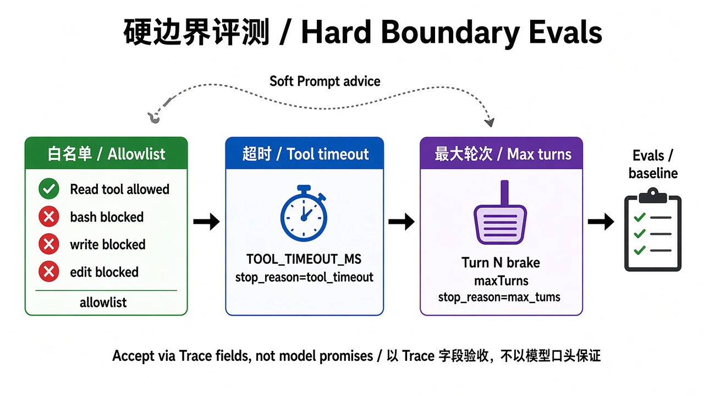

# 第 4 章 · 刹车：轮数与超时 / Chapter 4 · Brakes: Max Turns and Tool Timeout

> 对照代码：`git checkout ch04` · 上一章：[第 3 章](./ch03.md) · 下一章：[第 5 章 · 边界](./ch05.md)



*图：白名单、工具超时、最大轮数，都以 trace 字段验收，不以模型口头保证验收 / Accept via trace fields, not model promises.*
*注：图中的 `TOOL_TIMEOUT_MS` 是旧实验 lab05 的环境变量写法，本书改成写在 case 里的 `tool_timeout_ms`；图中 `max_tums` 是笔误，应为 `max_turns`。重画需求已列入缺口清单。*

## 这一章解决什么问题

模型可能一直调用工具停不下来，工具也可能卡住不返回。prompt 里写“请尽快结束”“请耐心等”都不算数：模型可以不听，卡住的工具更不会听。刹车必须装在 harness 里：

- **轮数上限**：一轮 = 模型回复一次，以及它请求的工具全部执行完。到了上限就停，不管模型还想不想继续。
- **工具超时**：harness 给**每一个**自定义工具套上同一个计时器，工具自己不需要写任何超时逻辑。

## 代码在哪

| 文件 | 作用 |
|---|---|
| `src/run-state.ts` | 全书唯一记录“为什么停”的地方：`run.stop(reason)`，第一次调用生效，写一行 `harness_stop` |
| `src/gates/max-turns.ts` | 轮数计数器；接在 pi 钩子 `session.agent.shouldStopAfterTurn` 上，每轮写一行 `turn_guard` |
| `src/gates/tool-timeout.ts` | `withToolTimeout(tool, ms, onTimeout)`：任何工具都可以套 |
| `src/tools/slow.ts` | 演示工具：按要求睡一会儿，自己没有任何超时逻辑 |
| `src/index.ts` | 闸门咬住后，用 pi 钩子 `afterToolCall` 返回 `terminate: true`，结束这一批工具调用 |

闸门参数写在 case 里，不写在 prompt 里：

```jsonc
{ "id": "max-turns-brake",    "allowed_tools": ["read"], "max_turns": 1,         "expect": { "stop_reason": "max_turns" } }
{ "id": "tool-timeout-brake", "allowed_tools": ["slow"], "tool_timeout_ms": 400, "expect": { "stop_reason": "tool_timeout" } }
```

## 动手跑

```bash
git checkout ch04
cd book/harness && npm install && npm test             # 30 个测试
NO_PROXY=127.0.0.1,localhost CASE_ID=max-turns-brake npm start;    echo "exit=$?"
npm run check -- traces/latest.jsonl max-turns-brake
NO_PROXY=127.0.0.1,localhost CASE_ID=tool-timeout-brake npm start; echo "exit=$?"
npm run check -- traces/latest.jsonl tool-timeout-brake
```

退出码约定：`0` = success；`2` = 闸门刹车（预期内的停机）；`1` = 模型或运行错误。

## 看什么验收

- `max-turns-brake`：读文件再回答至少要 2 轮；`max_turns=1` 时，trace 里出现 `turn_guard(turn=1)` → `harness_stop(stop_reason=max_turns)`，模型没有机会回答第二轮。
- `tool-timeout-brake`：prompt 里写着“请耐心等它完成”，`slow` 要睡 3000ms，harness 只给 400ms。trace 里是 `harness_stop(stop_reason=tool_timeout, timeoutMs=400)`，并且 `tool_execution_end.isError=true`。

## 真跑记录（作者本机）

`max-turns-brake`：第 1 轮读完文件就停，`turns=1`，退出码 2。`tool-timeout-brake`：约 0.4 秒时被刹住，整次运行约 3.3 秒，退出码 2。第 2、3 章的 case 回归全部 PASS。

## 产品拍板

- 轮数和超时是**产品参数**，由产品定，写在 case / 配置里，评审时能看到。
- 刹车是**预期内的停机**，要和“出错了”区分开：退出码不同，`stop_reason` 也不同。
- 超时属于 harness，不属于工具：将来新增任何工具，都会自动被同一个计时器罩住。

## 费曼标准答

1. prompt 里的“请尽快结束”只是建议，轮数上限和超时必须由 harness 强制执行。
2. 一轮 = 模型回复一次加上它请求的工具全部跑完；到上限就在下一轮之前停下。
3. 超时由 harness 统一套在每个工具外面，工具自己不用管。
4. 所有停机原因都只通过 `run.stop()` 记录，第一次生效，trace 里留一行 `harness_stop`。
5. 退出码 2 表示“闸门按预期刹住了”，不是程序坏了。

## 下一章

[第 5 章](./ch05.md)：白名单管住了“能用哪个工具”，但管不住“工具去读哪里”。
