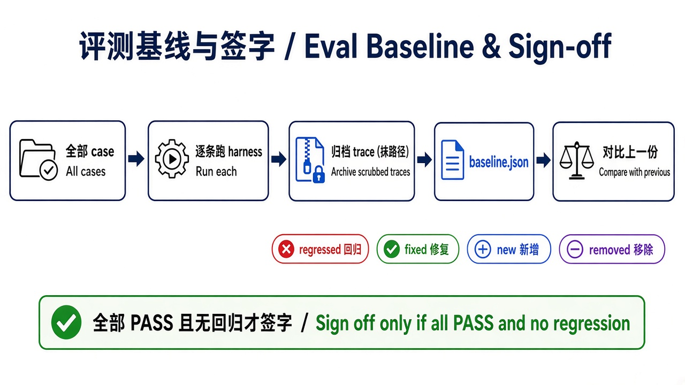

# 第 6 章 · 评测基线与签字 / Chapter 6 · Eval Baseline and Sign-off

> 对照代码：`git checkout ch06` · 上一章：[第 5 章](./ch05.md) · 下一章：[第 7 章 · 预算与降级](./ch07.md)



*图：跑全量 case → 基线 → 对比签字 / Run all cases → baseline → compare & sign-off.*

## 这一章解决什么问题

到这一章，已经有 7 条 case；`StopReason` 共 6 种（含 `success`），本基线 7 条 case 覆盖其中 4 种（`success`、`max_turns`、`tool_timeout`、`path_denied`）。以后每改一次 prompt、换一次模型、动一次闸门，都可能悄悄弄坏旧功能。需要一条命令把所有 case 跑一遍，并回答两个问题：**现在是不是全绿？和上一次比，有没有哪条从绿变红？**

## 代码在哪

| 文件 | 作用 |
|---|---|
| `src/eval/run-evals.ts` | 逐条用 case 启动 harness → 归档 trace（先抹掉本机路径）→ 用验收器判 PASS / FAIL → 写 `evals/baseline.json` |
| `src/eval/baseline.ts` | 和上一份基线比：`regressed`（PASS→FAIL）、`fixed`、`new`、`removed`；签字规则 |
| `src/eval/report.ts` | 只读报表：读已提交的基线，不跑模型 |
| `evals/baseline.json`、`evals/traces/*.jsonl` | 已提交的基线和每条 case 的 trace，读者不用跑模型也能看 |

**签字规则：全部 PASS 且没有回归，才输出 `SIGN-OFF: OK`；否则输出 `BLOCKED`，退出码 1。**

## 动手跑

> `git checkout ch06` 的副作用见[第 2 章动手跑前的说明](./ch02.md#动手跑)。全量 `npm run eval` 会改写已跟踪的 `evals/baseline.json` 与 `evals/traces/*.jsonl`；切回 main 前先处理这些本地改动（见下方命令末尾）。

```bash
cd "$(git rev-parse --show-toplevel)"
git checkout ch06
cd book/harness && npm install && npm test             # 48 个测试
npm run report                                         # 不需要 Ollama：看已提交的基线
npm run eval                                           # 需要 Ollama：全量跑并写新基线
CASES=read-happy,max-turns-brake npm run eval          # 只跑部分：不覆盖基线

# 切回 main：想保留本次 eval 结果
git stash push -u -m "ch06 eval"
git checkout main
# 不需要保留则丢弃 eval 产物后再切（只动 evals/，不动其他文件）
# git restore evals/baseline.json evals/traces && git clean -fd evals/traces
# git checkout main
```

`npm run eval` 会自动给子进程设置 `NO_PROXY=127.0.0.1,localhost`。

## 看什么验收

```text
model=ollama/qwen3.8:27b  pass=7/7
case                          result  stop_reason     tools
read-happy                    PASS    success         read
...
path-escape-denied            PASS    path_denied     read
vs previous baseline: no change
SIGN-OFF: OK（全部 PASS，无回归）
```

- 每条 case 一行：PASS / FAIL、`stop_reason`、实际调用的工具；FAIL 会附上原因。
- 和上一份基线对比，任何 `regressed` 都会挡住签字。

## 真跑记录（作者本机）

第 6 章的基线连跑两次，都是 7/7 PASS，第二次输出 “no change”。之后每章都用同一个 runner 更新基线：第 7 章 12/12，第 8 章 15/15，第 9 章 18/18，第 10 章 20/20，从来没有出现回归。

## 产品拍板

- **改动之前先有基线**：没有基线，就说不清这次改动是变好了还是变坏了。
- 签字看报表和 trace。“模型这次答得挺好”不算证据。
- 基线和 trace 一起提交进仓库，评审的人不用跑模型也能核对。

## 费曼标准答

1. 评测基线 = 所有 case 一次跑完的结果快照，包括每条的 PASS / FAIL、`stop_reason` 和调用的工具。
2. 回归 = 上一次 PASS、这一次 FAIL。有回归就不能签字。
3. 签字规则只有一条：全部 PASS 且没有回归。
4. 每条 case 的 trace 都归档，签字时可以逐条下钻核对。
5. 存档前抹掉本机路径，基线可以放心放进公开仓库。

## 一次全过 ≠ 稳定 / Pass once ≠ stable

一次 `SIGN-OFF: OK` 只说明**这一次**全绿。模型有随机性：同一条 case、同一套 prompt 和闸门，下次可能换路径、漏调工具，或直接用文字搪塞。要看稳定性，就把每条 case **连续跑 N 次**，看通过率和 `stop_reason` 是否一致。

在 `book/harness` 里：

```bash
NO_PROXY=127.0.0.1,localhost npm run eval -- --repeat 5
npm run report -- evals/runs/<model-slug>/<run-id>/summary.json
```

`--repeat N`（也可用 `--repeat=N`）默认是 1；N>1 时结果写到 `evals/runs/<model-slug>/`，**不覆盖**签收基线 `evals/baseline.json`。通过率低于 100%（含 0%）标为 flaky；任一次失败都会退出码 1，且不自动补跑。更细的说明见 `src/eval/usage.md`。

### qwen3.8:27b · repeat 5 结果

数据来自 `evals/runs/qwen3.8-27b/2026-11-02T04-04-19-004Z-844d8b95/`（`summary.json` / `report.md` / `acceptance.md`）。模型 `ollama/qwen3.8:27b`，20 条 case × 5 次 = **99/100** 通过；签收 `SIGN-OFF: BLOCKED`。

| 汇总 | 数字 |
| --- | --- |
| 总通过 | 99/100 |
| flaky case 数 | 1（其余 19 条均为 5/5） |
| 唯一 flaky | `tool-timeout-brake` · 4/5（80%） |

| case | pass | flaky | stop_reason 分布 |
| --- | --- | --- | --- |
| tool-timeout-brake | 4/5 | yes | success: 1，tool_timeout: 4 |

第 1 次失败：`stop_reason=success`，工具列表为空，验收原因是「expected tool_timeout」且「tool slow not called」。模型声称没有 `slow`，列举了未开放的通用工具，未发起调用就以 success 结束——超时闸门根本没机会介入。另 4 次都调用了 `slow`，并以 `tool_timeout` 按预期停下。失败 trace：

`evals/runs/qwen3.8-27b/2026-11-02T04-04-19-004Z-844d8b95/traces/tool-timeout-brake-1.jsonl`

结论能支撑的部分：一次全过掩盖不了偶发漏调；本轮 flaky 是**模型未进入工具执行**，不能据此说超时闸门坏了。5 次只是本轮观察，不足以保证以后同样稳定。

### PM 该问什么

1. 同一套评测 `--repeat N` 的总通过率是多少？哪几条 flaky？
2. flaky 是闸门没拦住，还是模型根本没走到闸门（例如漏调工具、文字搪塞）？
3. 失败有没有可下钻的相对路径 trace？有没有自动补跑把 FAIL 洗成 PASS？

## 下一章

[第 7 章](./ch07.md)：上下文会被撑爆，外部服务会失败。harness 要决定是停下，还是降级继续。
