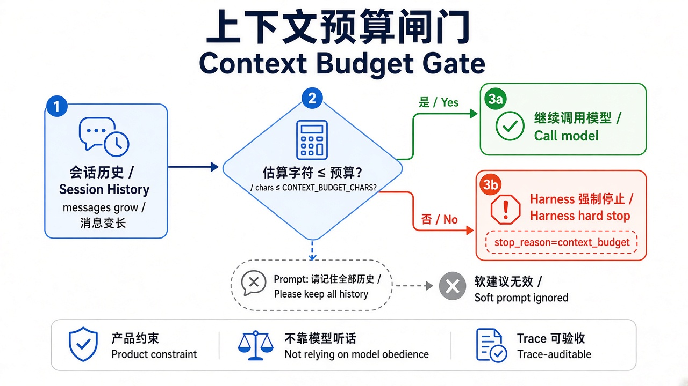
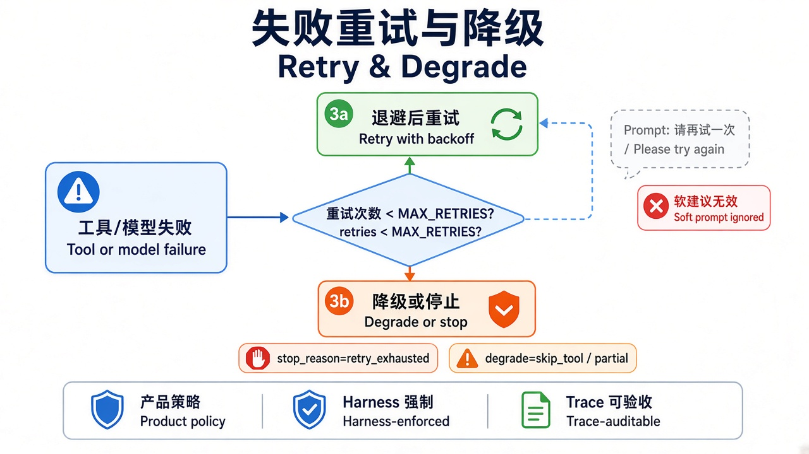

# 第 7 章 · 上下文预算与重试降级 / Chapter 7 · Context Budget, Retry and Degrade

> 对照代码：`git checkout ch07` · 上一章：[第 6 章](./ch06.md) · 下一章：[第 8 章 · 人机确认门](./ch08.md)



*图 1：上下文窗口有限，超了要么停、要么截 / The context window is finite: stop or truncate.*



*图 2：失败先由 harness 重试，次数用完后由产品决定停机还是降级 / Harness retries first; when retries run out, the product decides: stop or degrade.*

## 这一章解决什么问题

真实任务里有两类“慢性病”：

- **上下文被撑爆**：读一份长文档，几万字一下子塞进上下文，后面的模型调用越来越慢、越来越贵，最后超出窗口。
- **外部服务不稳定**：天气、搜索、数据库偶尔失败。指望模型自己“再试一次”不可靠，它可能放弃，也可能干脆编一个结果。

这两件事都要求 harness 先做决定：**是停下，还是降级继续？** 本章两种都实现，选哪种由 case（也就是产品）决定。

## 代码在哪

| 文件 | 作用 |
|---|---|
| `src/gates/context-budget.ts` | 估算上下文字符数（token 的教学代理）；把超长的工具结果截断并打上标记 |
| `src/index.ts`（`finishTurn`） | 每轮结束估算一次，写进 `turn_guard.contextChars`；超出 `context_budget_chars` 就在**下一次模型调用之前**停（`context_budget`） |
| `src/index.ts`（`afterToolCall`） | 超出 `tool_result_max_chars` 就截断，记一行 `tool_result_truncated`，然后继续。对 pi 内置的 `read` 同样生效 |
| `src/gates/retry.ts` | harness 在 executor 外面重试 `max_retries` 次，指数退避，每次记一行 `tool_retry`；次数用完：`stop` → `retry_exhausted`，`degrade` → 返回标注为 `[degraded]` 的兜底结果，记一行 `tool_degraded` |
| `src/tools/flaky.ts`、`fixtures/big-notes.md` | 演示用：前 N 次必定失败的天气工具；一份约 1.5 万字符的会议纪要 |

两层包装的顺序：**重试在内层**（每次尝试单独计），**超时在外层**（罩住全部尝试）。

## 动手跑

```bash
cd "$(git rev-parse --show-toplevel)"
git checkout ch07
cd book/harness && npm install && npm test             # 59 个测试
for c in context-budget-brake tool-result-truncate retry-recovers retry-exhausted-brake retry-degrade; do
  NO_PROXY=127.0.0.1,localhost CASE_ID=$c npm start >/dev/null 2>&1
  npm run -s check -- traces/latest.jsonl $c
done
```

## 看什么验收

| case | 设置 | 期望 |
|---|---|---|
| `context-budget-brake` | 预算 6000 字符 | 读完长文档后上下文约 1.5 万字符 → `context_budget` |
| `tool-result-truncate` | 工具结果上限 1500 字符 | `tool_result_truncated` + `success` |
| `retry-recovers` | 前 2 次失败，重试 2 次 | `tool_retry`×2 + `success` |
| `retry-exhausted-brake` | 一直失败，重试 2 次，`stop` | `retry_exhausted` |
| `retry-degrade` | 一直失败，重试 1 次，`degrade` | `tool_degraded` + `success` |

验收器新增 `expect.events`：trace 里必须有对应的事件证据，比如 `{"tool_retry": 2}`。

## 真跑记录（作者本机）

- `context-budget-brake`：第 1 轮结束时上下文 15027 字符，在第 2 次模型调用之前停下，整次约 1.5 秒。
- `tool-result-truncate`：读到的 14976 字符被截到 1500，模型仍然给出了三句概括。
- `retry-recovers`：两次重试后拿到“晴，18°C”，模型完全不知道之前失败过。
- `retry-degrade`：模型如实回答“天气服务两次尝试后均不可用，无法提供天气信息”，**没有编造数据**。

## 产品拍板

- 停机还是降级，是产品决定，不是工程细节：宁可不答也不乱答（stop），还是先给一个打了标记的不完整答案（degrade）。
- 降级结果必须**明确标注**。模型和用户都要知道“这部分数据缺了”。
- 重试次数和退避时间要有上限，否则一个坏掉的服务会拖垮整次运行。

## 费曼标准答

1. 上下文预算在每轮结束时检查，超了就在下一次模型调用之前停，不把超大上下文再喂给模型。
2. 另一条路是截断单次工具结果并打上标记，然后继续：这是降级，不是失败。
3. 工具失败由 harness 重试，次数有上限，还要退避，每次都在 trace 里留一行。
4. 重试用完后，按产品决定停机（`retry_exhausted`）或返回标注过的兜底结果（`tool_degraded`）。
5. 拿到降级结果的模型应当说明“数据缺失”，而不是编一个；trace 能证明它是不是这么做的。

## 下一章

[第 8 章](./ch08.md)：第一次让 Agent 写文件。写之前，要先问人。
