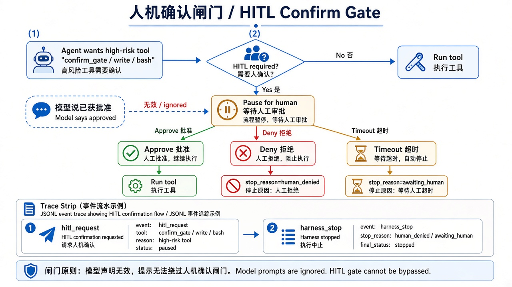

# 第 8 章 · 人机确认门 + 第一次写入 / Chapter 8 · Human Confirm Gate and the First Write

> 对照代码：`git checkout ch08` · 上一章：[第 7 章](./ch07.md) · 下一章：[第 9 章 · 成本与延迟](./ch09.md)



*图：有副作用的动作执行前必须由人确认；拒绝或超时就不执行 / Side-effecting actions need a human yes; deny or timeout means no.*

## 这一章解决什么问题

前七章只开只读工具。真正有用的 Agent 迟早要**改东西**：写文件、发消息、下单。这类动作一旦做了就收不回，所以本章同时加两道门：

1. **只能写指定目录**：能读的地方 ≠ 能写的地方。`src/` 在 workspace 里、可以读，但不能写。写类工具（pi 内置的 `write`、`edit`）的路径必须落在 case 的 `writable_dirs` 里。
2. **写之前问人**：`confirm_tools` 里的工具，执行前必须得到人的明确同意。

顺序是**先过策略，再问人**：越界的请求直接拦下，不去打扰人。

## 代码在哪

| 文件 | 作用 |
|---|---|
| `src/gates/tool-policy.ts` | 第 3 道检查：写类工具的路径必须在 `writable_dirs` 里，否则 `path_denied`（原因记为 `not in writable_dirs`） |
| `src/gates/hitl.ts` | 三种确认者：终端 `y/N`（只有明确输入 `y` 才算同意，超时视为拒绝；默认超时 60 秒，`HITL_TIMEOUT_MS=60000`，可用环境变量覆盖）；评测用的“模拟的人”（来自 case 的 `hitl_decision`，trace 标 `by: simulated`）；什么都没配置 = 一律拒绝 |
| `src/index.ts`（`beforeToolCall`） | 策略过了，再写 `hitl_request` → 问人 → 写 `hitl_decision`；拒绝就 `block` 并停机（`human_denied`） |
| `src/index.ts` | 每次运行前清空可写目录，保证产物只来自这一次运行（`workspace/` 不进仓库） |

## 动手跑

> `git checkout ch08` 的副作用见[第 2 章动手跑前的说明](./ch02.md#动手跑)；跑完后 `git checkout main`。

```bash
cd "$(git rev-parse --show-toplevel)"
git checkout ch08
cd book/harness && npm install && npm test             # 69 个测试

# 亲手当一次“人”：终端会问你要不要允许写入
NO_PROXY=127.0.0.1,localhost HITL_MODE=tty CASE_ID=hitl-approve-write npm start
cat workspace/out/note.md

# 评测用的三条 case（模拟的人）
for c in hitl-approve-write hitl-denied-brake write-outside-writable-denied; do
  NO_PROXY=127.0.0.1,localhost CASE_ID=$c npm start >/dev/null 2>&1
  npm run -s check -- traces/latest.jsonl $c
done
```

## 看什么验收

| case | 期望 | trace 里的证据 |
|---|---|---|
| `hitl-approve-write` | 写入成功，`success` | `hitl_request` → `hitl_decision(approved=true)` → `write` 执行成功 |
| `hitl-denied-brake` | 不执行，`human_denied` | `hitl_decision(approved=false)` → `harness_stop` → `write` 执行失败 |
| `write-outside-writable-denied` | 写 `src/hacked.ts` 被拦，`path_denied` | **没有** `hitl_request`：在问人之前就被策略挡下 |

## 真跑记录（作者本机）

- 同意：`workspace/out/note.md` 写入“第 12 场：道具清单已与美术组核对完毕。”
- 拒绝：`workspace/out/` 为空。
- 越界：`src/hacked.ts` 没有生成。
- 终端模式下输入 `y` → `success`，输入 `n` → `human_denied`，trace 里都记为 `by: human`。

## 产品拍板

- 哪些动作必须问人（`confirm_tools`），是产品清单，不是工程师临场决定。
- **安全默认是拒绝**：没人确认、确认超时、确认者没配置，都按“不同意”处理。
- 每一次确认都留痕：谁确认的、同意没有、为什么。评测里“模拟的人”要明确标出来，不能冒充真人。

## 费曼标准答

1. 能读的地方不等于能写的地方：写类工具只能写 `writable_dirs`。
2. 有副作用的工具执行前必须由人确认，只有明确说“是”才执行。
3. 先过策略再问人：越界的请求直接拦下，不浪费人的注意力。
4. 没人回答、超时、没配置确认者，一律视为拒绝。
5. trace 里成对出现 `hitl_request` 和 `hitl_decision`，并且写明是真人还是模拟的人。

## 下一章

[第 9 章](./ch09.md)：每一步都不贵、不慢，加起来却可能超支、超时。
