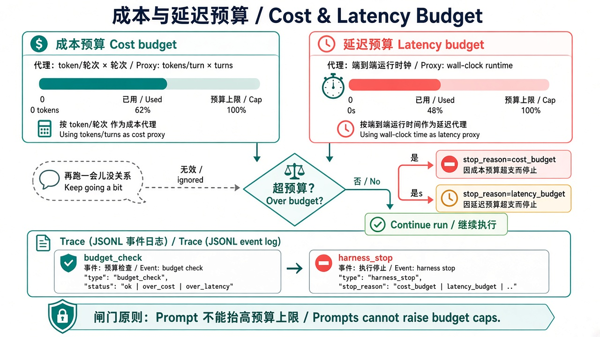
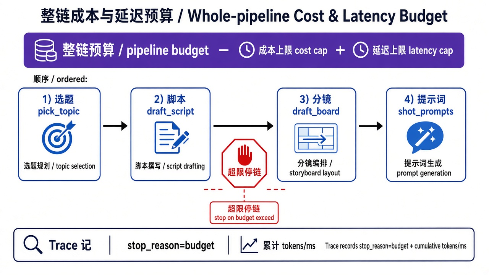

# 第 9 章 · 成本与延迟预算 / Chapter 9 · Cost and Latency Budget

> 对照代码：`git checkout ch09` · 上一章：[第 8 章](./ch08.md) · 下一章：[第 10 章 · 综合项目](./ch10.md)



*图 1：成本和延迟各有一道闸，超限就停，并留下证据 / Separate brakes for cost and latency, with evidence.*



*图 2：预算罩住整条链路，不是单步上限 / The budget covers the whole run, not each step.*
*注：图 2 原本画的是旧实验 lab07 的固定流水线，概念相同：本书把“整条流水线”换成了“整次 Agent 运行”。*

## 这一章解决什么问题

第 4 章的超时管的是“**单个工具**最多跑多久”。但一次任务可能有好几轮模型调用、好几次工具调用：每一步都在限额以内，加起来照样会超支、超时。用户感受到的是**整次运行**花了多少钱、等了多久。

- **成本**：累计 pi 报告的真实 token 用量（`message.usage`）。本地模型不花钱，就用 token 数当成本的代理；接云模型时换成金额即可。
- **延迟**：从运行开始算的墙钟时间。

两处检查：**每轮结束后**（下一次模型调用之前）、**每个工具开始之前**。

## 代码在哪

| 文件 | 作用 |
|---|---|
| `src/gates/budget.ts` | `createBudgetGuard({ tokenBudget, latencyBudgetMs })`：`recordUsage()` 累计 token，`check()` 返回 `cost_budget` / `latency_budget` 或“未超”；`0` 表示不设该项预算 |
| `src/index.ts`（`finishTurn`） | 每轮记账：`turn_guard.tokens`、`turn_guard.elapsedMs`；超了就在下一次模型调用之前停 |
| `src/index.ts`（`beforeToolCall`） | 已经超支或超时，就不再开始新的工具 |

## 动手跑

> `git checkout ch09` 的副作用见[第 2 章动手跑前的说明](./ch02.md#动手跑)；跑完后 `git checkout main`。

```bash
cd "$(git rev-parse --show-toplevel)"
git checkout ch09
cd book/harness && npm install && npm test             # 75 个测试
for c in budget-within-limits cost-budget-brake latency-budget-brake; do
  NO_PROXY=127.0.0.1,localhost CASE_ID=$c npm start >/dev/null 2>&1
  npm run -s check -- traces/latest.jsonl $c
  grep -o '"eventType":"turn_guard"[^}]*' traces/latest.jsonl
done
```

## 看什么验收

| case | 设置 | 期望 |
|---|---|---|
| `budget-within-limits` | 预算宽松 | `success`；`turn_guard` 里能看到 token 和耗时逐轮累加 |
| `cost-budget-brake` | `token_budget=300` | 系统提示加工具清单本身就上千 token → 第 2 次模型调用之前停，`cost_budget` |
| `latency-budget-brake` | `latency_budget_ms=1500`，**没有**单步超时 | `latency_budget` |

## 真跑记录（作者本机）

- `budget-within-limits`：第 1 轮累计 912 token、2.3 秒；第 2 轮累计 1931 token、3.4 秒；`success`。
- `cost-budget-brake`：第 1 轮结束时已用 906 token，超出 300 的预算，没有进入第 2 次模型调用。
- `latency-budget-brake`：第一次模型调用就用掉 1.9 秒，超出 1.5 秒预算；harness 在 `slow` 工具**开始之前**就停了。这说明“工具开始前也查一次预算”是必要的：否则还要白白多等 2.5 秒。

## 产品拍板

- 预算按**整次运行**定，和用户的感受一致；单步超时（第 4 章）是另一道闸，两者都要。
- 超预算要有独立的 `stop_reason`（`cost_budget` / `latency_budget`），不能混进“出错了”。这样产品才能区分“系统坏了”和“系统守住了预算”。
- 本地模型用 token 代替金额。换成云模型时只换单价，闸门逻辑不变。

## 费曼标准答

1. 单步超时管一个工具；整次预算管从开始到结束的所有轮、所有工具。
2. 成本按真实 token 用量累计；本地模型用 token 当代理，云模型换算成金额。
3. 每轮结束后、每个工具开始前各查一次，超了就不再开始下一步。
4. 每一步都合规，加起来也可能超预算，所以预算必须罩住整次运行。
5. trace 里逐轮记录累计 token 和耗时，超限时写明用了多少、预算多少。

## 下一章

[第 10 章](./ch10.md)：把前面所有闸门同时打开，让 Agent 交付一个小产品。
