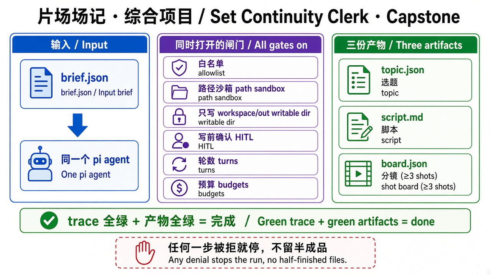

# 第 10 章 · 综合项目：片场场记（精简版） / Chapter 10 · Capstone: Set Continuity Clerk (Lite)

> 对照代码：`git checkout ch10` · 上一章：[第 9 章](./ch09.md) · 回到[目录](../README.md)



*图：同一 agent、全闸门、三份产物 / One agent, all gates, three artifacts.*

## 这一章解决什么问题

前面每章只练一道闸门。真实产品里，所有闸门是**同时**打开的，而且光是“过程守规矩”还不够，**交付的东西也得对**。

这一章的虚拟产品叫“片场场记”：给它一份短视频需求（`fixtures/brief.json`），它要依次交付三份产物：

1. `workspace/out/topic.json`：选题（标题、开场钩子、受众、时长、平台）
2. `workspace/out/script.md`：脚本（`# 脚本`，以及 `## 标题`、`## 开场钩子`、`## 正文`）
3. `workspace/out/board.json`：分镜（`scenes`，以及至少 3 个 `shots`，每个都有 `shot_id`、`scene`、`description`）

它和旧实验 `labs/07-set-clerk` 的区别在于：那里是**写死顺序的流水线**，按步骤调用模型；这里是**同一个 pi agent** 自己决定怎么调用工具，harness 只负责守住边界、记录证据、验收结果。

## 一次运行用上的所有闸门

| 闸门 | 来自 | case 里的设置 |
|---|---|---|
| 工具白名单 + 路径沙箱 | 第 2、5 章 | `allowed_tools: ["read", "write"]` |
| 只能写一个目录 | 第 8 章 | `writable_dirs: ["workspace/out"]` |
| 每次写入前问人 | 第 8 章 | `confirm_tools: ["write"]` |
| 轮数上限 | 第 4 章 | `max_turns: 12` |
| 工具结果截断 | 第 7 章 | `tool_result_max_chars: 4000` |
| 成本、延迟预算 | 第 9 章 | `token_budget: 80000`、`latency_budget_ms: 600000` |

## 新能力：产物验收

| 文件 | 作用 |
|---|---|
| `src/check-artifacts.ts` | 检查交付物：JSON 字段、数组至少几条、每一项的字段、Markdown 标题必须独占一行；`write_order`：每个文件**第一次成功写入**的先后顺序 |
| `src/check-trace.ts` | `checkCase()` = trace 检查 + 产物检查，两者都绿才算过；`artifacts_absent`：失败时不能留下半成品 |
| `src/eval/run-evals.ts` | `npm run eval` 同时检查 trace 和产物 |

**trace 证明过程守规矩，产物检查证明交付物是对的。**

## 动手跑

```bash
cd "$(git rev-parse --show-toplevel)"
git checkout ch10
cd book/harness && npm install && npm test             # 82 个测试
NO_PROXY=127.0.0.1,localhost CASE_ID=capstone-set-clerk npm start
npm run check -- traces/latest.jsonl capstone-set-clerk
cat workspace/out/topic.json workspace/out/script.md workspace/out/board.json

# fail-stop：人拒绝第一次写入
NO_PROXY=127.0.0.1,localhost CASE_ID=capstone-fail-stop npm start
npm run check -- traces/latest.jsonl capstone-fail-stop
ls workspace/out                                       # 应为空

# 全书 20 条 case 一次跑完并签字
npm run eval
```

## 看什么验收

- `capstone-set-clerk`：`stop_reason=success`；`read` 和 `write` 都执行成功；3 次 `hitl_decision`；写入顺序是 topic → script → board；三份产物全部通过结构检查。
- `capstone-fail-stop`：第一次写入被拒 → `human_denied`；`write` 一次都没执行成功；`workspace/out/` 里**什么都没有**。
- `npm run eval`：20/20 PASS，`SIGN-OFF: OK`。

## 真跑记录（作者本机）

- 成功的一次：5 轮，累计 8905 token，三次写入都经过（模拟的）人确认，三份产物全部合规。
- fail-stop：第 1 轮读完 brief，第一次写入被拒后立即停下，累计 2717 token，没有留下任何文件。
- 稳定性：综合项目又单独跑了 3 次，全部 PASS；模型有时会在写入之间再读一次 brief，验收不受影响，因为写入顺序只看每个文件第一次成功写入的时间。
- 全书基线：20/20 PASS，和上一份基线相比没有变化。

## 产品拍板

- “完成”的定义是 **trace 全绿 + 产物全绿**，缺一不可：文案写得好但路径不对，不算过；路径对但字段缺了，也不算过。
- 失败策略是 **fail-stop**：任何一步被拦或被拒，整条线停下，不交半成品。要不要允许“半成品降级交付”，是另一个需要产品单独拍板的选项。
- 产物的结构要求（字段、条数、标题）写进 case，评审时可以逐条对照。

## 费曼标准答

1. 综合项目让同一个 pi agent 在所有闸门同时打开的情况下交付三份产物，harness 守边界、记证据、做验收。
2. trace 证明过程守规矩，产物检查证明交付物对，两者都绿才算完成。
3. 写入顺序只看每个文件第一次成功写入的先后，中间重读、重写不影响判定。
4. 任何一步被拒或被拦，整条线停下，不留半成品，这叫 fail-stop。
5. 全书 20 条 case 一条命令跑完，全部 PASS 且没有回归才签字。

## 回顾全书

| 章 | 学会什么 | 证据 `stop_reason` |
|---:|---|---|
| 0–1 | 模型 vs Agent，看见循环 | — |
| 2 | 最小 harness：选模型、限定工具、写 trace | `success`、`model_error` |
| 3 | Schema vs Executor；隔离本机配置 | — |
| 4 | 轮数上限、工具超时 | `max_turns`、`tool_timeout` |
| 5 | 白名单复核、路径沙箱 | `tool_denied`、`path_denied` |
| 6 | 评测基线、回归、签字 | — |
| 7 | 上下文预算、重试与降级 | `context_budget`、`retry_exhausted` |
| 8 | 只写指定目录、人机确认 | `human_denied` |
| 9 | 整次运行的成本与延迟预算 | `cost_budget`、`latency_budget` |
| 10 | 所有闸门同时打开，交付并验收产物 | 以上全部 |
