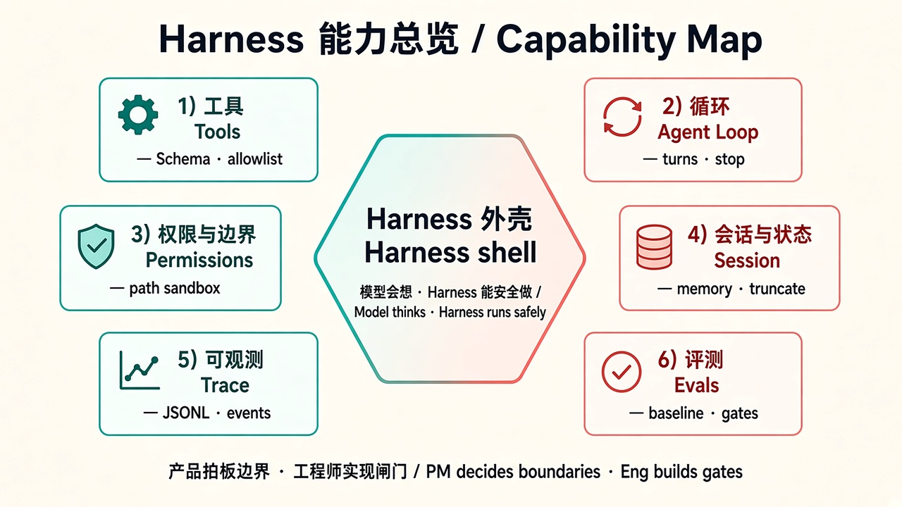

# 01 · Harness 能力总览

> 视角：产品经理（PM）· 图解 + 费曼  
> 日期：2026-10-30（Asia/Taipei）  
> 对照：`notes/glossary.md`、`notes/course-plan.md`、课 1–5 实验

## 一句话定义

**Harness** 是围绕模型的工程外壳：它不替模型思考，但决定模型能用哪些工具、如何执行与回传结果、如何限制风险、如何记录与评测整个 Agent 循环。

## 图解

> 配图：**中英文配套**（CN + EN labels）。

## 六能力：产品拍板 vs 工程师实现

| 能力 | 产品要拍板什么 | 工程师通常实现什么 |
|---|---|---|
| 1. 工具（Tools） | 哪些能力对用户开放？默认 allowlist？禁止哪些危险操作？ | Tool Schema、注册、执行器、参数校验 |
| 2. 循环（Agent Loop） | 允许多少轮？失败时重试还是停？何时必须人工确认？ | turn 调度、消息历史、toolResult 回填、终止条件 |
| 3. 权限与边界 | 能碰哪些目录/网络/数据？越权时对用户怎么说？ | 路径沙箱、权限门、拒绝策略、审计字段 |
| 4. 会话与状态 | 会话是否持久？跨会话记住什么、必须忘记什么？ | SessionManager、上下文窗口、摘要/截断 |
| 5. 可观测（Trace） | 出了事故要能回答「当时调了什么」？对内日志保留多久？ | JSONL/事件订阅、耗时、toolCallId、错误码 |
| 6. 评测与质量门 | 上线/改 Prompt/微调前用什么 baseline？成功标准是什么？ | cases、指标、A/B、回归集 |

核心分工口诀：

- **模型**：会不会想、会不会选工具  
- **Harness**：能不能安全、稳定、可观测地做  

## 费曼问答

**题：如果产品里只有「裸模型单轮对话」，用户缺的是什么？**

### PM 的回答

产品如果只能单轮对话、不能用工具、没有 loop、也没有长程状态，那就只是聊天框：用户没法让系统真正读文件、查环境、改配置或连续多步完成任务；每次都要把上下文自己粘贴进去，也无法指望系统在边界内自动执行。

### 小哈补充

缺的不只是「看起来智能」，而是两层工程能力：

1. **执行**：Schema → toolCall → Executor → toolResult，模型请求之外要有真实动作。  
2. **边界**：allowlist、路径沙箱、轮数/超时、trace 与评测——没有它们，即便接了工具也不敢交给真实用户。

课 1 三种读文件方式已经证明：裸模型读不到；宿主注入只是人肉 Harness；Agent + `read` 才是动态循环。

## 和本仓库的关系

- 术语底稿：`notes/glossary.md`  
- 完整课表：`notes/course-plan.md`  
- 动手证据：`labs/01-model-api` … `labs/05-minimal-harness`  

下一课：[02 · 工具循环](./02-tool-loop.md)