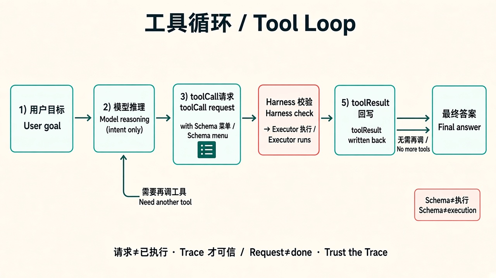

> **旧版参考资料**：已并入第 1 章（[ch01](../../book/harness/chapters/ch01.md)）。

# 02 · 工具循环

> 视角：产品经理（PM）· 图解 + 费曼  
> 日期：2026-10-30（Asia/Taipei）  
> 对照：课 1–5（尤其课 2 allowlist、课 3 事件、课 4 Schema、课 5 SDK）

## 一句话定义

**工具循环** = 模型发出结构化工具请求 → Harness 校验并执行 → 把结果写回上下文 → 模型再判断，直到最终答案或触发终止。

## 图解

> 配图：**中英文配套**（CN + EN labels）。


典型链（与课 3 / 课 5 trace 一致）：

```text
user prompt
  -> assistant toolCall(name + arguments)
  -> tool_execution_start
  -> Executor 真正执行
  -> tool_execution_end (+ toolResult)
  -> assistant final（或再次 toolCall）
  -> agent_end
```

## 三个必须分清的词

| 名词 | 是什么 | 不是什么 |
|---|---|---|
| **Schema** | 给模型看的「菜单」：工具名、参数类型、约束 | 不会自己读文件或跑命令 |
| **toolCall** | 模型输出的一次请求（含 name / arguments / id） | 还不等于已经执行成功 |
| **Executor** | Harness 侧真正干活的代码（如 `read` 打开文件） | 不是模型脑子里的幻想 |

审计时以 `toolCall.arguments`、`tool_execution_start/end`、`isError` 为准，不能只信最终自然语言（课 4 参数类型冲突实验已证明）。

## 产品要点

1. **没有 Schema，就没有可信工具调用**（课 2：`--no-tools` 零次 `tool_execution_*`）。  
2. **有 Schema 也不等于安全**：还要 allowlist、路径边界、超时、最大轮数。  
3. **多轮是常态**：Turn1 常是 toolCall，Turn2 才是最终答案（课 2 / 课 5）。  
4. **Trace 是产品保险**：同一 `toolCallId` 串起 start/end，才能复盘「当时到底调了什么」。  
5. **微调不替代循环**：改权重改变「想怎么调」；执行、拒绝、日志仍靠 Harness。

## 产品拍板项（本课可直接用）

- [ ] 默认开放哪些工具？哪些永远要人工确认？  
- [ ] 越权/坏参数时：静默失败、结构化错误，还是对用户可读说明？  
- [ ] 单任务最大轮数、单工具超时、结果最大长度？  
- [ ] 是否强制写 trace？保留哪些字段给客服/安全审计？  
- [ ] 上线前最小评测集是否覆盖「无工具 / 单工具 / 越权拒绝」？

## 对照课 1–5

| 课 | 你看到的证据 | 对工具循环的意义 |
|---|---|---|
| 01 Model API | 裸模型 / 注入上下文 / Agent `read` 三对照 | 只有 Agent 路径才有动态执行 |
| 02 Pi CLI | `--no-tools` vs `--tools read` | allowlist 决定「能不能真读」 |
| 03 Agent Events | JSONL：`toolCall` ↔ `tool_execution_*` | 循环可观测、可标注 |
| 04 Custom Tool | Schema + `execute` + `registerTool`；Qwen3.8 类型冲突 | Schema 约束请求；最终话术可能撒谎 |
| 05 Minimal Harness | SDK：`tools:["read"]` + subscribe → `traces/latest.jsonl` | 循环控制从 CLI 参数变成代码 |

课 5 复盘摘要（2026-10-30）：`npm start` 成功；`read` ×1（`call_vls1bbzg`，`isError=false`）；2 turns；`user → assistant → toolResult → assistant`。

## 费曼题

**请用自己的话区分 Schema / toolCall / Executor。**

### PM 的回答

- **Schema** 类似一个说明书。  
- **toolCall** 是个任务说明。  
- **Executor** 是干活的人。

### 小哈补充

说得对：说明书规定能点什么菜，任务说明是这一单点了啥，干活的人才真正下厨。三者分开，才不会把「模型嘴上说调用了」当成「系统已经安全执行了」。

## 下一步

- 动手：在课 5 上**一次只加一个**控制点（`maxTurns` 或路径策略）。  
- 笔记：下一课 [03 · 会话与上下文](./03-session-context.md)。  
- 回到总览：[01 · 能力总览](./01-capability-overview.md)