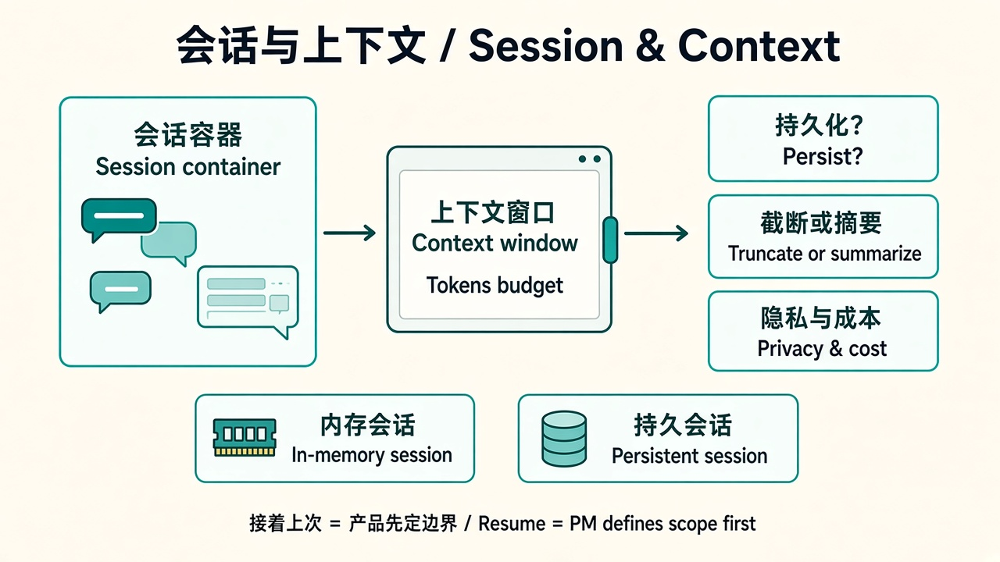

# 03 · 会话与上下文

> 视角：产品经理（PM）· 图解 + 费曼  
> 日期：2026-10-30（Asia/Taipei）  
> 对照：课 5 `SessionManager.inMemory`、课 2/3 的 `--no-session` 与 JSONL

## 一句话定义

**会话**是一次（或一串）对话的容器；**上下文**是这一刻真正送进模型的消息窗口。Harness 要决定：记什么、忘什么、塞不下时怎么截断或摘要、跨请求是否续上。

## 图解

> 配图：**中英文配套**（CN + EN labels）。

## 要点

1. **窗口有限**：context window / maxTokens 不是无限聊天记录；超了必须丢、摘要或拒收。  
2. **截断与摘要**：丢最旧消息、保留 system+最近工具结果、或生成摘要——策略影响正确率与成本。  
3. **会话边界**：内存会话（进程结束即忘）vs 持久会话（可「接着上次」）；边界不清会串戏、泄密。  
4. **隐私与成本**：多记一轮 = 多传 token、多一份日志面；产品要定保留多久、谁能看、默认是否落盘。

## 产品拍板 vs 工程师实现

| 维度 | 产品拍板 | 工程师实现 |
|---|---|---|
| 是否持久 | 关掉 App 还要不要记得？默认开新会话还是续旧的？ | SessionManager 内存 / 文件 / DB |
| 「接着上次」 | 续的是同一任务、同一项目，还是同一账号全部历史？ | session id、工作区绑定、加载策略 |
| 塞不下时 | 优先保 system？保最近工具结果？还是先摘要再问用户？ | 截断、摘要、预算计数 |
| 隐私 | 哪些字段禁止进日志？多久清除？ | 红action、TTL、访问控制 |
| 成本 | 免费档上下文上限？长会话是否提示用户开新话题？ | token 计量、告警、降级 |

## 对照课 5（内存 session）

课 5 最小 Harness（`labs/05-minimal-harness/src/index.ts`）：

- `sessionManager: SessionManager.inMemory(cwd)` → **不落 Pi 会话历史文件**  
- 一次 `session.prompt(...)` 内多 turn 仍共享消息历史（所以能 `read` 后再答）  
- 进程结束 / `session.dispose()` 后，**没有「接着上次」**——除非你另存 trace 或改持久化  

和课 2/3 的 `--no-session` 同类意图：实验可复现、少副作用；产品若要「接着聊」，必须显式设计持久层，不能假装模型自己记得。

## 费曼题

**用户说「接着上次」时，产品要先定清楚什么？**

### PM 的回答

要定：

1. **上下文窗口大小**，以及**什么时候压缩 / 截断**。  
2. **上文以什么形式给到用户（和模型）**：全量还是摘要，**给什么**。

### 小哈补充

这两点是「塞得下、怎么塞」。还要先定清楚：**接的是哪一次会话**（哪个任务 / 项目 / 设备），以及**按谁的身份续**（同一用户、同一权限、同一工作区）。窗口和摘要策略再好，接错会话或越权续聊，都会串戏或泄密。

## 下一步

- 产品：为你的场景写一条「会话默认策略」一句话（例如：仅当前任务内存会话，关闭即清空）。  
- 工程：课 5 之后再加持久 session 时，一次只改这一个变量并保留 baseline。  
- 下一课：[04 · 权限与路径](./04-permissions-paths.md) · 上一课：[02 · 工具循环](./02-tool-loop.md)