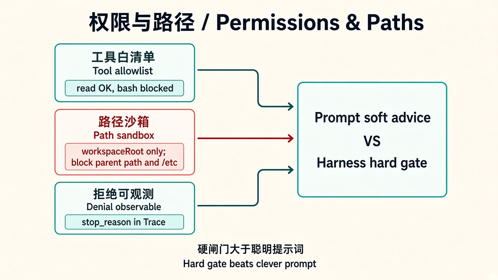

# 04 · 权限与路径

> 视角：产品经理（PM）· 图解 + 费曼  
> 日期：2026-10-30（Asia/Taipei）  
> 对照：课 2 allowlist、课 4 越界拒绝、课 5 `tools: ["read"]` 与计划中的 `policy.ts`

## 一句话定义

**权限与路径**决定 Agent「允许碰什么」：哪些工具、哪些目录、哪些操作可以自动执行，哪些必须拒绝或人工确认。模型再聪明，也不能越过 Harness 的边界。

## 图解

> 配图：**中英文配套**（CN + EN labels）。

## 要点

1. **Allowlist 先于能力**：没进名单的工具 = 不存在（课 2：`--no-tools` 零执行）。  
2. **路径沙箱**：相对路径、禁止 `..`、禁止逃出项目根；符号链接也要防。  
3. **拒绝要可观测**：结构化错误进 trace，而不是静默成功或只靠模型口头道歉。  
4. **写操作单独门禁**：`bash/edit/write` 与只读工具分级；产品默认应偏保守。  
5. **Pi 不是安全沙箱**：继承启动用户的系统权限；边界必须自己定。

## 产品拍板 vs 工程师实现

| 维度 | 产品拍板 | 工程师实现 |
|---|---|---|
| 默认工具集 | 首发只读？哪些要二次确认？ | `tools: [...]` / CLI `--tools` |
| 可访问范围 | 仅当前项目？可含用户指定文件夹？ | cwd 边界、path policy、realpath 检查 |
| 越权体验 | 对用户说「无权限」还是引导申请？ | 拒绝码、文案、审计日志 |
| 升级路径 | 何时开放 write/bash？谁审批？ | 权限级别、人工确认门 |
| 事故响应 | 误删/泄密如何回滚与通知？ | 备份、dry-run、kill switch |

## 对照课 5 与后续计划

课 5 现状（`labs/05-minimal-harness`）：

- 已做：`tools: ["read"]`、强制 Linux/`cwd`、自写 JSONL  
- **尚未做**（course-plan / README 写明）：`maxTurns`、单工具超时、**路径策略 `policy.ts`**、结果截断、单测  

产品含义：现在的「安全」主要靠 allowlist 收窄；真正的路径沙箱仍是下一工程增量——拍板「只能碰本项目」之后，要用测试证明 `../` 必拒。

## 费曼题

**为什么「只告诉模型不要读项目外的文件」不够，还必须在 Harness 里做路径校验？**

### PM 的回答

要把路径限制在**允许的目录里执行**，防止越权访问、甚至破坏系统。只靠 Prompt「请不要读外面」不够硬。

### 小哈补充

对：这必须是 **Harness 策略强制**（校验失败就不调用 Executor），**不是**再写一句 Prompt 求求模型听话。模型可能忽略指令或编造「已读」；策略层拒绝不依赖它是否配合。

## 下一步

- 工程：课 5 一次只加 `policy.ts`（或 `maxTurns`），配最小单测。  
- 产品：写出你场景的默认 allowlist 一句话。  
- 下一课：[05 · 轮数与超时](./05-turns-timeout.md) · 上一课：[03 · 会话与上下文](./03-session-context.md)