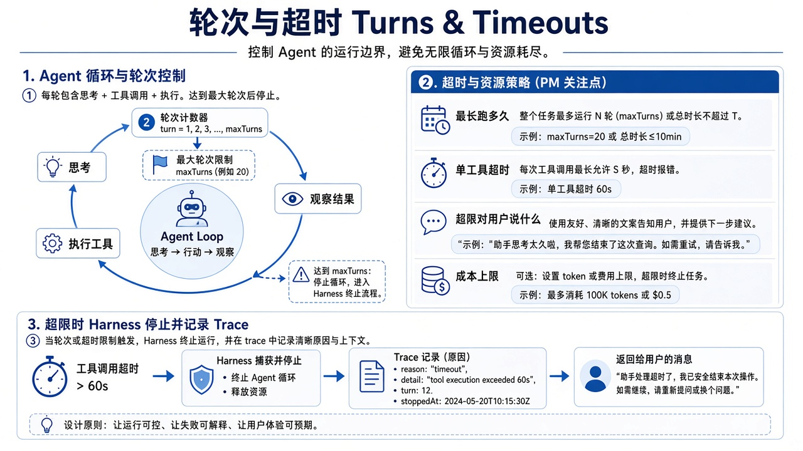
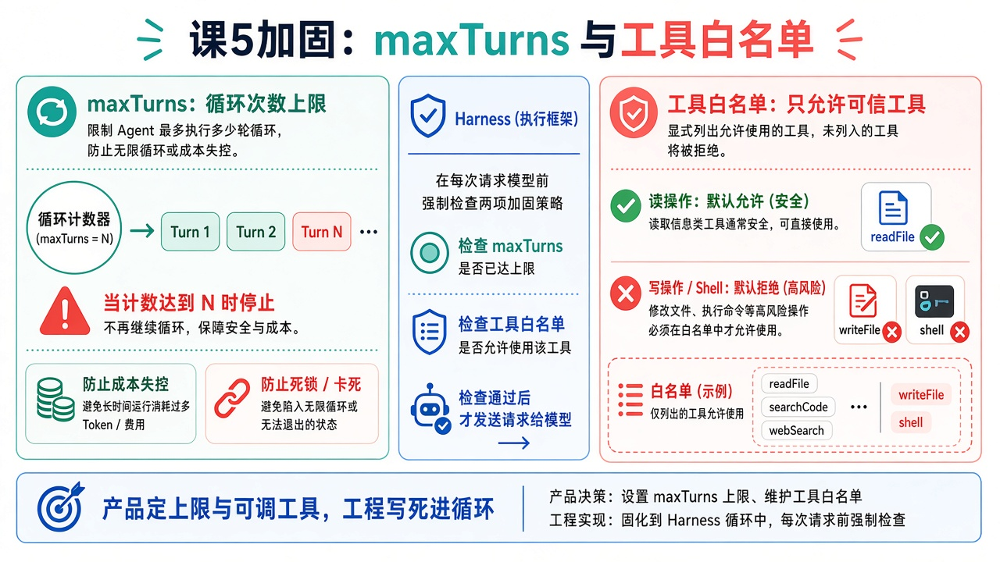

# 05 · 轮数与超时

> 视角：产品经理（PM）· 图解 + 费曼  
> 日期：2026-10-31（Asia/Shanghai）  
> 对照：课 5 `labs/05-minimal-harness` 加固 — `maxTurns` + `tools: ["read"]`

## 一句话定义

**轮数与超时**是给 Agent loop 装的刹车：最多转几圈、单次工具最多跑多久、超时或触顶时如何结束并告诉用户「为什么停」。

## 图解

## 要点

1. **无限循环是默认风险**：模型可反复 toolCall；没有 `maxTurns` 就会烧时间/钱/机器。  
2. **Turn ≠ 用户句**：一轮常是「模型一次输出」；一次用户任务往往 2+ turns（toolCall + final）。  
3. **单工具超时**：卡死的 shell/网络不能拖死整次会话（**本课仍未实现**，下一增量）。  
4. **终止原因要产品化**：`success | max_turns | tool_timeout | tool_error | model_error`——客服与评测都靠它。  
5. **课 5 工程状态（2026-10-31）**：`maxTurns` **已落地**；工具仍仅 `read`；超时 / 路径策略仍延后。

## 产品拍板 vs 工程师实现

| 维度 | 产品拍板 | 工程师实现 |
|---|---|---|
| 最大轮数 | 普通任务几轮？复杂任务是否可申请加码？ | `MAX_TURNS` + `shouldStopAfterTurn`、触顶写 `stop_reason=max_turns` |
| 工具边界 | 这课只读文件够不够？ | `tools: ["read"]` allowlist（已有） |
| 单工具超时 | 读文件 3s？跑命令 30s？ | （未做）超时包装、取消、`isError` |
| 用户感知 | 「思考中」多久后提示？能否手动停？ | 进度 UI、cancel、终止文案 |
| 评测 | 触顶算失败还是部分成功？ | cases 里 `max_turns` 字段与指标 |

## 对照课 5 加固

- 实现位置：`labs/05-minimal-harness/src/max-turns.ts` + `src/index.ts`。  
- 官方钩子：`session.agent.shouldStopAfterTurn`（pi-agent-core）；无单独 `createAgentSession({ maxTurns })` API。  
- Trace：`turn_guard`（每轮计数）、触顶时 `harness_stop` / 收尾 `harness_end` 带 `stop_reason`。  
- 单元测试：`npm test`（不依赖 Ollama）。  
- 触顶演示：`MAX_TURNS=1 NO_PROXY=127.0.0.1,localhost npm start`（需本机 Ollama）。

## 费曼题

**如果没有最大轮数，用户会遇到什么？产品应如何向用户解释「被刹车停住」？**

### PM 的回答

没有上限会**无限循环**：模型反复 toolCall，空转烧**成本**/配额；工具卡住还会变成**死循环**，拖死会话。产品应说「触达安全轮数上限被刹车」，不是「模型坏了」，并给下一步：缩小任务 / 提高限额 / 人工接手。

### 小哈补充

对：无限循环、成本、死循环是同一护栏的三面——轮数顶防空转烧钱，单工具超时防卡死。文案要可审计（终止原因 `max_turns` / `tool_timeout`），别把护栏伪装成模型故障。

### 加固后费曼（2026-10-31）

**maxTurns 与工具 allowlist 各防什么？缺一不可吗？**

- **maxTurns**：防「转太久」——即使工具都合法，也能空转烧钱。  
- **allowlist**：防「碰不该碰的」——即使轮数很少，也不能 bash/写盘。  
- 缺一不可：只有 allowlist 仍可能合法工具死循环；只有 maxTurns 仍可能一轮内干坏事。二者是正交护栏。

## 下一步

- 工程：在课 5 **再加一项**单工具超时（仍一次一个控制点），或进入 `labs/06-evals` 做触顶 case。  
- 下一课笔记：[06 · 可观测与 Trace](./06-observability-trace.md) · 上一课：[04 · 权限与路径](./04-permissions-paths.md)
