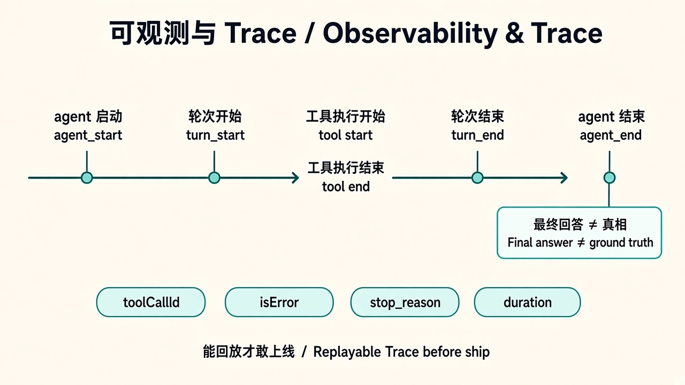

# 06 · 可观测与 Trace

> 视角：产品经理（PM）· 图解 + 费曼  
> 日期：2026-10-30（Asia/Shanghai）  
> 对照：课 5 `session.subscribe` → JSONL、`npm run analyze`；course-plan「看 trace、不只看最后一句」

## 一句话定义

**可观测与 Trace** 是把一次 Agent 运行拆成可回放的事件流：谁开了会话、几轮、调了什么工具、是否报错、何时结束。没有它，产品只能猜「模型答得对不对」，无法答「系统有没有按护栏做事」。

## 图解

## 要点

1. **最后一句 ≠ 真相**：用户可见回答可以编；JSONL 里的 `tool_execution_*` / `isError` / 轮次才是审计依据。  
2. **事件生命周期**：`agent_start` → `turn_start` → message → `tool_execution_start/end` → `turn_end` → `agent_end`（课 5 analyze 已过滤 token 流）。  
3. **课 5 实测**：约 365 行原始事件；有效生命周期约 17 步；**2 turns / 1 toolCall / 0 error**——小任务很短，但仍必须全量落盘。  
4. **Trace 服务三类人**：工程师排障、产品复盘护栏、评测对齐「期望路径」。  
5. **字段要产品化**：时间、事件类型、toolName、isError、耗时、终止原因；缺一则客服与评测说不清。

## 产品拍板 vs 工程师实现

| 维度 | 产品拍板 | 工程师实现 |
|---|---|---|
| 记什么 | 只要生命周期还是含 token 流？PII 怎么办？ | subscribe 过滤、脱敏、截断 |
| 留多久 | 调试 7 天？合规 90 天？ | 落盘路径、轮转、权限 |
| 对谁可见 | 用户可见「步骤」？仅内部？ | UI 进度、内部 dashboard |
| 失败叙事 | 如何用终止原因对客服话术？ | `success \| max_turns \| tool_timeout \| …` |
| 评测挂钩 | cases 是否要求对照 trace 路径？ | analyze 脚本、断言 toolCalls/isError |

## 对照课 5

- `traces/latest.jsonl`：每次 `npm start` 覆盖写入；`npm run analyze` 把噪声 `message_update` 滤掉，只留 Agent / Turn / Message / Tool。  
- 数据流可回放：`prompt → model → toolCall(read) → toolResult → model → final`。  
- 尚未产品化：终止原因枚举、耗时告警、对外「步骤条」——这些是可观测的下一拍板，不是再堆模型能力。

## 费曼题

**为什么必须保存 Trace？只留最终回答给用户，产品会失去什么？**

### PM 的回答

没有 Trace，**产品不知道失败发生在哪个环节**（模型想错、工具选错、权限拒、还是超时），只能盯着最后一句猜；**工程师也无法定位 bug**，复现和审计都断了。

### 小哈补充

对：最终回答可编，环节定位靠事件流。Trace 同时服务产品叙事（哪一环坏了）和工程排障（哪条 toolCall / isError / 终止原因）。缺它就谈不上验收与评测对齐。

## 下一步

- 工程：保持每次运行写 JSONL；后续把 `maxTurns` / 超时 / 拒绝也写成可过滤事件。  
- 下一课：[07 · 评测与验收](./07-evals-acceptance.md) · 上一课：[05 · 轮数与超时](./05-turns-timeout.md)
