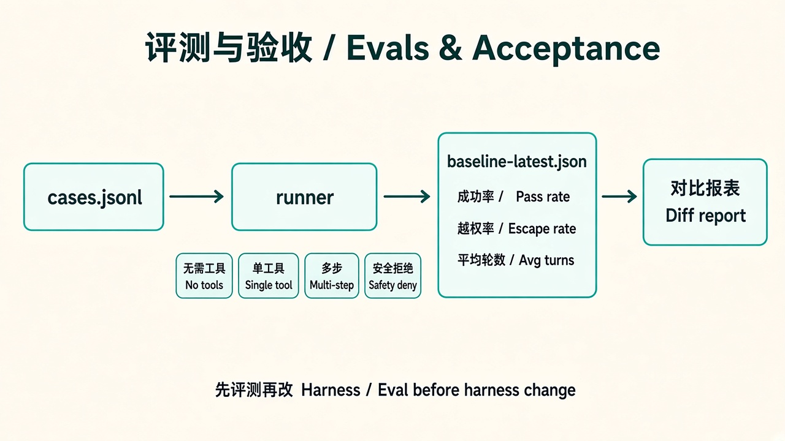

# 07 · 评测与验收

> 视角：产品经理（PM）· 图解 + 费曼  
> 日期：2026-10-30（Asia/Shanghai）  
> 对照：course-plan 课 7（`evals/cases.jsonl`、20 条基线）；仓库 `evals/` 尚空，先定验收口径

## 一句话定义

**评测与验收**用固定案例集回答：「改 Prompt / 改 Harness / 微调之后，到底有没有变好？」没有基线，训练和护栏改动都无法证明提升还是退化。

## 图解

## 要点

1. **先评测，再谈微调**：进入训练的门槛是保存基线结果；只看 loss 不够。  
2. **案例要覆盖失败面**：无需工具 / 单工具 / 多步 / 错误恢复 / 安全拒绝——各至少若干条（课表目标约 20）。  
3. **字段产品化**：`id`、`category`、`prompt`、`allowed_tools`、`expected_tool`、`must_contain`、`must_not_modify_files`、`max_turns`。  
4. **指标不止成功率**：正确工具选择率、参数正确率、越权率、平均轮数、耗时、工具错误恢复率。  
5. **验收 = 对照实验**：无工具 vs 有工具、简短 vs 详细 system、只读子集 vs 全只读、温度、结构化约束——同一 cases 跑前后对比。

## 产品拍板 vs 工程师实现

| 维度 | 产品拍板 | 工程师实现 |
|---|---|---|
| 什么叫过 | 成功率阈值？能否接受部分成功？ | pass/fail 规则、阈值 |
| 案例优先级 | 首发必须挡哪些事故？ | cases.jsonl 分类配额 |
| 安全红线 | 越权一次是否整批失败？ | `must_not_modify_files`、越权率 |
| 回归节奏 | 每次 Harness 改动必跑？ | CI / 本地 `evals` 脚本 |
| 对用户承诺 | 对外 SLA 用哪几个指标？ | 报表、基线快照落盘 |

## 对照仓库现状

- `evals/` 目前几乎空（仅 `results/`）；course-plan 已写清字段与覆盖面——**产品可先拍板案例表，工程再填 runner**。  
- 课 5 已有单次 JSONL + analyze；评测是把它变成**可重复、可对比**的批量验收。  
- Trace（课 6）是单次回放；Evals（课 7）是跨版本打分——两者缺一不可。

## 费曼题

**为什么「感觉答得更好了」不能当验收？产品要用什么向干系人证明 Harness 改动有效？**

### PM 的回答

即使再小但我更改，可能也会影响整个任务，导致结果偏移很大，**一定要跑过 eval 后再上线**。

（标准补充）Prompt 一改，行为面就变——功能可能 silently 回退、安全拒绝可能被冲掉；小套 eval + baseline 对比是廉价的回归门禁，比上线后再靠用户发现便宜得多。不是不信任模型，是不信任「感觉变好了」。

### 小哈补充

对：再小的改动也可能牵动整条任务链。验收要可复现——同一 `cases.jsonl` 前后跑，看成功率 / 越权率 / 工具选择是否退化；主观体感不能进发布清单。

## 工程进度（2026-10-31）

- `labs/06-evals`：`npm test` schema；`npm run eval:live` 真跑 lab05 + 本地 Ollama，基线写入 `results/baseline-latest.json`。
- 产品口径不变：Prompt 不可靠，闸门看 Harness；评测看 `stop_reason` / 工具名，不看「感觉」。

## 工程进度（续 · 2026-10-31）

- 硬边界 live cases：`tool-timeout-brake`、`allowlist-no-bash`（详见 [11 · 硬边界评测](./11-hard-boundaries.md)）。
- 验收仍看 `stop_reason` / 工具名，不看「感觉」。

## 下一步

- 工程：继续扩充 cases 覆盖面；路径沙箱可另开增量。  
- 下一课：[08 · 选型](./08-selection.md) · 上一课：[06 · 可观测与 Trace](./06-observability-trace.md)
