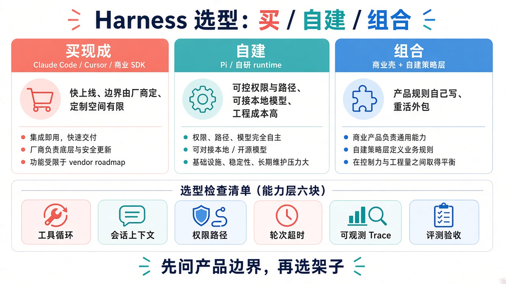

> **旧版参考资料**：已并入附录（[PM 验收清单](../../book/harness/chapters/appendix-pm-checklist.md)）。

# 08 · 选型（买 / 自建 / 组合）

> 视角：产品经理（PM）· 图解 + 费曼  
> 日期：2026-10-30（Asia/Shanghai）  
> 对照：课 1 能力总览六块；本仓库 `pi` + `qwen3.8:27b` 样本路径

## 一句话定义

**选型**决定 Agent 外壳从哪来：整包买、自己造，还是买核心、自建边界。模型能力只决定「会不会想」；Harness 选型决定「能不能按你的边界可控地做」。

## 图解

> 配图：**中英文配套**（CN + EN labels）。

## 要点

1. **三条路**：买（SaaS / 闭源 Agent 平台）、自建（SDK + 自有策略）、组合（买模型/工具运行时，自建权限、轮数、trace、评测）。  
2. **用能力层六块做检查清单**（对照课 1）：工具循环、会话上下文、权限路径、轮数超时、可观测 Trace、评测验收——缺哪块就标风险，而不是只比「模型智商」。  
3. **本仓库样本适合学可控边界**：`pi` SDK + 本地 `qwen` 让你亲手看见 allowlist、JSONL、analyze；不是生产终局，是把六块拆开摸清楚。  
4. **产品拍板边界**：数据出域、越权后果、SLA、谁付 token/工具成本、事故谁背锅。  
5. **工程师评估实现成本**：集成工期、可替换性、测试与评测接口、运维（日志留存、熔断）。

## 六块能力检查清单（选型时各问一句）

| 能力块 | 选型时要问 |
|---|---|
| 工具循环 | Schema / toolCall / Executor 是否可审计、可限制？ |
| 会话上下文 | 历史谁存、多久清、能否导出给评测？ |
| 权限路径 | 能否强制 allowlist + 路径沙箱，还是只靠 Prompt？ |
| 轮数超时 | 有无 maxTurns / 单工具超时与终止原因？ |
| 可观测 Trace | 事件流能否落盘、过滤、对接客服？ |
| 评测验收 | 能否跑同一 cases 做 baseline 对比？ |

## 产品拍板 vs 工程师实现

| 维度 | 产品拍板 | 工程师实现 |
|---|---|---|
| 买 / 自建 / 组合 | 合规与差异化要握在谁手里？ | POC 工期、供应商锁定、替换成本 |
| 必须自建的块 | 哪几块是红线（权限、评测、trace）？ | 自研模块边界、接口契约 |
| 可外包的块 | 模型托管、向量库、UI 能否买？ | 集成、SLA、降级方案 |
| 学习 vs 上线 | 样本仓库教什么、生产缺什么？ | 从 lab 迁到服务的缺口清单 |
| 风险接受度 | 静默失败 / 越权一次是否可接受？ | 门禁、kill switch、审计 |

## 为什么 pi + qwen 适合「学」而不是「直接当产品」

- **可控**：本地模型 + 显式 `tools: ["read"]` + 自写 JSONL，边界看得见。  
- **可拆**：六块能力可逐课加（maxTurns、policy、evals），符合「一次只加一个控制点」。  
- **有上限**：Pi 非系统沙箱、无现成 20 条评测 runner、无多租户——上线前要用检查清单补洞，而不是把 demo 当 SLA。

## 费曼题

**费曼：你们产品更该买、自建，还是组合？用六块能力清单各打一句理由。**

### PM 的回答

我的产品更该用**组合**，再小成本下使用成熟方案，特定业务问题可以自建解决。

### 小哈补充

对：组合 = 通用能力买/接成熟方案，**产品边界与策略层自建**。对接时用六块清单验收（工具循环、会话、权限路径、轮数超时、Trace、评测）——买的块要能露出控制面，自建的块要能挂上评测与审计。

## 下一步

- 产品：用六块清单给当前候选方案打分（买 / 自建 / 组合各一列）。  
- 工程：标出「必须自建」模块的接口与评测挂钩点。  
- 下一课：[09 · 协作](./09-collaboration.md) · 上一课：[07 · 评测与验收](./07-evals-acceptance.md)
