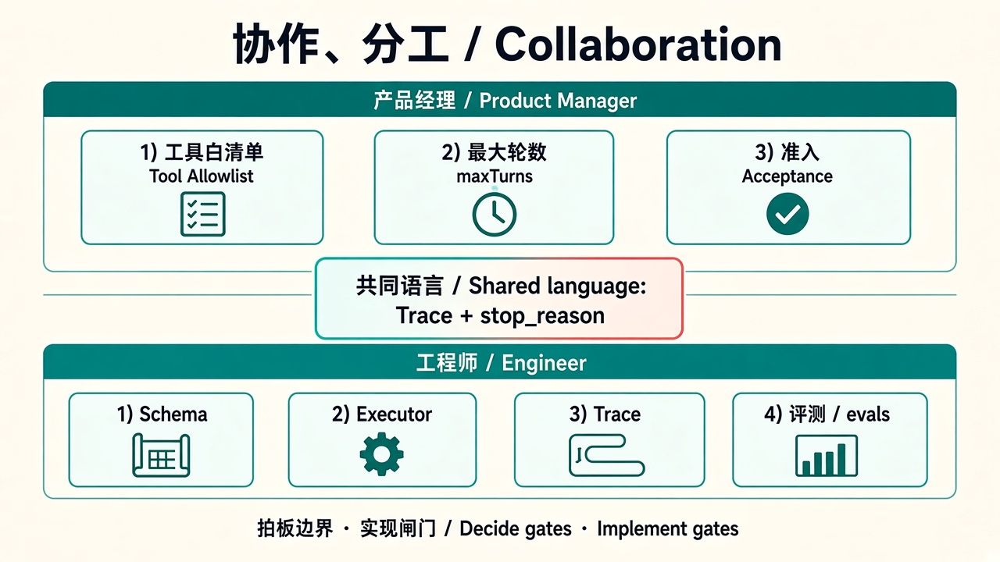

# 09 · 协作（产品 × 工程）

> 视角：产品经理（PM）· 图解 + 费曼  
> 日期：2026-10-30（Asia/Shanghai）  
> 对照：课 1 六块能力；课 8 组合选型；课 6–7 Trace / Evals 作对接验收

## 一句话定义

**协作层**把 Harness 从「概念」变成「会议室可拍板」：产品说清边界与验收，工程师说清成本与接口；双方共用同一套六块语言，而不是各说模型智商。

## 图解

> 配图：**中英文配套**（CN + EN labels）。

## 要点

1. **分工清晰**：产品拍板「允许什么 / 何时停 / 怎样算过」；工程师落地策略、超时、trace、评测 runner。  
2. **共同语言 = 六块**：工具循环、会话上下文、权限路径、轮数超时、可观测 Trace、评测验收——开会逐块对，不空谈「智能一点」。  
3. **组合选型下的对接**：买的块要露出控制面（权限、轮数、日志）；自建块要挂上 Trace 字段与 eval cases。  
4. **验收先于感觉**：改 Prompt / 换供应商 / 加工具，一律 baseline 对比后再上线（课 7）。  
5. **事故叙事共用终止原因**：`success | max_turns | tool_timeout | tool_error | …`——客服、产品、工程说同一种失败。

## 产品拍板 vs 工程师落地

| 维度 | 产品拍板 | 工程师落地 |
|---|---|---|
| 范围 | 首发只读？哪些要人审？ | allowlist、确认门、policy |
| 护栏 | 最大轮数、超时体感、越权零容忍？ | maxTurns、timeout、拒绝码 |
| 可观测 | 用户看步骤条还是仅内部？ | JSONL 字段、脱敏、dashboard |
| 验收 | 哪些 cases 是发布门禁？ | cases.jsonl、CI、阈值 |
| 组合边界 | 哪几块必须握在自己手里？ | 适配层、可替换接口、降级 |

## 带进需求会的检查姿势

- 先画/指六块，再谈供应商或自建工期。  
- 每块问：控制面在谁？失败怎么进 Trace？怎么进 eval？  
- 输出应是「接口 + 门禁」，不是「再调一调 Prompt」。

## 费曼题

**下一周要跟工程师开 harness 需求会，你会带哪三句话进会议室？**

### PM 的回答

1. **目标是什么，成功标准 / 上线门槛**  
2. **成本和时间**  
3. **业务背景**

### 小哈补充

对：进会议室先对齐这三块，再谈 Schema / 策略。三句话定方向与约束，细节才有落点。

## 下一步

- 产品：起草一页「六块 × 买/自建」表，开会逐格填负责人与验收标准。  
- 工程：标出当前 lab 已具备 vs 生产缺口。  
- 下一课：[10 · 落地](./10-landing.md) · 上一课：[08 · 选型](./08-selection.md)
