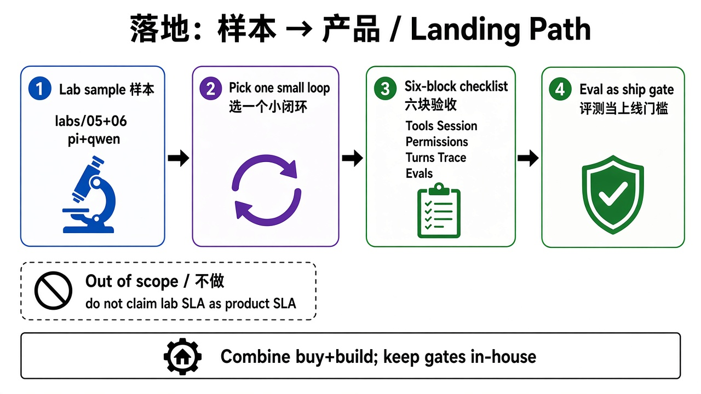

# 10 · 落地（样本 → 产品）

> 视角：产品经理（PM）· 图解 + 费曼  
> 日期：2026-10-30（Asia/Shanghai）  
> 对照：课 8 组合选型；课 7 评测门禁；课 9 协作三句话；目标产品 ProductA / ProductB / ProductC

## 一句话定义

**落地**把 Harness 学习样本变成真实产品的一小步：不一次造整平台，而是选一个**小闭环**，用组合方案接成熟能力，用六块清单验收边界，用 eval 当上线门槛。

## 图解

## 要点

1. **样本 ≠ 产品**：`pi` + `qwen` lab 用来摸清可控边界；上线要补多租户、SLA、数据出域与完整评测。  
2. **三个产品锚点**：ProductA / ProductB / ProductC——先选一个场景做小闭环，而不是并行铺三条线。  
3. **组合选型落地**：通用能力买/接成熟方案；产品边界、权限策略、Trace、评测自建或握在自己手里（课 8）。  
4. **六块验收**：工具循环、会话、权限路径、轮数超时、Trace、Evals——对接供应商与自建模块时逐块打勾。  
5. **小闭环优先**：目标清晰 + 成功标准/上线门槛 + 成本时间（课 9 三句话）；跑过 eval 再发（课 7）。

## 产品拍板 vs 工程师落地

| 维度 | 产品拍板 | 工程师落地 |
|---|---|---|
| 先做哪条线 | ProductA / ProductB / ProductC 谁先？ | POC 范围、数据与账号边界 |
| 小闭环定义 | 用户从进到出的最小价值路径 | 工具集、会话、UI 入口 |
| 组合切分 | 哪些块外购、哪些块自建 | 适配层、密钥、降级 |
| 上线门槛 | 成功率 / 越权零容忍 / 延迟 | cases.jsonl、CI、熔断 |
| 观测与客服 | 失败怎么对用户说 | 终止原因、Trace 查询 |

## 从小闭环到扩展

- 先证明：一条任务路径可护栏、可回放、可回归。  
- 再扩展：加工具、加写操作、加第二条产品线——每步都带 baseline 对比。  
- 忌：把 lab 的「能跑」直接写成对外 SLA。

## 费曼题

**三个产品里，你想先落地哪一个小闭环？成功标准一句话是什么？**

### PM 的回答

先落地 **ProductB**；成功标准我不确定，本质是 chatbot，问小哈。

### 小哈建议（成功标准草案）

1. **站内问答准确**：能回答 ProductB 站点公开信息（作品 / 产品链接），不编造私人细节。  
2. **边界拒绝**：越权 / 隐私 / 危险请求按策略拒绝，可在 eval 里有 deny cases。  
3. **小闭环可测**：固定 8–12 条 cases，改 Prompt / 策略后 baseline 不回退即可上线试运行。

## 下一步

- 产品：选定 ProductA / ProductB / ProductC 之一，写一句话成功标准 + 六块缺口表。  
- 工程：对照 lab 05–评测计划，列生产最小增量（maxTurns、policy、cases）。  
- 上一课：[09 · 协作](./09-collaboration.md) · 总览：[01 · 能力总览](./01-capability-overview.md)
