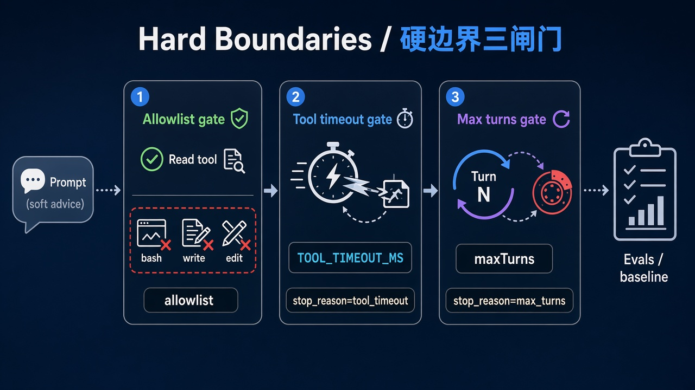
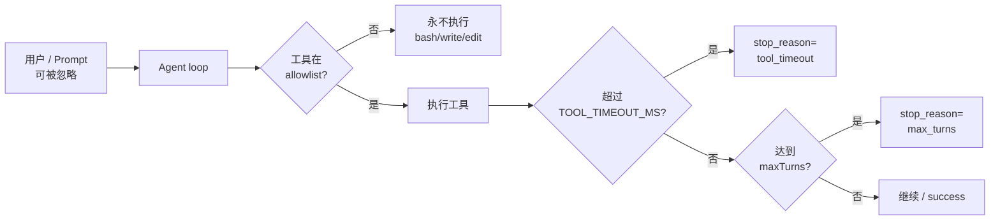

# 11 · 硬边界评测（超时 + 权限拒绝）

> 视角：产品经理 · 图解 + 费曼  
> 日期：2026-10-31（Asia/Shanghai）  
> 对照：`labs/05-minimal-harness`（`TOOL_TIMEOUT_MS` + allowlist）· `labs/06-evals` 硬边界 cases  
> 路线决策：闭环（allowlist → maxTurns → live eval）之后，补「Prompt 挡不住、Harness 必须挡」的硬边界验收。

## 一句话定义

**硬边界**是产品红线在代码里的闸门：工具超时、工具白名单、最大轮数。它们不靠模型「听话」，而靠 Harness 在执行层切断；评测用固定 case 证明闸门仍在。

## 图解

## 本课决策（为什么是这一步）

| 选项 | 是否做 | 理由 |
|---|---|---|
| 单工具超时 | **做** | 课 5 笔记已写「仍未实现」；没有超时，卡死的工具会拖死会话 |
| Allowlist 拒绝进 live eval | **做** | schema-only 只证明字段；live 才能证明「提示词要 bash 也调不出来」 |
| 付费云评测 / 外部业务样本 | **不做** | 本课固定本地 Ollama + 仓库内 labs；保持可开源复现 |
| 路径沙箱深化 | 延后 | 先把超时与白名单验收钉死，再扩路径策略 |

## 要点

1. **三类正交闸门**：allowlist 防「碰不该碰的」；`maxTurns` 防「转太久」；`TOOL_TIMEOUT_MS` 防「单次工具卡死」。  
2. **Prompt 不是闸门**：写「请快点结束 / 不要用 bash」进 system prompt，模型仍可能忽略——验收只看 trace 里的 `stop_reason` 与 `toolName`。  
3. **超时要可演示**：课 5 增加演示工具 `slow`（仅用于评测），用短超时强制 `tool_timeout`，不依赖真实网络卡死。  
4. **拒绝要可观测**：allowlist 案例期望 `tool_names_exclude: bash/write/edit`，而不是听最终自然语言有没有「道歉」。  
5. **先 schema，再 live**：`npm test` 校验 cases；`eval:live` 才动 Ollama；基线写入 `results/baseline-latest.json`。

## 产品拍板 vs 工程师实现

| 维度 | 产品拍板 | 工程师实现 |
|---|---|---|
| 单工具超时 | 读文件几秒？演示/评测用多少毫秒？超时文案说什么？ | `TOOL_TIMEOUT_MS` + `withToolTimeout`；trace `stop_reason=tool_timeout` |
| 工具边界 | 首发只读？评测是否允许演示用 `slow`？ | `EVAL_ALLOWED_TOOLS` / `tools: [...]`；自定义 `slow` 仅在 allowlist 含它时注册 |
| 越权口径 | 提示词诱导 bash 算不算失败？ | live case `allowlist-no-bash`：工具名不得出现 bash/write/edit |
| 验收节奏 | 每次护栏改动是否必跑硬边界子集？ | `EVAL_CASE_ID=tool-timeout-brake` / 全量 `eval:live` |

## 对照工程

- Harness：`labs/05-minimal-harness/src/tool-timeout.ts`、`slow-tool.ts`；`index.ts` 读 `TOOL_TIMEOUT_MS` / `EVAL_ALLOWED_TOOLS`。  
- Evals：`labs/06-evals/cases.json` → `tool-timeout-brake`、`allowlist-no-bash`（另保留原有 happy path / maxTurns）。  
- 跑法：`NO_PROXY=127.0.0.1,localhost npm run eval:live`（在 `labs/06-evals`）。

## 费曼题

**为什么「请模型快点停」和「请不要调用 bash」都不能当产品护栏？硬边界评测要证明什么？**

### 参考答（自学用）

Prompt 是软建议，模型可以忽略、可以换说法继续干。硬边界评测要证明：**代码路径**在超时后写出 `tool_timeout`，在白名单外**根本不出现**危险工具名——和模型有没有「表态听话」无关。

## 下一步

- 巩固：把硬边界三闸门讲给同伴（费曼）；对照 baseline 看四条 live 是否仍绿。  
- 可选增量：路径沙箱 / 权限 deny 文案产品化；把 cases 扩到课表目标规模。  
- 上一课笔记：[07 · 评测与验收](./07-evals-acceptance.md) · 路线总览：[README](./README.md)
