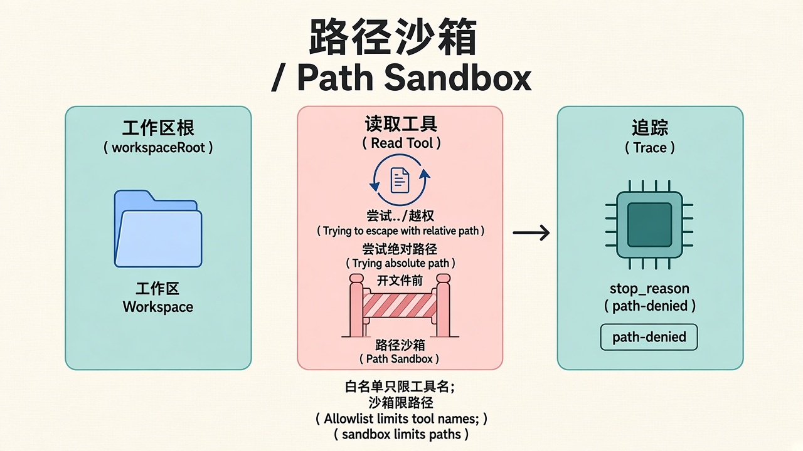
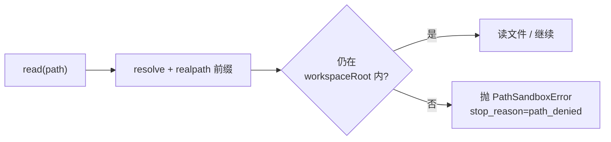

# 12 · 路径沙箱（Workspace Path Policy）

> 视角：产品经理 · 图解 + 费曼  
> 日期：2026-10-31（Asia/Shanghai）  
> 对照：`labs/05-minimal-harness`（`assertInsideWorkspace` + sandboxed `read`）· `labs/06-evals` case `path-escape-denied`  
> 路线决策：硬边界三闸门（allowlist / maxTurns / timeout）之后，补「文件工具不得逃出工作区」的路径策略。

## 一句话定义

**路径沙箱**是文件类工具的工作区围栏：无论模型传相对路径、`..` 上爬，还是绝对路径，Harness 都在执行前解析并拒绝逃出 `workspaceRoot` 的请求；拒绝必须能在 Trace 里看见（如 `stop_reason=path_denied`）。

## 图解

> 配图：**中英文配套**（CN + EN labels）。

## 本课决策（为什么是这一步）

| 选项 | 是否做 | 理由 |
|---|---|---|
| 工作区路径闸门 | **做** | 课 5/11 已延后「路径策略」；没有它，只读 allowlist 仍可能读到工作区外敏感文件 |
| 替换内置 `read` 为沙箱版 | **做** | pi 允许同名 `customTools` 覆盖内置；闸门放在工具执行层，不靠 Prompt |
| 完整 OS 沙箱 / 容器 | **不做** | 本课目标是可开源复现的最小策略；容器是部署层增量 |
| 写工具 / 多根目录 ACL | 延后 | 先钉死「读逃逸被拒」的验收，再扩写与多 workspace |

## 要点

1. **Allowlist ≠ 路径沙箱**：白名单只决定「有没有 read」；路径沙箱决定「read 能碰到哪」。  
2. **Prompt 挡不住**：写「不要读 /etc」进 system prompt，模型仍可能尝试——验收看 Trace 是否 `path_denied` / 工具 `isError`。  
3. **解析后再判**：先 `resolve`（处理绝对路径与 `..`），再对已存在前缀做 `realpath`，挡住符号链接逃逸。  
4. **拒绝要可观测**：`harness_stop` / `harness_end` 写出 `stop_reason=path_denied`；评测 case 固定诱导路径。  
5. **产品口径**：对用户说「路径越出工作区被拒绝」，不要说「模型坏了」。

## 产品拍板 vs 工程师实现

| 维度 | 产品拍板 | 工程师实现 |
|---|---|---|
| 工作区根 | 会话根是仓库？子目录？多根？ | `workspaceRoot = cwd`（本课）；可后续 `WORKSPACE_ROOT` |
| 越权定义 | `..`、绝对路径、符号链接算不算失败？ | `assertInsideWorkspace`；越界 → `PathSandboxError` |
| 用户文案 | 拒绝时展示什么？ | Trace + 工具错误信息含 `path_denied` |
| 验收 | 每次护栏改动是否必跑逃逸 case？ | `EVAL_CASE_ID=path-escape-denied` / 全量 `eval:live` |

## 对照工程

- Harness：`labs/05-minimal-harness/src/path-sandbox.ts`、`sandboxed-read.ts`；`index.ts` 在 allowlist 含 `read` 时注册沙箱版。  
- Evals：`labs/06-evals/cases.json` → `path-escape-denied`（live，`inject_read_path` / `EVAL_INJECT_READ_PATH` 探针，不依赖模型是否听话）+ schema 说明。  
- 跑法：`NO_PROXY=127.0.0.1,localhost npm run eval:live`（在 `labs/06-evals`）。

## 费曼题

**为什么「工具白名单只有 read」仍然不够安全？路径沙箱要在哪一层证明逃逸被挡住？**

### 参考答（自学用）

白名单只回答「能不能调用 read」，不回答「read 的 path 能指到哪」。没有路径沙箱，模型仍可用 `../` 或绝对路径读出工作区外文件。路径沙箱要在 **Harness 执行层**证明：越界请求根本读不到内容，并且 Trace 里出现可审计的 `path_denied`——与模型有没有「保证不越权」无关。

## 下一步

- 巩固：把「allowlist × 路径沙箱」正交关系讲给同伴；对照 baseline 看 `path-escape-denied` 是否仍绿。  
- 可选增量：写工具同样套闸门；多 workspace 根；容器级隔离。  
- 下一课：[13 · Trace 作为验收证据](./13-trace-acceptance.md)
- 上一课笔记：[11 · 硬边界评测](./11-hard-boundaries.md) · 路线总览：[README](./README.md)
