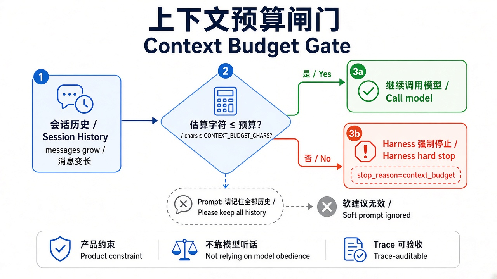
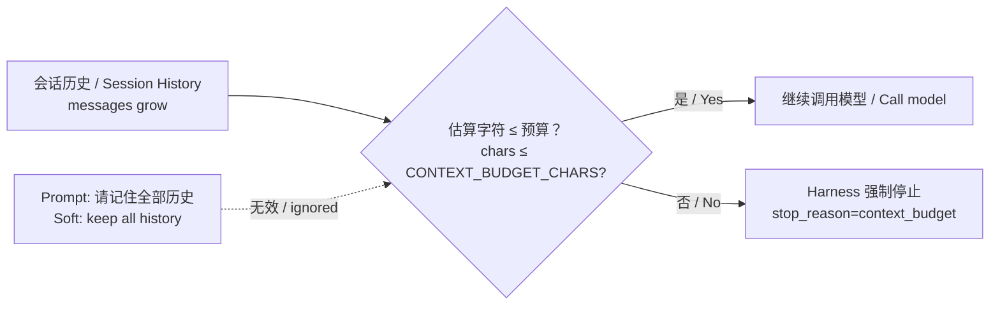

> **旧版参考资料**：已并入第 7 章（[ch07](../../book/harness/chapters/ch07.md)）。

# 14 · 上下文预算（Session / Context Window 产品约束）

> 视角：产品经理 · 图解 + 费曼  
> 日期：2026-10-31（Asia/Shanghai）  
> 对照：课 03 概念笔记 · `labs/05-minimal-harness`（`CONTEXT_BUDGET_CHARS`）· `labs/06-evals` case `context-budget-brake`  
> 路线决策：闸门闭环（allowlist / maxTurns / timeout / path）之后，把「会话窗口有限」从概念落到可验收的硬边界。

## 一句话定义

**上下文预算**是产品对「一次会话能塞进模型多少历史」的硬上限。超预算时由 Harness 截断或停止，并在 Trace 写出可审计的 `stop_reason=context_budget`——不是靠 Prompt 写「请记住全部历史」。

## 图解

> 配图：**中英文配套**（CN + EN labels）。

## 本课决策（为什么是这一步）

| 选项 | 是否做 | 理由 |
|---|---|---|
| 字符预算闸门（token 代理） | **做** | 课 03 已讲窗口有限；本课用字符数当教学代理，免依赖特定分词器，本地可复现 |
| `stop` 策略进 live eval | **做** | 与 maxTurns / timeout 同形：注入超预算填充 → Trace 必须出现 `context_budget` |
| `truncate` 纯函数单测 | **做** | 产品常选「丢最旧、保 system + 最近」；单测钉死策略，不绑模型 |
| 精确 tokenizer / 付费长上下文 API | **不做** | 公开课保持零付费；真生产可替换为 tokenizer，接口语义不变 |
| 持久会话跨进程恢复 | 延后 | 先钉「单次运行预算」，再扩落盘与续聊 |

## 要点

1. **窗口是产品约束，不是模型脾气**：context window 有限；多记一轮 = 多成本、多延迟、多串戏风险。  
2. **Prompt 挡不住溢出**：「请记住全部历史」是软建议；验收只认 Trace 的 `context_budget_check` / `stop_reason=context_budget`。  
3. **两种策略要产品拍板**：`stop`（超了就停，安全可解释）vs `truncate`（丢掉最旧，尽量继续）——本课 live 用 `stop`，`truncate` 用单测证明。  
4. **字符 ≈ token 的教学代理**：本课用字符长度估算，避免绑死某一模型的 tokenizer；上线产品应换成真实 token 计数，但闸门位置不变。  
5. **探针不依赖模型听话**：`EVAL_INJECT_CONTEXT_CHARS` 注入填充消息，和路径沙箱探针同类——证明的是 Harness，不是模型。

## 产品拍板 vs 工程师实现

| 维度 | 产品拍板 | 工程师实现 |
|---|---|---|
| 预算大小 | 免费档 / 付费档各多少？用户可见提示？ | `CONTEXT_BUDGET_CHARS`（教学）→ 生产换 token 预算 |
| 超限策略 | 直接停，还是静默截断并继续？ | `CONTEXT_BUDGET_POLICY=stop\|truncate` |
| 保留优先级 | 一定保 system？保最近工具结果？ | `truncateMessagesToBudget`：system + 最新非 system |
| 文案 | 对用户说「会话过长已截断/已停止」，别说「模型坏了」 | Trace 字段 + 产品层文案 |
| 验收 | 改会话策略是否必跑预算 case？ | `EVAL_CASE_ID=context-budget-brake` / 全量 `eval:live` |

## 对照工程

- Harness：`labs/05-minimal-harness/src/context-budget.ts`（估算 / 停止 / 截断）；`index.ts` 在 prompt 前做预算检查。  
- Evals：`labs/06-evals/cases.json` → `context-budget-brake`（live：`inject_context_chars=5000`，`context_budget_chars=1000` → `stop_reason=context_budget`）+ schema 说明。  
- 跑法：`NO_PROXY=127.0.0.1,localhost npm run eval:live`（在 `labs/06-evals`）。

## 费曼题

**为什么「请模型记住全部历史」不能当产品的会话策略？上下文预算评测要在 Trace 里证明什么？**

### 参考答（自学用）

因为窗口物理上有限，Prompt 无法创造更多 token。评测要证明：当估算上下文超过 `CONTEXT_BUDGET_CHARS` 时，Harness **在调用模型前**写出 `stop_reason=context_budget`（或按产品选择执行可测的截断），与模型有没有「答应记住」无关。

## 下一步

- 巩固：对照课 03，用一句话区分「会话容器」和「上下文预算闸门」。  
- 可选增量：真实 tokenizer；持久 session + 预算；对用户的「开新话题」引导。  
- 上一课：[13 · Trace 作为验收证据](./13-trace-acceptance.md) · 概念课：[03 · 会话与上下文](./03-session-context.md) · 路线总览：[README](./README.md)

- 下一课：[15 · 失败重试与降级](./15-retry-degrade.md)
