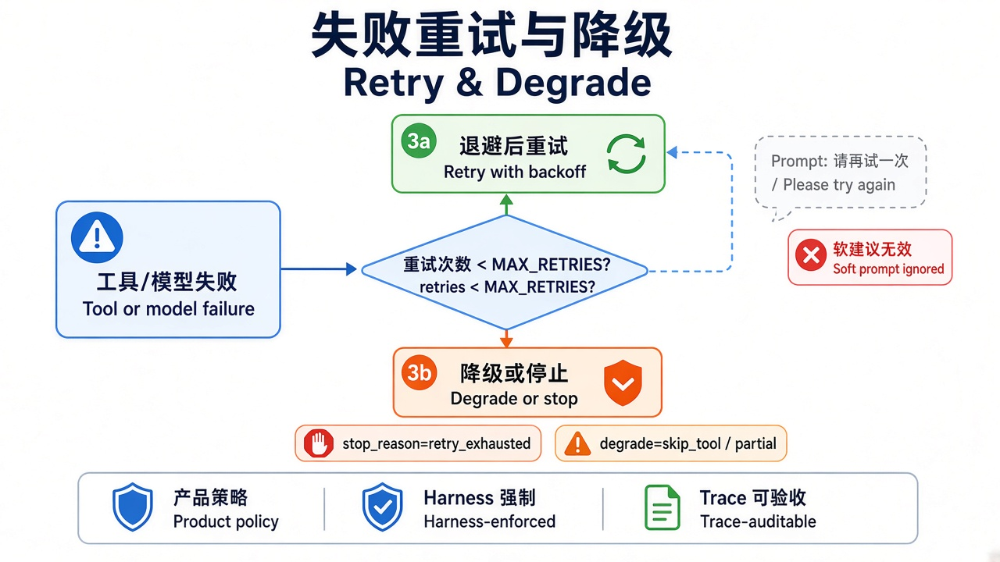
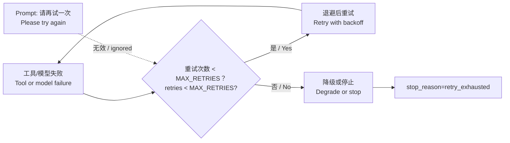

# 15 · 失败重试与降级（Retry & Degrade）

> 视角：产品经理 · 图解 + 费曼  
> 日期：2026-10-31（Asia/Shanghai）  
> 对照：`labs/05-minimal-harness`（`MAX_RETRIES` / `ON_RETRY_EXHAUSTED`）· `labs/06-evals` case `retry-exhausted-brake`  
> 路线决策：上下文预算之后，补「失败了怎么办」——重试有预算，耗尽后降级或停止，且必须可验收。

## 一句话定义

**重试预算**规定工具/模型失败后还能再试几次、间隔多久；**降级**规定预算耗尽后是停止、跳过该工具，还是返回部分结果。这些是 Harness 策略，不是 Prompt「请再试一次」。

## 图解

> 配图：**中英文配套**（CN + EN labels）。

## 本课决策（为什么是这一步）

| 选项 | 是否做 | 理由 |
|---|---|---|
| 重试次数硬预算 | **做** | 无限重试会烧钱、拖垮延迟，也会把瞬时故障放大成雪崩 |
| 线性退避（教学） | **做** | 用纯函数演示「间隔可产品化」；生产可换成指数/抖动 |
| 耗尽后 `stop` 进 live | **做** | Trace 固定 `retry_exhausted`，与其它闸门同形验收 |
| `skip_tool` / `partial` 单测 | **做** | 产品常要「跳过坏工具继续」或「给半成品」——先钉决策函数 |
| 真实网络抖动 / 付费 API | **不做** | 探针模拟失败，本地零付费可复现 |

## 要点

1. **失败是常态**：工具超时、路径拒绝、模型报错都会发生；产品要预先写清「试几次、然后怎样」。  
2. **Prompt 不是重试器**：「请再试一次」可被忽略，也无法保证退避与上限。  
3. **预算要可数**：本课 `MAX_RETRIES` = 首次失败后的额外次数；总尝试 ≈ 1 + MAX_RETRIES。  
4. **耗尽必有策略**：`stop`（安全可解释）、`skip_tool`（跳过继续）、`partial`（交半成品）——live 用 `stop` 验 Trace。  
5. **探针不靠模型**：`EVAL_INJECT_TOOL_FAILURES=1` 模拟连续失败，Harness 自己跑完重试账本。

## 产品拍板 vs 工程师实现

| 维度 | 产品拍板 | 工程师实现 |
|---|---|---|
| 最多试几次 | 读文件？写操作？付费调用？ | `MAX_RETRIES` |
| 间隔 | 立刻重试还是等一会儿？ | `RETRY_BACKOFF_MS`（线性：n × base） |
| 耗尽后 | 停 / 跳工具 / 部分结果？ | `ON_RETRY_EXHAUSTED`；Trace `degrade` 字段 |
| 文案 | 「暂时不可用，已停止重试」 | 不要说「模型不听话」 |
| 验收 | 改重试策略是否必跑 case？ | `EVAL_CASE_ID=retry-exhausted-brake` |

## 对照工程

- Harness：`labs/05-minimal-harness/src/retry-budget.ts`；`index.ts` 在注入探针中执行重试账本。  
- Evals：`retry-exhausted-brake`（live：`max_retries=2`，注入失败 → `stop_reason=retry_exhausted`）。  
- 跑法：`NO_PROXY=127.0.0.1,localhost npm run eval:live`（在 `labs/06-evals`）。

## 费曼题

**为什么「请模型再试一次」不能当重试策略？重试预算评测要在 Trace 里证明什么？**

### 参考答（自学用）

因为重试次数、退避和耗尽后的降级必须可预测、可计费、可审计；Prompt 既不计数也不强制停止。评测要证明：连续失败达到预算后，Harness 写出 `stop_reason=retry_exhausted`（及所选 `degrade`），与模型有没有「答应再试」无关。

## 下一步

- 巩固：对照超时闸门——超时是「单次太久」，重试是「失败太多次」。  
- 可选增量：指数退避 + jitter；按错误类型分流（4xx 不重试 / 5xx 重试）。  
- 上一课：[14 · 上下文预算](./14-context-budget.md) · 路线总览：[README](./README.md)
