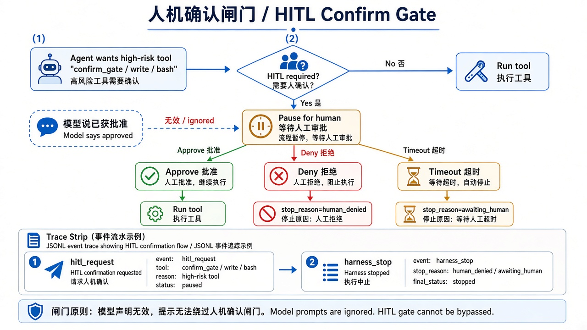
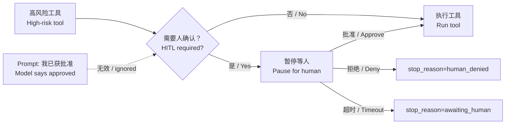

# 16 · 人机确认闸门（HITL Confirm Gate）

> 视角：产品经理 · 图解 + 费曼  
> 日期：2026-10-31（Asia/Shanghai）  
> 对照：`labs/05-minimal-harness`（`HITL_REQUIRED_TOOLS` / `EVAL_INJECT_HITL`）· `labs/06-evals` case `hitl-denied-brake`  
> 路线决策：重试与降级之后，补「高风险动作必须有人点头」——批准、拒绝、超时都要进 Trace，评测可用自动拒绝做确定性验收。

## 一句话定义

**人机确认（HITL）闸门**规定：高风险工具（本课演示 `confirm_gate`，以及若开放的 `write` / `bash`）在执行前必须暂停等待人工批准；拒绝或超时分别记为 `stop_reason=human_denied` / `awaiting_human`。这是 Harness 策略，不是 Prompt「我已经获得批准」。

## 图解

> 配图：**中英文配套**（CN + EN labels）。

## 本课决策（为什么是这一步）

| 选项 | 是否做 | 理由 |
|---|---|---|
| 高风险工具名单 | **做** | 产品先拍板哪些动作必须人确认；默认演示 `confirm_gate` + `write`/`bash` |
| 拒绝与超时分码 | **做** | `human_denied` ≠ `awaiting_human`：拒绝是明确否决，超时是没等到人 |
| 评测自动拒绝 | **做** | CI 不能等人点按钮；`EVAL_INJECT_HITL=deny` 确定性验收 |
| 真实 UI / 推送通知 | **不做** | 本课钉闸门语义与 Trace；交互壳可后续接 |
| 开放真实 bash/write | **不做** | 仍靠 allowlist；HITL 是「若将来开放」的前置闸 |

## 要点

1. **高风险 ≠ 模型自觉**：删文件、写盘、跑 shell 这类动作，不能靠「请先问用户」的 Prompt。  
2. **暂停是一等公民**：闸门触发时 Harness 写出 `hitl_request`，再等人或注入决策。  
3. **三种结局要可区分**：批准继续；拒绝 → `human_denied`；超时 → `awaiting_human`。  
4. **CI 用注入**：`EVAL_INJECT_HITL=deny|timeout|approve` 模拟人，不依赖真实点击。  
5. **与 allowlist 互补**：allowlist 决定「能不能出现」；HITL 决定「出现后能不能立刻跑」。

## 产品拍板 vs 工程师实现

| 维度 | 产品拍板 | 工程师实现 |
|---|---|---|
| 哪些工具要确认 | 写文件？发消息？转账？ | `HITL_REQUIRED_TOOLS` |
| 等人多久 | 秒级弹窗 vs 异步工单 | `HITL_TIMEOUT_MS`（教学可 0 + 注入） |
| 拒绝文案 | 「已取消，等待人工确认」 | Trace `stop_reason`；对用户别怪模型 |
| 超时策略 | 当拒绝？还是挂起可恢复？ | 本课：超时 = `awaiting_human` 停跑 |
| 验收 | 改名单是否必跑 case？ | `EVAL_CASE_ID=hitl-denied-brake` |

## 对照工程

- Harness：`labs/05-minimal-harness/src/hitl-gate.ts`；`index.ts` 在注入探针中走确认账本。  
- Evals：`hitl-denied-brake`（live：`EVAL_INJECT_HITL=deny` → `stop_reason=human_denied`）。  
- 跑法：`NO_PROXY=127.0.0.1,localhost npm run eval:live`（在 `labs/06-evals`）。

## 费曼题

**为什么「模型说已经问过用户了」不能当人机确认？HITL 评测要在 Trace 里证明什么？**

### 参考答（自学用）

因为批准必须来自 Harness 可审计的人机通道（UI / 工单 / 注入决策），模型文本既不能计数也不能强制暂停。评测要证明：高风险工具触发后，Harness 写出 `hitl_request`，并在拒绝或超时时分别落 `human_denied` / `awaiting_human`——与模型有没有「声称获批」无关。

## 下一步

- 巩固：对照 allowlist——名单挡住「不该有的工具」；HITL 挡住「该有但未获批的执行」。  
- 可选增量：异步恢复（超时后可从 `awaiting_human` 续跑）；按工具参数分级（只读参数免确认）。  
- 下一课：[17 · 成本与延迟预算](./17-cost-latency.md)
- 上一课：[15 · 失败重试与降级](./15-retry-degrade.md) · 路线总览：[README](./README.md)
