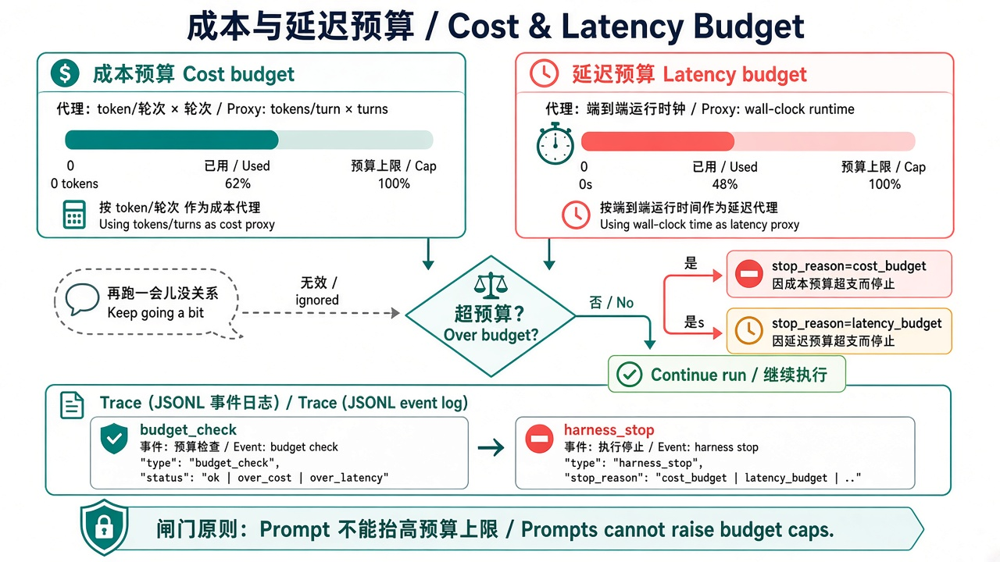
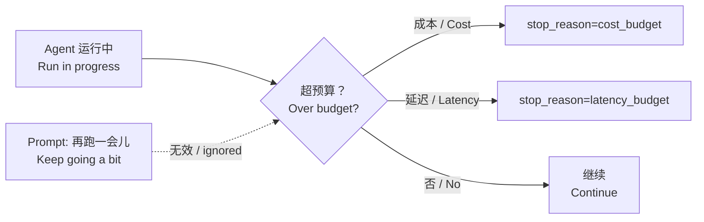

> **旧版参考资料**：已并入第 9 章（[ch09](../../book/harness/chapters/ch09.md)）。

# 17 · 成本与延迟预算（Cost & Latency Budget）

> 视角：产品经理 · 图解 + 费曼  
> 日期：2026-10-31（Asia/Shanghai）  
> 对照：`labs/05-minimal-harness`（`COST_BUDGET_UNITS` / `LATENCY_BUDGET_MS`）· `labs/06-evals` cases `cost-budget-brake` / `latency-budget-brake`  
> 路线决策：人机确认之后，补「跑得起、跑得完」——花多少、等多久必须有硬上限，且超限要能在 Trace 里验收。

## 一句话定义

**成本预算**用可计量代理（本课：轮次 × 单位成本）限制一次 Agent 运行的花费；**延迟预算**用墙钟时间限制端到端时长。超限时 Harness 停止并写出 `stop_reason=cost_budget` 或 `latency_budget`。这是产品上限，不是 Prompt「再跑一会儿没关系」。

## 图解

> 配图：**中英文配套**（CN + EN labels）。

## 本课决策（为什么是这一步）

| 选项 | 是否做 | 理由 |
|---|---|---|
| 成本代理（units） | **做** | 本地样本无真实账单；用「轮次 × 单位」教闸门形状，生产可换成 billed tokens |
| 墙钟延迟上限 | **做** | 用户体感与 SLA 看的是 wall-clock，不是模型自觉 |
| 双 `stop_reason` | **做** | 超花费 vs 超时长对策不同（降档模型 / 缩短工具 / 换异步） |
| 同时超限时优先 cost | **做** | Trace 稳定可断言；产品也可改优先级，但要写进策略 |
| 真实云计费对接 | **不做** | 探针注入用量/耗时，本地零付费可复现 |

## 要点

1. **钱与时间都是产品约束**：无限跑会烧钱、拖垮体验；上限要写进 Harness，不靠「省着点用」的 Prompt。  
2. **代理要诚实标注**：本课 `COST_BUDGET_UNITS` 是教学代理；上线时换成 token / 美元，闸门代码形状不变。  
3. **延迟 ≠ 工具超时**：工具超时是单次调用；延迟预算是整次运行的墙钟。  
4. **超限必可观测**：写出 `budget_check` + `harness_stop`，评测断言 `stop_reason`。  
5. **探针不靠模型**：`EVAL_INJECT_COST_UNITS` / `EVAL_INJECT_ELAPSED_MS` 注入已用量与已耗时。

## 产品拍板 vs 工程师实现

| 维度 | 产品拍板 | 工程师实现 |
|---|---|---|
| 一次运行最多花多少 | 免费档 / 付费档 / 内测档 | `COST_BUDGET_UNITS`（或 billed tokens） |
| 用户最多等多久 | 同步对话 vs 后台任务 | `LATENCY_BUDGET_MS` |
| 超限文案 | 「已达本次用量上限」 | Trace `cost_budget` / `latency_budget` |
| 双超谁优先 | 先报成本还是先报延迟？ | 本课：成本优先 |
| 验收 | 改预算是否必跑 case？ | `cost-budget-brake` / `latency-budget-brake` |

## 对照工程

- Harness：`labs/05-minimal-harness/src/cost-latency-budget.ts`；`index.ts` 注入探针执行预算检查。  
- Evals：`cost-budget-brake`、`latency-budget-brake`（live 注入超限 → 对应 `stop_reason`）。  
- 跑法：`NO_PROXY=127.0.0.1,localhost npm run eval:live`（在 `labs/06-evals`）。

## 费曼题

**为什么「再跑一会儿没关系」不能当成本/延迟策略？评测要在 Trace 里证明什么？**

### 参考答（自学用）

因为花费与墙钟必须可预测、可计费、可对用户承诺；Prompt 既不计量也不强制停。评测要证明：注入用量或耗时超过预算后，Harness 分别写出 `stop_reason=cost_budget` 或 `latency_budget`，与模型是否「答应省一点」无关。

## 下一步

- 巩固：对照 maxTurns（轮数闸）与 tool timeout（单次工具）——本课是「整次运行」的钱与时间。  
- 可选增量：按模型单价折算真实费用；延迟预算触发后降级到更快模型。  
- 上一课：[16 · 人机确认闸门](./16-hitl-gate.md) · 下一课：[18 · 开源读者上手](./18-getting-started.md) · 路线总览：[README](./README.md)
