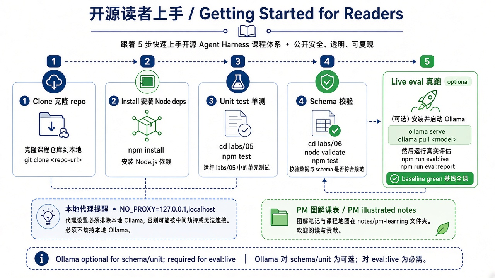
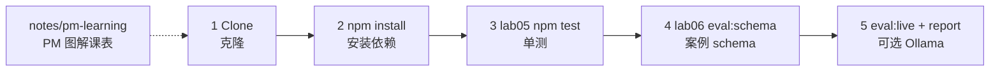

> **旧版参考资料**：未纳入主线，仅作参考。

# 18 · 开源读者上手指南（Getting Started for Readers）

> 视角：产品经理 + 第一次打开仓库的读者 · 图解 + 费曼  
> 日期：2026-10-31（Asia/Shanghai）  
> 对照：根目录 [`README.md`](../../README.md) · `labs/05-minimal-harness` · `labs/06-evals` · 本目录课表  
> 路线决策：闸门加深线（课 14–17）收束后，补「克隆后如何证明这本书还在工作」——文档课，不新增闸门代码。

## 一句话定义

**上手指南**把公开课从「能读」变成「能跑」：装好依赖 → 单测绿 → schema 绿 →（可选）live 基线绿 → 打开 PM 图解课表。证明仓库健康靠命令与 Trace，不靠口头保证。

## 图解

> 配图：**中英文配套**（CN + EN labels）。





## 本课决策（为什么是这一步）

| 选项 | 是否做 | 理由 |
|---|---|---|
| 克隆 → 绿基线路径 | **做** | 开源读者第一问是「我怎么验证」 |
| 标明 Ollama 可选/必选 | **做** | 单测与 schema 无模型；live 才要本机 Ollama |
| `NO_PROXY` 提示 | **做** | 代理劫持 localhost 是最常见翻车点 |
| 新增闸门代码 | **不做** | 课 14–17 已加深；本课是入口文档 |
| 付费云 API | **不做** | 样本栈保持本地可复现 |

## 前置条件 / Prerequisites

| 需要 | 用途 | 没有时 |
|---|---|---|
| **Git** | clone | 无法拉取 |
| **Node.js 20+**（建议 LTS） | `npm install` / `npm test` | 单测与 eval 脚本跑不了 |
| **Linux 或 WSL2** | lab05 运行时检查 | Windows 原生会直接拒绝（设计如此） |
| **Ollama + 本地模型**（如 `qwen3.8:27b`） | 仅 `eval:live` | 仍可跑单测 + schema；live 会 blocker 退出 |

## 五步上手 / Five steps

在仓库根目录（下文 `<repo-root>`）操作：

### 1) Clone

```bash
git clone https://github.com/yukawasensei/harness-book-for-everyone.git
cd harness-book-for-everyone   # or your local folder name
```

### 2) Install（两个 lab 包）

```bash
cd labs/05-minimal-harness && npm install && cd -
cd labs/06-evals && npm install && cd -
```

### 3) 单测（无 Ollama）

```bash
cd labs/05-minimal-harness
npm test
```

期望：闸门纯函数测试全部 PASS（maxTurns / timeout / path / context / retry / HITL / cost-latency …）。

### 4) Schema 校验（无 Ollama）

```bash
cd labs/06-evals
npm run eval:schema
# 等价：npm test
```

期望：`cases.json` 全部 schema-ok。

### 5) Live 基线（需要 Ollama）

```bash
# 避免代理劫持本机 Ollama
export NO_PROXY=127.0.0.1,localhost
# 确认 Ollama 已启动且已拉取课程所用模型（见 lab05 / evals README）

cd labs/06-evals
npm run eval:live
npm run eval:report
```

期望：`passCount == total`；报表列出各闸门的 `stop_reason`。单条重跑可用 `EVAL_CASE_ID=...`。

## 笔记在哪 / Where notes live

| 路径 | 给谁 |
|---|---|
| [`notes/pm-learning/`](./README.md) | **推荐主线**：图解 + 产品拍板 + 费曼 |
| 根 [`README.md`](../../README.md) | 公开课入口、安全基线、课表速览 |
| [`OPEN_SOURCE.md`](../../OPEN_SOURCE.md) | 公开发布检查清单 |
| `labs/05` · `labs/06` | 最小 harness + evals 工程 |

加深弧（课 14–18）：上下文预算 → 重试降级 → HITL → 成本延迟 → **本课上手**——到这里，读者应能独立把基线跑绿。

## 产品拍板 vs 读者自检

| 维度 | 产品/维护者拍板 | 读者自检 |
|---|---|---|
| 绿意味着什么 | Trace / baseline，不是「模型看起来乖」 | 三道命令（见费曼题） |
| 模型选型 | 样本默认本地 Qwen；可替换但要改配置 | live 失败先查 Ollama / `NO_PROXY` |
| 贡献边界 | 公开安全：无密钥、无私人路径 | 发 PR 前跑单测 + schema |

## 费曼题

**克隆之后，哪三条命令能证明「这本书还在工作」？**

### 参考答（自学用）

1. `cd labs/05-minimal-harness && npm test` — 闸门单测绿  
2. `cd labs/06-evals && npm run eval:schema` — 案例 schema 绿  
3. `cd labs/06-evals && NO_PROXY=127.0.0.1,localhost npm run eval:live` —（有 Ollama 时）live 基线绿；再用 `npm run eval:report` 看签字表  

没有 Ollama 时，前两条仍足以证明「课还在、闸门代码与案例规格未坏」；第三条证明「本机样本栈端到端可验收」。

## 下一步

- 下一课：[19 · 片场场记 · 内容生产](./19-set-clerk-content-production.md)（落地实操弧起点）。  
- 从 [`01 · 能力总览`](./01-capability-overview.md) 按课表读；或从 [`14 · 上下文预算`](./14-context-budget.md) 复习加深弧。  
- 改 Harness 前：先跑本课三条命令，再谈 Done。  
- 上一课：[17 · 成本与延迟预算](./17-cost-latency.md) · 路线总览：[README](./README.md)

---

**加深弧 14–18 完成。** 下一弧是 **落地实操·内容生产**（课 19 起，虚拟产品「片场场记」），不重复本弧闸门课。
