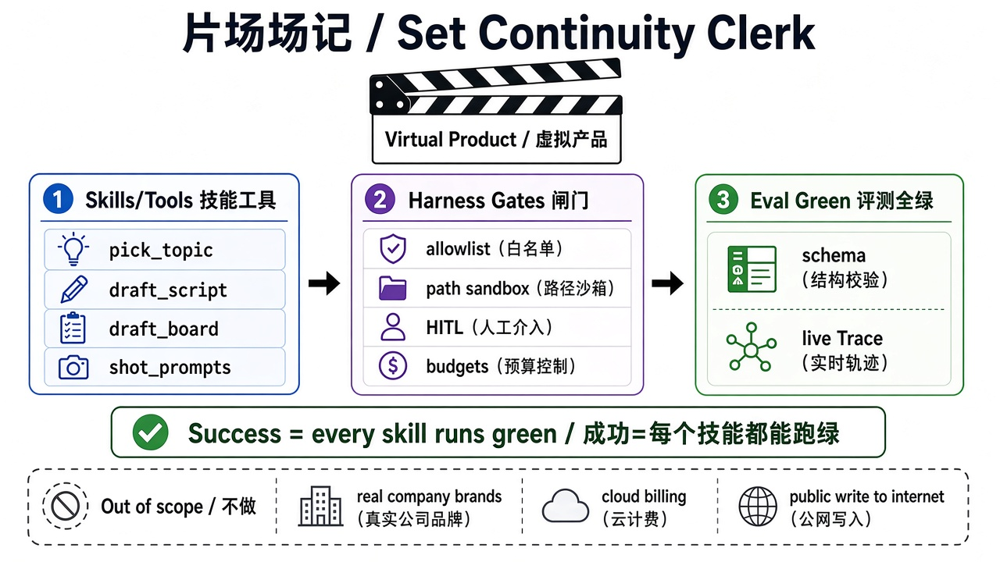
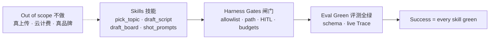

# 19 · 虚拟产品：片场场记 · 内容生产（Set Continuity Clerk）

> 视角：产品经理 · 图解 + 费曼  
> 日期：2026-11-01（Asia/Shanghai）  
> 对照：课 10 落地认知 · 课 07/13 评测与 Trace 签字 · 样本栈仍为 **pi + 本地 qwen**  
> 路线决策：加深弧 14–18 收束后，开 **落地实操弧·内容生产**——用脱敏虚拟产品练整套闸门与 eval，不接真实公司产品仓。

## 一句话定义

**片场场记（Set Continuity Clerk）**是公开课的虚拟项目一：面向短视频多平台分发背景（抖音 / 小红书 / 视频号），先只做 **内容生产** 前半段——选题 → 脚本 → 分镜（含角色/道具/场景）→ 分镜头提示词。Agent 只能在沙箱里调用有限技能写结构化产出；**成功 = 四个技能都能跑绿（schema + live Trace）、产出路径正确、日志可回溯**——不是「生成好看」。

## 图解

> 配图：**中英文配套**（CN + EN labels）。风格锁定：纯白底、扁平教材矢量（见仓库 [`skills/harness-diagram/`](../../skills/harness-diagram/SKILL.md)）。

## 业务背景（叙事用，不全做）

创作者常见流水线：

选题 → 脚本 → 分镜 + 角色/道具/场景设定 → 分镜头提示词 → **镜头成片** → **后期剪辑** → **社媒文案** → **定时发布**

本课与项目一弧只钉 **到分镜头提示词为止** 的内容生产；成片渲染、剪辑、真发平台、数据复盘、素材库管理留给后续弧或项目二。

## 本课决策（为什么是这一步）

| 选项 | 是否做 | 理由 |
|---|---|---|
| 虚拟产品「片场场记」 | **做** | 脱敏对齐创作者工作流；公开课可讲、可评测 |
| 只切内容生产四技能 | **做** | 一次一弧；验收面可控 |
| 成功标准 = 绿跑 + 路径 + Trace | **做** | 主观「好看」无法当门禁（费曼已过） |
| 样本栈 pi + 本地 qwen | **做** | 与课 01–18 / lab05–06 连续 |
| 真上传 / 云计费 / 真实品牌 / 真账号 | **不做** | 公开安全；Out of scope |
| lab 技能桩实现 | **课 20 已落** | 见 [`labs/07-set-clerk`](../../labs/07-set-clerk/) 与 [课 20](./20-skill-eval-stubs.md) |
| dsh Web Agent + 服务器沙箱 | **占坑** | 项目二形态课，不当本弧依赖 |

## 要点

1. **虚拟项目 ≠ 聊天 Demo**：交付物是沙箱内结构化文件（大纲 / 脚本 / 分镜 / 提示词），不是「聊得开心」。  
2. **四个生产技能（本弧 in-scope）**：`pick_topic`、`draft_script`、`draft_board`（分镜 + 角色/道具/场景）、`shot_prompts`。  
3. **闸门全开、形状已知**：allowlist、路径沙箱、写覆盖可 HITL、上下文/成本/延迟预算——与加深弧同一套验收语言。  
4. **成功标准可观测**：每技能有 case；`eval:schema` + `eval:live` 全绿；Trace 证明写入规定路径；能回溯日志。  
5. **明确不做**：真实公司品牌、云渲染计费、公网写入/真发平台、真实数据分析与素材库。

## 产品拍板 vs 工程师实现

| 维度 | 产品拍板 | 工程师实现（占位 → 课 20） |
|---|---|---|
| 先做哪段流水线 | 内容生产四步；后半成片/发布延后 | skill 名、输入 fixture、输出 schema |
| 输出落点 | 只能进沙箱 `workspace/out/`（或等价） | 路径沙箱 + 目录约定 |
| 覆盖已有稿 | 是否必须 HITL？ | `HITL_REQUIRED_TOOLS` 含写类技能 |
| 成功标准 | 四技能全绿 + 路径对 + Trace 可审计 | cases + baseline + `eval:report` |
| 公开边界 | 无真实品牌/账号/密钥 | fixture 用虚构主题 |

## 对照工程

- **本课**：产品定义与验收口径（本文 + 图解）；**不新增** lab 技能实现。  
- **下一课（课 20）**：已落 [`labs/07-set-clerk`](../../labs/07-set-clerk/)——四个 skill 桩、sandbox 输出路径与 schema/path/Trace case。  
- **已有底座**：`labs/05-minimal-harness` 闸门 · `labs/06-evals` 评测形状可复用。  
- **项目二（未来）**：dsh Web Agent + 服务器沙箱——学成熟壳与远端执行边界，另开课。

## 费曼题

**用一句话说清「内容生产版」片场场记的成功标准；为什么不能用「生成好看」当验收？**

### 参考答（自学用）

成功标准：四个生产技能都能实现并评测全绿，产出落在规定沙箱路径，且可用 Trace/日志回溯。不能用「好看」——主观无法进 CI，也证明不了闸门与路径策略仍在。

## 下一步

- 下一课：[20 · 技能评测桩](./20-skill-eval-stubs.md)（`labs/07-set-clerk` 四技能桩 + schema/path/Trace）。  
- 巩固：对照课 10「落地」与课 13「Trace 签字」——本课把它们收成虚拟产品 backlog。  
- 上一课：[18 · 开源读者上手](./18-getting-started.md) · 路线总览：[README](./README.md)

---

**落地实操弧 · 内容生产** 从本课起：先产品与验收，再工程桩。
