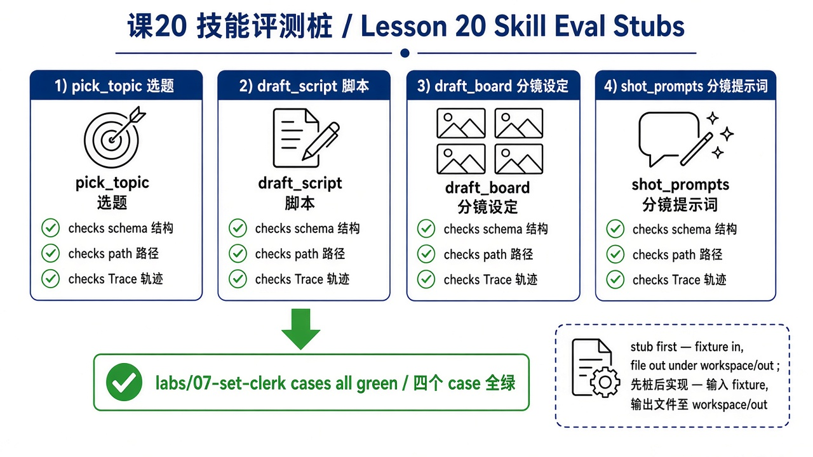
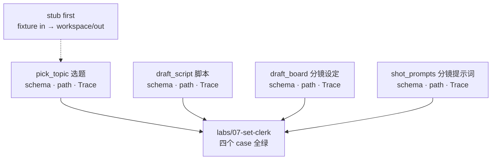

> **旧版参考资料**：已并入第 10 章（[ch10](../../book/harness/chapters/ch10.md)）。

# 20 · 技能评测桩（Skill Eval Stubs）

> 视角：产品经理 · 图解 + 费曼  
> 日期：2026-11-01（Asia/Shanghai）  
> 对照：课 19 片场场记产品边界 · 课 07/13 评测与 Trace · `labs/06-evals` 案例形状  
> 工程落点：[`labs/07-set-clerk/`](../../labs/07-set-clerk/)

## 一句话定义

**评测桩**是内容生产四技能的可执行验收标准：输入 fixture → 沙箱写出文件 → 用 **schema / path / Trace** 断言。先桩后实现——桩全绿，才有资格谈「模型写得好不好」。

## 图解

> 配图：**中英文配套**（CN + EN labels）。风格锁定：纯白底、扁平教材矢量（见仓库 [`skills/harness-diagram/`](../../skills/harness-diagram/SKILL.md)）。





## 本课决策（为什么是这一步）

| 选项 | 是否做 | 理由 |
|---|---|---|
| 先定评测桩再接模型 | **做** | 标准先于效果；主观「好看」无法进 CI（课 19 费曼已过） |
| 每技能断言 schema + path + Trace | **做** | 费曼过关三件套；与加深弧验收语言一致 |
| 确定性假实现（模板写文件） | **做** | 证明 Harness/eval 管线通，不依赖 Ollama |
| 产出只进 `workspace/out/` | **做** | 路径沙箱可测；越界应 `PATH_DENIED` |
| 真渲染 / 真发平台 / 主观打分进 CI | **不做** | 公开安全；Out of scope |
| live 接本地 qwen | **可选占坑** | `eval:live` 脚本位保留；本课 PASS 不靠模型 |

## 要点

1. **评测桩 = 标准的可执行版**：不是文档口号，而是 `npm test` 能红能绿。  
2. **三件套缺一不可**：schema（结构）、path（落点）、Trace（可回溯的 write + `stop_reason`）。  
3. **先桩后实现**：假实现可以「写得呆」，但不能「路径错 / 无 Trace / 字段缺」。  
4. **与 lab06 同形**：schema 无模型；live 是加分项。  
5. **四个 case 全绿**才算课 20 工程过关：`pick_topic` / `draft_script` / `draft_board` / `shot_prompts`。

## 产品拍板 vs 工程师实现

| 维度 | 产品拍板 | 工程师实现（本课已落） |
|---|---|---|
| 每技能最低证明什么 | schema + path + Trace | `cases.json` + `validate-schema.mjs` |
| 输入从哪来 | 虚构 brief fixture | `fixtures/brief.json` |
| 输出落哪 | 只能 `workspace/out/` | `path-sandbox.mjs` |
| 日志长什么样 | 可回溯 write / stop | `traces/*.jsonl` |
| 何时换真模型 | 桩全绿之后 | 下一增量；`eval:live` 先 SKIP |

## 对照工程

- **Lab**：[`labs/07-set-clerk/`](../../labs/07-set-clerk/) — `npm test` / `npm run eval:schema`  
- **命令（无 Ollama）**：

```bash
cd labs/07-set-clerk
npm test
```

- **底座**：闸门形状参考 `labs/05-minimal-harness`；案例语言参考 `labs/06-evals`。  
- **上一课产品定义**：[19 · 片场场记 · 内容生产](./19-set-clerk-content-production.md)

## 费曼题

**为什么内容生产要先做评测桩而不是先调模型？每个技能的桩至少要证明哪三件事？**

### 参考答（自学用）

评测桩是标准：标准定好了，才能判断模型效果是否达标；先调模型只能得到不可复现的「感觉」。每个技能至少证明 **schema（结构）**、**path（路径）**、**Trace（轨迹）**。

## 下一步

- 下一课：[21 · 接模型写稿](./21-model-behind-stubs.md)（桩不变，换 Ollama/qwen 适配器；文案好看但 path 错仍算不过）。  
- 巩固：对照课 13 Trace 签字与课 07 evals——本课把它们收成虚拟产品的技能门禁。  
- 上一课：[19 · 片场场记 · 内容生产](./19-set-clerk-content-production.md) · 路线总览：[README](./README.md)

---

**落地实操弧 · 内容生产** 本课交付：可跑的评测桩，不是「更好的 Prompt」。
