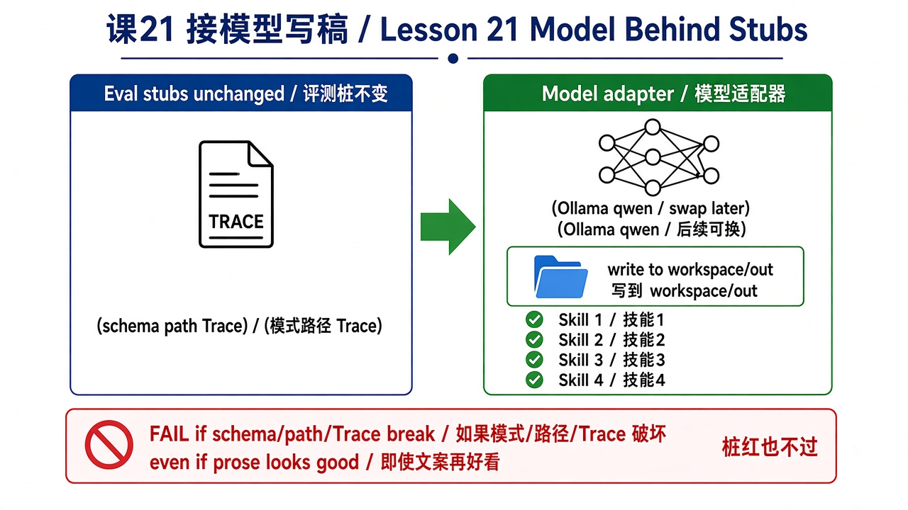
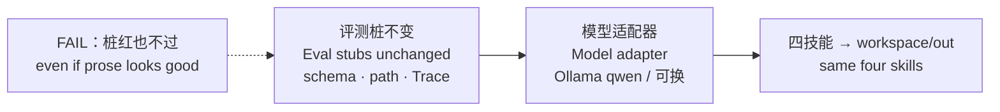

# 21 · 接模型写稿（Model Behind Stubs）

> 视角：产品经理 · 图解 + 费曼  
> 日期：2026-11-01（Asia/Shanghai）  
> 对照：课 20 评测桩 · 课 15 重试降级 · `labs/07-set-clerk`  
> 工程落点：[`labs/07-set-clerk/`](../../labs/07-set-clerk/)（`MODEL=ollama`）

## 一句话定义

把确定性假实现换成 **模型适配器**（默认本机 Ollama/qwen，以后可换）；**评测桩不变**——schema / path / Trace 红了就不过，文案再好看也白搭。

## 图解

> 配图：**中英文配套**（CN + EN labels）。风格锁定：纯白底、扁平教材矢量（见仓库 [`skills/harness-diagram/`](../../skills/harness-diagram/SKILL.md)）。





## 本课决策（为什么是这一步）

| 选项 | 是否做 | 理由 |
|---|---|---|
| 桩是合同，模型是供应商 | **做** | 换 qwen / 别的模型只换适配器，不改 case |
| `eval:schema` 仍无 Ollama | **做** | CI / clone 验证不依赖本机推理 |
| `eval:live` 可选 + `NO_PROXY` | **做** | 代理常劫持 localhost；活着才跑，否则 SKIP |
| 模型输出必须解析进同一 schema/path | **做** | 散文不能直接当验收；解析失败 Trace + 可降级回桩 |
| 成本/延迟预算继续生效 | **记着** | 接模型后更容易超（课 17）；本课先钉适配器形状 |
| 为了过 live 把桩改松 | **不做** | 费曼：改松会影响结果判断；path 错不算过 |

## 要点

1. **桩是合同**：四个 case 的 schema / path / Trace 期望值不随模型切换而改写。  
2. **模型是供应商**：`MODEL=ollama` 启用适配器；默认 stub；后续可换别的后端。  
3. **结构化落盘**：模型散文 → 解析/补齐 → 仍写 `workspace/out/`；写错路径照样 `PATH_DENIED`。  
4. **失败可观测**：`model_call` / `model_parse_fail` / `degrade` 进 Trace；可重试再降级回桩。  
5. **好看 ≠ 过关**：文案质量是产品体验；**验收以桩为准**（费曼已过）。

## 产品拍板 vs 工程师实现

| 维度 | 产品拍板 | 工程师实现（本课已落） |
|---|---|---|
| 默认怎么跑 | 无模型也必须绿 | `npm test` = stub + validate |
| 何时碰模型 | 可选 live | `MODEL=ollama npm run eval:live` |
| 换模型改什么 | 只改适配器/环境变量 | `src/model-adapter.mjs` + `OLLAMA_MODEL` |
| 解析失败怎么办 | 可降级，但路径/schema 仍要过 | Trace `degrade` → stub_fallback |
| path 错了能不能过 | **不能** | 与 stub 同一 `validate-schema.mjs` |

## 对照工程

- **Lab**：[`labs/07-set-clerk/`](../../labs/07-set-clerk/)  
- **无模型（必须）**：

```bash
cd labs/07-set-clerk
npm test
```

- **可选 live**：

```bash
cd labs/07-set-clerk
NO_PROXY=127.0.0.1,localhost MODEL=ollama npm run eval:live
```

- 上一课：[20 · 技能评测桩](./20-skill-eval-stubs.md)

## 费曼题

**为什么接模型后评测桩不能改松？「文案好看但 path 错了」该不该算过？**

### 参考答（自学用）

评测桩改松会影响结果判断——标准一动，绿就失去可比性。path 是评测标准的一部分，错了不算过；文案再好看也不能替代 schema / path / Trace。

## 下一步

- 巩固：对照课 15 降级与课 17 预算——接模型后把「贵/慢」重新量一次。  
- 预告：可继续收紧 HITL（覆盖已有稿）或接分发文案技能（仍不真发平台）。  
- 上一课：[20 · 技能评测桩](./20-skill-eval-stubs.md) · 路线总览：[README](./README.md)

---

**落地实操弧 · 内容生产** 本课交付：可换的模型适配器 + 不变的评测合同。
